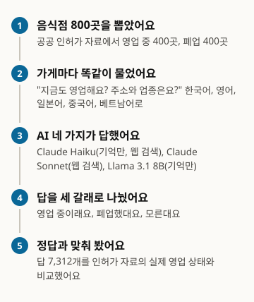
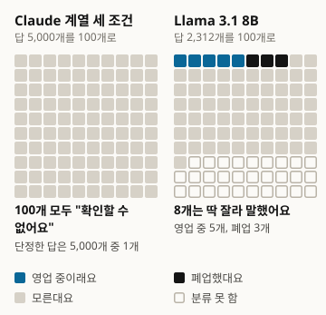
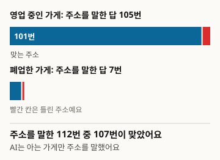
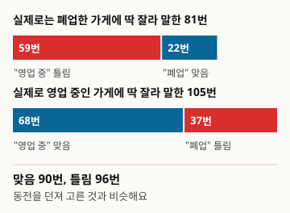
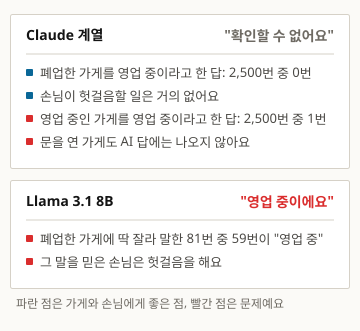

# Local404: AI는 폐업한 동네 가게를 아직 영업 중이라고 말하는가

한국 일반음식점 800곳, 5개 언어, 4개 응답 조건에 대한 AI 응답 조사

- 저자: Define404 Research
- 날짜: 2026-10-24
- 사전등록: OSF https://osf.io/5qnxu (2026-10-20 등록)
- 이해관계: 저자 소속 Define404는 AI 응답 모니터링과 가게별 AI 노출 진단 서비스를 준비하고 있어요. 자사 제품은 조사 대상에 넣지 않았어요.

## 요약

동네 가게가 지금도 영업하는지, 주소와 업종은 무엇인지 AI에게 물으면 어떻게 답하는지 조사했어요. 정답은 공공 인허가 데이터로 삼았어요. 영업 400곳과 폐업 400곳을 층화 추출해 5개 언어로 질문을 자동으로 보냈고, 규칙 기반 사전과 LLM 보조 판정으로 답을 분류해 사전등록 가설을 검정했어요. Claude Haiku 5.5와 Sonnet 5.5의 세 조건(유효 답 5,000건)에서 영업 여부를 단정한 답은 1건뿐이었고, 폐업 가게를 영업 중이라고 한 답은 없었어요. 그래서 가설 H1, H3, H4는 검정이 성립하지 않았어요. Llama 3.1 8B는 확정 판정 1,641건 중 186건(11.3%)에서 단정했고 정확도는 48.4%였어요. 폐업 가게를 영업 중이라고 답한 비율이 영업 가게를 폐업이라고 답한 비율보다 높았어요(H1 지지).

### 핵심 결과

- Claude 계열 세 조건은 질문의 99.98%(4,999/5,000)에서 영업 여부를 단정하지 않고 확인할 수 없다고 답했어요. 폐업 가게를 영업 중이라고 한 답은 0건이에요(폐업 가게 답 기준 윌슨 95% 상한: 검색 조건 1.51%, 기억 조건 0.19%).
- 웹 검색을 쓰는 조건도 같았어요. 검색 조건 1,000건 가운데 단정은 1건이었고, 그 1건은 정답이었어요.
- 주소를 말한 Claude 답 112건은 거의 모두 영업 중인 가게에 대한 것이었고, 95.5%(107건)가 맞았어요.
- Llama 3.1 8B는 영업 단정(127건)이 폐업 단정(59건)보다 많았어요. 폐업 가게를 영업 중이라고 답한 비율(7.3%)이 영업 가게를 폐업이라고 답한 비율(4.4%)보다 높았어요(차이 2.9%p, Holm 보정 p=0.039).

<!-- src: 001-local404/analysis/out_final/exploratory_summary.csv; 001-local404/analysis/out_final/h1.csv; 001-local404/analysis/out_final/holm.csv; 001-local404/analysis/out_final/judgments.csv (L-mem, status in open/closed: 186건, 정답 90건) -->

## 1 서론

사람들은 동네 가게가 지금도 문을 여는지 AI에게 물어요. 지도 앱을 열기 전에 대화형 AI에 "이 식당 아직 해요?"라고 묻는 일은 이미 흔해요. 폐업한 가게를 영업 중이라고 답하면 손님은 헛걸음을 하고, 영업 중인 가게를 폐업했다고 답하면 가게는 손님을 잃어요. 그런데 가게 주인은 AI가 자기 가게에 대해 무엇을 말하는지 확인할 방법이 거의 없어요.

이 조사는 그 문제를 잴 수 있는 형태로 바꿨어요. 정답은 지방행정 인허가 자료가 정한 영업 상태로 두고, 같은 가게에 같은 질문을 다섯 언어로 보내 AI 응답 조건별로 답을 비교했어요. 표본 설계, 질의 수집, 판정, 통계 분석을 모두 코드로 만들어서 같은 절차를 다시 돌릴 수 있어요. 가설과 분석 방법은 수집 전에 OSF에 사전등록했어요.

연구 질문은 가설 다섯 개로 정리했어요. H1은 폐업 가게를 영업 중이라고 답하는 비율이 영업 가게를 폐업이라고 답하는 비율보다 높은지예요. H2는 한국어가 아닌 질문의 정답률이 한국어보다 낮은지, H3은 웹 검색이 오류율을 낮추는지, H4는 폐업 후 시간이 길수록 영업 중이라는 오답이 줄어드는지, H5는 같은 가게에 대한 답이 언어에 따라 달라지는지예요.

## 2 조사 방법

그림 1. 이렇게 조사했어요

<!-- src: 001-local404/analysis/make_figures.py; 001-local404/analysis/out_final/exploratory_summary.csv -->

### 2.1 표본

정답 원천은 지방행정 인허가 "식품_일반음식점" 전국 파일이에요(file.localdata.go.kr, 2026-10-21 수신, 2,305,461행). 주소가 없거나, 상호가 2자 미만이거나, 같은 시군구에 같은 상호가 2행 이상이거나, 폐업인데 폐업일자가 없는 행은 뺐어요.

층은 영업 상태(영업, 폐업), 카카오 장소 등록 여부(있음, 없음), 지역(광역, 도)을 곱한 8개이고, 층마다 100곳씩 모두 800곳(영업 400, 폐업 400)을 뽑았어요. 층 후보를 관리번호로 정렬하고 시드 20261021로 섞어 앞에서부터 채웠어요. 예비 조사에서 무작위로 고른 가게는 모든 시스템이 모른다고 답해 차이를 볼 수 없었어요. 그래서 온라인 인지도를 대신하는 변수로 카카오 등록 여부를 층에 넣었어요. 표본 크기는 H1에서 10%p 차이를 유의수준 5%, 검정력 80%로 잡아내는 데 필요한 집단당 약 392곳에 맞췄어요.

웹 검색 조건은 800곳 중 100곳의 층화 부표본(영업 50, 폐업 50, 8개 층에 비례 배분, 시드 20261024)에서 모았어요.

표 1. 표본 구성

| 구분 | 곳수 | 구성 | 시드 |
|---|---|---|---|
| 전체 표본 (기억 조건) | 800 | 8개 층 x 100 (영업 400, 폐업 400) | 20261021 |
| 검색 부표본 (검색 조건) | 100 | 8개 층 비례 배분 (영업 50, 폐업 50) | 20261024 |

<!-- src: 001-local404/prereg.md#3; 001-local404/DEVIATIONS.md; 001-local404/analysis/out_final/results.json#inputs.sample_v2_sha256 -->

### 2.2 질문

가게마다 영업 여부, 주소, 업종을 함께 묻는 질문 하나를 한국어, 영어, 일본어, 중국어 간체, 베트남어로 만들었어요. 상호와 시군구는 모든 언어에서 한국어 표기를 그대로 써요. 업종은 판정 대상이라 질문에 넣지 않았어요. 질문 틀은 부록 A에 있어요(`collect/question_templates.json` v1.1).

### 2.3 응답 시스템

표 2. 응답 시스템과 유효 답

| 코드 | 모델 | 조건 | 가게 수 | 유효 답 |
|---|---|---|---|---|
| H-mem | Claude Haiku 5.5 | 도구 없음 | 800 | 4,000 |
| H-search | Claude Haiku 5.5 | 웹 검색 | 100 | 500 |
| S-search | Claude Sonnet 5.5 | 웹 검색 | 100 | 500 |
| L-mem | Llama 3.1 8B Instruct (Ollama q8_0, 최대 300토큰, 시드 20261021) | 도구 없음 | 800 | 2,312 (영어 800, 일본어 800, 한국어 712) |

<!-- src: 001-local404/analysis/out_final/data_inventory.csv; 001-local404/collect/PROTOCOL.md; 001-local404/collect/run_lmem.py -->

Claude 응답은 자동 질의 절차로 모았어요. 질의마다 공통 지시문을 붙였고, 지시문에는 "Answer honestly. If you cannot confirm something, say so."라는 문장이 들어 있어요. 기억 조건에는 도구를 쓰지 말라는 지시를, 검색 조건에는 질문마다 웹 검색을 쓰라는 지시를 더했어요. 질문마다 따로 답하게 했고, 응답자는 조사 목적과 정답을 몰라요. Llama는 로컬 환경에서 질문 하나만 사용자 메시지로 보내 답을 받았어요. 공통 지시문은 붙이지 않았어요.

### 2.4 판정

판정 규칙(`judge/rules.md` v1.0)은 수집 전에 고정했어요. 영업 여부는 영업 단정, 폐업 단정, 모름(확인 불가 또는 결론 없음)의 세 가지예요. 단서를 달았어도 결론이 영업이면 영업 단정이에요. 주소는 도로명이나 법정동이 정답과 같으면 맞음, 다르면 틀림, 말하지 않으면 없음이에요. 업종은 8개 묶음(한식, 중식, 일식, 양식·경양식, 분식, 치킨·호프·주점, 카페·디저트, 기타)으로 정답과 비교해요. 느슨한 정답은 영업 여부가 맞은 경우이고, 엄격한 정답은 영업 여부와 함께 말한 주소·업종이 모두 맞은 경우예요.

1차 판정은 다국어 표현 사전을 쓰는 규칙 코드(`analysis/auto_judge.py`)가 해요. 사전으로 결론이 나지 않는 항목은 LLM 보조 판정으로 넘겨요. 보조 판정은 규칙 원문과 질문, 답만 보고 답을 하나씩 분류하며, 정답과 응답 시스템은 보지 못해요. 정답과의 대조는 코드가 해요. Claude 계열 세 조건에서는 LLM 보조 판정이 492건(H-mem 214, H-search 171, S-search 107)을 확정했어요. L-mem은 사전 판정만 적용했고, 사전으로 확정되지 않은 671건(29.0%)은 미확정으로 남겨 모든 검정과 정확도 계산에서 뺐어요.

### 2.5 분석

사전등록한 분석은 다음과 같아요. H1은 폐업 가게 중 영업 중 단정 비율과 영업 가게 중 폐업 단정 비율의 차이이고, 가게 단위 군집 표준오차를 써요. H2는 같은 가게에서 한국어 대비 다른 언어 정답률의 짝 차이예요. H3은 Haiku 검색 대 Haiku 기억의 짝 차이예요. H4는 폐업 가게에서 영업 중 단정 여부를 폐업 후 일수의 로그에 회귀하는 로지스틱 혼합모형(가게 무작위 절편)이에요. H5는 5개 언어 답이 모두 같지는 않은 가게의 비율이에요. 신뢰구간은 윌슨 구간을 써요. H1~H4는 Holm 방법으로 다중성을 보정했고, 표본 40 미만 칸과 p값이 정의되지 않는 칸은 보정 가족에서 뺐어요. H5는 귀무가설이 불일치 비율 0이라 p값이 정의되지 않아요. 그래서 Holm 보정에서 빼고 신뢰구간 하한이 0을 넘는지로 판단했어요(부록 C). 사전등록에 없는 분석은 탐색 분석으로 표시해요.

## 3 결과

### 3.1 응답 분포: Claude 계열의 판단 유보

표 3. 시스템별 영업 상태 판정 (괄호는 윌슨 95% 신뢰구간)

| 시스템 | n | 영업 단정 | 폐업 단정 | 모름 | 미확정 |
|---|---|---|---|---|---|
| H-mem | 4,000 | 0 (0%) | 0 (0%) | 4,000 (100%; 99.90~100) | 0 |
| H-search | 500 | 0 (0%) | 0 (0%) | 500 (100%; 99.24~100) | 0 |
| S-search | 500 | 1 (0.2%; 0.04~1.12) | 0 (0%) | 499 (99.8%; 98.88~99.96) | 0 |
| L-mem | 2,312 | 127 (5.5%; 4.6~6.5) | 59 (2.6%; 2.0~3.3) | 1,455 (62.9%; 60.9~64.9) | 671 (29.0%) |

<!-- src: 001-local404/analysis/out_final/exploratory_summary.csv (scope=all) -->

그림 2. AI에게 100번 물으면 (답 수를 100칸으로 줄여 반올림했어요. Claude 계열이 단정한 1건은 5,000건 중 1건이라 한 칸보다 작아요)

<!-- src: 001-local404/analysis/make_figures.py; 001-local404/analysis/out_final/exploratory_summary.csv -->

Claude 계열 세 조건의 유효 답 5,000건 가운데 영업 여부를 단정한 답은 S-search의 중국어 질문 1건뿐이었어요. 그 답도 영업 중인 가게를 영업 중이라고 한 정답이었어요. 폐업 가게에 대한 답 2,500건에서 영업 중 단정은 0건이고, 영업 가게에 대한 답 2,500건에서 폐업 단정도 0건이에요. 폐업 가게 칸의 윌슨 95% 상한은 검색 조건 각 250건에서 1.51%, H-mem 2,000건에서 0.19%예요. 다섯 언어 모두에서 결과가 같았어요. 검색을 쓰는 조건에서도 단정은 1,000건 중 1건이었어요.

<!-- src: 001-local404/analysis/out_final/exploratory_summary.csv (scope=truth, scope=lang); 001-local404/analysis/out_final/status_distribution.csv -->

### 3.2 사전등록 가설 H1 ~ H5

Claude 계열 세 조건에서는 단정 응답이 사실상 없어서 H1, H3, H4의 검정이 성립하지 않았어요. 비교하려는 비율이 모두 0이면 표준오차가 0이 되어, 신뢰구간 기반 검정의 p값이 정의되지 않아요. 가설이 틀렸다는 뜻이 아니에요. 가설을 검정할 만한 변이가 이 조건의 응답에 없었다는 결과예요.

표 4. 사전등록 가설 검정 결과

| 가설 | 시스템 | 결과 |
|---|---|---|
| H1 | S-search, H-search, H-mem | 폐업 가게의 영업 중 단정 0%, 영업 가게의 폐업 단정 0%. 검정 불가(0 대 0) |
| H1 | L-mem | 7.3%(59/803; 95% CI 5.5~9.2) 대 4.4%(37/838; 3.0~5.8). 차이 2.9%p(0.6~5.2), 양측 p=0.013, Holm 보정 p=0.039. 지지 |
| H2 | S-search, H-search, H-mem | 정답률 0%로 한국어와 차이 없음. 검정 불가. 예외로 S-search 중국어에서 +1%p(1건, p=0.317) |
| H2 | L-mem | 영어 -15.1%p(-19.0~-11.2; Holm p=2.0e-13), 일본어 -10.2%p(-15.7~-4.7; Holm p=0.0010). 중국어·베트남어 응답 없음. 영어와 일본어에서 지지 |
| H3 | H-search 대 H-mem | 짝 500쌍(100곳), 두 조건 모두 오류 0건. 검정 불가 |
| H4 | S-search, H-search, H-mem | 영업 중 오답 0건(250, 250, 2,000건 중). 검정 불가 |
| H4 | L-mem | 폐업 가게 803건 중 영업 중 단정 59건. 로그 폐업일수당 오즈비 1.04(0.84~1.30), p=0.70. 지지되지 않음 |
| H5 | S-search | 5개 언어 판정이 갈린 가게 1/100(1.0%; 윌슨 0.18~5.45%). 형식상 충족하나 한 건에 의존 |
| H5 | H-search, H-mem | 0/100(상한 3.70%), 0/800(상한 0.48%). 모든 가게가 5개 언어에서 같은 판정 |
| H5 | L-mem | 5개 언어를 모두 갖춘 가게가 없어 검정 불가 |

<!-- src: 001-local404/analysis/out_final/h1.csv; 001-local404/analysis/out_final/h2.csv; 001-local404/analysis/out_final/h3.csv; 001-local404/analysis/out_final/h4.csv; 001-local404/analysis/out_final/h5.csv; 001-local404/analysis/out_final/holm.csv (holm_p_two_all) -->

H5의 S-search 1건은 중국어 답만 영업 중이고 나머지 네 언어는 모름이었어요. 영업 중과 폐업이 맞부딪친 가게는 어느 시스템에도 없어요. 이 한 건은 영업 중으로 단정한 유일한 답과 같은 항목이에요.

Llama의 H2 결과는 모름을 정답이 아닌 것으로 센 정답률이에요. 그래서 언어 간 차이는 상당 부분 단정 비율의 차이를 반영해요. 확정 판정 기준으로 Llama는 한국어 380건 중 120건(31.6%), 일본어 524건 중 61건(11.6%), 영어 737건 중 5건(0.7%)에서 영업 여부를 단정했어요.

### 3.3 주소와 업종

주소와 업종은 영업 여부를 단정하지 않는 답에도 들어 있었어요. 이 절은 탐색 분석이에요.

표 5. 주소와 업종 언급률과 정확도 (괄호는 윌슨 95% 신뢰구간)

| 시스템 | 주소 언급 | 주소 정확도 | 업종 언급 | 업종 정확도 |
|---|---|---|---|---|
| S-search | 26/500 (5.2%) | 25 (96.2%; 81.1~99.3) | 149/500 (29.8%) | 124 (83.2%; 76.4~88.4) |
| H-search | 34/500 (6.8%) | 30 (88.2%; 73.4~95.3) | 141/500 (28.2%) | 120 (85.1%; 78.3~90.1) |
| H-mem | 52/4,000 (1.3%) | 52 (100%; 93.1~100) | 738/4,000 (18.5%) | 561 (76.0%; 72.8~79.0) |
| L-mem | 70/2,312 (3.0%) | 미확정 항목 때문에 산출하지 않음 | 285/2,312 (12.3%) | 미확정 항목 때문에 산출하지 않음 |

<!-- src: 001-local404/analysis/out_final/exploratory_summary.csv (scope=all, address_*, type_*) -->

그림 3. Claude가 주소를 말한 답 (세 조건 합계)

<!-- src: 001-local404/analysis/make_figures.py; 001-local404/analysis/out_final/exploratory_summary.csv -->

Claude 계열 세 조건에서 주소를 말한 답 112건 중 107건(95.5%)이 정답 주소와 맞았어요. 주소를 말한 답은 대부분 영업 중인 가게에 대한 것이에요. S-search는 영업 가게 250건 중 26건에서 주소를 말했고, 폐업 가게 250건에서는 0건이었어요. H-search는 영업 31건 대 폐업 3건, H-mem은 영업 48건 대 폐업 4건이에요. 폐업한 가게는 온라인에 남은 정보가 적어 주소를 확인하기 어렵고, 그래서 모른다고 답하는 비율이 더 높은 것으로 보여요. 이것은 관찰된 패턴이고, 원인을 직접 검정한 결과는 아니에요.

업종은 주소보다 자주 나왔어요. 검색 조건(28~30%)이 기억 조건(18.5%)보다 자주 말했고, 정확도는 76~85%였어요.

### 3.4 Llama 결과

Llama 3.1 8B는 Claude 계열과 달리 영업 여부를 단정하는 답이 있었어요. 판정이 확정된 1,641건 중 186건(11.3%; 9.9~13.0)에서 단정했고, 영업 단정 127건과 폐업 단정 59건이에요. 단정한 186건 중 90건이 정답이라 정확도는 48.4%(41.3~55.5)였어요. 동전 던지기와 크게 다르지 않아요.

표 6. Llama 언어별 영업 상태 판정

| 언어 | n | 영업 단정 | 폐업 단정 | 모름 | 미확정 |
|---|---|---|---|---|---|
| 영어 | 800 | 5 (0.6%) | 0 (0%) | 732 (91.5%) | 63 (7.9%) |
| 일본어 | 800 | 37 (4.6%) | 24 (3.0%) | 463 (57.9%) | 276 (34.5%) |
| 한국어 | 712 | 85 (11.9%) | 35 (4.9%) | 260 (36.5%) | 332 (46.6%) |

<!-- src: 001-local404/analysis/out_final/exploratory_summary.csv (system=L-mem, scope=lang); 001-local404/analysis/out_final/judgments.csv (L-mem, 확정 단정 186건 중 정답 90건: 한국어 57/120, 일본어 31/61, 영어 2/5) -->

폐업 가게에 단정한 81건 중 59건(72.8%)이 영업 중이라는 오답이었고, 영업 가게에 단정한 105건 중 37건(35.2%)이 폐업이라는 오답이었어요. Llama는 영업 중이라고 답하는 쪽으로 기울었고, 폐업한 가게에서는 이 쏠림이 오류가 돼요. 이 단정 조건부 비교(차이 37.6%p)는 탐색 분석이에요. 확정 단정의 정확도는 한국어 47.5%(57/120), 일본어 50.8%(31/61)로 언어 간 차이가 작았어요.

그림 4. Llama가 딱 잘라 말한 답 (확정 판정 기준)

<!-- src: 001-local404/analysis/make_figures.py; 001-local404/analysis/out_final/exploratory_summary.csv -->

### 3.5 판정 일치도

판정의 신뢰도는 사전 판정과 LLM 보조 판정이 같은 답에 같은 결론을 내렸는지로 평가했어요. Claude 계열 세 조건에서 두 방식이 모두 분류한 답을 비교했어요.

표 7. 사전 판정과 LLM 보조 판정의 일치

| 항목 | n | 일치율 | 코헨 카파 (95% CI) |
|---|---|---|---|
| 영업 상태 | 1,364 | 100% | 산출 불가 (거의 모든 답이 한 범주) |
| 주소 | 1,239 | 95.7% | 0.35 (0.22~0.48) |
| 업종 | 722 | 73.0% | 0.46 (0.39~0.52) |

<!-- src: 001-local404/analysis/out_final/llm_dictionary_agreement.csv (group=all) -->

영업 상태는 1,364건 전부 일치했어요. 다만 거의 모든 답이 모름이라 범주가 한쪽에 몰려 카파는 정의되지 않아요. 일치율 100%는 모름 판정이 안정적이라는 것만 보여 주고, 단정 판정이 타당하다는 것까지 보여 주지는 않아요. 주소의 카파는 주소를 말한 답이 드물어서 낮게 계산돼요. 업종은 일치가 73%로 가장 낮았어요. 그래서 업종 정확도(표 5)는 이 판정의 불확실성을 감안해 읽어야 해요.

## 4 논의

이 조사의 핵심 발견은 틀린 답이 없다는 것이 아니라, AI가 판단을 미룬다는 것이에요. Claude 계열은 영업 여부를 묻는 질문에 거의 항상 확인할 수 없다고 답했고, 폐업한 가게를 영업 중이라고 한 경우는 5,000건 중 없었어요. 가게 입장에서는 좋은 면과 나쁜 면이 함께 있어요. 잘못된 영업 안내로 손님이 헛걸음할 위험은 낮아요. 하지만 영업 중인 가게도 AI에게 "확인할 수 없는 가게"로 남아요. 영업 가게 2,500건 가운데 영업 중이라고 답한 것은 1건뿐이에요.

주소와 업종도 같은 방향을 가리켜요. 주소는 대부분 영업 중인 가게에 대해서만 나왔고, 정확도는 높았어요. AI는 아는 가게는 정확하게 말하고, 모르는 가게는 모른다고 말해요. 그러니 가게가 AI의 답에 들어가려면 AI가 확인할 수 있는 형태로 가게 정보가 공개되어 있어야 한다고 보는 것이 자연스러워요. 이것은 가설로 검정한 것이 아니라 관찰된 패턴에서 나온 해석이에요.

웹 검색도 판단 유보를 바꾸지 못했어요. 검색 조건에서도 단정은 1,000건 중 1건이었어요. 검색이 영업 여부를 직접 확인할 수 있는 출처에 닿지 못했을 수도 있고, 근거가 부족하면 단정하지 말라는 지시문이 작용했을 수도 있어요. 이 설계로는 두 가능성을 나눠 볼 수 없어요.

Llama 3.1 8B는 대조적이에요. 소형 로컬 모델은 단정을 내렸고, 정확도는 48.4%였어요. 특히 폐업 가게에 단정한 답의 72.8%가 영업 중이라는 오답이었어요. 틀리면서도 자신 있게 말하는 쪽의 위험을 보여 줘요. 판단을 미루는 것과 틀리게 단정하는 것은 서로 다른 실패예요. 이번 자료에서 Claude 계열은 앞쪽에, Llama는 뒤쪽에 가까웠어요. 다만 두 계열은 모델과 지시문이 모두 달라서(5절 1항), 어디까지가 모델의 성질이고 어디까지가 지시문의 효과인지는 가려지지 않아요.

그림 5. 판단을 미루는 AI와 틀리게 단정하는 AI (두 계열은 지시문도 달라서 모델만의 차이로 볼 수는 없어요, 5절 1항)

<!-- src: 001-local404/analysis/make_figures.py; 001-local404/analysis/out_final/exploratory_summary.csv -->

Llama 안에서는 한국어 질문의 단정 비율이 가장 높았어요(전체 답 대비 한국어 120/712, 일본어 61/800, 영어 5/800). 한국 가게에 대한 한국어 자료가 상대적으로 많기 때문일 수 있어요. 하지만 단정의 정확도는 언어별로 비슷했으니, 더 많이 말한다고 더 정확해지지는 않았어요.

## 5 한계

1. 응답 시스템별 지시문 조건이 달라요. Claude 계열은 확인할 수 없으면 그렇다고 말하라는 지시를 받았고, Llama는 질문만 받았어요. 그래서 계열 간 차이에는 모델 차이와 지시문 차이가 함께 담겨 있어요.
2. 검색 조건은 100곳 층화 부표본에서 모았고, Llama 응답은 영어 800건, 일본어 800건, 한국어 712건에 한정돼요.
3. 조사는 2026-10-21부터 24일까지 한 시점에 했고, 판정은 규칙 기반 분류와 LLM 판정으로 했어요.

## 6 결론

Claude Haiku 5.5와 Sonnet 5.5는 이 조사의 지시문 조건에서 한국 동네 음식점의 영업 여부를 사실상 단정하지 않았어요. 폐업 가게를 영업 중이라고 답한 경우는 5,000건 중 0건이었어요. 이 조건에서 실제 문제는 오답의 위험보다, 정보가 없어서 가게가 AI 답에 드러나지 않는 것이에요. 웹 검색을 더해도 같았어요. 반면 소형 공개 모델 Llama 3.1 8B는 단정을 내렸고, 단정한 답의 절반 가까이가 틀렸어요. 폐업 가게를 영업 중이라고 답하는 경향은 사전등록 가설 H1을 지지했어요. AI가 영업 여부, 주소, 업종을 정확히 말하게 하려면 AI가 확인할 수 있는 공개 정보가 먼저 있어야 해요. 이 자료가 가리키는 방향이에요.

## 자료 공개

- 공개 저장소: https://github.com/johndefine404/define404-research-public/tree/main/001-local404 (경로 `001-local404/`). 분석 코드와 결과를 공개해요. 상호와 주소가 든 원 표본과 답변 원문은 빼고, 상호·주소를 뺀 표본을 실었어요.
- 연구 저장소(비공개) 리포트 확정 커밋: `b52ee75cd1fb6f35f8aed6381e866a3e3a54887c` (이후 정리 커밋은 결과 폴더 이름을 `analysis/out_dryrun`에서 `analysis/out_final`로 바꾸고, 시험 결과 안내 문구를 지우고, 문장 끝을 해요체로 바꿨어요. 수치는 바꾸지 않았어요)
- 시드: 표본 20261021, 검색 부표본 20261024, Llama 20261021
- 표본 파일 `sampling/sample_v2.csv` SHA-256: `4aaf1ecd22963e703e3283c9223206e3cde2aa1e9daf6fde24f53fc8abc24871`
- 사전등록 `prereg.md` SHA-256: `87be279e17ebc0922ca079845ea3959ee04ca1379033f7b2c5e5fd8a21abc02b`
- 판정 규칙 `judge/rules.md` SHA-256: `a4ddb1efe5bd50c8d74e64a9678773646c9d05da0af73e749bf3f55f79386209`
- 응답 원본 지문(파일 510개 해시의 SHA-256): `71bee2b3dc6dd3af61c09f5334b840f12798f40043cea9eec57c99bda10a4ed0`
- 분석 결과 `analysis/out_final/results.json` SHA-256: `f9a4dbdcf88ac7aff3e32d13cea971ddbaa224332fbcaa176f995c6a79ea6123`
- 재현: `python analysis/run_analysis.py --dryrun --out analysis/out_final` (실행 옵션 이름이 dryrun이고, 결과 파일의 mode 열 값도 dryrun이에요. Llama 수집이 계획보다 적어 `--final`의 완전성 검사를 통과하지 못하기 때문이에요. 다시 실행하면 생성 시각과 지문이 바뀌어요)

개인사업자의 상호와 주소는 공개 자료에서 빼고, 부록 A의 예시는 가상 이름을 써요.

<!-- src: 001-local404/analysis/out_final/results.json#inputs -->

## 부록 A 질문 예시

가상의 가게 "하늘식당"(서울 마포구)에 대한 질문 틀이에요.

| 언어 | 질문 |
|---|---|
| 한국어 | 마포구에 있는 음식점 '하늘식당', 지금도 영업하나요? 주소와 어떤 종류의 음식점인지도 알려 주세요. |
| 영어 | Is the restaurant '하늘식당' in 마포구 still open? Please also tell me its address and what kind of restaurant it is. |
| 일본어 | 마포구にある「하늘식당」という飲食店は今も営業していますか？住所と、どんな種類のお店かも教えてください。 |
| 중국어 | 位于마포구的餐厅“하늘식당”现在还在营业吗？请同时告诉我它的地址和它是什么类型的餐厅。 |
| 베트남어 | Nhà hàng '하늘식당' ở 마포구 hiện còn mở cửa không? Cho tôi biết luôn địa chỉ và đây là loại nhà hàng gì. |

## 부록 B 판정 규칙 요약

- 영업 여부: 영업 단정, 폐업 단정, 모름 세 가지예요. 단서를 달아도 결론이 있으면 단정으로 봐요. 영업과 폐업이 함께 나오면 마지막 결론 문장을 따르고, 결론이 없으면 모름이에요. 다른 이름이나 다른 지역 가게만 소개한 답도 모름이에요.
- 정답: 인허가 영업상태명이 영업 또는 정상이면 영업, 폐업이면 폐업.
- 주소: 도로명(길 이름까지) 또는 법정동·읍면이 같으면 맞음, 다른 곳을 대상 가게 주소로 제시하면 틀림, 말하지 않거나 다른 가게 주소만 말하면 없음.
- 업종: 8개 묶음(한식, 중식, 일식, 양식·경양식, 분식, 치킨·호프·주점, 카페·디저트, 기타)으로 비교해요. 정답이 기타이면 업종 판정에서 빼요.
- 점수: 느슨한 정답은 영업 여부가 맞은 경우, 엄격한 정답은 여기에 더해 말한 주소·업종이 모두 맞은 경우예요.
- 판정 순서: 다국어 표현 사전, LLM 보조 판정(정답 비공개), 코드의 정답 대조.

<!-- src: 001-local404/judge/rules.md#1-5 -->

## 부록 C 사전등록 대비 변경

| 항목 | 사전등록 | 실행 |
|---|---|---|
| 로컬 모델 | Cloudflare Workers AI의 Llama 3.1 8B (W-mem) | 로컬 Ollama의 Llama 3.1 8B Instruct (L-mem) |
| 검색 조건 표본 | 800곳 전체 | 100곳 층화 부표본 |
| 판정 | 규칙 기반 사전 판정 | 사전 판정에 LLM 보조 판정 추가 |
| 판정 신뢰도 평가 | 무작위 200답을 사람 2명이 판정한 일치도와 코헨 카파 | 사전 판정과 LLM 보조 판정의 일치도(표 7)로 대신함 |
| H5와 Holm 보정 | H1~H5를 Holm 보정 | H5는 p값이 정의되지 않아 Holm 가족에서 제외, 신뢰구간 하한으로 판단 |
| Llama 응답 언어 | 5개 언어 | 영어, 일본어, 한국어 |
| 응답 지시문 | 시스템 간 동일한 지시문을 규정하지 않음 | Claude 세 조건은 공통 지시문, Llama는 질문 문장만 |
| 응답 재수집 | 실패한 답과 빈 답만 재시도 | 일부 응답 재수집(응답 언어 불일치·무효 응답 대체) |

<!-- src: 001-local404/DEVIATIONS.md; 001-local404/prereg.md#5-6 -->

## 부록 D 사전 판정 단독 결과

판정 규칙을 수집 뒤에 보완했기 때문에(LLM 보조 판정 추가), 사전등록 8절에 따라 원래 규칙인 사전 판정만 적용한 결과도 함께 실어요. 사전 판정만 쓰면 Claude 세 조건에서 영업 여부를 단정한 답은 S-search 500건, H-search 500건, H-mem 4,000건 모두 0건이에요. 사전으로 결론이 나지 않은 답은 S-search 15건, H-search 25건, H-mem 0건이었어요. 따라서 본문의 유일한 영업 단정 1건(S-search 중국어)은 보조 판정으로 확정된 답이에요. 사전 판정만으로는 5개 언어 판정이 갈린 가게가 어느 시스템에도 없어서 H5는 지지되지 않아요(5개 언어 판정이 모두 확정된 가게 기준 S-search 91곳, H-search 81곳, H-mem 800곳에서 0곳). Llama는 보조 판정을 쓰지 않았으므로 본문 결과가 곧 사전 판정 결과예요.

<!-- src: 001-local404/analysis/out_dictonly/exploratory_summary.csv (Claude 세 조건, scope=all); 001-local404/analysis/out_dictonly/h5.csv -->
