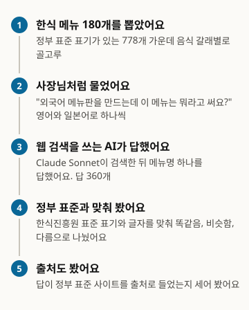
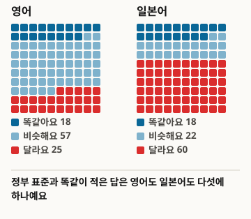
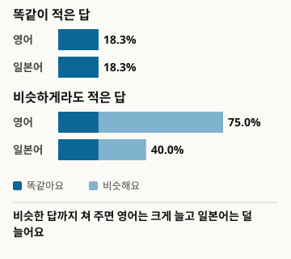
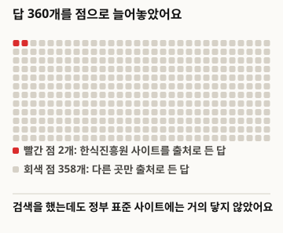
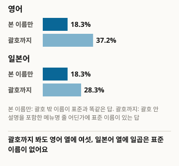

# AIに韓国料理メニューの外国語名を尋ねると、政府標準とどれほど一致するか

本稿は翻訳版です。基準版は韓国語原文、バージョン1です: https://define404.com/report/004-hansik-menu-translation/

韓国料理メニュー180品の英語・日本語メニュー名をウェブ検索条件のClaudeに尋ね、韓食振興院の標準表記と照合した調査

- 著者: Define404 Research
- 日付: 2026-10-29
- 事前登録: 研究リポジトリのコミット9f84ace(2026-10-28 23:41 ICT)
- DOI: https://doi.org/10.5281/zenodo.23739014
- 利害関係: 著者が所属するDefine404は、小さな店向けのAI点検サービスを準備しており、メニューの外国語表記点検を項目として検討しています。自社製品は調査対象ではありません。

## 要約

店主がAIアシスタントに韓国料理メニューの英語名・日本語名を尋ねたとき、政府が公開した標準表記と同じ答えが返ってくるかを調べました。正解は、韓食振興院の韓食ポータルにある「韓食メニュー外国語表記法」778件としました。料理の種類11区分で層化してメニュー180品を抽出し、店主がメニューを作る状況設定で、英語・日本語それぞれ180問をウェブ検索条件のClaude Sonnet 5.5に尋ねました。回答からメニュー名を1つ取り出し、標準表記とルールで照合しました。正規化後に標準と完全に一致した回答(厳密一致)は英語18.3%、日本語18.3%で同率でした。英語が日本語より高いという第一仮説は支持されませんでした。近い回答まで含めると(緩い一致以上)、英語75.0%、日本語40.0%に開きました。政府標準サイトを出典に挙げた回答は360件中2件のみで、第二仮説は解釈しませんでした。

### 主な結果

- 政府標準と完全に同じ表記の回答は、英語が180件中33件(18.3%; 95%信頼区間13.4~24.6)、日本語も180件中33件(18.3%; 13.4~24.6)でした。両言語の対差は0.0%p(-8.2~8.2)です。
- 標準に近い回答まで含めると、英語は180件中135件(75.0%; 68.2~80.8)、日本語は72件(40.0%; 33.1~47.3)です。日本語は十のうち六(60.0%; 52.7~66.9)が標準と異なる名前でした。
- 韓食振興院のサイトを出典に挙げた回答は360件中2件(0.6%; 0.2~2.0)です。英語2件、日本語0件です。
- 登録済みルールは括弧内を除いて主名のみを比較します。括弧内の説明まで見ると、標準名を含む回答は英語37.2%(30.5~44.5)、日本語28.3%(22.3~35.3)です(結果を見た後に追加した探索的分析)。

<!-- src: 002-menu-translation/analysis/out/results.json#preregistered.rates_en, rates_ja, H1_en_minus_ja_strict_paired; exploratory.cites_hansik_rate; 002-menu-translation/analysis/out/explore_contains.csv -->

## 1 序論

外国人客が増え、街の食堂も英語・日本語のメニューを作るようになりました。翻訳業者に頼むには品数が少なく、店主はAIアシスタントに「このメニューは英語で何と書けばいいですか」と尋ねます。政府はメニューの外国語表記を統一するため、農林畜産食品部・韓食振興院の名義で標準表記を公開しています。AIがその標準と異なる名前を教えると、店主はそれと知らないまま標準から外れたメニューを作ることになります。

この調査は、その差を測れる形にしました。正解を韓食振興院が公開した標準表記に置き、同じメニューを英語と日本語で尋ね、回答を標準とルールで照合しました。標本抽出、質問、判定、分析をすべてコードにしたので、同じ手順をもう一度実行できます。仮説と分析は、収集前に研究リポジトリへコミットして登録しました。

この調査が測るのは、回答が政府標準表記と同じかどうかだけです。標準と異なる回答が、そのまま誤訳というわけではありません。ただ、標準はメニュー表記を統一するために政府が公開した基準なので、店主がAIの回答をそのまま載せれば、メニューに標準から外れた表記が載ることになります。

貢献は三つです。第一に、韓国料理メニュー名を尋ねたAIの回答を政府の公式標準と照合した最初の測定です(第2節で確認した範囲内で)。第二に、英語と日本語を同じメニューで対にして比較しました。第三に、原データ収集、シード固定抽出、ルール判定、分析のコードを公開し、別のAIや別の時点で同じ調査を繰り返せるようにしました。

## 2 関連研究

原文を開いて確認した研究のみを記します(確認日2026-10-28)。

Yaoら(2024)は、文化特有項目を含む対訳コーパスを6言語対で構築し、大規模言語モデルがニューラル機械翻訳より文化知識を翻訳にうまく使うと報告しました[1]。韓国料理メニューは個別に扱っていません。Zhangら(2024)は中国語・英語のメニューデータセットを構築し、文化特有項目の自動識別と翻訳戦略を提案しました[2]。中国語メニューのみを扱っています。Yuanら(2026)は小説に基づく文化認識翻訳データセットと評価枠組みを提案しましたが、韓国語を含むかどうかは要旨に記載がありません[3]。Zengら(2026)はメニュー・調理画像4,870問で10言語、12のマルチモーダルモデルを選択式で評価しました[4]。翻訳の正解を政府標準と照合してはいません。Lee(2025)はドラマの台詞590対でChatGPTとPapagoの韓英翻訳を比較しましたが、料理名は扱っていません[5]。

5編のいずれにも、韓国料理メニュー名を政府の公式標準と照合し、ウェブ検索条件のAIアシスタントがどれほど同じ表記を出すかを測った結果はありません。この調査はその空白を埋めます。

<!-- src: 002-menu-translation/gate.md#3 -->

## 3 調査方法

図1. 調査の進め方

<!-- src: 002-menu-translation/analysis/make_figures.py; 002-menu-translation/analysis/out/results.json -->

### 3.1 正解の出典と標本

正解の出典は、韓食振興院の韓食ポータルにある「韓食メニュー外国語表記法」の表です(hansik.or.kr、2026-10-28収集、778件)。列は番号、料理名、ローマ字表記、英語、日本語、中国語簡体・繁体で、出典表記は農林畜産食品部、韓食振興院、文化体育観光部、国立国語院、韓国観光公社、農村振興庁です。空欄と重複する料理名はなく、除外した行はありません。収集ファイルのSHA-256は第8節にあります。

層は、韓国語の料理名の末尾語で定めた料理の種類11区分です。層ごとに母集団の比率で配分しつつ最低5品を置き、合計180品を抽出しました。層内の候補を番号順に並べ、シード20261028でシャッフルして先頭から埋めました。標本サイズは、第一仮説で両言語の対差15%pを有意水準5%(片側)、検出力80%で検出するのに必要な175品に合わせ、180品としました。対差の分散は、両言語の回答が無相関で比率が0.5という最悪値で見積もりました。

表1. 標本構成(料理の種類は料理名の末尾語ルールで定めたもので、公式分類と異なる場合があります)

| 料理の種類 | 母集団 | 標本 |
|---|---|---|
| 焼き物・炒め物・揚げ物 | 174 | 40 |
| 和え物・キムチ・副菜 | 133 | 30 |
| スープ・湯(タン) | 106 | 24 |
| ご飯・粥 | 92 | 21 |
| 蒸し物・煮物・茹で肉 | 74 | 17 |
| 麺 | 51 | 11 |
| その他 | 44 | 10 |
| チゲ・鍋 | 39 | 9 |
| 餅・韓菓・飲み物 | 38 | 8 |
| 定食・膳 | 7 | 5 |
| 醤・薬味 | 20 | 5 |
| 合計 | 778 | 180 |

<!-- src: 002-menu-translation/prereg.md#3; 002-menu-translation/sampling/sample_v1_log.txt -->

### 3.2 質問

メニューごと、言語ごとに1問ずつ、英語180問と日本語180問です。質問は、韓国で韓国料理店を営む店主が外国語メニューを作る状況として書き、1行目に「NAME: ...」の形式でメニュー名を1つ書いた後、1〜2文で説明するよう求めました。料理名は両言語とも韓国語表記のまま入れました。質問に標準、韓食振興院、ガイドという語は入れていません。質問テンプレートは付録Aにあります(collect/question_templates.json v1.0)。

言語ごとにシード20261028でシャッフルし、10問ずつ18バッチを作りました。1バッチは1言語で、互いに異なるメニューです。

### 3.3 回答システム

表2. 回答システム

| モデル | 条件 | 設問 | 有効回答 |
|---|---|---|---|
| Claude Sonnet 5.5 | ウェブ検索、設問ごとに検索必須 | 360 (英語180、日本語180) | 360 |

<!-- src: 002-menu-translation/log.md; 002-menu-translation/analysis/out/results.json#n_items -->

回答者はサブエージェントとして呼び出し、調査の目的と正解は知らせていません。指示文の冒頭に、以前の会話とは無関係であることと、質問の言語で答えることを入れました。バッチは3本ずつ並列で実行し、収集は2026-10-28の夜から29日にかけて行いました。360問すべてで回答を得て、検索を一度も行わなかった回答はありませんでした。1問は2回目の検索が制限で止まったと回答に記していましたが、1回目の検索は実行されていたため有効としました。試験収集は別途行わず、最初の2バッチで形式を確認した後、その回答も本データとして使いました。

### 3.4 判定

判定ルール(judge/rules.md v1.0)は収集前に固定し、ルール自動判定コード(judge/auto_judge.py)のみを使いました。回答の最初の「NAME:」行からメニュー名候補を1つ取り出します。候補が「A / B」のように2つ以上あれば1つ目を使い、括弧内は除きます。抽出に失敗した回答はなく、人手で判定した件数は0です。

英語は、小文字化、Unicode正規化(NFKC)、括弧内の除去、句読点の除去、冠詞とand・withの除去、ローマ字表記のゆれの統一(キムチkimchi/gimchi、餅tteok/ddeok/ddukなど)を経て、標準の英語表記と同じなら厳密一致です。単語集合のJaccard係数が0.5以上か、標準のローマ字表記を丸ごと含んでいれば緩い一致です。それ以外は不一致です。日本語は、NFKC、空白・中黒・長音記号・括弧内の除去、促音の有無の無視を経て、標準の日本語表記と同じなら厳密一致、文字2-gramのDice係数が0.5以上か標準を丸ごと含めば緩い一致です。回答がない、または分からないとだけ答えた場合は未提示です。回答の出典リストにhansik.or.krがあれば「標準出典の参照」です。

表3. 判定例(標本180品のうち5品、標準表記は韓食振興院の韓食ポータルから引用)

| メニュー | 言語 | 標準表記 | AI回答のメニュー名 | 判定 |
|---|---|---|---|---|
| 어간장 | 英語 | Fish Soy Sauce | Fish Soy Sauce (Eo-ganjang) | 厳密一致 |
| 비빔밥 | 日本語 | ビビンバ | ビビンバ | 厳密一致 |
| 새우튀김 | 英語 | Deep-fried Shrimp | Crispy Fried Shrimp | 緩い一致 |
| 계란찜 | 日本語 | 茶碗蒸し | ケランチム(韓国式卵蒸し) | 不一致 |
| 따로국밥 | 日本語 | タロクッパ | タログッパ(別盛りクッパ) | 不一致 |

<!-- src: 002-menu-translation/judge/judged.csv (M134-en, M014-ja, M148-en, M066-ja, M011-ja) -->

### 3.5 分析

分析コードはanalysis/run_analysis.pyで、標準ライブラリのみを使います。すべての比率にWilsonの95%信頼区間を付けます。1メニューにつき1言語あたり回答が1つなので、メニュー単位の比率がそのままクラスター単位です。第一仮説H1は、メニューごとに(英語の厳密一致 - 日本語の厳密一致)を求めた対差の平均と標準誤差、信頼区間、片側検定です。第二仮説H2は、英語の設問で標準出典を参照した群と参照しなかった群の厳密一致率の差です。2つの仮説はHolm法で補正しました。標本40未満のセルは解釈しません。事前登録にない分析は探索的分析と表示し、結果を見た後に追加した分析はその旨を記します。

事前登録は、prereg.mdを研究リポジトリにコミットしたものです(コミット9f84ace、2026-10-28 23:41 ICT)。登録後、prereg.mdと判定ルールは変更していません。

## 4 結果

### 4.1 政府標準と完全に同じ回答(H1)

表4. 言語別の判定分布(括弧はWilsonの95%信頼区間、nは各180)

| 判定 | 英語 | 日本語 |
|---|---|---|
| 厳密一致 | 33 (18.3%; 13.4~24.6) | 33 (18.3%; 13.4~24.6) |
| 緩い一致 | 102 (56.7%; 49.4~63.7) | 39 (21.7%; 16.3~28.2) |
| 不一致 | 45 (25.0%; 19.2~31.8) | 108 (60.0%; 52.7~66.9) |
| 未提示 | 0 (0.0%; 0.0~2.1) | 0 (0.0%; 0.0~2.1) |
| 緩い一致以上(厳密+緩い) | 135 (75.0%; 68.2~80.8) | 72 (40.0%; 33.1~47.3) |

<!-- src: 002-menu-translation/analysis/out/results.json#preregistered.rates_en, rates_ja -->

図2. メニュー100品を尋ねたら(回答数を100マスに縮めて四捨五入しました)

<!-- src: 002-menu-translation/analysis/make_figures.py; 002-menu-translation/analysis/out/results.json -->

正規化後に政府標準と完全に同じメニュー名を答えた比率は、英語18.3%、日本語18.3%で同率でした。メニュー180品の対差の平均は0.0%p(95%信頼区間-8.2~8.2)、片側p=0.500、Holm補正p=1.000です。英語の厳密一致率が日本語より高いというH1は支持されませんでした。両言語ともすべての設問でメニュー名を提示しました。

表5. 事前登録した仮説の検定結果

| 仮説 | 結果 |
|---|---|
| H1 英語 > 日本語(厳密一致、対) | 18.3%対18.3%。対差0.0%p(-8.2~8.2)、片側p=0.500、Holm p=1.000。支持されず |
| H2 標準出典の参照 > 非参照(英語の厳密一致) | 参照2問(0/2)、非参照178問(33/178、18.5%; 13.5~24.9)。参照セルが40未満のため解釈せず |

<!-- src: 002-menu-translation/analysis/out/results.json#preregistered.H1_en_minus_ja_strict_paired, H2_strict_by_hansik_citation_en -->

### 4.2 近い回答まで含めると(緩い一致)

図3. 近い回答まで数えると、英語は大きく増え、日本語はあまり増えません

<!-- src: 002-menu-translation/analysis/make_figures.py; 002-menu-translation/analysis/out/results.json -->

厳密一致に緩い一致を加えた「緩い一致以上」の比率は、英語75.0%(68.2~80.8)、日本語40.0%(33.1~47.3)です。英語の回答は、標準と単語が半分以上重なるか、標準のローマ字表記を含む場合が多くありました(緩い一致56.7%)。日本語の回答は、標準と異なる名前が60.0%(52.7~66.9)で最も多いセルでした。表3の계란찜(ケランチム)のように、標準は日本語訳(茶碗蒸し)なのに回答は韓国語の発音をカタカナで書いた(ケランチム)場合がここに入ります。言語別の緩い一致以上の比率の差は、事前登録した仮説ではなく探索的分析です。

### 4.3 政府標準サイトを引用した回答(H2)

図4. 政府標準サイトを出典に挙げた回答はほとんどありませんでした

<!-- src: 002-menu-translation/analysis/make_figures.py; 002-menu-translation/analysis/out/results.json -->

回答360件のうち、出典リストに韓食振興院のサイト(hansik.or.kr)がある回答は2件(0.6%; 0.2~2.0)です。英語180件中2件(1.1%; 0.3~4.0)、日本語180件中0件(0.0%; 0.0~2.1)です。その2件はトンテジョン(동태전)とタロクッパ(따로국밥)の英語回答で、いずれも緩い一致でした。参照群が2問のため、H2は解釈しませんでした。非参照178問の厳密一致率は18.5%(13.5~24.9)です。設問ごとにウェブ検索を行ったにもかかわらず、政府標準サイトにはほとんど届きませんでした。

<!-- src: 002-menu-translation/analysis/out/results.json#exploratory.cites_hansik_rate; 002-menu-translation/analysis/out/explore_contains.csv (all, cites_hansik_or_kr); 002-menu-translation/judge/judged.csv (cites_hansik=1: M145-en, M011-en) -->

### 4.4 探索的分析

料理の種類別の英語厳密一致率は表6のとおりです。標本40以上のセルは焼き物・炒め物・揚げ物(40品)の1つだけで、そのセルの厳密一致率は25.0%(14.2~40.2)です。残りのセルは40未満のため解釈しません。

表6. 料理の種類別の英語厳密一致(探索的分析、40未満のセルは解釈せず)

| 料理の種類 | n | 厳密一致 | 比率 (95% CI) | 解釈 |
|---|---|---|---|---|
| 焼き物・炒め物・揚げ物 | 40 | 10 | 25.0% (14.2~40.2) | 解釈 |
| 和え物・キムチ・副菜 | 30 | 1 | 3.3% (0.6~16.7) | 40未満 |
| スープ・湯(タン) | 24 | 8 | 33.3% (18.0~53.3) | 40未満 |
| ご飯・粥 | 21 | 5 | 23.8% (10.6~45.1) | 40未満 |
| 蒸し物・煮物・茹で肉 | 17 | 6 | 35.3% (17.3~58.7) | 40未満 |
| 麺 | 11 | 0 | 0.0% (0.0~25.9) | 40未満 |
| その他 | 10 | 0 | 0.0% (0.0~27.8) | 40未満 |
| チゲ・鍋 | 9 | 1 | 11.1% (2.0~43.5) | 40未満 |
| 餅・韓菓・飲み物 | 8 | 1 | 12.5% (2.2~47.1) | 40未満 |
| 定食・膳 | 5 | 0 | 0.0% (0.0~43.4) | 40未満 |
| 醤・薬味 | 5 | 1 | 20.0% (3.6~62.4) | 40未満 |

<!-- src: 002-menu-translation/analysis/out/results.json#exploratory.strict_by_category_en -->

英語の不一致45件のうち、標準の主要な食材語が抜けて別の食材語が入った「食材不一致」は2件(4.4%; 1.2~14.8)です。英語の不一致の大半は、食材ではなく表現の仕方が違っていました。複数提示と抽出失敗は0件です。

<!-- src: 002-menu-translation/analysis/out/results.json#exploratory.ingredient_mismatch_among_en_mismatch, flags -->

以下は結果を見た後に追加した探索的分析です。登録済みルールは括弧内を除いて主名のみを比較します。そのため「ケランチム(韓国式卵蒸し)」のように括弧内に説明を付けた回答は、括弧の外の名前だけで判定されます。括弧内まで含めたメニュー名の行全体に標準名が含まれる回答を別に数えると、英語180件中67件(37.2%; 30.5~44.5)、日本語180件中51件(28.3%; 22.3~35.3)です(analysis/explore_contains.py)。

図5. 括弧内の説明まで見ると(結果を見た後に追加した探索的分析)

<!-- src: 002-menu-translation/analysis/make_figures.py; 002-menu-translation/analysis/out/explore_contains.csv; 002-menu-translation/analysis/out/results.json -->

## 5 考察

この調査の要点は二つです。第一に、政府標準と完全に同じメニュー名を得られる確率は、英語も日本語も五つに一つほど(18.3%)で、言語による違いはありませんでした。第二に、近い回答まで数えると、英語(75.0%)と日本語(40.0%)は大きく分かれます。英語の回答には、標準と単語が重なる説明型の名前が多くありました(緩い一致56.7%)。日本語の回答には、表3の계란찜のように韓国語の発音をカタカナに移した名前があり、そうした回答は標準の日本語訳と重なる文字が少ないです。同じAI、同じメニュー、同じ状況でも、言語によって標準への近さが変わりました。

店の側から読むとこうなります。AIが教える英語のメニュー名は、標準と意味が通じる場合が多いものの、表記まで同じ場合は少ないです。日本語は、表記が同じ場合も少なく、意味が通じる形で書かれた場合も半分に届きません。標準と異なるメニュー名がそのまま誤訳というわけではありませんが、メニュー表記を政府標準に合わせたい店主であれば、AIの回答をそのまま写さず、標準を直接確認する必要があります。

ウェブ検索が政府標準サイトに届かなかった点が目を引きます。設問ごとに検索したのに、韓食振興院のサイトを出典に挙げた回答は360件中2件でした。複数の回答が「公式の標準英語名は見つからなかった」と記していました(例: ウサムギョプ・スクチュ・ポックム(우삼겹숙주볶음)の英語回答、"I found no official standard English name for this dish")。標準が公開されていても、検索結果の上位に出なければ、AIはその標準を知らないまま自分で名前を作ります。この件数は数えておらず、原因を検定したわけでもありません。

括弧内の説明まで見ると、標準名を含む回答は英語37.2%、日本語28.3%に増えます。主名は自分流に書き、括弧に標準名を添えた回答がそれだけあったということです。それでも英語の十のうち六、日本語の十のうち七は、括弧まで見ても標準名がありませんでした。この分析は結果を見た後に追加したもので、仮説検定ではありません。

## 6 限界

1. 回答システムがClaude Sonnet 5.5のウェブ検索条件1つです。他のAIアシスタントや検索なしの条件には一般化できません。
2. 質問テンプレートが1つです。「NAME:」形式の要求と店主という状況設定が回答に影響する可能性があり、別の言い方で尋ねれば結果が変わるかもしれません。
3. ルール判定の限界です。括弧内を除いて主名のみを比較するため、括弧に標準名を書いた回答は不一致か緩い一致になります(4.4節で探索)。また、意味が同じでも単語が違えば不一致です。表3の따로국밥(タロクッパ対タログッパ)は1文字の違いで不一致になりました。緩い一致の閾値(Jaccard・Dice 0.5)は収集前に決めましたが、任意の値です。
4. 標準表記は公式の基準の一つであって、唯一の正解ではありません。標準と異なる回答の翻訳品質は、この調査では測っていません。
5. 料理の種類は料理名の末尾語ルールで定めたもので、公式分類と異なる場合があり、種類別のセルは1つだけが40以上です。
6. 回答エージェントはClaude Code環境(ユーザー設定・メモリを含む)で動作し、1つのエージェントが10問を続けて答えたため、文脈効果があるかもしれません。
7. 調査は2026-10-28から29日の間の一時点で行いました。モデルと検索結果が変われば、結果も変わる可能性があります。

## 7 倫理と利害関係

- 個人情報は扱っていません。質問と回答に人名、店名、住所はありません。
- 正解の出典の著作権は韓食振興院にあります(韓食ポータル著作権ポリシー、2026-10-28確認: 著作権は韓食振興院、収益目的の利用は事前協議、出典表示必須)。そのため、原データの表と標本180品の標準表記は再配布せず、収集コードとファイルハッシュで再現できるようにしました。本文には例5件のみを出典を明記して引用しました。
- 著者が所属するDefine404は、小さな店向けのAI点検サービスを準備しており、メニューの外国語表記点検を項目として検討しています。自社製品は調査対象ではなく、この調査に外部資金はありません。
- 回答の収集は著者のClaudeサブスクリプションの範囲内で行い、追加費用はありません。

## 8 再現方法

- 公開リポジトリ: https://github.com/johndefine404/define404-research-public (パス002-menu-translation/)。原データ収集コード、シード固定抽出コード、質問テンプレート、バッチ、ルール判定コード、分析コード、結果ファイル、当方の判定(メニュー番号と判定のみ)を公開しています。原データの表、標準表記の文字列、回答の原文は収録していません。
- 事前登録: 研究リポジトリのコミット9f84ace0f6d74576686023187776c5c752f7c5ad (2026-10-28 23:41 ICT)。prereg.md SHA-256: 4cd0480d1af8b2b66bb10cfc4332a53ecd5806cf9dc3256d209c816a6c912596 (登録後の変更なし)
- 判定ルールjudge/rules.md SHA-256: 76370cd882e392dafe6b093f3d11406acadbcdddb3c91ffde8559d87c5ae7908
- 原データの表sampling/raw/hansik_menu_800_20261028.csv SHA-256: 620f0fc8be6918a7a5482e66f86086bf7991505bb679e046d28fa837bf4cc26f (収集コードsampling/fetch_source.pyで再取得して照合)
- 標本sampling/sample_v1.csv SHA-256: ec8992250598de301cf4acf5872476fcc67912c31a4be47084a303d70517868f、シード20261028
- 回答原文のフィンガープリント(バッチファイル36個のハッシュのSHA-256): b13052316b77ed6865a0cd299816b9eb8d2867187918623dea066321a25faae9
- 分析結果analysis/out/results.json SHA-256: b8b256647b25b729f4f51b42d7d0aff1e8a30167be15925040266355ff8fccab
- 再現手順: python sampling/fetch_source.py (原データ収集、ハッシュ照合) → python sampling/draw_sample.py → python collect/build_batches.py → 回答収集 → python judge/auto_judge.py → python analysis/run_analysis.py → python analysis/explore_contains.py → python analysis/make_figures.py
- 公開要約データ(CSV): 指標別の比率、信頼区間、標本数のみを収めています。標準表記の原文はありません。
- DOI: 発行後にZenodoに登録して記載します。

<!-- src: 002-menu-translation/log.md; 002-menu-translation/prereg.md#3; shasum -a 256 -->

## 店ですぐできること

1. 外国語のメニュー名はAIの回答をそのまま載せず、韓食振興院の韓食ポータルにある「韓食メニュー外国語表記法」で直接調べて確認してください。この調査でAIの回答が標準と完全に同じだったのは、英語も日本語も五つに一つでした。
2. 日本語メニューは特に確認してください。日本語の回答は十のうち六が標準と異なる名前で、標準は日本語訳なのに回答は韓国語の発音をカタカナで書いた場合がありました。
3. AIの回答に括弧で添えられた名前があれば、そちらも見てください。括弧内に標準名を書いた回答がありました。ただし括弧まで見ても、英語の十のうち六、日本語の十のうち七には標準名がありませんでした。
4. AIに「韓食振興院の標準表記で教えてほしい」と尋ねる方法は、この調査では試していません。効果を測っていない方法です。

## 参考文献

1. Yao B., Jiang M., Bobinac T., Yang D., Hu J. Benchmarking Machine Translation with Cultural Awareness. arXiv 2305.14328, v3 2024-10-19. https://arxiv.org/abs/2305.14328
2. Zhang Z., He C., Iyer V., Birch A. Cultural Adaptation of Menus: A Fine-Grained Approach. arXiv 2408.13534, 2024-08-24 (WMT 2024). https://arxiv.org/abs/2408.13534
3. Yuanら. Culture-Aware Machine Translation in Large Language Models: Benchmarking and Investigation. arXiv 2604.24361, 2026-04-27 (ACL 2026). https://arxiv.org/abs/2604.24361
4. Zengら. CulturalMenuBench: Probing the Knowledge-Application Gap in Multimodal Culinary Reasoning. arXiv 2609.03526, 2026-09-03. https://arxiv.org/abs/2609.03526
5. Lee J.-H. A Comparative Study of ChatGPT and Papago Korean-to-English Translations of Dialogue from the Adaptation of Pachinko. International Journal of Contents 21(3), 2025, 138-151. https://www.accesson.kr/ijcon/v.21/3/138/57464
6. 韓食振興院. 韓食メニュー外国語表記法(韓食メニュー外国語表記法ガイド800選). 韓食ポータル、2026-10-28収集. https://www.hansik.or.kr/board/dn/list/017?menuSn=12

<!-- src: 002-menu-translation/gate.md#1, #3 -->

## 付録A 質問テンプレート

架空のメニュー「하늘비빔밥」を入れた例です。実際の設問では、料理名の位置に標本メニューの韓国語の料理名をそのまま入れました。

| 言語 | 質問 |
|---|---|
| 英語 | I run a Korean restaurant in Korea and I'm making an English menu. How should I write the dish '하늘비빔밥' on the menu? Put one English menu name on the first line in the form 'NAME: ...', then add one or two short sentences of explanation. |
| 日本語 | 韓国で韓国料理店をやっていて、日本語のメニューを作っています。「하늘비빔밥」という料理はメニューにどう書けばいいですか。1行目に「NAME: ...」の形でメニュー名を1つだけ書いて、そのあとに1〜2文で短く説明してください。 |

<!-- src: 002-menu-translation/collect/question_templates.json v1.0 -->

## 付録B 判定ルールの要約

- 単位: 1問はメニュー1品 x 言語1つです。判定対象は回答から取り出したメニュー名候補1つで、説明文は判定しません。
- 候補の抽出: 最初の「NAME:」行の文字、なければ短い1行目、どちらもなければ抽出失敗(この調査では0件)です。2つ以上あれば1つ目を使い、括弧内は除きます。
- 英語の正規化: 小文字化、NFKC、括弧内の除去、句読点・ハイフン・スラッシュの除去、冠詞とand・&・withの除去、ローマ字のゆれの統一。
- 日本語の正規化: NFKC、空白・中黒・長音記号・括弧内の除去、促音の有無の無視。
- 厳密一致: 正規化した候補が正規化した標準と同じ。緩い一致: 英語は単語集合のJaccardが0.5以上または標準のローマ字表記を含む、日本語は文字2-gramのDiceが0.5以上または標準を含む。不一致: どちらでもない。未提示: 回答なし。
- 標準出典の参照: 回答の出典リストにhansik.or.krを含む。

<!-- src: 002-menu-translation/judge/rules.md#1-5 -->
