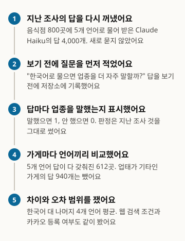
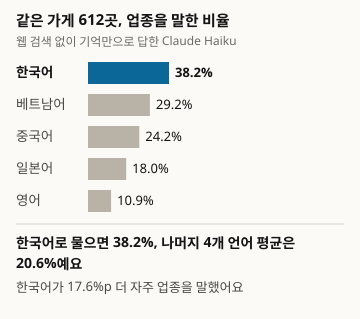
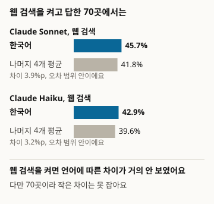
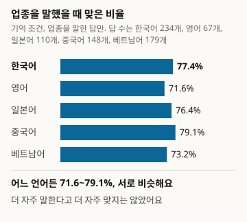
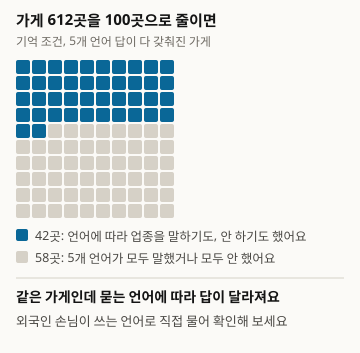

# 같은 가게, 5개 언어 답의 일관성: AI가 주는 가게 정보는 질문 언어에 따라 달라지는가

Local404 데이터 노트. 한국 일반음식점 800곳에 대한 Claude 응답을 5개 언어 사이에서 다시 비교했어요

- 저자: 김하원 (Define404 Research)
- 날짜: 2026-10-28
- 유형: 데이터 노트. 2호 Local404가 모은 답을 새 질문으로 다시 분석했어요. 새로 묻거나 새로 판정하지 않았어요.
- 사전 등록: 연구 저장소 커밋 7169864(2026-10-28 23:39 ICT). 분석을 돌리기 전에 가설과 분석 방법을 담은 prereg.md를 커밋했어요.
- 이해관계: 저자 소속 Define404는 AI 응답 모니터링과 가게별 AI 노출 진단 서비스를 준비하고 있어요. 자사 제품은 조사 대상에 넣지 않았어요.

## 요약

같은 가게를 같은 AI에게 다섯 언어로 물으면 가게 정보가 같은 만큼 나오는지 봤어요. 2호 Local404가 모은 Claude의 답(Haiku 5.5 기억 조건 800곳, Haiku 5.5·Sonnet 5.5 웹 검색 두 조건 100곳)과 판정 라벨을 그대로 썼어요. 기억 조건에서 5개 언어 답이 다 갖춰진 612곳 가운데 한국어 질문이 업종을 말한 비율은 38.2%, 나머지 4개 언어 평균은 20.6%로 차이 17.6%p(95% 신뢰구간 15.1~20.2)였어요(H1 지지). 웹 검색 두 조건(70곳)에서는 차이가 3.9%p, 3.2%p로 신뢰구간이 0을 품었어요. 업종을 말했을 때 맞은 비율은 언어별로 71.6~79.1%로 비슷했어요.

### 핵심 결과

- 기억 조건 612곳에서 한국어로 물으면 업종을 38.2% 말했고, 나머지 4개 언어 평균은 20.6%였어요. 차이 17.6%p(15.1~20.2), Holm 보정 p < 0.001, 사전 등록 가설 H1 지지.
- 언어별로는 베트남어 29.2%, 중국어 24.2%, 일본어 18.0%, 영어 10.9%였어요. 한국어와 영어 사이에서 가장 많이 갈렸어요(612곳 중 187곳, 30.6%).
- 웹 검색 조건 70곳에서는 차이가 3.9%p(-0.9~8.8), 3.2%p(-5.1~11.5)로 작았어요. 70곳이라 작은 차이는 잡지 못해요.
- 업종을 말한 답이 맞은 비율은 한국어 77.4%, 영어 71.6%, 일본어 76.4%, 중국어 79.1%, 베트남어 73.2%였어요. 더 자주 말한다고 더 자주 맞지는 않았어요.

<!-- src: 003-local404-consistency/analysis/out/h1.csv; h2.csv; holm.csv; explore_correctness.csv; explore_pairs.csv -->

## 1 서론

외국인 손님이 AI에게 자기 언어로 "이 집 어떤 음식점이에요?"라고 물으면, 한국어로 물을 때와 같은 답을 받을까요. 2호 Local404는 음식점 800곳의 영업 여부, 주소, 업종을 5개 언어로 묻고 공공 인허가 자료와 맞춰 봤어요. Claude 계열은 영업 여부를 거의 단정하지 않아 언어 간 판정 일치(2호 H5)는 바닥에 붙어 있었고, 업종은 답의 18~30%에서 나왔지만 시스템별 합계로만 보고했어요. 같은 가게 안에서 언어별로 갈리는지는 보지 않았어요.

이 노트는 그 빈자리를 채워요. 새로 묻지 않고 2호의 답과 판정 라벨을 그대로 쓰되, 질문과 분석 방법을 먼저 저장소에 기록한 뒤 분석했어요. 질문은 세 가지예요. 한국어 질문이 다른 언어보다 업종을 더 자주 말하는가(H1, 웹 검색 조건은 H2). 언어 간 불일치가 카카오 장소에 등록된 가게에서 더 많은가(H3). 어느 언어 쌍에서 갈리고, 갈릴 때 어느 쪽이 맞는가(탐색).

## 2 관련 연구

다국어 언어 모델이 같은 사실을 언어마다 다르게 기억한다는 보고는 여러 편 있어요. Jiang 외(2020)는 23개 언어에서 자료가 많은 언어일수록 사실 회상이 높다고, Kassner 외(2021)는 53개 언어에서 사실 회상에 언어 편향이 있다고 보고했어요. Qi 외(2023)는 언어 간 일관성을 정확도와 분리해 재는 지표를 제안했고, Chua 외(2024)는 최신 대형 모델도 깊은 지식은 언어 사이를 잘 넘지 못한다고 보고했어요. 이 연구들은 백과사전형 사실을 빈칸 채우기나 선다형으로 쟀어요. 특정 지역의 소규모 사업장에 대한 자유 답변을 실제 사용 조건에서 언어 간에 비교한 보고는 확인한 범위에서 찾지 못했어요.

## 3 조사 방법

그림 1. 이렇게 조사했어요

<!-- src: 003-local404-consistency/analysis/make_figures.py; analysis/out/data_inventory.csv -->

### 3.1 자료

새 표본을 뽑지 않았어요. 2호의 표본 800곳(영업 400, 폐업 400)과 웹 검색 부표본 100곳, 그리고 2호가 공개한 판정 결과 파일(judgments.csv, 7,312행) 하나를 입력으로 썼어요. 답 원문은 쓰지 않았어요. 질문은 영업 여부, 주소, 업종을 함께 묻는 한 문장이고, 상호와 시군구는 모든 언어에서 한국어 표기 그대로예요(2호 부록 A).

표 1. 자료 구성

| 조건 | 모델 | 답 | 가게 | 업태 기타로 뺀 답 | 5개 언어 완비 가게 |
|---|---|---|---|---|---|
| 기억 조건 | Claude Haiku 5.5, 도구 없음 | 4,000 | 800 | 940 | 612 |
| 검색 조건(Haiku) | Claude Haiku 5.5, 웹 검색 | 500 | 100 | 150 | 70 |
| 검색 조건(Sonnet) | Claude Sonnet 5.5, 웹 검색 | 500 | 100 | 150 | 70 |
| 기억 조건(Llama) | Llama 3.1 8B, 영어·일본어·한국어만 | 2,312 | 800 | 539 | 0 |

<!-- src: 003-local404-consistency/analysis/out/data_inventory.csv -->

Llama는 5개 언어가 없어 확증 분석에서 뺐고, 영업 상태 판정의 3개 언어 일관성만 탐색으로 봤어요. 미확정 라벨은 Claude 세 조건에서 업종·주소 모두 0건이었어요.

### 3.2 측정과 판정

판정 라벨은 2호의 사전 판정과 LLM 보조 판정 결과를 그대로 썼고, 새 판정자를 붙이지 않았어요. 업종 언급은 업종 라벨이 맞음 또는 틀림이면 1, 없음이면 0이에요. 정답 업태가 기타라 2호가 업종 판정에서 뺀 답(기억 조건 940개)은 결측으로 두었어요. 가게 단위 비교는 5개 언어 값이 모두 있는 가게만 썼어요(기억 조건 612곳, 검색 조건 각 70곳). 언급 불일치 가게는 5개 언어 가운데 일부만 업종을 말한 가게예요.

### 3.3 분석

사전 등록(커밋 7169864)과 같아요. H1은 기억 조건에서 가게마다 한국어 언급(0/1)에서 나머지 4개 언어 언급의 평균을 뺀 짝 차이의 평균이고, 가게 군집 표준오차로 95% 신뢰구간을 구했어요. H2a(Sonnet 검색)와 H2b(Haiku 검색)는 같은 통계예요. H3은 기억 조건에서 언급 불일치 가게 비율을 카카오 등록 가게와 비등록 가게 사이에서 독립 두 군으로 비교했어요. 양측 p 4개를 한 가족으로 Holm 보정했고, 보정 p < 0.05이고 차이 부호가 가설 방향일 때 지지로 판정했어요. 표본 40 미만 칸은 해석하지 않았고, 사전 등록에 없는 분석은 탐색으로 표시해요. 검출 가능한 최소 차이는 기억 조건 800곳에서 약 4~7%p, 검색 조건 100곳에서 약 11~20%p로 미리 적었어요(유의수준 5% 양측, 검정력 80%).

## 4 결과

### 4.1 사전 등록 가설

표 2. 사전 등록 가설 검정 결과 (차이는 %p, 괄호는 95% 신뢰구간)

| 가설 | 조건 | 비교 | 가게 | 차이 | 양측 p | Holm p | 판정 |
|---|---|---|---|---|---|---|---|
| H1 | 기억 조건 | 한국어 38.2% 대 나머지 4개 평균 20.6% | 612 | 17.6 (15.1~20.2) | < 0.001 | < 0.001 | 지지 |
| H2a | 검색 조건(Sonnet) | 한국어 45.7% 대 나머지 평균 41.8% | 70 | 3.9 (-0.9~8.8) | 0.112 | 0.240 | 지지 안 됨 |
| H2b | 검색 조건(Haiku) | 한국어 42.9% 대 나머지 평균 39.6% | 70 | 3.2 (-5.1~11.5) | 0.447 | 0.447 | 지지 안 됨 |
| H3 | 기억 조건 | 불일치 가게 비율, 카카오 등록 39.0%(310곳) 대 비등록 46.0%(302곳) | 612 | -7.0 (-14.8~0.8) | 0.080 | 0.240 | 지지 안 됨(반대 방향) |

<!-- src: 003-local404-consistency/analysis/out/h1.csv; h2.csv; h3.csv; holm.csv -->

H1은 지지됐어요. 같은 가게 612곳에 대해 한국어로 물으면 업종을 38.2% 말했고, 나머지 4개 언어 평균은 20.6%였어요. 짝 차이 17.6%p의 신뢰구간(15.1~20.2)은 미리 적은 검출 가능 차이(4~7%p)를 크게 넘어요. 언어별 짝 차이는 표 3과 같아요.

그림 2. 어느 언어로 물으면 업종을 말할까요

<!-- src: 003-local404-consistency/analysis/make_figures.py; analysis/out/h1.csv -->

표 3. 기억 조건 언어별 업종 언급률과 한국어와의 짝 차이 (612곳, 사전 등록 밖의 기술 통계)

| 언어 | 업종 언급률 | 한국어와의 차이 (%p, 95% CI) |
|---|---|---|
| 한국어 | 38.2% | 기준 |
| 베트남어 | 29.2% | 9.0 (6.4~11.6) |
| 중국어 | 24.2% | 14.1 (10.5~17.6) |
| 일본어 | 18.0% | 20.3 (17.0~23.5) |
| 영어 | 10.9% | 27.3 (23.5~31.1) |

<!-- src: 003-local404-consistency/analysis/out/h1.csv (confirmatory=False 행) -->

H2a와 H2b는 지지되지 않았어요. 웹 검색을 켠 두 조건에서는 차이가 3.9%p와 3.2%p였고 신뢰구간이 0을 품었어요. 다만 70곳에서 검출 가능한 차이는 약 11~20%p라, "차이가 없다"가 아니라 "이 크기 아래의 차이는 못 본다"로 읽어야 해요. 두 검색 조건 모두 언급률 자체는 기억 조건보다 높았어요(가게 묶음이 달라 짝 비교는 아니에요).

그림 3. 웹 검색을 켜면 어떨까요

<!-- src: 003-local404-consistency/analysis/make_figures.py; analysis/out/h2.csv -->

H3은 반대 방향이었어요. 언급 불일치 가게 비율은 카카오 등록 가게 39.0%(310곳), 비등록 가게 46.0%(302곳)로, 등록 가게가 오히려 7.0%p 낮았어요(-14.8~0.8). 비등록 가게는 모든 언어에서 침묵해 일치하기 쉬울 것이라는 사전 등록의 전제와 달랐어요.

### 4.2 탐색: 어느 언어 쌍에서 갈리나

기억 조건 612곳 가운데 5개 언어 중 일부만 업종을 말한 가게는 260곳(42.5%; 윌슨 95% 신뢰구간 38.6~46.4)이었어요. 영업 중인 가게(282곳)는 51.4%(45.6~57.2), 폐업한 가게(330곳)는 34.8%(29.9~40.1)였어요. 검색 조건에서는 Haiku 70곳 중 27곳(38.6%; 28.0~50.3), Sonnet 70곳 중 26곳(37.1%; 26.8~48.9)이었어요.

표 4. 언어 쌍별 업종 언급 불일치 (기억 조건, 612곳, 괄호는 윌슨 95% 신뢰구간)

| 언어 쌍 | 불일치 가게 | 앞 언어만 말함 | 뒤 언어만 말함 |
|---|---|---|---|
| 한국어, 영어 | 187 (30.6%; 27.0~34.3) | 177 | 10 |
| 한국어, 중국어 | 134 (21.9%; 18.8~25.3) | 110 | 24 |
| 한국어, 일본어 | 130 (21.2%; 18.2~24.7) | 127 | 3 |
| 한국어, 베트남어 | 69 (11.3%; 9.0~14.0) | 62 | 7 |
| 영어, 중국어 | 153 (25.0%; 21.7~28.6) | 36 | 117 |
| 영어, 베트남어 | 150 (24.5%; 21.3~28.1) | 19 | 131 |
| 영어, 일본어 | 129 (21.1%; 18.0~24.5) | 43 | 86 |
| 일본어, 중국어 | 124 (20.3%; 17.3~23.6) | 43 | 81 |
| 중국어, 베트남어 | 115 (18.8%; 15.9~22.1) | 42 | 73 |
| 일본어, 베트남어 | 105 (17.2%; 14.4~20.3) | 18 | 87 |

<!-- src: 003-local404-consistency/analysis/out/explore_pairs.csv (system=H-mem) -->

한국어가 든 쌍에서는 거의 언제나 한국어 쪽만 말했어요. 한국어와 영어가 갈린 187곳 중 177곳이 한국어만 업종을 말한 가게였어요.

### 4.3 탐색: 말했을 때 맞았나

표 5. 업종을 말한 답 중 맞은 비율 (기억 조건, 답 단위, 가게 군집 95% 신뢰구간)

| 언어 | 업종을 말한 답 | 맞은 비율 |
|---|---|---|
| 한국어 | 234 | 77.4% (72.0~82.7) |
| 영어 | 67 | 71.6% (60.8~82.5) |
| 일본어 | 110 | 76.4% (68.4~84.3) |
| 중국어 | 148 | 79.1% (72.5~85.6) |
| 베트남어 | 179 | 73.2% (66.7~79.7) |

<!-- src: 003-local404-consistency/analysis/out/explore_correctness.csv (system=H-mem, kind=match_rate_among_said) -->

맞은 비율은 언어별로 71.6~79.1%였고 신뢰구간이 서로 겹쳐요. 둘 이상 언어가 업종을 말한 가게 210곳 가운데 한 언어는 맞고 다른 언어는 틀린 가게는 4곳(1.9%; 0.7~4.8)뿐이었어요. 어느 언어가 맞은 쪽이 되는지 센 쌍 단위 집계는 언어별 2~6건, 검색 두 조건의 언어별 언급 답은 26~32건이라 해석하지 않아요.

그림 4. 말한 업종은 맞았을까요

<!-- src: 003-local404-consistency/analysis/make_figures.py; analysis/out/explore_correctness.csv -->

### 4.4 탐색: 주소와 Llama

주소는 어느 언어로 물어도 거의 나오지 않았어요. 기억 조건 800곳에서 주소를 말한 비율은 한국어 1.2%, 나머지 4개 언어 평균 1.3%로 차이 -0.1%p(-0.4~0.3)였고, 일부 언어만 주소를 말한 가게는 7곳(0.9%; 0.4~1.8)이었어요. 검색 조건에서는 100곳 중 Haiku 11곳(11.0%; 6.3~18.6), Sonnet 8곳(8.0%; 4.1~15.0)이었어요. 주소를 말한 답은 언어별 40건 미만이라 정확도는 해석하지 않아요. Llama 3.1 8B는 한국어·영어·일본어 영업 상태 판정이 모두 확정된 230곳에서 97곳(42.2%; 36.0~48.6)의 판정이 언어 간에 달랐고, 영업 중과 폐업이 맞부딪친 가게는 0곳이었어요.

<!-- src: 003-local404-consistency/analysis/out/explore_address.csv; explore_lmem_status.csv -->

## 5 논의

기억 조건에서 Claude Haiku는 같은 가게를 한국어로 물을 때 업종을 가장 자주 말했고, 영어로 물을 때 가장 드물게 말했어요. 베트남어가 한국어 다음으로 높았다는 점은 자료가 많은 언어일수록 회상이 높다는 기존 보고(Jiang 외 2020)만으로는 설명하기 어려워요.

그림 5. 같은 가게, 언어마다 다른 답

<!-- src: 003-local404-consistency/analysis/make_figures.py; analysis/out/explore_inconsistency.csv -->

말하는 빈도는 언어마다 달랐지만 맞는 비율은 비슷했어요. 둘 이상 언어가 말한 가게에서 판정이 갈린 경우는 1.9%뿐이에요. 언어는 "말하느냐"를 바꾸고 "맞느냐"는 거의 바꾸지 않았어요. Qi 외(2023)가 일관성과 정확도를 따로 봐야 한다고 한 이유가 이 자료에서도 보여요. 웹 검색을 켜면 언어 차이가 작아졌고 언급률은 올라갔어요. 검색이 언어와 무관하게 같은 출처에 닿았기 때문일 수 있지만, 70곳 표본이라 작은 차이가 남아 있을 가능성은 열려 있어요.

기억 조건에서 업종을 말한 답의 일부는 가게 이름에서 업종을 짐작한 것일 수 있어요. 상호에 "치킨", "횟집" 같은 말이 들어 있으면 AI가 가게를 몰라도 업종을 말할 수 있고, 한국어 질문에서 그 짐작이 더 잘 일어날 수 있어요. 이 가능성은 이번 자료로 확인하지 않았어요.

### 가게에서 바로 할 일

- 외국인 손님이 쓰는 언어로 AI에게 가게를 직접 물어 보세요. 한국어로 물으면 말하던 업종을 영어로 물으면 안 말한 가게가 612곳 중 177곳이었어요.
- 한국어 답이 틀렸다면 다른 언어 답도 틀렸을 가능성이 커요. 둘 이상 언어가 업종을 말한 가게 210곳 중 판정이 갈린 곳은 4곳이었어요.
- 웹 검색을 켠 AI는 언어에 따른 차이가 작았어요(70곳 기준). 어느 조건의 AI가 가게를 설명하는지에 따라 결과가 달라요.

## 6 한계

1. 판정은 2호의 사전 판정과 LLM 보조 판정이에요. 업종 판정의 두 방식 일치율이 73%(카파 0.46, 2호 표 7)라 언급 여부와 맞음 여부 모두 판정 오차를 포함해요.
2. 검색 두 조건은 70곳이라 검정력이 낮아요. 지지되지 않음은 차이 없음이 아니에요.
3. 한국어 질문이 더 많이 말한 원인이 모델의 언어별 지식 차이인지, 질문 문장의 차이(상호·시군구가 모든 언어에서 한국어 표기)인지, 상호에서 업종을 짐작한 것인지는 가릴 수 없어요. 2호의 수집 환경과 지시문의 영향도 분리할 수 없어요.
4. 수집 시점은 2026-10-21부터 24일까지 한 시점이에요.

## 7 윤리와 이해관계

개인사업자의 상호와 주소는 공개 자료에서 뺐고, 이 노트는 답 원문을 쓰지 않았어요. 저자 소속 Define404는 AI 응답 모니터링과 가게별 AI 노출 진단 서비스를 준비하고 있어요. 자사 제품은 조사 대상에 넣지 않았어요. 외부 지원금은 없어요.

## 8 재현 방법

- 입력: 2호 공개 저장소의 판정 결과 001-local404/analysis/out_final/judgments.csv (SHA-256 37220e4ee92e815a968f91d1b4c80f4b3e84aa0d95e3415fc269bb3fab01bf26). https://github.com/johndefine404/define404-research-public
- 통계 코드: 2호 001-local404/analysis/stats_lib.py (SHA-256 206d5e4191f0c436305866daa90ca328b92afde972cb908aefac0f0101ae94fb), 수정 없이 사용
- 분석 코드: 003-local404-consistency/analysis/run_analysis.py. 실행은 python analysis/run_analysis.py. 가짜 입력 시험은 analysis/tests/test_fake_input.py
- 결과: analysis/out/ 의 h1.csv, h2.csv, h3.csv, holm.csv, explore_*.csv, data_inventory.csv, results.json. 원고의 숫자는 이 파일에서만 옮겼어요
- 그림: analysis/make_figures.py 가 결과 파일에서 숫자를 읽어 report/figures/*.svg 를 만들어요
- 사전 등록: 연구 저장소 커밋 7169864742847ee54118b42f23ef2285f705e97d (2026-10-28T23:39:04+07:00). 분석 실행 전에 prereg.md를 커밋했어요
- 의존성: numpy, pandas, scipy (analysis/requirements.txt)

## 참고문헌

- Chua, L. 외 (2024). Crosslingual Capabilities and Knowledge Barriers in Multilingual Large Language Models. arXiv:2406.16135. https://arxiv.org/abs/2406.16135
- Jiang, Z., Anastasopoulos, A., Araki, J., Ding, H., Neubig, G. (2020). X-FACTR: Multilingual Factual Knowledge Retrieval from Pretrained Language Models. arXiv:2010.06189. https://arxiv.org/abs/2010.06189
- Kassner, N., Dufter, P., Schütze, H. (2021). Multilingual LAMA: Investigating Knowledge in Multilingual Pretrained Language Models. arXiv:2102.00894. https://arxiv.org/abs/2102.00894
- Qi, J., Fernández, R., Bisazza, A. (2023). Cross-Lingual Consistency of Factual Knowledge in Multilingual Language Models. arXiv:2310.10378. https://arxiv.org/abs/2310.10378
- Define404 Research (2026). Local404: AI는 폐업한 동네 가게를 아직 영업 중이라고 말하는가. https://define404.com/report/002-local404-closed-shops/
