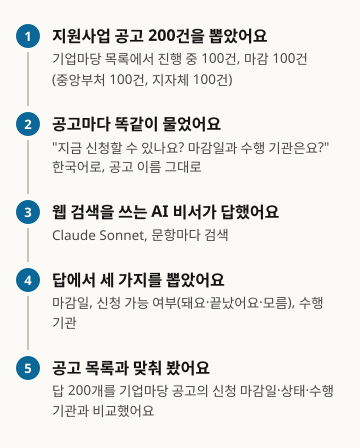
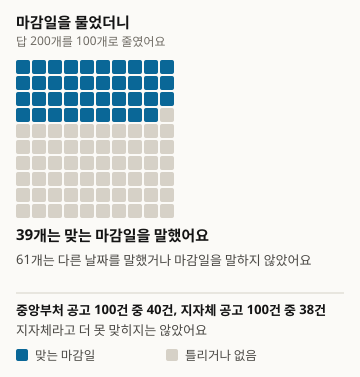
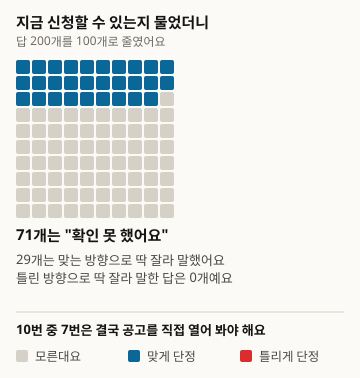
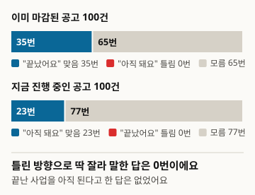
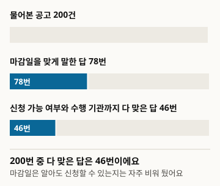

# Hỏi AI về thông báo chương trình hỗ trợ, AI có nói đúng hạn nộp hồ sơ không

Đây là bản dịch. Bản gốc là tiếng Hàn, phiên bản 1: https://define404.com/report/005-support-program-deadlines/

Chúng tôi hỏi một trợ lý AI có tìm kiếm web bằng tiếng Hàn về 200 thông báo chương trình hỗ trợ trên Bizinfo (기업마당) và đối chiếu hạn nộp hồ sơ, tình trạng còn nhận hồ sơ hay không và cơ quan thực hiện trong câu trả lời với danh sách thông báo

- Tác giả: Kim Hawon (Define404 Research)
- Ngày: 2026-10-29
- Loại: Báo cáo đo lường. Hỏi mới 200 thông báo và chấm theo quy tắc.
- Đăng ký trước: commit 35fac08 của kho nghiên cứu (2026-10-28 23:41 ICT). Tệp prereg.md chứa giả thuyết, mẫu, quy tắc chấm và phương pháp phân tích đã được commit trước khi thu thập.
- DOI: https://doi.org/10.5281/zenodo.23739022
- Xung đột lợi ích: Define404, nơi tác giả làm việc, đang chuẩn bị dịch vụ giám sát câu trả lời của AI và chẩn đoán mức độ hiện diện trên AI cho từng cửa hàng. Sản phẩm của công ty không được đưa vào đối tượng khảo sát.

## Tóm tắt

Chúng tôi đo xem khi chủ cửa hàng nhỏ hỏi trợ lý AI "Chương trình hỗ trợ này bây giờ còn nộp hồ sơ được không? Hạn là khi nào?" thì có nhận được câu trả lời đúng hay không. Đáp án chuẩn là danh sách thông báo của Bizinfo (기업마당, bizinfo.go.kr), cổng thông tin chương trình hỗ trợ của chính phủ Hàn Quốc. Chúng tôi chọn mẫu phân tầng 200 thông báo sao cho có 100 đang mở và 100 đã hết hạn, 100 của bộ ngành trung ương và 100 của chính quyền địa phương, rồi hỏi Claude Sonnet 5.5 có tìm kiếm web mỗi thông báo một lần bằng tiếng Hàn. Câu trả lời được chấm theo quy tắc cố định trước khi thu thập. Có 78 trong 200 câu trả lời (39.0%) nói đúng hạn nộp hồ sơ; chênh lệch giữa bộ ngành trung ương 40.0% và chính quyền địa phương 38.0% là -2.0 điểm phần trăm, nên giả thuyết đăng ký trước H1 (địa phương thấp hơn) không được ủng hộ. Về việc còn nhận hồ sơ hay không, 142 trong 200 câu trả lời (71.0%) nói không xác nhận được, và 58 câu trả lời có kết luận đều đúng hướng. Số câu trả lời nói thông báo đã hết hạn vẫn còn nộp được và số câu trả lời nói thông báo đang mở đã hết hạn đều là 0, nên H2 cũng không được ủng hộ. Quy tắc chấm tình trạng nhận hồ sơ được phát hiện có lỗi sau khi thu thập và đã được sửa; kết quả theo quy tắc ban đầu được đăng nguyên vẹn trong phụ lục.

### Kết quả chính

- Có 78 trong 200 câu trả lời nói đúng hạn nộp hồ sơ, tức 39.0% (khoảng tin cậy 95%: 32.5~45.9). Thông báo của bộ ngành trung ương 40.0% (30.9~49.8), thông báo của chính quyền địa phương 38.0% (29.1~47.8), chênh lệch -2.0 điểm phần trăm (-15.5~11.5). H1 không được ủng hộ.
- Về tình trạng nhận hồ sơ, 142 trong 200 câu trả lời (71.0%; 64.4~76.8) không đưa ra kết luận mà nói không xác nhận được. 58 câu trả lời có kết luận (29.0%; 23.2~35.6) đều đúng hướng.
- Số câu trả lời nói 100 thông báo đã hết hạn vẫn còn nộp được là 0, số câu trả lời nói 100 thông báo đang mở đã hết hạn là 0. Vì cả hai loại lỗi đều bằng 0, H2 (phía nói thông báo hết hạn vẫn còn nộp được nhiều hơn) không được ủng hộ.
- Điểm nghiêm ngặt, đòi hỏi đúng cả hạn nộp hồ sơ, tình trạng nhận hồ sơ và cơ quan thực hiện, là 46 trong 200 (23.0%; 17.7~29.3). Chênh lệch ghép cặp so với điểm nới lỏng chỉ xét hạn nộp hồ sơ là 16.0 điểm phần trăm (10.9~21.1).

<!-- src: 004-support-programs/analysis/out/results.json#preregistered.cells.all, H1, H2; analysis/out/results.json#exploratory.loose_minus_strict_paired -->

## 1 Giới thiệu

Các chương trình hỗ trợ cho hộ kinh doanh nhỏ ở Hàn Quốc có nhiều thông báo và thời hạn ngắn. Chỉ riêng Bizinfo, tính đến 2026-10-28 đã có 1,445 thông báo đang mở. Chủ cửa hàng khó đọc hết danh sách này, nên ngày càng nhiều người hỏi trợ lý AI "Cái này bây giờ còn nộp được không?". Nếu AI nói sai hạn, chủ cửa hàng hoặc không kịp nộp hồ sơ đã chuẩn bị, hoặc mất thời gian cho một chương trình đã kết thúc.

Về các chế độ phúc lợi ở Mỹ đã có nghiên cứu đo độ chính xác của câu trả lời AI (Mục 2), nhưng trong phạm vi chúng tôi kiểm tra, chưa tìm thấy báo cáo nào hỏi một trợ lý AI phổ thông có tìm kiếm web về thông báo chương trình hỗ trợ của Hàn Quốc và đo các mục có đáp án cố định theo danh sách công khai (hạn nộp hồ sơ, cơ quan thực hiện, còn mở hay không).

Khảo sát này nhằm đo khoảng trống đó. Có ba đóng góp. Lấy danh sách thông báo của Bizinfo làm đáp án, chúng tôi chọn mẫu phân tầng 200 thông báo và đo tỷ lệ nói đúng hạn của trợ lý AI. Chúng tôi xem AI sai theo hướng nào về tình trạng nhận hồ sơ ở thông báo đã hết hạn và thông báo đang mở. Và chúng tôi commit mã chọn mẫu, quy tắc chấm và mã phân tích vào kho trước khi thu thập để có thể chạy lại cùng quy trình.

Có hai giả thuyết. H1 (chính) là tỷ lệ nói đúng hạn nộp hồ sơ ở thông báo của chính quyền địa phương thấp hơn ở thông báo của bộ ngành trung ương. H2 (phụ) là tỷ lệ khẳng định thông báo đã hết hạn vẫn còn nộp được cao hơn tỷ lệ khẳng định thông báo đang mở đã hết hạn.

## 2 Nghiên cứu liên quan

Phần lớn nghiên cứu đo độ chính xác của câu trả lời AI về chế độ công đều xoay quanh phúc lợi ở Mỹ. Gosciak và cộng sự (2026) nhờ chuyên gia gán đáp án cho 770 câu hỏi về SNAP (hỗ trợ thực phẩm) của Mỹ và thử nghiệm xem độ chính xác của chatbot ảnh hưởng thế nào đến độ chính xác của nhân viên tư vấn. Vals AI (2026) đặt 2,931 tiêu chí chấm của chuyên gia cho 459 tình huống SNAP, chấm bằng trọng tài LLM, mô hình tốt nhất đạt 76.93%. Simpson và cộng sự (2026) báo cáo các trường hợp mô hình mới nhất xử lý sai điều khoản ngoại lệ trong 225 tình huống quy tắc pháp lý. Kennan và cộng sự (2025) so sánh câu trả lời thông thường và câu trả lời có bổ sung tìm kiếm của chatbot về SNAP và Medicaid ở 7 bang.

Các nghiên cứu này xác định đáp án bằng phán đoán của chuyên gia và xử lý những câu hỏi cần diễn giải như điều kiện hưởng chế độ. Khảo sát này ngược lại, chỉ chọn các mục không cần diễn giải. Hạn nộp hồ sơ và cơ quan thực hiện là giá trị ghi trong danh sách thông báo nên có thể đối chiếu bằng quy tắc. Cách chấm theo hai điểm nới lỏng và nghiêm ngặt của FreshQA (Vu và cộng sự 2023); khoảng tin cậy và chênh lệch ghép cặp theo Miller (2024). Tiêu chí không diễn giải ô có dưới 40 mẫu lấy từ PopQA (Mallen và cộng sự 2023). Thiết kế tiếp nối báo cáo số 2 Local404 (Define404 Research 2026), vốn đo tình trạng còn hoạt động của cửa hàng trong khu phố bằng cùng cách làm.

## 3 Phương pháp khảo sát

Hình 1. Khảo sát được tiến hành như thế này

<!-- src: 004-support-programs/analysis/make_figures.py; analysis/out/results.json -->

### 3.1 Tổng thể và mẫu

Nguồn đáp án là tệp Excel tải về của danh sách thông báo chương trình hỗ trợ trên Bizinfo (nhận ngày 2026-10-28, 1,445 dòng đang mở, 26,425 dòng đã qua). Các cột gồm bộ chủ quản, cơ quan thực hiện, lĩnh vực hỗ trợ, tên thông báo, ngày bắt đầu nhận hồ sơ, ngày kết thúc nhận hồ sơ, ngày đăng và URL chi tiết thông báo. Đáp án được cố định theo giá trị trong tệp này; dù Bizinfo có sửa thông báo trong thời gian thu thập, đáp án vẫn không đổi.

Các dòng bị loại gồm: 699 dòng có tên thông báo xuất hiện từ hai lần trở lên, 68 dòng không có ngày nhận hồ sơ, 16 dòng chưa bắt đầu nhận hồ sơ, 360 dòng đang mở nhưng hạn không nằm trong khoảng 2026-11-18 đến 2027-06-30 (kể cả thông báo nhận hồ sơ thường xuyên, quanh năm), và 23,522 dòng đã qua nhưng hạn không nằm trong khoảng 2026-08-01 đến 10-21. Khoảng hạn chừa biên 7 ngày ở mỗi đầu để tình trạng không thay đổi trong thời gian thu thập.

Tầng là 4 ô được tạo bởi tình trạng (đang mở, đã hết hạn) nhân với cấp chủ quản (bộ ngành trung ương, chính quyền địa phương). Bộ chủ quản có tên kết thúc bằng thành phố đặc biệt, thành phố trực thuộc trung ương, thành phố tự trị đặc biệt, tỉnh tự trị đặc biệt hoặc tỉnh được xếp là chính quyền địa phương; còn lại (kể cả cục, ủy ban) là bộ ngành trung ương. Trong mỗi ô, ứng viên được sắp theo mã thông báo, xáo trộn với seed 20261028 và lấy 50 dòng đầu, tổng cộng 200. Cỡ mẫu được đặt theo mức 98 mỗi nhóm, cần để phát hiện chênh lệch 20 điểm phần trăm ở H1 với mức ý nghĩa 5% và lực kiểm định 80%. Mỗi thông báo có một câu trả lời nên 200 thông báo là mẫu hiệu dụng.

Bảng 1. Cấu trúc mẫu (seed 20261028)

| Ô | Ứng viên | Mẫu |
|---|---|---|
| Đang mở x Bộ ngành trung ương | 265 | 50 |
| Đang mở x Chính quyền địa phương | 752 | 50 |
| Đã hết hạn x Bộ ngành trung ương | 718 | 50 |
| Đã hết hạn x Chính quyền địa phương | 1,470 | 50 |
| Tổng | 3,205 | 200 |

<!-- src: 004-support-programs/sampling/sample_log.txt; 004-support-programs/prereg.md#3 -->

### 3.2 Câu hỏi

Mỗi thông báo có một câu hỏi bằng tiếng Hàn. Mẫu câu là "'{tên thông báo}' 지원사업, 지금 신청할 수 있나요? 신청 마감일이 언제이고 어느 기관이 사업을 수행하는지도 알려 주세요." (Chương trình hỗ trợ '{tên thông báo}' bây giờ còn nộp hồ sơ được không? Hãy cho tôi biết thêm hạn nộp hồ sơ là khi nào và cơ quan nào thực hiện.) Tên thông báo được đưa vào đúng như đăng trên Bizinfo (kể cả tiền tố địa phương); hạn nộp, cơ quan và tình trạng là đối tượng chấm nên không đưa vào câu hỏi. Câu hỏi được chia thành 20 lô, mỗi lô 10 câu, và tệp lô chỉ chứa câu hỏi.

### 3.3 Hệ thống trả lời

Chỉ có một hệ thống trả lời: Claude Sonnet 5.5 kèm tìm kiếm web, được chọn vì gần với cách người dùng thực tế sử dụng. Mỗi lần gọi xử lý một lô (10 câu), và bên trả lời không biết mục đích khảo sát cũng như đáp án. Hướng dẫn yêu cầu tìm kiếm cho từng câu, trả lời bằng ngôn ngữ của câu hỏi, và nếu nhận được thông báo giới hạn tìm kiếm thì dừng lại và chỉ ghi những câu đã tìm. Thu thập diễn ra từ đêm 2026-10-28 đến 10-29; cả 200 câu đều có ít nhất 1 lần tìm kiếm nên không có câu trả lời không hợp lệ. Nguyên văn câu trả lời và nguồn tìm kiếm được lưu trong tệp theo từng lô.

### 3.4 Chấm

Việc chấm dùng mã quy tắc cố định trước khi thu thập. Có ba mục.

- Tình trạng nhận hồ sơ: một trong ba giá trị, khẳng định còn nộp được, khẳng định đã hết hạn, hoặc không rõ (không xác nhận được hoặc không có kết luận). Đáp án là tình trạng của tầng.
- Hạn nộp hồ sơ: trong các ngày xuất hiện ở câu trả lời, ngày nằm trong ngữ cảnh hạn (trong vòng 40 ký tự quanh các từ tiếng Hàn chỉ hạn, đến, kết thúc, thời gian nộp, thời gian nhận hồ sơ, hoặc ở cuối một khoảng thời gian) trùng với ngày kết thúc nhận hồ sơ trong đáp án thì đúng; chỉ có ngày khác thì sai; không có ngày trong ngữ cảnh hạn thì không có.
- Cơ quan thực hiện: nếu cơ quan thực hiện (với thông báo do chính quyền cơ sở thực hiện hoặc bộ trực tiếp thực hiện thì là bộ chủ quản và tên thành phố, huyện, quận ở đầu tên thông báo) xuất hiện trong câu trả lời, kể cả tên viết tắt, thì đúng; nếu chỉ nêu cơ quan khác thì sai.

Điểm nới lỏng là đúng hạn nộp hồ sơ. Điểm nghiêm ngặt đòi hỏi đúng hạn nộp hồ sơ, đúng tình trạng nhận hồ sơ và cơ quan thực hiện không sai. Không dùng trọng tài LLM và không dùng chấm bởi 2 người.

Việc chấm tình trạng nhận hồ sơ được sửa một lần sau khi thu thập (Mục 3.6). Theo quy tắc đã sửa (v1.1), số câu trả lời do trung tâm chấm trực tiếp là 0. Theo quy tắc ban đầu (v1.0), có 1 câu trả lời có cả cách diễn đạt còn nộp được và đã hết hạn trong cùng một câu nên được đánh dấu để chấm trực tiếp; câu đó được tính là không rõ trong bảng kết quả v1.0 (Phụ lục B).

### 3.5 Phân tích

Mọi tỷ lệ đều kèm khoảng tin cậy Wilson 95%. Mỗi thông báo có một câu trả lời nên khoảng này trùng với khoảng cụm theo đơn vị đối tượng. H1 được kiểm định bằng khoảng tin cậy 95% và kiểm định z một phía cho chênh lệch giữa tỷ lệ điểm nới lỏng ở thông báo của chính quyền địa phương và tỷ lệ ở bộ ngành trung ương. H2 là chênh lệch giữa tỷ lệ khẳng định thông báo đã hết hạn còn nộp được và tỷ lệ khẳng định thông báo đang mở đã hết hạn. Giá trị p của hai giả thuyết được hiệu chỉnh Holm. Chênh lệch giữa điểm nới lỏng và điểm nghiêm ngặt của cùng một thông báo được báo cáo dưới dạng chênh lệch ghép cặp. 4 ô tình trạng nhân cấp chủ quản (50 mỗi ô) và việc tách sai với không có ở hạn nộp hồ sơ là phân tích khám phá, không có trong đăng ký trước. Ô có dưới 40 mẫu không được diễn giải.

### 3.6 Khác biệt so với đăng ký trước

Khi đọc mẫu đã chấm sau thu thập, chúng tôi phát hiện phần triển khai của quy tắc chấm tình trạng nhận hồ sơ đã đăng ký (v1.0) có lỗi. v1.0 tách câu trả lời thành từng câu và lấy câu cuối cùng có cách diễn đạt còn nộp được hoặc đã hết hạn làm kết luận; nó đọc "신청 가능성은 사실상 없어 보입니다" (khả năng nộp hồ sơ trên thực tế là không có) thành còn nộp được, và đọc việc nhắc đến đợt trước của cùng chương trình đã hết hạn thành kết luận rằng thông báo mục tiêu đã hết hạn. Vì vậy, trước khi diễn giải kết quả phân tích, chúng tôi sửa quy tắc thành v1.1. v1.1 coi câu đầu tiên của câu trả lời là câu kết luận: nếu câu đầu có cách diễn đạt phía hết hạn ("không thể nộp", "hết hạn", "kết thúc", "đã qua", "không có khả năng" v.v.) thì khẳng định đã hết hạn; có cách diễn đạt phía còn nộp được ("có thể nộp", "nộp được", "đang nhận hồ sơ" v.v.) thì khẳng định còn nộp được; không có cả hai thì không rõ. Cả 200 câu trả lời đều ghi kết luận hoặc không xác nhận được ở câu đầu tiên. Quy tắc về hạn nộp hồ sơ và cơ quan thực hiện không thay đổi.

Theo Mục 8 của bản đăng ký trước, kết quả v1.0 được đăng nguyên vẹn trong Phụ lục B. Theo v1.0, H2 được ủng hộ với +34.0 điểm phần trăm; theo v1.1, cả hai loại lỗi đều là 0 nên không được ủng hộ. Khác biệt giữa hai kết quả xuất phát từ lỗi chấm, và đây là phần cần đọc thận trọng nhất trong khảo sát này (Mục 5).

## 4 Kết quả

### 4.1 Hạn nộp hồ sơ

Bảng 2. Tỷ lệ nói đúng hạn nộp hồ sơ (điểm nới lỏng) và điểm nghiêm ngặt (trong ngoặc là khoảng tin cậy Wilson 95%)

| Nhóm | n | Đúng hạn | Đúng cả hạn, tình trạng và cơ quan |
|---|---|---|---|
| Toàn bộ | 200 | 78 (39.0%; 32.5~45.9) | 46 (23.0%; 17.7~29.3) |
| Bộ ngành trung ương | 100 | 40 (40.0%; 30.9~49.8) | 28 (28.0%; 20.1~37.5) |
| Chính quyền địa phương | 100 | 38 (38.0%; 29.1~47.8) | 18 (18.0%; 11.7~26.7) |
| Đang mở | 100 | 45 (45.0%; 35.6~54.8) | 18 (18.0%; 11.7~26.7) |
| Đã hết hạn | 100 | 33 (33.0%; 24.6~42.7) | 28 (28.0%; 20.1~37.5) |

<!-- src: 004-support-programs/analysis/out/tables.md#표1; analysis/out/results.json#preregistered.cells -->

Hình 2. Hỏi AI 100 lần thì bao nhiêu câu trả lời nói đúng hạn (200 câu rút về 100 ô và làm tròn)

<!-- src: 004-support-programs/analysis/make_figures.py; analysis/out/results.json#preregistered.cells -->

Có 78 trong 200 câu trả lời (39.0%) nói đúng hạn nộp hồ sơ. Trong 122 câu còn lại, 58 câu chỉ nêu ngày khác trong ngữ cảnh hạn và 64 câu không có ngày nào trong ngữ cảnh hạn. Ở thông báo đang mở: đúng 45, sai 20, không có 35; ở thông báo đã hết hạn: đúng 33, sai 38, không có 29. Cách tách này là phân tích khám phá. Trong số sai có cả những câu nêu ngày của thông báo khác có tên tương tự hoặc của đợt trước (Mục 6).

<!-- src: 004-support-programs/judge/judged.csv (deadline 열: correct 78, wrong 58, none 64; ongoing 45/20/35, expired 33/38/29) -->

### 4.2 Giả thuyết đăng ký trước H1: thông báo của chính quyền địa phương có thấp hơn không

Bảng 3. Kết quả kiểm định giả thuyết đăng ký trước (chênh lệch tính bằng điểm phần trăm, trong ngoặc là khoảng tin cậy 95%)

| Giả thuyết | So sánh | Chênh lệch | p một phía | p Holm | Kết luận |
|---|---|---|---|---|---|
| H1 | Điểm nới lỏng của địa phương 38.0% so với trung ương 40.0% | -2.0 (-15.5~11.5) | 0.386 | 0.772 | Không được ủng hộ |
| H2 | Khẳng định còn nộp được ở thông báo hết hạn 0% so với khẳng định đã hết hạn ở thông báo đang mở 0% | 0.0 (0.0~0.0) | 0.500 | 0.772 | Không được ủng hộ (cả hai lỗi đều 0) |

<!-- src: 004-support-programs/analysis/out/tables.md#표2; analysis/out/results.json#preregistered.H1, H2 -->

Tỷ lệ nói đúng hạn ở thông báo của chính quyền địa phương thấp hơn bộ ngành trung ương 2.0 điểm phần trăm, nhưng khoảng tin cậy chạy từ -15.5 đến 11.5 và bao trùm rộng số 0. Cỡ mẫu này được thiết kế để bắt chênh lệch 20 điểm phần trăm, nên chênh lệch nhỏ hơn có thể tồn tại mà không thấy được. Giả thuyết rằng thông báo của chính quyền địa phương khó hơn không được dữ liệu này ủng hộ.

### 4.3 Tình trạng nhận hồ sơ và giả thuyết H2

Bảng 4. Phân bố câu trả lời về tình trạng nhận hồ sơ (quy tắc chấm v1.1, trong ngoặc là khoảng tin cậy Wilson 95%)

| Nhóm | n | Khẳng định đúng hướng | Khẳng định sai hướng | Không rõ |
|---|---|---|---|---|
| Toàn bộ | 200 | 58 (29.0%; 23.2~35.6) | 0 | 142 (71.0%; 64.4~76.8) |
| Đang mở | 100 | 23 (23.0%; 15.8~32.2) | 0 | 77 (77.0%; 67.8~84.2) |
| Đã hết hạn | 100 | 35 (35.0%; 26.4~44.7) | 0 | 65 (65.0%; 55.3~73.6) |
| Bộ ngành trung ương | 100 | 34 (34.0%; 25.5~43.7) | 0 | 66 (66.0%; 56.3~74.5) |
| Chính quyền địa phương | 100 | 24 (24.0%; 16.7~33.2) | 0 | 76 (76.0%; 66.8~83.3) |

<!-- src: 004-support-programs/analysis/out/results.json#preregistered.cells (status_ok, unknown); H2 diff 0 -->

Hình 3. Hỏi còn nộp được không thì 7 trong 10 lần AI nói "không xác nhận được" (200 câu rút về 100 ô và làm tròn)

<!-- src: 004-support-programs/analysis/make_figures.py; analysis/out/results.json#preregistered.cells.all -->

Có 142 trong 200 câu trả lời (71.0%) nói ngay ở câu đầu rằng không tìm thấy thông báo hoặc không xác nhận được. 58 câu trả lời có kết luận đều đúng hướng. Trong 100 thông báo đã hết hạn, số câu nói bây giờ vẫn nộp được là 0 (cận trên Wilson 95%: 3.7%); trong 100 thông báo đang mở, số câu nói đã hết hạn cũng là 0 (cận trên 3.7%). Vì cả hai tỷ lệ đều bằng 0, chênh lệch của H2 là 0.0 điểm phần trăm và giả thuyết không được ủng hộ. Điều này không cho thấy giả thuyết sai, mà cho thấy câu trả lời trong điều kiện này không có lỗi nào để so sánh.

Hình 4. Số câu khẳng định dứt khoát sai hướng là 0

<!-- src: 004-support-programs/analysis/make_figures.py; analysis/out/results.json#preregistered.cells (ongoing, expired) -->

Ở thông báo đã hết hạn, 35 câu kết luận đã hết hạn; ở thông báo đang mở, chỉ 23 câu kết luận bây giờ vẫn nộp được. Ở thông báo đang mở, không rõ nhiều hơn, với 77 câu. Ngay cả khi tìm thấy thông báo, nhiều câu trả lời vẫn hướng người dùng đi xác nhận với cơ quan thay vì đưa kết luận đang mở vào câu đầu tiên.

<!-- src: 004-support-programs/analysis/out/results.json#preregistered.cells.ongoing.unknown, expired.status_ok -->

### 4.4 Khám phá: điểm nghiêm ngặt và so sánh 4 ô

Trên cùng các thông báo, chênh lệch ghép cặp giữa điểm nới lỏng (39.0%) và điểm nghiêm ngặt (23.0%) là 16.0 điểm phần trăm (10.9~21.1). Trong 78 câu nói đúng hạn, 47 câu cũng khẳng định đúng tình trạng nhận hồ sơ, và 1 trong số đó nói sai cơ quan thực hiện nên điểm nghiêm ngặt là 46. Cơ quan thực hiện được nói đúng ở 161 trong 200 câu, 39 câu nêu cơ quan khác. Các con số trong mục này là phân tích khám phá.

<!-- src: 004-support-programs/analysis/out/results.json#exploratory.loose_minus_strict_paired; judge/judged.csv (loose=1 and status_ok=1: 47건, agency correct 161, wrong 39) -->

Bảng 5. 4 ô tình trạng x cấp chủ quản (50 mỗi ô, ngoài đăng ký trước, trong ngoặc là khoảng tin cậy Wilson 95%)

| Ô | Đúng hạn | Đúng tất cả | Không rõ |
|---|---|---|---|
| Đang mở x Bộ ngành trung ương | 40.0% (27.6~53.8) | 22.0% (12.8~35.2) | 72.0% (58.3~82.5) |
| Đang mở x Chính quyền địa phương | 50.0% (36.6~63.4) | 14.0% (7.0~26.2) | 82.0% (69.2~90.2) |
| Đã hết hạn x Bộ ngành trung ương | 40.0% (27.6~53.8) | 34.0% (22.4~47.8) | 60.0% (46.2~72.4) |
| Đã hết hạn x Chính quyền địa phương | 26.0% (15.9~39.6) | 22.0% (12.8~35.2) | 70.0% (56.2~80.9) |

<!-- src: 004-support-programs/analysis/out/tables.md#표3; analysis/out/results.json#exploratory.by_cell -->

Thông báo đang mở của chính quyền địa phương có tỷ lệ đúng hạn cao nhất, 50.0%, nhưng cũng có nhiều không rõ nhất, 82.0%, nên tỷ lệ đúng tất cả thấp nhất, 14.0%. Nghĩa là có khá nhiều câu trả lời tìm ra hạn nhưng không kết luận rằng bây giờ vẫn nộp được. Với 50 mỗi ô, khoảng tin cậy của chênh lệch giữa các ô rất rộng, và bảng này chỉ nên đọc như nguồn giả thuyết cho khảo sát tiếp theo.

## 5 Thảo luận

Trong khảo sát này, trợ lý AI nói đúng hạn nộp hồ sơ của thông báo chương trình hỗ trợ khoảng bốn trong mười lần, và với tình trạng nhận hồ sơ thì khoảng bảy trong mười lần trả lời là không xác nhận được. Không có câu trả lời nào khẳng định sai hướng. Điều này cùng hướng với báo cáo số 2 Local404, nơi các mô hình dòng Claude hầu như không khẳng định cửa hàng trong khu phố còn hoạt động hay không. Tuy nhiên, lần này nhờ đưa nguyên tên thông báo và dùng tìm kiếm web, những giá trị cụ thể như hạn nộp hồ sơ được tìm ra gần một nửa.

Với chủ cửa hàng, có hai trường hợp rủi ro. Một là câu trả lời sai hạn: 58 trong 200 câu nêu ngày không đúng trong ngữ cảnh hạn. Một phần trong đó là ngày của thông báo khác có tên tương tự hoặc của đợt trước, nên nếu chủ cửa hàng coi ngày đó là hạn của thông báo này năm nay thì sẽ nộp hồ sơ muộn. Hai là không có câu trả lời: 77 trong 100 thông báo đang mở không có kết luận về việc còn nộp được hay không, và trong trường hợp này chủ cửa hàng dù sao cũng phải mở nguyên văn thông báo ra xem.

Việc sửa quy tắc chấm sau khi thu thập cần được ghi riêng. Nếu chạy đúng quy tắc đã đăng ký, 43 trong 100 thông báo đã hết hạn được tính là nói bây giờ vẫn nộp được và H2 được ủng hộ (Phụ lục B). Nhưng trong 43 câu đó có những câu mang nghĩa ngược lại như "신청 가능성은 사실상 없어 보입니다" (khả năng nộp hồ sơ trên thực tế là không có). Quy tắc đã sửa chỉ xét kết luận ở câu đầu tiên, và kết quả là số khẳng định sai hướng thành 0. Chúng tôi cho rằng quy tắc đã sửa gần với ý của câu trả lời hơn, nhưng sự thật là kết quả đã đổi sang hướng ngược với giả thuyết sau khi sửa quy tắc vẫn còn nguyên. Khảo sát tiếp theo cần đăng ký quy tắc câu đầu tiên trước khi thu thập và chạy lại cùng thiết kế để xác nhận.

Hình 5. Đúng hạn nhưng số câu đúng tất cả còn ít hơn

<!-- src: 004-support-programs/analysis/make_figures.py; analysis/out/results.json#preregistered.cells.all -->

### Việc chủ cửa hàng có thể làm ngay

- Hạn nộp hồ sơ mà AI cho biết, hãy kiểm tra lại trong nguyên văn thông báo trên Bizinfo. Trong khảo sát này, 78 trong 200 câu trả lời nói đúng hạn và 58 câu nói ngày khác.
- Khi AI nói "không xác nhận được", điều đó không có nghĩa là chương trình đã kết thúc. Ở 77 trong 100 thông báo đang mở, AI không đưa ra kết luận về việc còn nộp được hay không.
- Hãy hỏi bằng đúng tên thông báo như đã đăng trên Bizinfo. Ngay cả khi hỏi như vậy, khảo sát này cho thấy AI chỉ nói đúng hạn khoảng bốn trong mười lần. Nếu gọi tắt, có thể nhận được ngày của một thông báo khác có tên tương tự.

## 6 Hạn chế

1. Hệ thống trả lời chỉ có một điều kiện là Claude Sonnet 5.5 kèm tìm kiếm web nên không có so sánh giữa các mô hình. Một agent trả lời liên tiếp 10 câu nên câu trước có thể ảnh hưởng đến câu sau.
2. Quy tắc chấm tình trạng nhận hồ sơ được sửa sau khi thu thập (Mục 3.6). Vì quy tắc đã sửa chỉ xét câu đầu tiên, câu trả lời nào nói không xác nhận được ở câu đầu rồi đưa kết luận trong phần thân sẽ được tính là không rõ. Kết quả theo quy tắc ban đầu nằm ở Phụ lục B.
3. Việc chấm hạn coi mọi ngày trong ngữ cảnh hạn là tuyên bố về hạn của thông báo mục tiêu. Vì vậy những câu nêu hạn của thông báo khác có tên tương tự hoặc của đợt trước, và những câu giới thiệu thông báo khác thay thế rồi nêu hạn của nó, cũng bị tính là sai. Trong 58 câu sai có bao nhiêu thuộc loại này thì quy tắc lần này không tách được.
4. Nguồn đáp án chỉ có Bizinfo. Thông báo không có trên Bizinfo (chỉ có trên Sobiz24 (소상공인24) hoặc chỉ có trên trang riêng của chính quyền địa phương) nằm ngoài tổng thể. Sobiz24 đang bảo trì vào ngày thu thập nên không kiểm tra được.
5. Câu hỏi đưa nguyên tên thông báo. Đây là điều kiện dễ hơn so với cách chủ cửa hàng thực tế hỏi một cách mơ hồ.
6. Điều kiện đối tượng hỗ trợ, lãi suất, hạn mức là văn bản tự do nên không chấm. Đúng hạn và đúng cơ quan thực hiện không có nghĩa là mọi câu trả lời chủ cửa hàng cần đều đúng.
7. Thu thập diễn ra tại một thời điểm, từ 2026-10-28 đến 29. Kết quả tìm kiếm thay đổi hằng ngày nên hỏi lại cùng câu hỏi có thể cho con số khác.

## 7 Đạo đức và xung đột lợi ích

Tên thông báo và địa chỉ thông báo là thông tin Bizinfo công khai nên được đưa nguyên vẹn vào dữ liệu công khai. Không xử lý thông tin có thể nhận dạng cá nhân. Nguyên văn câu trả lời của AI không được đưa vào dữ liệu công khai. Define404, nơi tác giả làm việc, đang chuẩn bị dịch vụ giám sát câu trả lời của AI và chẩn đoán mức độ hiện diện trên AI cho từng cửa hàng. Sản phẩm của công ty không được đưa vào đối tượng khảo sát. Không có tài trợ bên ngoài.

## 8 Cách tái lập

- Kho công khai: https://github.com/johndefine404/define404-research-public (đường dẫn 004-support-programs/). Công khai mẫu, kết quả chấm, mã phân tích, script vẽ hình. Không gồm nguyên văn câu trả lời của AI.
- Nguồn đáp án: Excel thông báo chương trình hỗ trợ của Bizinfo (nhận ngày 2026-10-28) sampling/raw/bizinfo_ongoing_20261028.xlsx, bizinfo_expired_20261028.xlsx. Mã băm ở sampling/raw/SHA256SUMS
- Mẫu: sampling/draw_sample.py (seed 20261028), kết quả sampling/sample.csv (SHA-256 893f36426392a7fddee39ed59d8a960df959dbc2df6603a8ed0b919fe4a86df5, hai lần chạy trùng nhau)
- Câu hỏi: collect/question_templates.json v1.0, lô ở collect/batches/
- Chấm: judge/auto_judge.py (quy tắc đã đăng ký v1.0, kết quả judge/judged_v10.csv), judge/status_v11.py (sửa đổi v1.1, kết quả judge/judged.csv). Nội dung quy tắc ở judge/rules.md
- Phân tích: analysis/run_analysis.py. Kết quả là results.json, tables.md trong analysis/out/ (v1.1) và analysis/out_v10/ (v1.0). Mọi con số trong bản thảo chỉ được chép từ các tệp này
- Hình: analysis/make_figures.py đọc số từ analysis/out/results.json và tạo report/figures/*.svg
- Đăng ký trước: commit 35fac08415747034b71e0be72186a46c8964a352 của kho nghiên cứu (2026-10-28 23:41 ICT). prereg.md được commit trước khi thu thập
- Phụ thuộc: chỉ dùng thư viện chuẩn
- Dữ liệu tóm tắt theo thông báo (CSV): gồm mã thông báo, tình trạng, cấp chủ quản, tên thông báo, thời gian nhận hồ sơ, địa chỉ và kết quả chấm (v1.1 và v1.0). Không có nguyên văn câu trả lời của AI

## Tài liệu tham khảo

- Gosciak, J. và cộng sự (2026). LLMs in social services: How does chatbot accuracy affect human accuracy? arXiv:2603.11213. https://arxiv.org/abs/2603.11213
- Vals AI (2026). Public Benefits Bench v1.1. https://www.vals.ai/benchmarks/snap (truy cập 2026-10-28)
- Simpson, R. và cộng sự (2026). Confidently Wrong: Exception Chain Collapse in Frontier LLM Rule Evaluation. arXiv:2607.23386. https://arxiv.org/abs/2607.23386
- Kennan, E. và cộng sự (2025). AI-Powered Rules as Code: Experiments with Public Benefits Policy. Georgetown Beeck Center. https://beeckcenter.georgetown.edu/the-digital-benefits-network-and-massive-data-institute-experiment-with-ai-to-translate-public-benefits-policies-into-software-code/
- Vu, T. và cộng sự (2023). FreshLLMs: Refreshing Large Language Models with Search Engine Augmentation. arXiv:2310.03214. https://arxiv.org/abs/2310.03214
- Mallen, A. và cộng sự (2023). When Not to Trust Language Models: Investigating Effectiveness of Parametric and Non-Parametric Memories. arXiv:2212.10511. https://arxiv.org/abs/2212.10511
- Miller, E. (2024). Adding Error Bars to Evals: A Statistical Approach to Language Model Evaluations. arXiv:2411.00640. https://arxiv.org/abs/2411.00640
- Define404 Research (2026). Local404: AI có nói cửa hàng trong khu phố đã đóng cửa vẫn còn hoạt động không (tiếng Hàn). https://define404.com/report/002-local404-closed-shops/

## Phụ lục A Tóm tắt quy tắc chấm

- Tình trạng nhận hồ sơ (v1.1): coi câu đầu tiên của câu trả lời là câu kết luận. Câu đầu có cách diễn đạt phía hết hạn thì khẳng định đã hết hạn, có cách diễn đạt phía còn nộp được thì khẳng định còn nộp được, không có cả hai thì không rõ. Kết luận mang tính suy đoán như "có vẻ là" cũng được tính theo hướng đó. Đáp án là tình trạng của tầng (đang mở thì còn nộp được, đã hết hạn thì đã hết hạn).
- Tình trạng nhận hồ sơ (v1.0, quy tắc đã đăng ký): tách câu trả lời thành từng câu và coi câu cuối cùng có cách diễn đạt còn nộp được hoặc đã hết hạn là kết luận. Câu điều kiện ("nếu đã qua hạn thì không thể nộp") không phải kết luận. Nếu cùng một câu có cả hai cách diễn đạt thì đánh dấu để chấm trực tiếp.
- Hạn nộp hồ sơ: trích mọi ngày theo các cách viết tiếng Hàn như 2026-11-09, 2026.11.09, 2026년 11월 9일, 11월 9일. Nếu trong vòng 40 ký tự quanh ngày có một trong các từ tiếng Hàn chỉ hạn, đến, kết thúc, thời gian nộp, thời gian nhận hồ sơ, "việc nộp là", "việc nhận là", hoặc ngay trước đó có dấu khoảng thời gian (~, từ) thì đó là ngữ cảnh hạn. Ngày trùng với ngày kết thúc nhận hồ sơ trong đáp án xuất hiện trong ngữ cảnh hạn thì đúng, chỉ có ngày khác thì sai, không có thì không có.
- Cơ quan thực hiện: lấy tên cơ quan thực hiện làm chuẩn. Với thông báo do chính quyền cơ sở thực hiện hoặc bộ trực tiếp thực hiện, thêm bộ chủ quản và tên thành phố, huyện, quận ở đầu tên thông báo vào chuẩn. Bỏ khoảng trắng, dấu ngoặc, các từ như "quỹ" và coi các tên viết tắt thông dụng (소진공, 중기부, 중진공, KOTRA v.v.) là tương đương. Tên chuẩn xuất hiện trong câu trả lời thì đúng; chỉ nêu cơ quan khác là cơ quan thực hiện hoặc chủ quản thì sai.
- Điểm: điểm nới lỏng là đúng hạn nộp hồ sơ; điểm nghiêm ngặt đòi hỏi đúng hạn nộp hồ sơ, đúng tình trạng nhận hồ sơ và cơ quan thực hiện không sai.

<!-- src: 004-support-programs/judge/rules.md#1-4, 7 -->

## Phụ lục B Kết quả theo quy tắc đã đăng ký v1.0

Theo Mục 8 của bản đăng ký trước, phụ lục này đăng kết quả áp dụng nguyên vẹn quy tắc chấm đã đăng ký (v1.0). Việc chấm hạn nộp hồ sơ và cơ quan thực hiện giống nhau ở cả hai phiên bản nên điểm nới lỏng trùng với phần chính; chỉ tình trạng nhận hồ sơ và điểm nghiêm ngặt là khác.

Bảng 6. Tỷ lệ theo quy tắc đã đăng ký v1.0 (trong ngoặc là khoảng tin cậy Wilson 95%)

| Nhóm | n | Đúng hạn | Đúng tất cả | Đúng tình trạng nhận hồ sơ | Không rõ |
|---|---|---|---|---|---|
| Toàn bộ | 200 | 39.0% (32.5~45.9) | 22.5% (17.3~28.8) | 54.5% (47.6~61.3) | 19.5% (14.6~25.5) |
| Bộ ngành trung ương | 100 | 40.0% (30.9~49.8) | 24.0% (16.7~33.2) | 59.0% (49.2~68.1) | 19.0% (12.5~27.8) |
| Chính quyền địa phương | 100 | 38.0% (29.1~47.8) | 21.0% (14.2~30.0) | 50.0% (40.4~59.6) | 20.0% (13.3~28.9) |
| Đang mở | 100 | 45.0% (35.6~54.8) | 24.0% (16.7~33.2) | 72.0% (62.5~79.9) | 19.0% (12.5~27.8) |
| Đã hết hạn | 100 | 33.0% (24.6~42.7) | 21.0% (14.2~30.0) | 37.0% (28.2~46.8) | 20.0% (13.3~28.9) |

<!-- src: 004-support-programs/analysis/out_v10/tables.md#표1 -->

Bảng 7. Kiểm định giả thuyết theo quy tắc đã đăng ký v1.0 (chênh lệch tính bằng điểm phần trăm, trong ngoặc là khoảng tin cậy 95%)

| Giả thuyết | Chênh lệch | p một phía | p Holm | Kết luận |
|---|---|---|---|---|
| H1 | -2.0 (-15.5~11.5) | 0.386 | 0.386 | Không được ủng hộ |
| H2 | +34.0 (22.8~45.2) | 0.000 | 0.000 | Được ủng hộ |

<!-- src: 004-support-programs/analysis/out_v10/tables.md#표2 -->

Theo v1.0, trong 100 thông báo đã hết hạn có 43 câu khẳng định còn nộp được, 37 câu khẳng định đã hết hạn, 20 câu không rõ; trong 100 thông báo đang mở có 72 câu khẳng định còn nộp được, 9 câu khẳng định đã hết hạn, 19 câu không rõ. Chênh lệch của H2 là 43.0% trừ 9.0%, tức +34.0 điểm phần trăm. Theo v1.1, cùng các câu trả lời đó cho thông báo đã hết hạn là khẳng định còn nộp được 0, khẳng định đã hết hạn 35, không rõ 65; cho thông báo đang mở là khẳng định còn nộp được 23, khẳng định đã hết hạn 0, không rõ 77. Chênh lệch ghép cặp giữa điểm nới lỏng và điểm nghiêm ngặt ở hai phiên bản lần lượt là 16.5 điểm phần trăm (11.3~21.7) và 16.0 điểm phần trăm (10.9~21.1). 1 câu được đánh dấu chấm trực tiếp theo v1.0 được tính là không rõ trong bảng này; theo quy tắc v1.1, câu đầu của nó thuộc phía hết hạn nên chỉ riêng quy tắc đã chấm là khẳng định đã hết hạn.

<!-- src: 004-support-programs/judge/judged_v10.csv (status_claim x status); judge/judged.csv; analysis/out_v10/tables.md#표3; analysis/out/tables.md#표3 -->

## Phụ lục C Thay đổi so với đăng ký trước

| Mục | Đăng ký trước | Thực hiện |
|---|---|---|
| Chấm tình trạng nhận hồ sơ | Theo câu kết luận cuối cùng (v1.0) | Theo kết luận ở câu đầu tiên (v1.1). Kết quả v1.0 ở Phụ lục B |
| Trung tâm chấm trực tiếp | Chỉ chấm trực tiếp những câu quy tắc không tách được và ghi số lượng | 0 trường hợp theo v1.1. 1 câu được đánh dấu theo v1.0 được tính là không rõ trong kết quả v1.0 |
| Thời gian thu thập | Từ 2026-10-28, muộn nhất đến 11-11 | Từ 2026-10-28 đến 10-29, cả 200 câu đều hợp lệ |
| Thông báo đang mở mà thời điểm trả lời đã qua hạn | Loại khỏi phân tích và nêu số lượng | Không có (0 trường hợp) |

<!-- src: 004-support-programs/judge/rules.md#7; 004-support-programs/log.md; 004-support-programs/prereg.md#5, 8 -->
