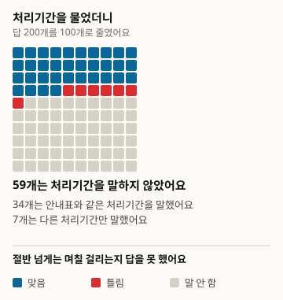
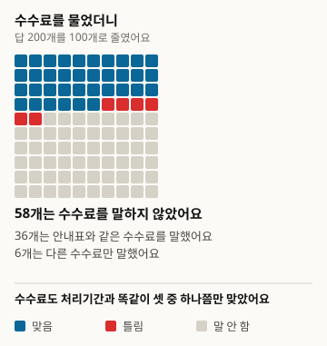
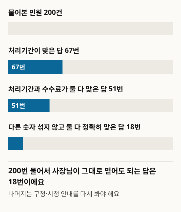
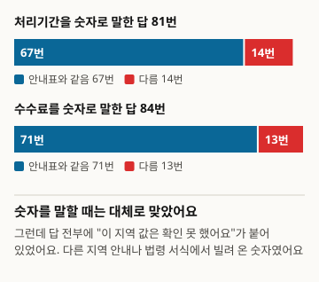

# When You Ask an AI How Long a Business Filing Takes and What It Costs, Does It Get It Right?

This is a translation. The reference version is the Korean original, version 1: https://define404.com/report/006-business-permit-fees/

We picked 200 filings that start a business from the civil service handbooks of six Korean municipalities, asked a web-search-enabled AI assistant for the processing time and fee of each, and checked the answers against the handbook values

- Author: Hawon Kim (Define404 Research)
- Date: 2026-11-10
- Type: Measurement report. 200 filings were newly queried and judged by rule.
- Preregistration: research repository commit 45ebc50 (2026-11-10 01:38 ICT). The prereg.md file, containing the hypotheses, sample, judging rules, and analysis method, was committed before data collection.
- DOI: https://doi.org/10.5281/zenodo.24091237
- Conflicts of interest: the author's company, Define404, is preparing an AI answer monitoring service and a per-shop AI visibility check. Its own products were not included in the study.

## Summary

We measured whether a small business owner who asks an AI assistant "If I file this business notification at the district office, how many days will it take and how much is the fee?" gets a correct answer. The ground truth was the civil service handbooks (민원사무편람) of six municipalities, published on the Public Data Portal (data.go.kr). Among the business notification, registration, and permit filings that have a single processing time and a single fee, we drew 200 at random from 218 and asked Claude Sonnet 5.5 with web search once per filing, in Korean. All 200 answers said they could not confirm the value for that municipality. The processing time matched the handbook in 67 answers (33.5%), the fee matched in 71 (35.5%), and both were exactly right with no other number mixed in for 18 answers (9.0%). Looking only at answers that stated a number, 82.7% of processing times and 84.5% of fees matched the handbook. Neither preregistered hypothesis was supported: H1 (fees are wrong more often than processing times) or H2 (filings with shorter processing times are answered more accurately). A post-collection review found defects in the judging rule and it was revised; the results under the original rule are reported unchanged in the appendix.

### Key results

- All 200 answers contained a statement that the value for that municipality could not be confirmed. When they gave a number, they borrowed it as a reference from another region's guidance or from a statutory form.
- The processing time was correct in 67 of 200 answers, 33.5% (95% confidence interval 27.3~40.3), and 119 answers (59.5%) did not state a processing time. The fee was correct in 71, 35.5% (29.2~42.3), and 116 answers (58.0%) did not state a fee.
- Answers that were exactly right on both processing time and fee, with no other number mixed in, numbered 18 of 200, 9.0% (5.8~13.8).
- On the same filings, the gap between fee accuracy and processing time accuracy was +2.0 percentage points (-3.9~7.9), so H1 was not supported. The gap in processing time accuracy between short and long filings was -1.6 percentage points (-14.8~11.5), so H2 was not supported either.

<!-- src: 005-business-permits/analysis/out/results.json#preregistered.cells.all, H1, H2; exploratory.hedged, given_claim -->

## 1 Introduction

To open a shop, an owner has to file a business notification, registration, or permit at the district or city office, and the type depends on the line of business. The processing time decides when they can start operating, and the fee ranges from free to tens of thousands of won depending on the filing. Municipalities publish these values in their civil service handbooks, but few owners go looking for a handbook file and open it. So more of them ask an AI assistant, "How many days will it take? How much is it?"

Studies that measured the accuracy of AI answers to public service questions dealt with English-speaking systems, such as UK government guidance (Majithia et al. 2026) and public information from several countries (Liu et al. 2026) (Section 2). We did not find, within the scope we checked, a report that asked a general-purpose AI assistant with web search about numbers fixed by a public guidance table, such as the processing time and fee of Korean municipal civil filings.

This study makes three contributions. First, we took the municipal civil service handbooks as ground truth, drew 200 business-start filings at random, and measured the accuracy of processing times and fees. Second, we separated answers that gave no number from answers that gave a different number, to see how many answers an owner could trust as they are. Third, we committed the sampling code, judging rules, and analysis code to the repository before collection, and we publish how we revised the rules after collection together with the audit results.

There are two hypotheses. H1 (primary, paired comparison) says that the share of answers giving the correct fee is lower than the share giving the correct processing time on the same filings. H2 (secondary) says that the share of answers giving the correct processing time is higher for filings with short processing times (immediate to 3 days) than for long ones (4 days or more). We expected that guessing a common value would be right more often for short filings.

## 2 Related Work

Studies that measure language model answers to public service questions have grown recently. Majithia et al. (2026) synthesized 22,000 pairs of UK citizen questions and answers from public gov.uk information to build the CitizenQuery-UK benchmark. Liu et al. (2026) evaluated 10 search agents on the CIVI benchmark, which covers public information from federal, state, and local governments in several countries; none reached the human baseline, and 72.1% of failures came from the search step. Gosciak et al. (2026) ran an experiment on how chatbot accuracy affects caseworker accuracy, using US SNAP counseling questions. On the Korean legal side, KBL (Kim et al. 2024) and KoBLEX (Lee et al. 2025) dealt with legal knowledge and reasoning grounded in statute articles.

These studies concern English-speaking systems, set the ground truth by expert judgment or synthetic answers, or dealt with legal reasoning. This study chose only two numbers that need no interpretation (processing time and fee), and the ground truth is the value in the guidance table the municipality published. The judging method follows the loose and strict scores of FreshQA (Vu et al. 2023), and the confidence intervals and paired differences follow Miller (2024). The rule of not interpreting cells with fewer than 40 cases comes from PopQA (Mallen et al. 2023). The design of asking an AI assistant with a public list as ground truth continues from Report No. 5 on support program deadlines (Define404 Research 2026).

## 3 Method

Figure 1. How we ran the study

<!-- src: 005-business-permits/analysis/make_figures.py; analysis/out/results.json -->

### 3.1 Population and sample

The ground truth source is the municipal civil service handbook files on the Public Data Portal (data.go.kr). On 2026-11-10 we downloaded 22 files using the search terms 민원편람 (civil handbook), 민원사무편람 (civil service handbook), and 민원사무현황 (civil service status), and used the 6 that have both a processing time column and a fee column. The files can be downloaded without a login or an authentication key.

Table 1. Ground truth sources (Public Data Portal files, received 2026-11-10)

| Municipality | Handbook reference date | Rows | Sample |
|---|---|---|---|
| Gangseo-gu, Seoul (서울특별시 강서구) | 2025-09-16 | 773 | 55 |
| Gimcheon-si, Gyeongsangbuk-do (경상북도 김천시) | 2025-09-03 | 500 | 40 |
| Siheung-si, Gyeonggi-do (경기도 시흥시) | 2026-09-11 | 498 | 34 |
| Gangneung-si, Gangwon Special Self-Governing Province (강원특별자치도 강릉시) | 2025-11-21 | 444 | 31 |
| Buk-gu, Daegu (대구광역시 북구) | 2026-09-03 | 426 | 21 |
| Changnyeong-gun, Gyeongsangnam-do (경상남도 창녕군) | 2025-11-25 | 373 | 19 |
| Total |  | 3,014 | 200 |

<!-- src: 005-business-permits/sampling/sample_log.txt; gate.md#1 -->

We kept only the filings made when starting a new business. A filing was included if its name contained '업' (business) and one of 신고 (notification), 등록 (registration), 허가 (permit), or 지정 (designation); filings that do not start a business, such as closure, suspension, change, succession, reissuance, and cancellation, were excluded (2,700 rows excluded). We also excluded filings whose processing time was not a single '즉시' (immediate) or 'N일' (N days), or whose fee was not a single '무료' (free) or 'N원' (N won) (94 rows). Filings whose electronic and in-person amounts differ, or that say "varies by type," fall here. Two rows whose filing name was shorter than 6 characters were also excluded. The 218 remaining candidates were sorted by file number and filing name, shuffled with seed 20261110, and the first 200 were drawn.

Of the 200 sampled filings, 89 have short processing times (immediate to 3 days) and 111 have long ones (4 days or more). By fee, 80 are free and 120 are paid. There is one answer per filing, so the number of filings, 200, is the effective sample size. The two groups for H2 are close to the 98 per group needed to detect a 20 percentage point difference at a 5% significance level with 80% power.

### 3.2 Questions

We built one Korean question for each filing. The template is "I am going to file '{civil service name}' at {municipality}. How many days does the processing take, and how much is the fee?" The municipality name and civil service name were inserted exactly as written in the handbook. The questions were split into 20 batches of 10, and the batch files contain only the questions.

### 3.3 Answering system

The answering system is a single condition: Claude Sonnet 5.5 with web search attached. We chose it because it is close to how people actually use AI. One call handled one batch (10 questions), and the respondent did not know the purpose of the study or the ground truth. The instructions told it to search for each question, answer in the language of the question, stop when a search limit message arrived, and record only the questions it had searched. Collection took place on 2026-11-10. Three questions dropped because of the search limit were collected again, so all 200 are valid. 197 answers used 1 search and 3 used 2.

### 3.4 Judging

Judging was done by rule code. It splits each answer into sentences, extracts the processing time and fee claims, and compares them with the handbook values.

- Processing time: from sentences containing words such as 처리 (processing), 소요 (required), 걸 (take), and 기간 (period), we extract 'N일' (N days) and '즉시' (immediate, including same-day and 8 hours or less). Date notations and deadlines for hygiene training or change notifications are excluded.
- Fee: from sentences containing words such as 수수료 (fee), 비용 (cost), and 납부 (payment), we extract amounts and '무료' (free, including no fee and exempt). Other money such as license tax, tax amounts, bonds, and deposits is excluded.
- For each item, no claimed value means unknown; the correct value inside the claimed values means correct (loose); a single claimed value equal to the correct one means correct (strict); no correct value among the claims means wrong.
- Both correct means that processing time and fee are both correct.

We did not use an LLM judge or two human judges. The number of answers that the rules could not decide and the hub judged directly is 0. The judging rule was revised once after collection (Section 3.6).

### 3.5 Analysis

All proportions carry Wilson 95% confidence intervals. Because there is one answer per filing, this equals a cluster-by-item interval. H1 is the 95% confidence interval of the paired difference (Miller 2024), fee correct minus processing time correct on the same filings, with a one-sided z test. H2 is the share of correct processing times for short filings minus that for long filings. The p values of the two hypotheses were Holm-corrected. The breakdowns by municipality, free versus paid, accuracy among answers that stated a number, and the direction of wrong answers are exploratory analyses not in the preregistration. We do not interpret cells with fewer than 40 cases.

### 3.6 Changes from the preregistration

After collection, the hub read the full text of 30 random answers (audit set, seed 20261110) and compared them with the values the rules extracted. In 10 of the 30, the registered rule (v1.0) extracted values wrongly. It counted amounts that the answer itself had excluded as "not applicable because it is a different line of business," it discarded a whole sentence when license tax was in the same sentence and so missed the real fee, and it missed "within 1 week" and "it takes 10 days."

So before interpreting the analysis results, we revised the rules to v1.1. Values in sentences containing a refusal expression are not counted, only the one amount after a word such as license tax is erased, and week units and the "it takes N days" form are counted as processing times. We measured the revised rules again on a new set of 30 random answers that does not overlap the audit set (validation set, seed 20261111). 8 of the 30 still had an extraction difference, and 7 of the 60 judgment cells (processing time and fee) differed from the human reading. The human reading was written down from the answer text alone, without looking at the ground truth.

Following Section 8 of the preregistration, we put the v1.0 results in Appendix B unchanged. Under both versions H1 and H2 are not supported, and the number of answers exactly right on both is 18 in both versions. What changed a lot is the wrong fees (25 in v1.0, 13 in v1.1).

Before collection, after looking at 2 pilot batches (20 filings), we added an exploratory column that only marks whether the phrase "could not confirm" is present. It was not used for judging.

## 4 Results

### 4.1 Processing time and fee

Table 2. Share of answers giving the correct processing time and fee (judging rule v1.1, parentheses show Wilson 95% confidence intervals)

| Item | Correct (loose) | Correct (strict) | Wrong | Not stated |
|---|---|---|---|---|
| Processing time | 67 (33.5%; 27.3~40.3) | 44 (22.0%; 16.8~28.2) | 14 (7.0%; 4.2~11.4) | 119 (59.5%; 52.6~66.1) |
| Fee | 71 (35.5%; 29.2~42.3) | 48 (24.0%; 18.6~30.4) | 13 (6.5%; 3.8~10.8) | 116 (58.0%; 51.1~64.6) |
| Both | 51 (25.5%; 20.0~32.0) | 18 (9.0%; 5.8~13.8) |  |  |

<!-- src: 005-business-permits/analysis/out/tables.md#표1~3; analysis/out/results.json#preregistered.cells.all -->

Figure 2. Out of 100 questions to the AI, answers that gave the correct processing time (200 filings reduced to 100 cells and rounded)

<!-- src: 005-business-permits/analysis/make_figures.py; analysis/out/results.json#preregistered.cells.all -->

Figure 3. Out of 100 questions to the AI, answers that gave the correct fee (200 filings reduced to 100 cells and rounded)

<!-- src: 005-business-permits/analysis/make_figures.py; analysis/out/results.json#preregistered.cells.all -->

For both processing time and fee, about one in three was correct, and more than half did not state a number. The paired difference between the loose and strict scores is 11.5 percentage points (7.1~15.9) for processing time and 11.5 percentage points (7.1~15.9) for fee. This means that about one answer in ten listed the correct value together with a value from another region or another procedure.

Figure 4. Only one answer in ten was exactly right on both processing time and fee

<!-- src: 005-business-permits/analysis/make_figures.py; analysis/out/results.json#preregistered.cells.all -->

### 4.2 Preregistered hypotheses

Table 3. Results of the preregistered hypothesis tests (differences in percentage points, parentheses show 95% confidence intervals)

| Hypothesis | Difference | One-sided p | Holm p | Verdict |
|---|---|---|---|---|
| H1 | +2.0 (-3.9~7.9) | 0.747 | 1.000 | Not supported |
| H2 | -1.6 (-14.8~11.5) | 0.597 | 1.000 | Not supported |

<!-- src: 005-business-permits/analysis/out/tables.md#표4; analysis/out/results.json#preregistered.H1, H2, cells.short, cells.long -->

H1 went in the opposite direction from the start. Fee accuracy was 2.0 percentage points higher than processing time accuracy, and the confidence interval includes 0. With this data, the accuracy of the two items cannot be told apart. H2 also showed no difference: 32.6% (23.7~42.9) for short filings (n=89) and 34.2% (26.1~43.5) for long filings (n=111). The assumption that the AI guesses a common value (3 days) is not supported by this data.

### 4.3 Exploratory: answers that gave a number, and "could not confirm"

From here on, these are exploratory analyses not in the preregistration.

All 200 answers contained the phrase "could not confirm the value for that municipality." The answers that gave a number cited another municipality's guidance, the processing time on a statutory form, or the fee table in an enforcement rule as a reference, and added "I could not confirm whether this applies as is in this region."

Looking only at answers that gave a number, 67 of the 81 that stated a processing time, 82.7% (73.1~89.4), matched the handbook. Among the 84 that stated a fee, 71, 84.5% (75.3~90.7), matched. Processing times and fees for business notification filings are often set by law or by a nationwide standard, so borrowing another region's value seems to have been right often.

Figure 5. When they gave a number it was mostly right, but all came with "could not confirm"

<!-- src: 005-business-permits/analysis/make_figures.py; analysis/out/results.json#exploratory.given_claim, hedged -->

The wrong answers also had a pattern. Of the wrong processing times, the 12 with a single claimed value all said a longer time than the handbook (cells under 40 cases are not interpreted). Of the 13 wrong fees, 8 stated an amount for a free filing, and 0 answers called a paid filing free.

Table 4. Accuracy by free and paid filings (exploratory, parentheses show Wilson 95% confidence intervals)

| Group | n | Processing time correct | Fee correct | Both exactly correct |
|---|---|---|---|---|
| Free filings | 80 | 17 (21.2%; 13.7~31.4) | 17 (21.2%; 13.7~31.4) | 5 (6.2%; 2.7~13.8) |
| Paid filings | 120 | 50 (41.7%; 33.2~50.6) | 54 (45.0%; 36.4~53.9) | 13 (10.8%; 6.4~17.7) |

<!-- src: 005-business-permits/analysis/out/results.json#preregistered.cells.free, paid -->

Accuracy was lower for free filings. Paid filings have a fee table that search finds easily, while free filings seem to have less source material. By municipality, Gangseo-gu (n=55) was correct on 19 processing times and 18 fees, and Gimcheon-si (n=40) on 13 processing times and 12 fees; the other four have fewer than 40 cases, so we do not interpret them.

<!-- src: 005-business-permits/analysis/out/results.json#exploratory.period_wrong_direction, fee_wrong_kind, by_city -->

## 5 Discussion

In this study, the AI assistant never said it had itself confirmed the processing time and fee of a municipal civil filing. Municipal civil service handbooks exist only as files on the Public Data Portal, and few web pages can be found directly by search. Instead, the AI found other regions' guidance or statutory forms and gave them as reference values, and those values matched the handbook in more than 80% of the answers that stated a number.

From the owner's side, two problems stack up. For more than half of the questions they get no number at all. When they do get a number, it is mixed with values from other regions or comes with a caveat that it could not be confirmed, so it is hard to trust as it is. Only one answer in ten was exactly right on both with no other number. In the end, nine times in ten the owner still has to check the district or city office guidance again.

The direction of the errors was also not the one that hurts the owner. Wrong processing times were longer than the handbook, and wrong fees were mostly an amount stated for a free filing. Wrongly saying that something is faster or costs nothing was rare. However, this cell has a small sample, so we cannot state it firmly.

The fact that we revised the judging rule after collection should be read with care. Each answer mixed "could not confirm" with reference values, so the rule that pulls numbers out of sentences was easily wrong. Even the revised rule differed from the human reading in 7 of 60 judgment cells on the 30-answer validation set. Proportions such as accuracy rates can move by a few percentage points. Still, two things are the same in both versions: all 200 answers said they could not confirm, and 18 answers were exactly right on both.

### What to do at the shop

- Check the processing time and fee of a business notification at the district or city office guidance or at Government24 (정부24), not from an AI answer. In this study only 18 of 200 answers were exactly right on both.
- If the AI says "I could not confirm it, but another district says 3 days," that is a reference value. It is not the value for your municipality.
- If a filing has no fee but the AI states an amount, check once more. This was the case for 8 of the 13 wrong fees.

## 6 Limitations

1. The answering system is a single condition, Claude Sonnet 5.5 with web search, so there is no comparison between models. Most questions got 1 search. A setting with more searches could change the results. One agent answered 10 questions in a row, so earlier questions may have influenced later ones.
2. We revised the judging rule after collection (Section 3.6). Even the revised rule differed from the human reading in 7 of 60 judgment cells on the 30-answer validation set. The original rule's results are in Appendix B.
3. The ground truth is the municipal handbook. If a handbook was slow to reflect a statute amendment, the AI answer could be right and the handbook wrong. The handbook reference dates differ, from 2025-09 to 2026-09.
4. The 6 municipalities are those that publish both the processing time and fee columns, so they are not randomly chosen municipalities. Only filings with a single processing time and fee were included, so filings with several amounts are missing.
5. We picked business-start filings mechanically by '업' in the filing name, so a few filings that are hard to call business-start, such as 사업개시신고 (business commencement notification) and 분실신고 (loss report), got in.
6. We put the filing name into the question as it is. This is an easier condition than the situation where an owner actually asks in vague terms.
7. Collection took one day, 2026-11-10. Search results change daily, so asking the same questions again could give different numbers.

## 7 Ethics and Conflicts of Interest

The filing names, processing times, and fees are information published by the municipalities, so we included them as they are in the public materials. We did not handle any information that could identify individuals. We did not put the original AI answer text in the public materials. The author's company, Define404, is preparing an AI answer monitoring service and a per-shop AI visibility check. Its own products were not included in the study. There is no external funding.

## 8 Reproduction

- Public repository: https://github.com/johndefine404/define404-research-public (path 005-business-permits)
- Ground truth source: 6 municipal civil service handbooks from the Public Data Portal (received 2026-11-10) sampling/raw/minwon_<number>.csv, hashes sampling/raw/SHA256SUMS, download script sampling/raw/download.sh
- Sample: sampling/draw_sample.py (seed 20261110), result sampling/sample.csv (SHA-256 f940f57621c88c8bd0fbcdcd84a984585ee51dfd58f540206570ed392fd11096, matched on two runs)
- Questions: collect/question_templates.json v1.0, batches collect/batches/, retries collect/batches_retry/
- Judging: judge/auto_judge.py (v1.1, result judge/judged.csv), judge/auto_judge_v10.py (registered rule v1.0, result judge/judged_v10.csv). Rule text judge/rules.md, audit judge/audit.py with audit_sample.json and audit_result.json
- Analysis: analysis/run_analysis.py. Results analysis/out/ (v1.1) and analysis/out_v10/ (v1.0), results.json and tables.md. The numbers in the manuscript were copied only from these files
- Figures: analysis/make_figures.py reads the numbers from analysis/out/results.json and creates report/figures/*.svg
- Preregistration: research repository commit 45ebc50 (2026-11-10 01:38 ICT). prereg.md was committed before collection
- Dependencies: standard library only
- Per-filing summary data (CSV): https://define404.com/report/data/006-business-permit-fees-summary.csv (filing name, ground truth, values extracted by the rule, and judgments under v1.1 and v1.0; no raw AI answers)

## References

- Majithia, N. 외 (2026). The CitizenQuery Benchmark: A Novel Dataset and Evaluation Pipeline for Measuring LLM Performance in Citizen Query Tasks. arXiv:2602.04064. https://arxiv.org/abs/2602.04064
- Liu, D. 외 (2026). CIVI: A Framework for Diagnosing Search Agent Failures in Civic Information. arXiv:2609.08094. https://arxiv.org/abs/2609.08094
- Gosciak, J. 외 (2026). LLMs in social services: How does chatbot accuracy affect human accuracy? arXiv:2603.11213. https://arxiv.org/abs/2603.11213
- Kim, Y. 외 (2024). Developing a Pragmatic Benchmark for Assessing Korean Legal Language Understanding in Large Language Models. arXiv:2410.08731. https://arxiv.org/abs/2410.08731
- Lee, J. 외 (2025). KoBLEX: Open Legal Question Answering with Multi-hop Reasoning. arXiv:2509.01324. https://arxiv.org/abs/2509.01324
- Vu, T. 외 (2023). FreshLLMs: Refreshing Large Language Models with Search Engine Augmentation. arXiv:2310.03214. https://arxiv.org/abs/2310.03214
- Mallen, A. 외 (2023). When Not to Trust Language Models: Investigating Effectiveness of Parametric and Non-Parametric Memories. arXiv:2212.10511. https://arxiv.org/abs/2212.10511
- Miller, E. (2024). Adding Error Bars to Evals: A Statistical Approach to Language Model Evaluations. arXiv:2411.00640. https://arxiv.org/abs/2411.00640
- Define404 Research (2026). When You Ask an AI About a Government Support Program, Does It Get the Deadline Right? https://define404.com/report/005-support-program-deadlines/

## Appendix A Summary of Judging Rules (v1.1)

- Processing time: only sentences containing one of 처리 (processing), 소요 (required), 걸 (take), 기간 (period), 기한 (deadline), 발급 (issuance), or 완료 (completion) are examined. Sentences with a refusal expression (적용되지 않 (does not apply), 적용할 수 없 (cannot apply), 다른 업종 (different line of business), 다른 절차 (different procedure), and so on) are skipped. 즉시 (immediate), 당일 (same day), 바로 처리 (processed right away), and 8 hours or less count as '즉시'; N일, N영업일 (business days), and N근무일 (working days) count as 'N일'; N주 (weeks) counts as 7N days; for a range such as 3~5일, both end values are counted. Date notations and hygiene training or business-start deadlines are excluded.
- Fee: only sentences containing one of 수수료 (fee), 비용 (cost), 납부 (payment), 요금 (charge), 인지 (stamp), or 금액 (amount) are examined, and sentences with a refusal expression are skipped. An amount within 25 characters after words such as 면허세 (license tax), 세액 (tax amount), 채권 (bond), 예치금 (deposit), 평가 (evaluation), and 과태료 (fine) is erased. 무료, 수수료 없음 (no fee), 면제 (exempt), and 0원 count as '무료'; 28,000원, 2만 8천 원, and 2.8만 원 are converted to integers in won.
- Score: no claimed value means unknown; the correct value inside the claimed values means correct (loose); a single claimed value equal to the correct one means correct (strict); anything else is wrong.
- Differences from the registered rule v1.0: skipping sentences with a refusal expression, erasing only the one amount after an excluded word instead of the whole sentence, and accepting week units and the "it takes N days" form.

## Appendix B Results Under the Registered Rule v1.0

Following Section 8 of the preregistration, we give the results of applying the registered judging rule (v1.0) as it was.

Table 5. Accuracy under the registered rule v1.0 (parentheses show Wilson 95% confidence intervals)

| Item | Correct (loose) | Correct (strict) | Wrong | Not stated |
|---|---|---|---|---|
| Processing time | 71 (35.5%; 29.2~42.3) | 49 (24.5%; 19.1~30.9) | 16 (8.0%; 5.0~12.6) | 113 (56.5%; 49.6~63.2) |
| Fee | 71 (35.5%; 29.2~42.3) | 50 (25.0%; 19.5~31.4) | 25 (12.5%; 8.6~17.8) | 104 (52.0%; 45.1~58.8) |
| Both | 46 (23.0%; 17.7~29.3) | 18 (9.0%; 5.8~13.8) |  |  |

<!-- src: 005-business-permits/analysis/out_v10/results.json#preregistered.cells.all -->

Table 6. Hypothesis tests under the registered rule v1.0 (differences in percentage points, parentheses show 95% confidence intervals)

| Hypothesis | Difference | One-sided p | Holm p | Verdict |
|---|---|---|---|---|
| H1 | +0.0 (-6.9~6.9) | 0.500 | 1.000 | Not supported |
| H2 | -1.2 (-14.5~12.1) | 0.570 | 1.000 | Not supported |

<!-- src: 005-business-permits/analysis/out_v10/results.json#preregistered.H1, H2 -->

Under v1.0, the accuracy among answers that stated a number is 71 of 87 processing times (81.6%) and 71 of 96 fees (74.0%). Wrong fees are more numerous than under v1.1 because amounts that the answer itself had excluded were counted as claims.

<!-- src: 005-business-permits/analysis/out_v10/results.json#exploratory.given_claim -->

## Appendix C Changes from the Preregistration

| Item | Preregistered | Executed |
|---|---|---|
| Judging rule | v1.0 (sentence-level extraction, whole sentence excluded when an exclusion word is present) | v1.1 (skip refusal sentences, exclude by amount, accept week units). v1.0 results are in Appendix B |
| Rule audit | None | Found defects with the 30-answer audit set and measured v1.1 on the 30-answer validation set (7 of 60 judgment cells differed) |
| Exploratory cells | By municipality, free versus paid, direction of wrong answers | After viewing the 20-filing pilot, added a "could not confirm" marker column; after collection, added the accuracy among answers that stated a number |
| Direct judging by the hub | Only answers the rules could not decide | 0 |
| Collection | 2026-11-10, 3 batches in parallel | 2026-11-10, 3 to 10 batches in parallel. 3 questions dropped by the search limit were filled by retry |
