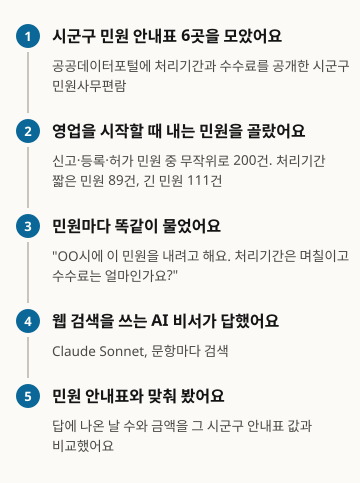
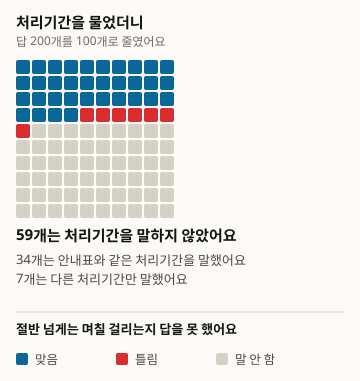
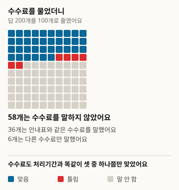
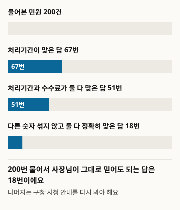
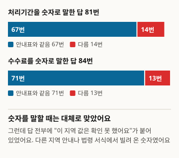

# AIに営業届出の処理期間と手数料を尋ねると、正しく教えてくれるのか

本稿は翻訳版です。基準版は韓国語、バージョン1です: https://define404.com/report/006-business-permit-fees/

市区郡6か所の民願案内表から、営業を始めるときに出す民願200件を抽出し、ウェブ検索を使うAIアシスタントに処理期間と手数料を尋ねて、案内表の値と照合しました

- 著者: 金夏原(キム・ハウォン、Define404 Research)
- 日付: 2026-11-10
- 種別: 測定報告。民願200件を新たに質問し、規則で判定しました。
- 事前登録: 研究リポジトリのコミット45ebc50(2026-11-10 01:38 ICT)。収集前に仮説・標本・判定規則・分析方法を記したprereg.mdをコミットしました。
- DOI: https://doi.org/10.5281/zenodo.24091237
- 利益相反: 著者が所属するDefine404は、AI回答モニタリングと店舗別AI露出診断のサービスを準備しています。自社製品は調査対象に含めていません。

## 要約

小さな店の店主がAIアシスタントに「区役所にこの営業届出を出すと何日かかって、手数料はいくらですか」と尋ねたとき、正しい答えが返ってくるかを測りました。正解は、公共データポータルで公開されている市区郡6か所の民願事務便覧としました。営業の届出・登録・許可の民願のうち、処理期間と手数料がそれぞれ1つに定まる218件から200件を無作為に抽出し、ウェブ検索を使うClaude Sonnet 5.5に韓国語で1件ずつ尋ねました。200件すべてが、その市区郡の値は確認できなかったと答えました。処理期間が案内表と一致した回答は67件(33.5%)、手数料が一致した回答は71件(35.5%)で、他の数字を混ぜずに両方を正確に当てた回答は18件(9.0%)でした。数字を述べた回答だけを見ると、処理期間の82.7%、手数料の84.5%が案内表と同じでした。事前登録した仮説H1(手数料の方が処理期間より外れる)とH2(処理期間が短い民願の方がよく当たる)は、どちらも支持されませんでした。判定規則は収集後の検収で欠陥が見つかって修正し、元の規則による結果は付録にそのまま掲載しました。

### 主な結果

- 200件すべてに「その市区郡の値は確認できなかった」という趣旨の文言が含まれていました。数字を述べるときは、他の地域の案内や法令の様式を参考として借りていました。
- 処理期間が一致した回答は200件中67件、33.5%(95%信頼区間27.3~40.3)で、119件(59.5%)は処理期間を述べませんでした。手数料が一致した回答は71件、35.5%(29.2~42.3)で、116件(58.0%)は述べませんでした。
- 他の数字を混ぜずに処理期間と手数料の両方を正確に当てた回答は、200件中18件、9.0%(5.8~13.8)です。
- 同じ民願での手数料の正答率と処理期間の正答率の差は+2.0ポイント(-3.9~7.9)で、H1は支持されませんでした。短い民願と長い民願の処理期間の正答率の差は-1.6ポイント(-14.8~11.5)で、H2も支持されませんでした。

<!-- src: 005-business-permits/analysis/out/results.json#preregistered.cells.all, H1, H2; exploratory.hedged, given_claim -->

## 1 はじめに

店を開くには、業種ごとに区役所や市役所へ営業の届出、登録、許可の民願を出す必要があります。いつ営業を始められるかは処理期間で決まり、手数料は民願ごとに無料から数万ウォンまでさまざまです。この値は市区郡が民願事務便覧として公開していますが、店主が便覧のファイルを探して開くことはまれです。そのため、AIアシスタントに「何日かかりますか。いくらですか」と尋ねることが増えています。

公共サービスに関する質問へのAI回答の正確さを測った研究は、英国政府の案内(Majithiaら 2026)や複数国の公共情報(Liuら 2026)のように、英語圏の制度を扱ってきました(2節)。韓国の市区郡民願の処理期間・手数料のように、公開された案内表で正解が固定される数字を、ウェブ検索を使う一般的なAIアシスタントに尋ねて測った報告は、確認した範囲では見つかりませんでした。

本調査の貢献は三つです。市区郡の民願事務便覧を正解として、営業開始の民願200件を無作為に抽出し、処理期間・手数料の正答率を測りました。AIが数字を述べなかった場合と、別の数字を述べた場合を分けて、店主がそのまま信じてよい回答がどれだけあるかを調べました。標本抽出コード、判定規則、分析コードを収集前にリポジトリにコミットし、収集後に規則を直した経緯と検収結果もあわせて公開しました。

仮説は二つです。H1(一次、対比較)は、同じ民願で手数料を正しく述べる割合が、処理期間を正しく述べる割合より低いという仮説です。H2(二次)は、処理期間を正しく述べる割合が、処理期間の短い民願(即時~3日)で、長い民願(4日以上)より高いという仮説です。よくある値を推測で述べるなら、短い民願の方が当たりやすいと考えました。

## 2 関連研究

公共サービスの質問に対する言語モデルの回答を測る研究が、近年増えています。Majithiaら(2026)は、gov.uk の公開情報から英国市民の質問と回答2万2千組を合成し、CitizenQuery-UKベンチマークを作りました。Liuら(2026)は、複数国の連邦・州・地方政府の公共情報を扱うCIVIベンチマークで検索エージェント10種を評価し、どれも人間の基準線に届かず、失敗の72.1%が検索の段階で起きたと報告しました。Gosciakら(2026)は、米国のSNAP相談の設問を使って、チャットボットの正確さが相談員の正確さに与える影響を実験しました。韓国の法律分野では、KBL(Kimら 2024)とKoBLEX(Leeら 2025)が、法律知識と条文根拠に基づく推論を扱いました。

これらの研究は、英語圏の制度を扱うか、正解を専門家の判定や合成回答で定めるか、法律推論を扱うものでした。今回の調査は、解釈の要らない数字2つ(処理期間、手数料)だけを選び、正解は市区郡が公開した案内表の値としました。判定方式はFreshQA(Vuら 2023)の緩やかな点数と厳格な点数の二つを、信頼区間と対差はMiller(2024)に従いました。標本が40未満の欄を解釈しない基準は、PopQA(Mallenら 2023)から取りました。公開されている一覧を正解としてAIアシスタントに尋ねる設計は、5号の支援事業締切日調査(Define404 Research 2026)とつながっています。

## 3 調査方法

図1. こうして調べました

<!-- src: 005-business-permits/analysis/make_figures.py; analysis/out/results.json -->

### 3.1 母集団と標本

正解の出どころは、公共データポータル(data.go.kr)にある市区郡の民願事務便覧のファイルです。2026-11-10に、検索語の民願便覧・民願事務便覧・民願事務現況でファイル22個を取得し、そのうち処理期間と手数料の欄が両方あった6個を使いました。ファイルはログインや認証キーなしで取得できます。

表1. 正解の出どころ(公共データポータルのファイル、2026-11-10受信)

| 市区郡 | 便覧基準日 | 行 | 標本 |
|---|---|---|---|
| ソウル特別市 江西区(강서구) | 2025-09-16 | 773 | 55 |
| 慶尚北道 金泉市(김천시) | 2025-09-03 | 500 | 40 |
| 京畿道 始興市(시흥시) | 2026-09-11 | 498 | 34 |
| 江原特別自治道 江陵市(강릉시) | 2025-11-21 | 444 | 31 |
| 大邱広域市 北区(북구) | 2026-09-03 | 426 | 21 |
| 慶尚南道 昌寧郡(창녕군) | 2025-11-25 | 373 | 19 |
| 合計 |  | 3,014 | 200 |

<!-- src: 005-business-permits/sampling/sample_log.txt; gate.md#1 -->

営業を新しく始めるときに出す民願だけを残しました。民願名に「業」と、届出・登録・許可・指定のいずれかが含まれるものを入れ、廃業・休業・変更・承継・再発行・取消のように営業開始ではない民願は除きました(2,700行を除外)。処理期間が「即時」か「N日」の1つでないもの、手数料が「無料」か「N원(ウォン)」の1つでないものも除きました(94行)。電子と窓口で金額が異なる民願や「類型別に相違」とある民願が、ここに入ります。民願名が6文字未満の2行も除きました。残った候補218件をファイル番号と民願名で並べ替え、シード20261110で混ぜて、先頭の200件を抽出しました。

標本200件のうち、処理期間が短い民願(即時~3日)が89件、長い民願(4日以上)が111件です。手数料は無料が80件、有料が120件です。民願1件に回答1つなので、民願数の200が実効標本です。H2の2群は、20ポイントの差を有意水準5%、検出力80%で検出するのに必要な1群98件に近い規模です。

### 3.2 質問

民願ごとに質問を韓国語で1つ作りました。質問の型は「{市区郡}に『{民願事務名}』民願を出そうと思います。処理期間は何日で、手数料はいくらですか」です。市区郡名と民願事務名は、便覧の表記のまま入れました。質問は10問ずつ20バッチに分け、バッチファイルには質問だけが入っています。

### 3.3 回答システム

回答システムは、Claude Sonnet 5.5にウェブ検索を付けた1条件です。人が実際に使う形に近いので選びました。1回の呼び出しが1バッチ(10問)を受け持ち、回答者は調査の目的と正解を知りません。指示文には、設問ごとに検索し、質問の言語で答え、検索上限のメッセージが来たら止まって検索した設問だけを記録するよう書きました。収集は2026-11-10に行いました。検索上限で抜けた3問は取り直し、200件すべてが有効です。197件は検索1回、3件は2回でした。

### 3.4 判定

判定は規則のコードで行いました。回答を文に分け、処理期間と手数料の主張値を取り出して、案内表の値と比べます。

- 処理期間: 処理・所要・かかる・期間といった語を含む文から、「N日」と「即時」(当日、8時間以下を含む)を取り出します。日付の表記と、衛生教育・変更届の期限は除きます。
- 手数料: 手数料・費用・納付といった語を含む文から、金額と「無料」(手数料なし・免除)を取り出します。免許税・税額・債券・預託金のような他の金銭は除きます。
- 項目ごとに、主張値がなければ不明、正解が主張値の中にあれば正答(緩やか)、主張値が正解1つだけなら正答(厳格)、正解がなければ誤りです。
- 両方正答は、処理期間と手数料がともに正答の場合です。

LLM判定者と人間2名の判定は使いませんでした。規則で分けられず、ハブが直接判定した回答は0件です。判定規則は収集後に一度修正しました(3.6節)。

### 3.5 分析

すべての割合にウィルソンの95%信頼区間を付けました。民願ごとに回答が1つなので、対象単位のクラスター区間と同じです。H1は、同じ民願の手数料正答から処理期間正答を引いた対差(Miller 2024)の95%信頼区間と、片側z検定です。H2は、短い民願の処理期間正答の割合から長い民願の割合を引いた差です。2つの仮説のp値にはHolm補正をかけました。市区郡別、無料・有料別、数字を述べた回答の正答率、誤りの方向は、事前登録にない探索分析です。標本が40未満の欄は解釈しません。

### 3.6 事前登録からの変更点

収集後に、無作為の30件(検収用、シード20261110)の回答原文をハブが直接読み、規則が取り出した値と突き合わせました。30件のうち10件で、登録規則(v1.0)が値を誤って取り出していました。回答自身が「別の業種なので適用できない」と除外した金額を数えていたこと、免許税が同じ文にあると文ごと捨てて本物の手数料を逃していたこと、「1週間以内」や「10日かかる」を見逃していたことです。

そこで、分析結果を解釈する前に規則をv1.1に直しました。拒否表現のある文の値は数えず、免許税のような語の後の金額1つだけを消し、週単位と「N日かかります」の形を処理期間として数えます。直した規則は、検収用と重ならない新しい無作為30件(検証用、シード20261111)で測り直しました。30件のうち8件に抽出の差が残り、判定60欄(処理期間・手数料)のうち7欄が人間の読み取りと異なりました。人間の読み取りは、正解を見ずに回答原文だけを読んで記録しました。

事前登録の8節に従い、v1.0の結果を付録Bにそのまま掲載しました。どちらの版でもH1・H2は支持されず、両方を正確に当てた回答はどちらの版でも18件です。大きく変わったのは手数料の誤りです(v1.0は25件、v1.1は13件)。

収集前に試験2バッチ(20件)を見て、「確認できなかった」という文言があるかどうかだけを記録する欄を、探索用に加えました。判定には使っていません。

## 4 結果

### 4.1 処理期間と手数料

表2. 処理期間と手数料を正しく述べた割合(判定規則v1.1、括弧内はウィルソン95%信頼区間)

| 項目 | 正答(緩やか) | 正答(厳格) | 誤り | 述べず |
|---|---|---|---|---|
| 処理期間 | 67 (33.5%; 27.3~40.3) | 44 (22.0%; 16.8~28.2) | 14 (7.0%; 4.2~11.4) | 119 (59.5%; 52.6~66.1) |
| 手数料 | 71 (35.5%; 29.2~42.3) | 48 (24.0%; 18.6~30.4) | 13 (6.5%; 3.8~10.8) | 116 (58.0%; 51.1~64.6) |
| 両方 | 51 (25.5%; 20.0~32.0) | 18 (9.0%; 5.8~13.8) |  |  |

<!-- src: 005-business-permits/analysis/out/tables.md#표1~3; analysis/out/results.json#preregistered.cells.all -->

図2. AIに100回尋ねたとき、処理期間を正しく述べた回答(200件を100マスに縮めて四捨五入しました)

<!-- src: 005-business-permits/analysis/make_figures.py; analysis/out/results.json#preregistered.cells.all -->

図3. AIに100回尋ねたとき、手数料を正しく述べた回答(200件を100マスに縮めて四捨五入しました)

<!-- src: 005-business-permits/analysis/make_figures.py; analysis/out/results.json#preregistered.cells.all -->

処理期間も手数料も3回に1回ほど当たり、半数を超える回答は数字を述べませんでした。緩やかな点数と厳格な点数の対差は、処理期間が11.5ポイント(7.1~15.9)、手数料が11.5ポイント(7.1~15.9)です。正しい値と一緒に、他の地域や他の手続きの値を並べて書いた回答が、10件に1件ほどあるという意味です。

図4. 処理期間と手数料を両方とも正確に当てた回答は、10件に1件です

<!-- src: 005-business-permits/analysis/make_figures.py; analysis/out/results.json#preregistered.cells.all -->

### 4.2 事前登録した仮説

表3. 事前登録した仮説の検定結果(差はポイント、括弧内は95%信頼区間)

| 仮説 | 差 | 片側p | Holm p | 判定 |
|---|---|---|---|---|
| H1 | +2.0 (-3.9~7.9) | 0.747 | 1.000 | 支持されず |
| H2 | -1.6 (-14.8~11.5) | 0.597 | 1.000 | 支持されず |

<!-- src: 005-business-permits/analysis/out/tables.md#표4; analysis/out/results.json#preregistered.H1, H2, cells.short, cells.long -->

H1は方向からして逆でした。手数料の正答率が処理期間より2.0ポイント高く、信頼区間は0を含みます。2つの項目の正答率は、このデータでは区別できません。H2も、短い民願(n=89)32.6%(23.7~42.9)、長い民願(n=111)34.2%(26.1~43.5)で、差はありませんでした。AIがよくある値(3日)を推測で述べるという想定は、このデータでは支持されません。

### 4.3 探索: 数字を述べた回答と「確認できませんでした」

ここからは、事前登録にない探索分析です。

200件すべての回答に、「その市区郡の値は確認できなかった」という趣旨の文言がありました。数字を述べた回答は、他の市区郡の案内、法令様式の処理期間、施行規則の手数料表を参考として挙げ、「この地域にそのまま適用されるかは確認できなかった」と付け加えていました。

数字を述べた回答だけを見ると、処理期間を述べた81件のうち67件、82.7%(73.1~89.4)が案内表と同じでした。手数料を述べた84件では、71件、84.5%(75.3~90.7)が同じでした。営業届出の民願の処理期間と手数料は、法令や全国共通の基準で定まっている場合が多く、他の地域の値を借りてきても、しばしば当たったものと見られます。

図5. 数字を述べたときはおおむね当たっていたが、すべてに「確認できませんでした」が付いていました

<!-- src: 005-business-permits/analysis/make_figures.py; analysis/out/results.json#exploratory.given_claim, hedged -->

誤った回答にも傾向がありました。処理期間が誤りだった回答のうち、主張値が1つの12件は、すべて案内表より長く述べていました(標本が40未満なので解釈しません)。手数料が誤りだった13件のうち8件は、無料の民願に金額を述べたもので、有料の民願を無料と述べた回答は0件でした。

表4. 無料・有料の民願別の正答率(探索、括弧内はウィルソン95%信頼区間)

| 区分 | n | 処理期間正答 | 手数料正答 | 両方正確に正答 |
|---|---|---|---|---|
| 無料の民願 | 80 | 17 (21.2%; 13.7~31.4) | 17 (21.2%; 13.7~31.4) | 5 (6.2%; 2.7~13.8) |
| 有料の民願 | 120 | 50 (41.7%; 33.2~50.6) | 54 (45.0%; 36.4~53.9) | 13 (10.8%; 6.4~17.7) |

<!-- src: 005-business-permits/analysis/out/results.json#preregistered.cells.free, paid -->

無料の民願で正答率が低くなりました。有料の民願は手数料表があるので検索に引っかかりやすく、無料の民願は根拠資料が少ないためと見られます。市区郡別では、江西区(n=55)が処理期間19件、手数料18件、金泉市(n=40)が処理期間13件、手数料12件で正答し、残りの4か所は標本が40未満なので解釈しません。

<!-- src: 005-business-permits/analysis/out/results.json#exploratory.period_wrong_direction, fee_wrong_kind, by_city -->

## 5 考察

今回の調査で、AIアシスタントが市区郡民願の処理期間と手数料を自分で確認したと述べたことは、一度もありませんでした。市区郡の民願事務便覧は公共データポータルにファイルとしてしかなく、検索ですぐ見つかるウェブページはまれです。AIは代わりに他の地域の案内や法令の様式を探して参考値として示し、その値は数字を述べた回答の80%超で案内表と同じでした。

店主の側から見ると、二つのことが重なります。半数を超える場合は、数字そのものを受け取れません。数字を受け取っても、他の地域の値が混ざっていたり、「確認できなかった」という断り書きが付いていたりして、そのまま信じにくいです。他の数字なしで両方が正確に当たった回答は、10件に1件です。結局、区役所・市役所の案内を見直す必要がある場合が、10件のうち9件になります。

誤りの方向も、店主に不利な側ではありませんでした。処理期間を誤った回答は案内表より長く述べ、手数料を誤った回答は無料の民願にお金を述べた場合が多くありました。もっと早くできる、お金がかからないと誤って案内した場合はまれでした。ただし、この欄は標本が小さく、断定はできません。

判定規則を収集後に直した点は、慎重に読む必要があります。回答ごとに「確認できなかった」と参考値が混ざっていて、文から数字を取り出す規則が簡単に間違えました。直した規則も、検証用30件で判定60欄のうち7欄が人間の読み取りと異なりました。正答率などの割合は、数ポイントの範囲で揺れる可能性があります。それでも、200件すべてが確認できなかったと答えた点と、両方を正確に当てた回答が18件である点は、2つの版で同じです。

### 店でいますぐできること

- 営業届出の処理期間と手数料は、AIの回答ではなく、区役所・市役所の民願案内や政府24(정부24)で確認してください。今回の調査で、両方を正確に当てた回答は200件中18件でした。
- AIが「確認できませんでしたが、他の区役所は3日です」と言ったら、それは参考値です。その市区郡の値ではありません。
- 手数料がかからない民願なのにAIが金額を述べたら、もう一度確認してください。手数料が誤りだった13件のうち8件が、このケースでした。

## 6 限界

1. 回答システムがClaude Sonnet 5.5のウェブ検索条件1つだけなので、モデル間の比較はありません。設問あたりの検索は大半が1回でした。検索をもっと多くする設定なら、結果が変わる可能性があります。1つのエージェントが10問を続けて答えたため、前の設問が後ろの設問に影響した可能性があります。
2. 判定規則を収集後に直しました(3.6節)。直した規則も、検証用30件で判定60欄のうち7欄が人間の読み取りと異なりました。元の規則の結果は付録Bにあります。
3. 正解が市区郡の便覧です。便覧が法令改正の反映に遅れていれば、AIの回答が正しく便覧が誤っている場合もあります。便覧の基準日は、2025-09から2026-09までと、互いに異なります。
4. 6市区郡は、処理期間・手数料の欄を両方公開している所であり、無作為に選んだ市区郡ではありません。処理期間・手数料が1つに定まる民願だけを入れたため、金額が複数ある民願は抜けています。
5. 民願名に「業」が含まれる営業開始の民願を機械的に選んだため、事業開始届や紛失届のように営業開始とは見なしにくい民願も、数件入りました。
6. 民願名をそのまま入れて尋ねました。店主が実際にぼんやりと尋ねる状況より、易しい条件です。
7. 収集は2026-11-10の1日だけです。検索結果は日々変わるため、同じ質問をもう一度すると数字が変わる可能性があります。

## 7 倫理と利益相反

民願名、処理期間、手数料は市区郡が公開した情報なので、公開資料にそのまま載せました。個人を特定できる情報は扱っていません。AIの回答原文は公開資料に入れていません。著者が所属するDefine404は、AI回答モニタリングと店舗別AI露出診断のサービスを準備しています。自社製品は調査対象に含めていません。外部の研究費はありません。

## 8 再現方法

- 公開リポジトリ: https://github.com/johndefine404/define404-research-public (パス 005-business-permits)
- 正解の出どころ: 公共データポータルの市区郡民願事務便覧6件(2026-11-10受信) sampling/raw/minwon_<番号>.csv、ハッシュ sampling/raw/SHA256SUMS、取得スクリプト sampling/raw/download.sh
- 標本: sampling/draw_sample.py(シード20261110)、結果 sampling/sample.csv (SHA-256 f940f57621c88c8bd0fbcdcd84a984585ee51dfd58f540206570ed392fd11096、2回実行で一致)
- 質問: collect/question_templates.json v1.0、バッチ collect/batches/、再試行 collect/batches_retry/
- 判定: judge/auto_judge.py(v1.1、結果 judge/judged.csv)、judge/auto_judge_v10.py(登録規則v1.0、結果 judge/judged_v10.csv)。規則本文 judge/rules.md、検収 judge/audit.pyとaudit_sample.json・audit_result.json
- 分析: analysis/run_analysis.py。結果 analysis/out/(v1.1)、analysis/out_v10/(v1.0)のresults.json、tables.md。原稿の数字は、このファイルからのみ転記しました
- 図: analysis/make_figures.pyがanalysis/out/results.jsonから数字を読み、report/figures/*.svgを作ります
- 事前登録: 研究リポジトリのコミット45ebc50 (2026-11-10 01:38 ICT)。収集前にprereg.mdをコミットしました
- 依存関係: 標準ライブラリのみ使います
- 民願別の要約データ(CSV): https://define404.com/report/data/006-business-permit-fees-summary.csv (民願名、正解、規則が抽出した値、判定v1.1・v1.0。AIの回答原文は含みません)

## 参考文献

- Majithia, N. 외 (2026). The CitizenQuery Benchmark: A Novel Dataset and Evaluation Pipeline for Measuring LLM Performance in Citizen Query Tasks. arXiv:2602.04064. https://arxiv.org/abs/2602.04064
- Liu, D. 외 (2026). CIVI: A Framework for Diagnosing Search Agent Failures in Civic Information. arXiv:2609.08094. https://arxiv.org/abs/2609.08094
- Gosciak, J. 외 (2026). LLMs in social services: How does chatbot accuracy affect human accuracy? arXiv:2603.11213. https://arxiv.org/abs/2603.11213
- Kim, Y. 외 (2024). Developing a Pragmatic Benchmark for Assessing Korean Legal Language Understanding in Large Language Models. arXiv:2410.08731. https://arxiv.org/abs/2410.08731
- Lee, J. 외 (2025). KoBLEX: Open Legal Question Answering with Multi-hop Reasoning. arXiv:2509.01324. https://arxiv.org/abs/2509.01324
- Vu, T. 외 (2023). FreshLLMs: Refreshing Large Language Models with Search Engine Augmentation. arXiv:2310.03214. https://arxiv.org/abs/2310.03214
- Mallen, A. 외 (2023). When Not to Trust Language Models: Investigating Effectiveness of Parametric and Non-Parametric Memories. arXiv:2212.10511. https://arxiv.org/abs/2212.10511
- Miller, E. (2024). Adding Error Bars to Evals: A Statistical Approach to Language Model Evaluations. arXiv:2411.00640. https://arxiv.org/abs/2411.00640
- Define404 Research (2026). AIに支援事業の公募を尋ねると、締切日を正しく教えてくれるのか. https://define404.com/report/005-support-program-deadlines/

## 付録A 判定規則の要約(v1.1)

- 処理期間: 処理・所要・かかる・期間・期限・発給・完了のいずれかがある文だけを見ます。拒否表現(適用されない・適用できない・別の業種・別の手続きなど)がある文は飛ばします。即時・当日・すぐ処理・8時間以下は「即時」、N日・N営業日・N勤務日は「N日」、N週は7N日、範囲3~5日は両端の値をどちらも数えます。日付の表記と、衛生教育・営業開始の期限は除きます。
- 手数料: 手数料・費用・納付・料金・印紙・金額のいずれかがある文だけを見て、拒否表現がある文は飛ばします。免許税・税額・債券・預託金・評価・過怠金のような語の後25字以内の金額は消します。無料・手数料なし・免除・0원は「無料」、28,000원・2万8千원・2.8万원は、ウォン単位の整数に直します。
- 点数: 主張値がなければ不明、正解が主張値の中にあれば正答(緩やか)、主張値が正解1つだけなら正答(厳格)、それ以外は誤りです。
- 登録規則v1.0との違い: 拒否表現の文を飛ばすこと、除外語がある文全体ではなくその後の金額1つだけを消すこと、週単位と「N日かかります」の形を認めることです。

## 付録B 登録規則v1.0の結果

事前登録の8節に従い、登録した判定規則(v1.0)をそのまま適用した結果を載せます。

表5. 登録規則v1.0の正答率(括弧内はウィルソン95%信頼区間)

| 項目 | 正答(緩やか) | 正答(厳格) | 誤り | 述べず |
|---|---|---|---|---|
| 処理期間 | 71 (35.5%; 29.2~42.3) | 49 (24.5%; 19.1~30.9) | 16 (8.0%; 5.0~12.6) | 113 (56.5%; 49.6~63.2) |
| 手数料 | 71 (35.5%; 29.2~42.3) | 50 (25.0%; 19.5~31.4) | 25 (12.5%; 8.6~17.8) | 104 (52.0%; 45.1~58.8) |
| 両方 | 46 (23.0%; 17.7~29.3) | 18 (9.0%; 5.8~13.8) |  |  |

<!-- src: 005-business-permits/analysis/out_v10/results.json#preregistered.cells.all -->

表6. 登録規則v1.0の仮説検定(差はポイント、括弧内は95%信頼区間)

| 仮説 | 差 | 片側p | Holm p | 判定 |
|---|---|---|---|---|
| H1 | +0.0 (-6.9~6.9) | 0.500 | 1.000 | 支持されず |
| H2 | -1.2 (-14.5~12.1) | 0.570 | 1.000 | 支持されず |

<!-- src: 005-business-permits/analysis/out_v10/results.json#preregistered.H1, H2 -->

v1.0では、数字を述べた回答の正答率は、処理期間が87件中71件(81.6%)、手数料が96件中71件(74.0%)です。v1.1より手数料の誤りが多いのは、回答自身が除外した金額まで主張として数えたためです。

<!-- src: 005-business-permits/analysis/out_v10/results.json#exploratory.given_claim -->

## 付録C 事前登録との相違

| 項目 | 事前登録 | 実行 |
|---|---|---|
| 判定規則 | v1.0(文単位の抽出、除外語がある文全体を除外) | v1.1(拒否文を飛ばす、金額単位で除外、週単位を認める)。v1.0の結果は付録B |
| 規則の検収 | なし | 検収用30件で欠陥を見つけ、検証用30件でv1.1を測定(判定60欄のうち7欄が相違) |
| 探索欄 | 市区郡別、無料・有料別、誤りの方向 | 試験20件を見たあと「確認できなかった」の表示欄を追加し、収集後に数字を述べた回答の正答率を追加 |
| ハブによる直接判定 | 規則で分けられない回答だけ | 0件 |
| 収集 | 2026-11-10、バッチ3つずつ並列 | 2026-11-10、バッチ3~10個を並列。検索上限で抜けた3問は再試行で補充 |
