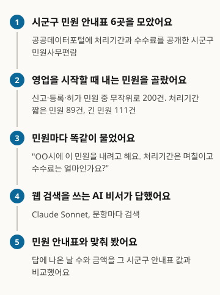
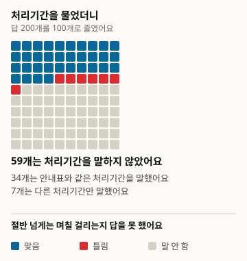
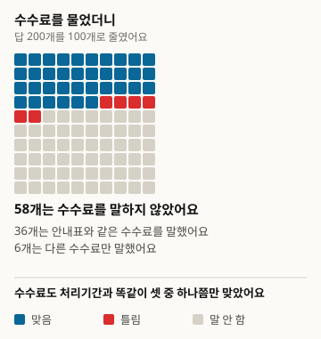
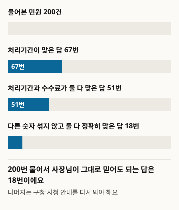
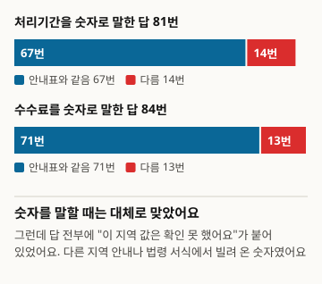

# AI에게 영업 신고 처리기간과 수수료를 물으면 맞게 알려 줄까요

시군구 6곳의 민원 안내표에서 영업을 시작할 때 내는 민원 200건을 뽑아, 웹 검색을 쓰는 AI 비서에게 처리기간과 수수료를 묻고 안내표 값과 맞춰 봤어요

- 저자: 김하원 (Define404 Research)
- 날짜: 2026-11-10
- 유형: 측정 보고서. 민원 200건을 새로 묻고 규칙으로 판정했어요.
- 사전 등록: 연구 저장소 커밋 45ebc50(2026-11-10 01:38 ICT). 수집 전에 가설·표본·판정 규칙·분석 방법을 담은 prereg.md를 커밋했어요.
- DOI: https://doi.org/10.5281/zenodo.24091237
- 이해관계: 저자 소속 Define404는 AI 응답 모니터링과 가게별 AI 노출 진단 서비스를 준비하고 있어요. 자사 제품은 조사 대상에 넣지 않았어요.

## 요약

사장님이 AI 비서에게 "구청에 이 영업 신고를 내면 며칠 걸리고 수수료는 얼마예요?"라고 물으면 맞는 답을 받는지 쟀어요. 정답은 공공데이터포털에 공개된 시군구 6곳의 민원사무편람으로 삼았어요. 영업 신고·등록·허가 민원 가운데 처리기간과 수수료가 하나로 정해진 218건에서 200건을 무작위로 뽑고, 웹 검색을 쓰는 Claude Sonnet 5.5에게 한국어로 한 번씩 물었어요. 200건 모두 그 시군구의 값은 확인하지 못했다고 답했어요. 처리기간이 안내표와 맞은 답은 67건(33.5%), 수수료가 맞은 답은 71건(35.5%)이었고, 다른 숫자를 섞지 않고 둘 다 정확히 맞힌 답은 18건(9.0%)이었어요. 숫자를 말한 답만 보면 처리기간 82.7%, 수수료 84.5%가 안내표와 같았어요. 사전 등록 가설 H1(수수료가 처리기간보다 더 틀림)과 H2(처리기간이 짧은 민원이 더 잘 맞음)는 둘 다 지지되지 않았어요. 판정 규칙은 수집 뒤 검수에서 결함을 찾아 고쳤고, 원래 규칙의 결과는 부록에 그대로 실었어요.

### 핵심 결과

- 200건 모두 "그 시군구 값은 확인하지 못했다"는 말이 들어 있었어요. 숫자를 말할 때는 다른 지역 안내나 법령 서식을 참고로 빌려 왔어요.
- 처리기간이 맞은 답은 200건 중 67건, 33.5%(95% 신뢰구간 27.3~40.3)였고, 119건(59.5%)은 처리기간을 말하지 않았어요. 수수료가 맞은 답은 71건, 35.5%(29.2~42.3)였고 116건(58.0%)은 말하지 않았어요.
- 다른 숫자를 섞지 않고 처리기간과 수수료를 둘 다 정확히 맞힌 답은 200건 중 18건, 9.0%(5.8~13.8)예요.
- 같은 민원에서 수수료 정답률과 처리기간 정답률의 차이는 +2.0%p(-3.9~7.9)로 H1은 지지되지 않았어요. 짧은 민원과 긴 민원의 처리기간 정답률 차이는 -1.6%p(-14.8~11.5)로 H2도 지지되지 않았어요.

<!-- src: 005-business-permits/analysis/out/results.json#preregistered.cells.all, H1, H2; exploratory.hedged, given_claim -->

## 1 서론

가게를 열려면 업종마다 구청이나 시청에 영업 신고, 등록, 허가 민원을 내야 해요. 언제 영업을 시작할 수 있는지는 처리기간에 달려 있고, 수수료는 민원마다 무료부터 수만 원까지 달라요. 이 값은 시군구가 민원사무편람으로 공개하지만, 사장님이 편람 파일을 찾아 여는 일은 드물어요. 그래서 AI 비서에게 "며칠 걸려요? 얼마예요?"라고 묻는 일이 늘어요.

공공 서비스 질문에 대한 AI 답의 정확도를 잰 연구는 영국 정부 안내(Majithia 외 2026)나 여러 나라 공공 정보(Liu 외 2026)처럼 영어권 제도를 다뤘어요(2절). 한국 시군구 민원의 처리기간·수수료처럼 공개 안내표로 정답이 고정되는 숫자를, 웹 검색을 쓰는 일반 AI 비서에게 물어 잰 보고는 확인한 범위에서 찾지 못했어요.

이 조사의 기여는 세 가지예요. 시군구 민원사무편람을 정답으로 두고 영업 개시 민원 200건을 무작위로 뽑아 처리기간·수수료 정답률을 쟀어요. AI가 숫자를 말하지 않은 경우와 다른 숫자를 말한 경우를 나눠, 사장님이 그대로 믿어도 되는 답이 얼마나 되는지 봤어요. 표본 추출 코드, 판정 규칙, 분석 코드를 수집 전에 저장소에 커밋했고, 수집 뒤 규칙을 고친 과정과 검수 결과를 함께 공개했어요.

가설은 두 개예요. H1(1차, 짝 비교)은 같은 민원에서 수수료를 맞게 말하는 비율이 처리기간을 맞게 말하는 비율보다 낮다는 가설이에요. H2(2차)는 처리기간을 맞게 말하는 비율이 처리기간이 짧은 민원(즉시~3일)에서 긴 민원(4일 이상)보다 높다는 가설이에요. 흔한 값을 짐작으로 말하면 짧은 민원에서 더 자주 맞을 거라고 봤어요.

## 2 관련 연구

공공 서비스 질문에 대한 언어 모델 답을 잰 연구가 최근 늘었어요. Majithia 외(2026)는 gov.uk 공개 정보로 영국 시민 질문과 답 2만 2천 쌍을 합성해 CitizenQuery-UK 벤치마크를 만들었어요. Liu 외(2026)는 여러 나라의 연방·주·지방 정부 공공 정보를 다룬 CIVI 벤치마크로 검색 에이전트 10개를 평가했고, 어느 것도 사람 기준선에 미치지 못했으며 실패의 72.1%가 검색 단계에서 나왔다고 보고했어요. Gosciak 외(2026)는 미국 SNAP 상담 문항으로 챗봇 정확도가 상담원 정확도에 미치는 영향을 실험했어요. 한국 법률 쪽에서는 KBL(Kim 외 2024)과 KoBLEX(Lee 외 2025)가 법률 지식과 조문 근거 추론을 다뤘어요.

이 연구들은 영어권 제도이거나, 정답을 전문가 판정이나 합성 답으로 정했거나, 법률 추론을 다뤘어요. 이번 조사는 해석이 필요 없는 숫자 두 개(처리기간, 수수료)만 골랐고, 정답은 시군구가 공개한 안내표 값이에요. 판정 방식은 FreshQA(Vu 외 2023)의 느슨한·엄격한 두 점수를, 신뢰구간과 짝 차이는 Miller(2024)를 따랐어요. 표본 40 미만 칸을 해석하지 않는 기준은 PopQA(Mallen 외 2023)에서 가져왔어요. 공개 목록을 정답으로 두고 AI 비서에게 묻는 설계는 5호 지원사업 마감일 조사(Define404 Research 2026)와 이어져요.

## 3 조사 방법

그림 1. 이렇게 조사했어요

<!-- src: 005-business-permits/analysis/make_figures.py; analysis/out/results.json -->

### 3.1 모집단과 표본

정답 원천은 공공데이터포털(data.go.kr)의 시군구 민원사무편람 파일이에요. 2026-11-10에 검색어 민원편람·민원사무편람·민원사무현황으로 파일 22개를 받았고, 그중 처리기간과 수수료 칸이 둘 다 있는 6개를 썼어요. 파일은 로그인이나 인증키 없이 받을 수 있어요.

표 1. 정답 원천 (공공데이터포털 파일, 2026-11-10 수신)

| 시군구 | 편람 기준일 | 행 | 표본 |
|---|---|---|---|
| 서울특별시 강서구 | 2025-09-16 | 773 | 55 |
| 경상북도 김천시 | 2025-09-03 | 500 | 40 |
| 경기도 시흥시 | 2026-09-11 | 498 | 34 |
| 강원특별자치도 강릉시 | 2025-11-21 | 444 | 31 |
| 대구광역시 북구 | 2026-09-03 | 426 | 21 |
| 경상남도 창녕군 | 2025-11-25 | 373 | 19 |
| 합계 |  | 3,014 | 200 |

<!-- src: 005-business-permits/sampling/sample_log.txt; gate.md#1 -->

영업을 새로 시작할 때 내는 민원만 남겼어요. 민원명에 '업'과 신고·등록·허가·지정 가운데 하나가 있으면 넣고, 폐업·휴업·변경·승계·재발급·취소처럼 영업 개시가 아닌 민원은 뺐어요(2,700행 제외). 처리기간이 '즉시'나 'N일' 하나가 아니거나 수수료가 '무료'나 'N원' 하나가 아닌 민원도 뺐어요(94행). 전자·방문 금액이 다르거나 "유형별 상이"인 민원이 여기에 들어가요. 민원명이 6자 미만인 2행도 뺐어요. 남은 후보 218건을 파일 번호와 민원명으로 정렬하고 시드 20261110으로 섞어 앞 200건을 뽑았어요.

표본 200건 가운데 처리기간이 짧은 민원(즉시~3일)이 89건, 긴 민원(4일 이상)이 111건이에요. 수수료는 무료 80건, 유료 120건이에요. 민원 1건에 답 1개라 민원 수 200이 실효 표본이에요. H2의 두 집단은 20%p 차이를 유의수준 5%, 검정력 80%로 잡는 데 필요한 집단당 98건에 가까워요.

### 3.2 질문

민원마다 질문 하나를 한국어로 만들었어요. 질문 틀은 "{시군구}에 '{민원사무명}' 민원을 내려고 해요. 처리기간은 며칠이고, 수수료는 얼마인가요?"예요. 시군구 이름과 민원사무명은 편람 표기 그대로 넣었어요. 질문은 10문항씩 20배치로 나눴고, 배치 파일에는 질문만 있어요.

### 3.3 응답 시스템

응답 시스템은 Claude Sonnet 5.5에 웹 검색을 붙인 조건 하나예요. 사람이 실제로 쓰는 형태에 가까워서 골랐어요. 한 호출이 한 배치(10문항)를 맡고, 응답자는 조사 목적과 정답을 몰라요. 지시문에는 문항마다 검색을 하고, 질문 언어로 답하고, 검색 한도 메시지가 오면 멈추고 검색한 문항만 기록하라고 적었어요. 수집은 2026-11-10에 했어요. 검색 한도로 빠진 3문항은 다시 받아 200건 모두 유효해요. 197건은 검색을 1회, 3건은 2회 했어요.

### 3.4 판정

판정은 규칙 코드로 했어요. 답을 문장으로 나누고, 처리기간과 수수료 주장값을 뽑아 안내표 값과 비교해요.

- 처리기간: 처리·소요·걸·기간 같은 낱말이 있는 문장에서 'N일'과 '즉시'(당일, 8시간 이하 포함)를 뽑아요. 날짜 표기와 위생교육·변경신고 기한은 빼요.
- 수수료: 수수료·비용·납부 같은 낱말이 있는 문장에서 금액과 '무료'(수수료 없음·면제)를 뽑아요. 면허세·세액·채권·예치금 같은 다른 돈은 빼요.
- 항목마다 주장값이 없으면 모름, 정답이 주장값 안에 있으면 맞음(느슨), 주장값이 정답 하나뿐이면 맞음(엄격), 정답이 없으면 틀림이에요.
- 둘 다 맞음은 처리기간과 수수료가 모두 맞은 경우예요.

LLM 판정자와 사람 2명 판정은 쓰지 않았어요. 규칙으로 가르지 못해 허브가 직접 판정한 답은 0건이에요. 판정 규칙은 수집 뒤에 한 번 고쳤어요(3.6절).

### 3.5 분석

모든 비율에 윌슨 95% 신뢰구간을 붙였어요. 민원마다 답이 하나라 대상 단위 군집 구간과 같아요. H1은 같은 민원의 수수료 맞음에서 처리기간 맞음을 뺀 짝 차이(Miller 2024)의 95% 신뢰구간과 단측 z 검정이에요. H2는 짧은 민원의 처리기간 맞음 비율에서 긴 민원의 비율을 뺀 차이예요. 두 가설의 p값은 Holm 보정을 했어요. 시군구별, 무료·유료별, 숫자를 말한 답의 정답률, 틀린 답의 방향은 사전 등록에 없는 탐색 분석이에요. 표본 40 미만 칸은 해석하지 않아요.

### 3.6 사전 등록과 달라진 점

수집 뒤 무작위 30건(검수용, 시드 20261110)의 답 원문을 허브가 직접 읽고, 규칙이 뽑은 값과 맞춰 봤어요. 30건 중 10건에서 등록 규칙(v1.0)이 값을 잘못 뽑았어요. 답이 스스로 "다른 업종이라 적용할 수 없다"고 배제한 금액을 셌고, 면허세가 같은 문장에 있으면 문장을 통째로 버려 진짜 수수료를 놓쳤고, "1주일 이내"나 "10일이 걸린다"를 놓쳤어요.

그래서 분석 결과를 해석하기 전에 규칙을 v1.1로 고쳤어요. 거절 표현이 있는 문장의 값은 세지 않고, 면허세 같은 낱말 뒤의 금액 하나만 지우고, 주 단위와 "N일이 걸려요" 꼴을 처리기간으로 세요. 고친 규칙은 검수용과 겹치지 않는 새 무작위 30건(검증용, 시드 20261111)으로 다시 쟀어요. 30건 중 8건에 추출 차이가 남았고, 판정 60칸(처리기간·수수료) 가운데 7칸이 사람 판독과 달랐어요. 사람 판독은 정답을 보지 않고 답 원문만 읽고 적었어요.

사전 등록 8절에 따라 v1.0 결과를 부록 B에 그대로 실었어요. 두 판본 모두 H1·H2는 지지되지 않고, 둘 다 정확히 맞힌 답은 두 판본 모두 18건이에요. 크게 달라진 것은 수수료 틀림이에요(v1.0 25건, v1.1 13건).

수집 전에 시범 2배치(20건)를 보고 "확인하지 못했다" 문구가 있는지만 표시하는 칸을 탐색용으로 더했어요. 판정에는 쓰지 않았어요.

## 4 결과

### 4.1 처리기간과 수수료

표 2. 처리기간과 수수료를 맞게 말한 비율 (판정 규칙 v1.1, 괄호는 윌슨 95% 신뢰구간)

| 항목 | 맞음(느슨) | 맞음(엄격) | 틀림 | 말하지 않음 |
|---|---|---|---|---|
| 처리기간 | 67 (33.5%; 27.3~40.3) | 44 (22.0%; 16.8~28.2) | 14 (7.0%; 4.2~11.4) | 119 (59.5%; 52.6~66.1) |
| 수수료 | 71 (35.5%; 29.2~42.3) | 48 (24.0%; 18.6~30.4) | 13 (6.5%; 3.8~10.8) | 116 (58.0%; 51.1~64.6) |
| 둘 다 | 51 (25.5%; 20.0~32.0) | 18 (9.0%; 5.8~13.8) |  |  |

<!-- src: 005-business-permits/analysis/out/tables.md#표1~3; analysis/out/results.json#preregistered.cells.all -->

그림 2. AI에게 100번 물으면 처리기간을 맞게 말한 답 (200건을 100칸으로 줄여 반올림했어요)

<!-- src: 005-business-permits/analysis/make_figures.py; analysis/out/results.json#preregistered.cells.all -->

그림 3. AI에게 100번 물으면 수수료를 맞게 말한 답 (200건을 100칸으로 줄여 반올림했어요)

<!-- src: 005-business-permits/analysis/make_figures.py; analysis/out/results.json#preregistered.cells.all -->

처리기간과 수수료 모두 셋 중 하나쯤 맞았고, 절반 넘게는 숫자를 말하지 않았어요. 느슨한 점수와 엄격한 점수의 짝 차이는 처리기간 11.5%p(7.1~15.9), 수수료 11.5%p(7.1~15.9)예요. 맞는 값과 함께 다른 지역이나 다른 절차의 값을 나란히 적은 답이 열 건 중 한 건쯤 된다는 뜻이에요.

그림 4. 처리기간과 수수료를 둘 다 정확히 맞힌 답은 열에 하나예요

<!-- src: 005-business-permits/analysis/make_figures.py; analysis/out/results.json#preregistered.cells.all -->

### 4.2 사전 등록 가설

표 3. 사전 등록 가설 검정 결과 (차이는 %p, 괄호는 95% 신뢰구간)

| 가설 | 차이 | 단측 p | Holm p | 판정 |
|---|---|---|---|---|
| H1 | +2.0 (-3.9~7.9) | 0.747 | 1.000 | 지지되지 않음 |
| H2 | -1.6 (-14.8~11.5) | 0.597 | 1.000 | 지지되지 않음 |

<!-- src: 005-business-permits/analysis/out/tables.md#표4; analysis/out/results.json#preregistered.H1, H2, cells.short, cells.long -->

H1은 방향부터 반대였어요. 수수료 정답률이 처리기간보다 2.0%p 높았고 신뢰구간이 0을 품어요. 두 항목의 정답률은 이 자료로는 구별되지 않아요. H2도 짧은 민원(n=89) 32.6%(23.7~42.9), 긴 민원(n=111) 34.2%(26.1~43.5)로 차이가 없었어요. AI가 흔한 값(3일)을 짐작으로 말한다는 가정은 이 자료로는 지지되지 않아요.

### 4.3 탐색: 숫자를 말한 답과 "확인 못 했어요"

여기부터는 사전 등록에 없는 탐색 분석이에요.

200건 모두 답에 "그 시군구 값은 확인하지 못했다"는 문구가 있었어요. 숫자를 말한 답은 다른 시군구 안내, 법령 서식의 처리기간, 시행규칙 수수료표를 참고로 들며 "이 지역에 그대로 적용되는지는 확인하지 못했다"고 덧붙였어요.

숫자를 말한 답만 보면 처리기간을 말한 81건 중 67건, 82.7%(73.1~89.4)가 안내표와 같았어요. 수수료를 말한 84건 중에서는 71건, 84.5%(75.3~90.7)가 같았어요. 영업 신고 민원의 처리기간과 수수료는 법령이나 전국 공통 기준으로 정해진 경우가 많아서, 다른 지역 값을 빌려 와도 자주 맞은 것으로 보여요.

그림 5. 숫자를 말할 때는 대체로 맞았지만, 전부 "확인 못 했어요"가 붙었어요

<!-- src: 005-business-permits/analysis/make_figures.py; analysis/out/results.json#exploratory.given_claim, hedged -->

틀린 답도 모양이 있었어요. 처리기간이 틀린 답 가운데 주장값이 하나인 12건은 모두 안내표보다 길게 말했어요(표본 40 미만이라 해석하지 않아요). 수수료가 틀린 13건 가운데 8건은 무료 민원에 금액을 말했고, 유료 민원을 무료라고 한 답은 0건이었어요.

표 4. 무료·유료 민원별 정답률 (탐색, 괄호는 윌슨 95% 신뢰구간)

| 구분 | n | 처리기간 맞음 | 수수료 맞음 | 둘 다 정확히 맞음 |
|---|---|---|---|---|
| 무료 민원 | 80 | 17 (21.2%; 13.7~31.4) | 17 (21.2%; 13.7~31.4) | 5 (6.2%; 2.7~13.8) |
| 유료 민원 | 120 | 50 (41.7%; 33.2~50.6) | 54 (45.0%; 36.4~53.9) | 13 (10.8%; 6.4~17.7) |

<!-- src: 005-business-permits/analysis/out/results.json#preregistered.cells.free, paid -->

무료 민원에서 정답률이 낮았어요. 유료 민원은 수수료표가 있어 검색에 잘 걸리고, 무료 민원은 근거 자료가 적은 것으로 보여요. 시군구별로는 강서구(n=55)가 처리기간 19건, 수수료 18건, 김천시(n=40)가 처리기간 13건, 수수료 12건 맞았고, 나머지 네 곳은 표본 40 미만이라 해석하지 않아요.

<!-- src: 005-business-permits/analysis/out/results.json#exploratory.period_wrong_direction, fee_wrong_kind, by_city -->

## 5 논의

이번 조사에서 AI 비서는 시군구 민원의 처리기간과 수수료를 스스로 확인했다고 말한 적이 한 번도 없었어요. 시군구 민원사무편람은 공공데이터포털에 파일로만 있고, 검색으로 바로 찾아지는 웹 페이지가 드물어요. AI는 대신 다른 지역 안내나 법령 서식을 찾아 참고값으로 줬고, 그 값은 숫자를 말한 답의 80% 넘게 안내표와 같았어요.

사장님 쪽에서 보면 두 가지가 겹쳐요. 절반 넘게는 숫자를 아예 받지 못해요. 숫자를 받아도 다른 지역 값과 같이 섞여 있거나 "확인하지 못했다"는 단서가 붙어 있어 그대로 믿기 어려워요. 다른 숫자 없이 둘 다 정확히 맞은 답은 열에 하나예요. 결국 구청·시청 안내를 다시 봐야 하는 경우가 열에 아홉이에요.

틀린 방향도 사장님에게 불리하지 않은 쪽이었어요. 처리기간을 틀린 답은 안내표보다 길게 말했고, 수수료를 틀린 답은 무료 민원에 돈을 말한 경우가 많았어요. 더 빨리 된다거나 돈이 안 든다고 잘못 안내한 경우는 드물었어요. 다만 이 칸은 표본이 작아 단정할 수 없어요.

판정 규칙을 수집 뒤에 고친 점은 조심해서 읽어야 해요. 답마다 "확인하지 못했다"와 참고값이 섞여 있어, 문장에서 숫자를 뽑는 규칙이 쉽게 틀렸어요. 고친 규칙도 검증용 30건에서 판정 60칸 중 7칸이 사람 판독과 달랐어요. 정답률 같은 비율은 몇 %p 안쪽으로 흔들릴 수 있어요. 그래도 200건 모두 확인하지 못했다고 답했다는 점과 둘 다 정확히 맞은 답이 18건이라는 점은 두 판본에서 같아요.

### 가게에서 바로 할 일

- 영업 신고 처리기간과 수수료는 AI 답 대신 구청·시청 민원 안내나 정부24에서 확인하세요. 이번 조사에서 둘 다 정확히 맞은 답은 200건 중 18건이었어요.
- AI가 "확인하지 못했지만 다른 구청은 3일"이라고 하면 참고값이에요. 그 시군구 값은 아니에요.
- 수수료가 없는 민원인데 AI가 금액을 말했다면 한 번 더 확인하세요. 수수료가 틀린 13건 중 8건이 이런 경우였어요.

## 6 한계

1. 응답 시스템이 Claude Sonnet 5.5 웹 검색 조건 하나라 모델 간 비교는 없어요. 문항당 검색이 대부분 1회였어요. 검색을 더 많이 하는 설정이면 결과가 달라질 수 있어요. 한 에이전트가 10문항을 이어서 답해 앞 문항이 뒤 문항에 영향을 줬을 수 있어요.
2. 판정 규칙을 수집 뒤에 고쳤어요(3.6절). 고친 규칙도 검증용 30건에서 판정 60칸 중 7칸이 사람 판독과 달랐어요. 원래 규칙 결과는 부록 B에 있어요.
3. 정답이 시군구 편람이에요. 편람이 법령 개정을 늦게 반영했으면 AI 답이 맞고 편람이 틀릴 수 있어요. 편람 기준일은 2025-09부터 2026-09까지 서로 달라요.
4. 6개 시군구는 처리기간·수수료 칸을 둘 다 공개한 곳이라 무작위로 고른 시군구가 아니에요. 처리기간·수수료가 하나로 정해진 민원만 넣어 금액이 여럿인 민원은 빠졌어요.
5. 민원명에 '업'이 들어간 영업 개시 민원을 기계적으로 골라, 사업개시신고나 분실신고처럼 영업 개시로 보기 어려운 민원도 몇 건 들어갔어요.
6. 민원명을 그대로 넣어 물었어요. 사장님이 실제로 두루뭉술하게 묻는 상황보다 쉬운 조건이에요.
7. 수집은 2026-11-10 하루예요. 검색 결과는 날마다 바뀌므로 같은 질문을 다시 하면 숫자가 달라질 수 있어요.

## 7 윤리와 이해관계

민원명, 처리기간, 수수료는 시군구가 공개한 정보라 공개 자료에 그대로 실었어요. 개인을 식별할 수 있는 정보는 다루지 않았어요. AI 답 원문은 공개 자료에 넣지 않았어요. 저자 소속 Define404는 AI 응답 모니터링과 가게별 AI 노출 진단 서비스를 준비하고 있어요. 자사 제품은 조사 대상에 넣지 않았어요. 외부 연구비는 없어요.

## 8 재현 방법

- 공개 저장소: https://github.com/johndefine404/define404-research-public (경로 005-business-permits)
- 정답 원천: 공공데이터포털 시군구 민원사무편람 6개(2026-11-10 수신, 파일 번호는 gate.md 1번) sampling/raw/minwon_<번호>.csv, 해시 sampling/raw/SHA256SUMS, 내려받기 sampling/raw/download.sh
- 표본: sampling/draw_sample.py(시드 20261110), 결과 sampling/sample.csv (SHA-256 f940f57621c88c8bd0fbcdcd84a984585ee51dfd58f540206570ed392fd11096, 두 번 실행 일치)
- 질문: collect/question_templates.json v1.0, 배치 collect/batches/, 재시도 collect/batches_retry/
- 판정: judge/auto_judge.py(v1.1, 결과 judge/judged.csv), judge/auto_judge_v10.py(등록 규칙 v1.0, 결과 judge/judged_v10.csv). 규칙 본문 judge/rules.md, 검수 judge/audit.py와 audit_sample.json·audit_result.json
- 분석: analysis/run_analysis.py. 결과 analysis/out/(v1.1), analysis/out_v10/(v1.0)의 results.json, tables.md. 원고의 숫자는 이 파일에서만 옮겼어요
- 그림: analysis/make_figures.py가 analysis/out/results.json에서 숫자를 읽어 report/figures/*.svg를 만들어요
- 사전 등록: 연구 저장소 커밋 45ebc50 (2026-11-10 01:38 ICT). 수집 전에 prereg.md를 커밋했어요
- 의존성: 표준 라이브러리만 써요
- 민원별 요약 자료(CSV): https://define404.com/report/data/006-business-permit-fees-summary.csv (민원명, 정답, 규칙이 뽑은 값과 판정 v1.1·v1.0. AI 답 원문은 없어요)

## 참고문헌

- Majithia, N. 외 (2026). The CitizenQuery Benchmark: A Novel Dataset and Evaluation Pipeline for Measuring LLM Performance in Citizen Query Tasks. arXiv:2602.04064. https://arxiv.org/abs/2602.04064
- Liu, D. 외 (2026). CIVI: A Framework for Diagnosing Search Agent Failures in Civic Information. arXiv:2609.08094. https://arxiv.org/abs/2609.08094
- Gosciak, J. 외 (2026). LLMs in social services: How does chatbot accuracy affect human accuracy? arXiv:2603.11213. https://arxiv.org/abs/2603.11213
- Kim, Y. 외 (2024). Developing a Pragmatic Benchmark for Assessing Korean Legal Language Understanding in Large Language Models. arXiv:2410.08731. https://arxiv.org/abs/2410.08731
- Lee, J. 외 (2025). KoBLEX: Open Legal Question Answering with Multi-hop Reasoning. arXiv:2509.01324. https://arxiv.org/abs/2509.01324
- Vu, T. 외 (2023). FreshLLMs: Refreshing Large Language Models with Search Engine Augmentation. arXiv:2310.03214. https://arxiv.org/abs/2310.03214
- Mallen, A. 외 (2023). When Not to Trust Language Models: Investigating Effectiveness of Parametric and Non-Parametric Memories. arXiv:2212.10511. https://arxiv.org/abs/2212.10511
- Miller, E. (2024). Adding Error Bars to Evals: A Statistical Approach to Language Model Evaluations. arXiv:2411.00640. https://arxiv.org/abs/2411.00640
- Define404 Research (2026). AI에게 지원사업 공고를 물으면 마감일을 맞게 알려 줄까요. https://define404.com/report/005-support-program-deadlines/

## 부록 A 판정 규칙 요약 (v1.1)

- 처리기간: 처리·소요·걸·기간·기한·발급·완료 가운데 하나가 있는 문장만 봐요. 거절 표현(적용되지 않·적용할 수 없·다른 업종·다른 절차 등)이 있는 문장은 건너뛰어요. 즉시·당일·바로 처리·8시간 이하는 '즉시', N일·N영업일·N근무일은 'N일', N주는 7N일, 범위 3~5일은 두 끝값을 다 세요. 날짜 표기와 위생교육·영업 개시 기한은 빼요.
- 수수료: 수수료·비용·납부·요금·인지·금액 가운데 하나가 있는 문장만 보고, 거절 표현이 있는 문장은 건너뛰어요. 면허세·세액·채권·예치금·평가·과태료 같은 낱말 뒤 25자 안의 금액은 지워요. 무료·수수료 없음·면제·0원은 '무료', 28,000원·2만 8천 원·2.8만 원은 원 단위 정수로 바꿔요.
- 점수: 주장값이 없으면 모름, 정답이 주장값 안에 있으면 맞음(느슨), 주장값이 정답 하나뿐이면 맞음(엄격), 그 밖은 틀림이에요.
- 등록 규칙 v1.0과 다른 점: 거절 표현 문장 건너뛰기, 제외 낱말이 있는 문장 전체 대신 그 뒤 금액 하나만 지우기, 주 단위와 "N일이 걸려요" 꼴 인정이에요.

## 부록 B 등록 규칙 v1.0 결과

사전 등록 8절에 따라 등록한 판정 규칙(v1.0)을 그대로 적용한 결과를 실어요.

표 5. 등록 규칙 v1.0의 정답률 (괄호는 윌슨 95% 신뢰구간)

| 항목 | 맞음(느슨) | 맞음(엄격) | 틀림 | 말하지 않음 |
|---|---|---|---|---|
| 처리기간 | 71 (35.5%; 29.2~42.3) | 49 (24.5%; 19.1~30.9) | 16 (8.0%; 5.0~12.6) | 113 (56.5%; 49.6~63.2) |
| 수수료 | 71 (35.5%; 29.2~42.3) | 50 (25.0%; 19.5~31.4) | 25 (12.5%; 8.6~17.8) | 104 (52.0%; 45.1~58.8) |
| 둘 다 | 46 (23.0%; 17.7~29.3) | 18 (9.0%; 5.8~13.8) |  |  |

<!-- src: 005-business-permits/analysis/out_v10/results.json#preregistered.cells.all -->

표 6. 등록 규칙 v1.0의 가설 검정 (차이는 %p, 괄호는 95% 신뢰구간)

| 가설 | 차이 | 단측 p | Holm p | 판정 |
|---|---|---|---|---|
| H1 | +0.0 (-6.9~6.9) | 0.500 | 1.000 | 지지되지 않음 |
| H2 | -1.2 (-14.5~12.1) | 0.570 | 1.000 | 지지되지 않음 |

<!-- src: 005-business-permits/analysis/out_v10/results.json#preregistered.H1, H2 -->

v1.0에서는 숫자를 말한 답의 정답률이 처리기간 87건 중 71건(81.6%), 수수료 96건 중 71건(74.0%)이에요. v1.1보다 수수료 틀림이 많은 것은 답이 스스로 배제한 금액까지 주장으로 셌기 때문이에요.

<!-- src: 005-business-permits/analysis/out_v10/results.json#exploratory.given_claim -->

## 부록 C 사전 등록 대비 변경

| 항목 | 사전 등록 | 실행 |
|---|---|---|
| 판정 규칙 | v1.0(문장 단위 추출, 제외 낱말이 있는 문장 전체 제외) | v1.1(거절 문장 건너뛰기, 금액 단위 제외, 주 단위 인정). v1.0 결과는 부록 B |
| 규칙 검수 | 없음 | 검수용 30건으로 결함을 찾고 검증용 30건으로 v1.1을 잼(판정 60칸 중 7칸 차이) |
| 탐색 칸 | 시군구별, 무료·유료별, 틀린 방향 | 시범 20건을 본 뒤 "확인하지 못했다" 표시 칸, 수집 뒤 숫자를 말한 답의 정답률을 더함 |
| 허브 직접 판정 | 규칙으로 못 가르는 답만 | 0건 |
| 수집 | 2026-11-10, 배치 3개씩 병렬 | 2026-11-10, 배치 3~10개 병렬. 검색 한도로 빠진 3문항은 재시도로 채움 |
