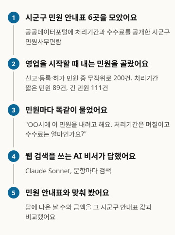
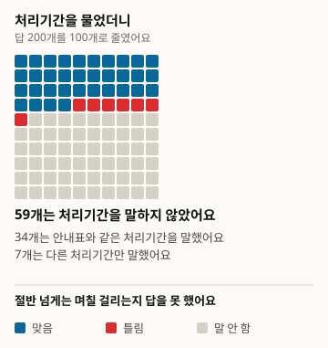
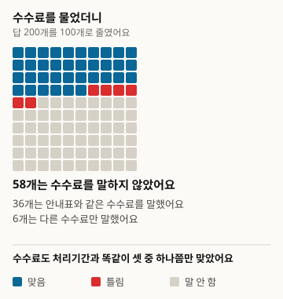
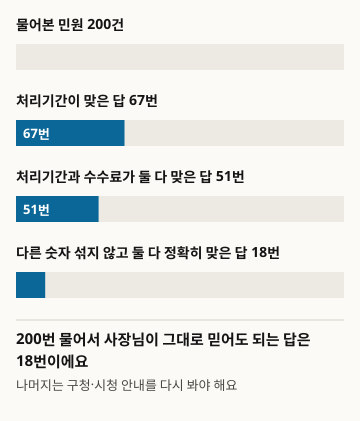
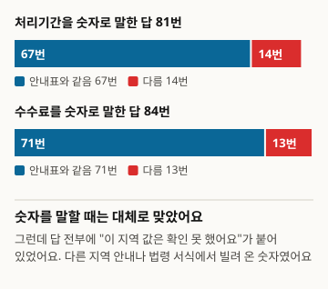

# Hỏi AI về thời gian xử lý và lệ phí đăng ký kinh doanh, AI có nói đúng không

Đây là bản dịch. Bản gốc là tiếng Hàn, phiên bản 1: https://define404.com/report/006-business-permit-fees/

Chúng tôi chọn 200 thủ tục dân sự dùng khi bắt đầu kinh doanh từ bảng hướng dẫn thủ tục của 6 quận, huyện, thành phố, hỏi trợ lý AI có tìm kiếm web về thời gian xử lý và lệ phí, rồi đối chiếu với giá trị trong bảng hướng dẫn

- Tác giả: Kim Hawon (Define404 Research)
- Ngày: 2026-11-10
- Loại: Báo cáo đo lường. Hỏi mới 200 thủ tục và chấm theo quy tắc.
- Đăng ký trước: commit 45ebc50 của kho nghiên cứu (2026-11-10 01:38 ICT). Tệp prereg.md chứa giả thuyết, mẫu, quy tắc chấm và phương pháp phân tích đã được commit trước khi thu thập.
- DOI: https://doi.org/10.5281/zenodo.24091237
- Xung đột lợi ích: Define404, nơi tác giả làm việc, đang chuẩn bị dịch vụ giám sát câu trả lời của AI và chẩn đoán mức độ hiện diện trên AI cho từng cửa hàng. Sản phẩm của công ty không được đưa vào đối tượng khảo sát.

## Tóm tắt

Chúng tôi đo xem khi chủ cửa hàng nhỏ hỏi trợ lý AI "Nộp đăng ký kinh doanh này ở ủy ban quận thì mất mấy ngày và lệ phí bao nhiêu?" thì có nhận được câu trả lời đúng hay không. Đáp án chuẩn là sổ tay thủ tục dân sự (민원사무편람) của 6 quận, huyện, thành phố được công bố trên Cổng dữ liệu công (공공데이터포털). Trong 218 thủ tục đăng ký, khai báo, cấp phép kinh doanh mà thời gian xử lý và lệ phí chỉ có một giá trị duy nhất, chúng tôi chọn ngẫu nhiên 200 thủ tục rồi hỏi Claude Sonnet 5.5 có tìm kiếm web mỗi thủ tục một lần bằng tiếng Hàn. Cả 200 câu trả lời đều nói không xác nhận được giá trị của quận, huyện, thành phố đó. Có 67 câu (33.5%) nói thời gian xử lý khớp với bảng hướng dẫn, 71 câu (35.5%) nói lệ phí khớp, và 18 câu (9.0%) đúng chính xác cả hai mà không kèm con số khác. Nếu chỉ xét những câu có nêu con số, 82.7% thời gian xử lý và 84.5% lệ phí giống bảng hướng dẫn. Giả thuyết đăng ký trước H1 (lệ phí sai nhiều hơn thời gian xử lý) và H2 (thủ tục có thời gian xử lý ngắn được trả lời đúng nhiều hơn) đều không được ủng hộ. Quy tắc chấm được phát hiện có lỗi qua kiểm tra sau khi thu thập và đã được sửa; kết quả theo quy tắc ban đầu được đăng nguyên vẹn trong phụ lục.

### Kết quả chính

- Cả 200 câu trả lời đều có lời nói "không xác nhận được giá trị của quận, huyện, thành phố đó". Khi nêu con số, AI mượn thông tin hướng dẫn của địa phương khác hoặc biểu mẫu theo luật làm tham khảo.
- Có 67 trong 200 câu trả lời nói đúng thời gian xử lý, tức 33.5% (khoảng tin cậy 95%: 27.3~40.3), và 119 câu (59.5%) không nêu thời gian xử lý. Có 71 câu nói đúng lệ phí, tức 35.5% (29.2~42.3), và 116 câu (58.0%) không nêu lệ phí.
- Số câu trả lời đúng chính xác cả thời gian xử lý lẫn lệ phí mà không kèm con số khác là 18 trong 200, tức 9.0% (5.8~13.8).
- Với cùng một thủ tục, chênh lệch giữa tỷ lệ đúng của lệ phí và của thời gian xử lý là +2.0 điểm phần trăm (-3.9~7.9), nên H1 không được ủng hộ. Chênh lệch tỷ lệ đúng về thời gian xử lý giữa thủ tục ngắn và thủ tục dài là -1.6 điểm phần trăm (-14.8~11.5), nên H2 cũng không được ủng hộ.

<!-- src: 005-business-permits/analysis/out/results.json#preregistered.cells.all, H1, H2; exploratory.hedged, given_claim -->

## 1 Giới thiệu

Muốn mở cửa hàng, tùy ngành nghề mà phải nộp thủ tục đăng ký, khai báo hoặc xin cấp phép kinh doanh tại ủy ban quận hoặc thành phố. Khi nào được bắt đầu kinh doanh phụ thuộc vào thời gian xử lý, còn lệ phí thì tùy thủ tục, từ miễn phí đến vài chục nghìn won. Các giá trị này do quận, huyện, thành phố công bố trong sổ tay thủ tục dân sự, nhưng hiếm chủ cửa hàng nào tìm và mở tệp sổ tay. Vì vậy ngày càng nhiều người hỏi trợ lý AI "Mất mấy ngày? Hết bao nhiêu tiền?".

Các nghiên cứu đo độ chính xác của câu trả lời AI cho câu hỏi về dịch vụ công đã xử lý các chế độ ở khu vực nói tiếng Anh, như hướng dẫn của chính phủ Anh (Majithia và cộng sự 2026) hay thông tin công của nhiều nước (Liu và cộng sự 2026) (mục 2). Trong phạm vi chúng tôi kiểm tra, chưa thấy báo cáo nào hỏi trợ lý AI đa dụng có tìm kiếm web về những con số mà bảng hướng dẫn công khai quyết định đáp án, như thời gian xử lý và lệ phí của thủ tục dân sự ở quận, huyện, thành phố Hàn Quốc.

Khảo sát này có ba đóng góp. Chúng tôi lấy sổ tay thủ tục dân sự của quận, huyện, thành phố làm đáp án, chọn ngẫu nhiên 200 thủ tục bắt đầu kinh doanh và đo tỷ lệ đúng của thời gian xử lý và lệ phí. Chúng tôi tách trường hợp AI không nêu con số khỏi trường hợp AI nêu con số khác, để xem bao nhiêu câu trả lời chủ cửa hàng có thể tin ngay. Mã chọn mẫu, quy tắc chấm và mã phân tích được commit vào kho trước khi thu thập, và chúng tôi công bố cả quá trình sửa quy tắc sau thu thập lẫn kết quả kiểm tra.

Có hai giả thuyết. H1 (chính, so sánh ghép cặp) cho rằng với cùng một thủ tục, tỷ lệ nói đúng lệ phí thấp hơn tỷ lệ nói đúng thời gian xử lý. H2 (phụ) cho rằng tỷ lệ nói đúng thời gian xử lý ở thủ tục có thời gian xử lý ngắn (ngay lập tức đến 3 ngày) cao hơn ở thủ tục dài (từ 4 ngày trở lên). Chúng tôi dự đoán rằng nếu AI đoán theo giá trị phổ biến thì sẽ đúng thường hơn ở thủ tục ngắn.

## 2 Nghiên cứu liên quan

Gần đây các nghiên cứu đo câu trả lời của mô hình ngôn ngữ cho câu hỏi về dịch vụ công đang tăng. Majithia và cộng sự (2026) dùng thông tin công của gov.uk để tổng hợp 22 nghìn cặp câu hỏi và câu trả lời của công dân Anh, tạo ra bộ đánh giá CitizenQuery-UK. Liu và cộng sự (2026) dùng bộ đánh giá CIVI về thông tin công của chính quyền liên bang, bang và địa phương ở nhiều nước để đánh giá 10 tác tử tìm kiếm; không tác tử nào đạt mức cơ sở của con người và 72.1% lỗi xảy ra ở bước tìm kiếm. Gosciak và cộng sự (2026) thử nghiệm ảnh hưởng của độ chính xác chatbot đến độ chính xác của nhân viên tư vấn bằng các câu hỏi tư vấn SNAP của Mỹ. Về pháp luật Hàn Quốc, KBL (Kim và cộng sự 2024) và KoBLEX (Lee và cộng sự 2025) xử lý kiến thức pháp luật và suy luận dựa trên điều khoản.

Các nghiên cứu này hoặc xử lý chế độ ở khu vực nói tiếng Anh, hoặc xác định đáp án bằng phán đoán chuyên gia hay câu trả lời tổng hợp, hoặc xử lý suy luận pháp lý. Khảo sát này chỉ chọn hai con số không cần diễn giải (thời gian xử lý, lệ phí), và đáp án là giá trị trong bảng hướng dẫn do quận, huyện, thành phố công bố. Cách chấm theo hai điểm nới lỏng và nghiêm ngặt của FreshQA (Vu và cộng sự 2023); khoảng tin cậy và chênh lệch ghép cặp theo Miller (2024). Tiêu chí không diễn giải ô có dưới 40 mẫu lấy từ PopQA (Mallen và cộng sự 2023). Thiết kế lấy danh sách công khai làm đáp án rồi hỏi trợ lý AI tiếp nối báo cáo số 5 về hạn nộp hồ sơ chương trình hỗ trợ (Define404 Research 2026).

## 3 Phương pháp khảo sát

Hình 1. Khảo sát được tiến hành như thế này

<!-- src: 005-business-permits/analysis/make_figures.py; analysis/out/results.json -->

### 3.1 Tổng thể và mẫu

Nguồn đáp án là các tệp sổ tay thủ tục dân sự của quận, huyện, thành phố trên Cổng dữ liệu công (data.go.kr). Vào 2026-11-10 chúng tôi tải 22 tệp bằng các từ khóa 민원편람, 민원사무편람 và 민원사무현황, và dùng 6 tệp có cả hai cột thời gian xử lý và lệ phí. Có thể tải các tệp này mà không cần đăng nhập hay khóa xác thực.

Bảng 1. Nguồn đáp án (tệp trên Cổng dữ liệu công, tải ngày 2026-11-10)

| Quận, huyện, thành phố | Ngày chuẩn của sổ tay | Dòng | Mẫu |
|---|---|---|---|
| Quận Gangseo, Thành phố đặc biệt Seoul | 2025-09-16 | 773 | 55 |
| Thành phố Gimcheon, tỉnh Gyeongsang Bắc | 2025-09-03 | 500 | 40 |
| Thành phố Siheung, tỉnh Gyeonggi | 2026-09-11 | 498 | 34 |
| Thành phố Gangneung, tỉnh đặc biệt Gangwon | 2025-11-21 | 444 | 31 |
| Quận Buk, Thành phố Daegu | 2026-09-03 | 426 | 21 |
| Huyện Changnyeong, tỉnh Gyeongsang Nam | 2025-11-25 | 373 | 19 |
| Tổng | | 3,014 | 200 |

<!-- src: 005-business-permits/sampling/sample_log.txt; gate.md#1 -->

Chúng tôi chỉ giữ các thủ tục nộp khi bắt đầu kinh doanh mới. Thủ tục nào có chữ 업 (nghề, ngành) trong tên và có một trong các từ khai báo, đăng ký, cấp phép, chỉ định thì được đưa vào; các thủ tục không phải bắt đầu kinh doanh như đóng cửa, tạm nghỉ, thay đổi, kế thừa, cấp lại, hủy bị loại (loại 2,700 dòng). Chúng tôi cũng loại các thủ tục mà thời gian xử lý không phải một giá trị duy nhất dạng "ngay lập tức" hoặc "N ngày", hoặc lệ phí không phải một giá trị duy nhất dạng "miễn phí" hoặc "N won" (94 dòng). Các thủ tục có số tiền khác nhau giữa nộp điện tử và nộp trực tiếp, hoặc ghi "khác nhau theo loại hình", thuộc nhóm này. Chúng tôi còn loại 2 dòng có tên thủ tục dưới 6 ký tự. 218 ứng viên còn lại được sắp xếp theo số tệp và tên thủ tục, xáo trộn với seed 20261110 và lấy 200 thủ tục đầu.

Trong 200 thủ tục của mẫu, thủ tục có thời gian xử lý ngắn (ngay lập tức đến 3 ngày) là 89 và thủ tục dài (từ 4 ngày trở lên) là 111. Về lệ phí, 80 thủ tục miễn phí và 120 thủ tục có thu phí. Mỗi thủ tục có một câu trả lời nên số thủ tục 200 là cỡ mẫu hiệu dụng. Hai nhóm của H2 gần với 98 thủ tục mỗi nhóm cần để phát hiện chênh lệch 20 điểm phần trăm ở mức ý nghĩa 5% và lực kiểm định 80%.

### 3.2 Câu hỏi

Với mỗi thủ tục, chúng tôi tạo một câu hỏi bằng tiếng Hàn. Khung câu hỏi là "Tôi định nộp thủ tục '{tên thủ tục}' tại {quận, huyện, thành phố}. Thời gian xử lý là mấy ngày và lệ phí là bao nhiêu?". Tên quận, huyện, thành phố và tên thủ tục được điền đúng như ghi trong sổ tay. Câu hỏi được chia thành 20 lô, mỗi lô 10 câu, và tệp lô chỉ chứa câu hỏi.

### 3.3 Hệ thống trả lời

Hệ thống trả lời chỉ có một điều kiện: Claude Sonnet 5.5 kèm tìm kiếm web. Chúng tôi chọn vì nó gần với cách người dùng thực tế sử dụng. Mỗi lần gọi phụ trách một lô (10 câu), và bên trả lời không biết mục đích khảo sát lẫn đáp án. Chỉ dẫn yêu cầu tìm kiếm cho từng câu, trả lời bằng ngôn ngữ của câu hỏi, dừng khi nhận thông báo hết hạn mức tìm kiếm và chỉ ghi những câu đã tìm. Việc thu thập diễn ra vào 2026-11-10. 3 câu bị thiếu do hết hạn mức tìm kiếm đã được lấy lại nên cả 200 câu đều hợp lệ. 197 câu tìm kiếm 1 lần, 3 câu tìm kiếm 2 lần.

### 3.4 Chấm

Việc chấm được thực hiện bằng mã quy tắc. Mã tách câu trả lời thành các câu, trích giá trị thời gian xử lý và lệ phí được nêu, rồi so với giá trị trong bảng hướng dẫn.

- Thời gian xử lý: từ các câu có những từ như xử lý, mất, thời gian, kỳ hạn, trích "N ngày" và "ngay lập tức" (gồm cả trong ngày, 8 giờ trở xuống). Bỏ cách ghi ngày tháng và thời hạn của giáo dục vệ sinh, khai báo thay đổi.
- Lệ phí: từ các câu có những từ như lệ phí, chi phí, nộp, trích số tiền và "miễn phí" (không có lệ phí, được miễn). Bỏ các khoản tiền khác như thuế môn bài, tiền thuế, trái phiếu, tiền đặt cọc.
- Với mỗi mục, nếu không có giá trị được nêu thì là không rõ; nếu đáp án nằm trong các giá trị được nêu thì là đúng (nới lỏng); nếu giá trị được nêu chỉ có đúng đáp án thì là đúng (nghiêm ngặt); nếu không có đáp án thì là sai.
- Đúng cả hai là trường hợp cả thời gian xử lý lẫn lệ phí đều đúng.

Chúng tôi không dùng người chấm LLM hay hai người chấm. Số câu trả lời mà quy tắc không phân loại được và hub phải chấm trực tiếp là 0. Quy tắc chấm đã được sửa một lần sau khi thu thập (mục 3.6).

### 3.5 Phân tích

Mọi tỷ lệ đều kèm khoảng tin cậy Wilson 95%. Mỗi thủ tục chỉ có một câu trả lời nên khoảng này trùng với khoảng cụm theo đối tượng. H1 là khoảng tin cậy 95% của chênh lệch ghép cặp (Miller 2024), lấy tỷ lệ lệ phí đúng trừ tỷ lệ thời gian xử lý đúng của cùng thủ tục, cùng kiểm định z một phía. H2 là chênh lệch giữa tỷ lệ thời gian xử lý đúng ở thủ tục ngắn và ở thủ tục dài. Giá trị p của hai giả thuyết được hiệu chỉnh Holm. Phân tích theo quận, huyện, thành phố, theo miễn phí hay có phí, tỷ lệ đúng của các câu có nêu con số và hướng của câu sai là phân tích khám phá không có trong đăng ký trước. Chúng tôi không diễn giải các ô có dưới 40 mẫu.

### 3.6 Khác biệt so với đăng ký trước

Sau khi thu thập, hub trực tiếp đọc nguyên văn câu trả lời của 30 mẫu ngẫu nhiên (dùng để kiểm tra, seed 20261110) và đối chiếu với giá trị mà quy tắc trích ra. Trong 30 câu có 10 câu mà quy tắc đã đăng ký (v1.0) trích sai giá trị. Quy tắc đã đếm số tiền mà chính câu trả lời loại trừ vì "là ngành khác nên không áp dụng"; nếu thuế môn bài nằm cùng câu thì bỏ cả câu nên làm mất lệ phí thật; và quy tắc bỏ sót "trong vòng 1 tuần" hay "mất 10 ngày".

Vì vậy trước khi diễn giải kết quả phân tích, chúng tôi sửa quy tắc thành v1.1. Giá trị trong câu có biểu hiện từ chối không được tính; chỉ xóa đúng một số tiền sau những từ như thuế môn bài; đơn vị tuần và dạng "mất N ngày" được tính là thời gian xử lý. Quy tắc đã sửa được đo lại bằng 30 mẫu ngẫu nhiên mới không trùng với mẫu kiểm tra (dùng để xác nhận, seed 20261111). Trong 30 câu còn 8 câu có khác biệt khi trích, và trong 60 ô chấm (thời gian xử lý, lệ phí) có 7 ô khác với cách đọc của con người. Cách đọc của con người được ghi chỉ dựa vào nguyên văn câu trả lời, không xem đáp án.

Theo mục 8 của đăng ký trước, chúng tôi đăng nguyên kết quả v1.0 ở Phụ lục B. Ở cả hai phiên bản, H1 và H2 đều không được ủng hộ, và số câu đúng chính xác cả hai đều là 18 ở cả hai phiên bản. Điều thay đổi lớn là số câu sai lệ phí (v1.0 là 25, v1.1 là 13).

Trước khi thu thập, sau khi xem 2 lô thử (20 câu), chúng tôi thêm một cột khám phá chỉ đánh dấu xem có cụm từ "không xác nhận được" hay không. Cột này không được dùng để chấm.

## 4 Kết quả

### 4.1 Thời gian xử lý và lệ phí

Bảng 2. Tỷ lệ nói đúng thời gian xử lý và lệ phí (quy tắc chấm v1.1, trong ngoặc là khoảng tin cậy Wilson 95%)

| Mục | Đúng (nới lỏng) | Đúng (nghiêm ngặt) | Sai | Không nêu |
|---|---|---|---|---|
| Thời gian xử lý | 67 (33.5%; 27.3~40.3) | 44 (22.0%; 16.8~28.2) | 14 (7.0%; 4.2~11.4) | 119 (59.5%; 52.6~66.1) |
| Lệ phí | 71 (35.5%; 29.2~42.3) | 48 (24.0%; 18.6~30.4) | 13 (6.5%; 3.8~10.8) | 116 (58.0%; 51.1~64.6) |
| Cả hai | 51 (25.5%; 20.0~32.0) | 18 (9.0%; 5.8~13.8) | | |

<!-- src: 005-business-permits/analysis/out/tables.md#표1~3; analysis/out/results.json#preregistered.cells.all -->

Hình 2. Hỏi AI 100 lần thì bao nhiêu câu trả lời nói đúng thời gian xử lý (200 câu rút về 100 ô và làm tròn)

<!-- src: 005-business-permits/analysis/make_figures.py; analysis/out/results.json#preregistered.cells.all -->

Hình 3. Hỏi AI 100 lần thì bao nhiêu câu trả lời nói đúng lệ phí (200 câu rút về 100 ô và làm tròn)

<!-- src: 005-business-permits/analysis/make_figures.py; analysis/out/results.json#preregistered.cells.all -->

Cả với thời gian xử lý lẫn lệ phí, khoảng một phần ba câu trả lời đúng, và hơn một nửa không nêu con số. Chênh lệch ghép cặp giữa điểm nới lỏng và điểm nghiêm ngặt là 11.5 điểm phần trăm (7.1~15.9) với thời gian xử lý và 11.5 điểm phần trăm (7.1~15.9) với lệ phí. Điều này nghĩa là cứ mười câu trả lời thì có khoảng một câu ghi giá trị đúng cùng với giá trị của địa phương khác hoặc thủ tục khác.

Hình 4. Cứ mười câu trả lời thì chỉ có một câu đúng chính xác cả thời gian xử lý lẫn lệ phí

<!-- src: 005-business-permits/analysis/make_figures.py; analysis/out/results.json#preregistered.cells.all -->

### 4.2 Giả thuyết đăng ký trước

Bảng 3. Kết quả kiểm định giả thuyết đăng ký trước (chênh lệch tính bằng điểm phần trăm, trong ngoặc là khoảng tin cậy 95%)

| Giả thuyết | Chênh lệch | p một phía | p Holm | Kết luận |
|---|---|---|---|---|
| H1 | +2.0 (-3.9~7.9) | 0.747 | 1.000 | Không được ủng hộ |
| H2 | -1.6 (-14.8~11.5) | 0.597 | 1.000 | Không được ủng hộ |

<!-- src: 005-business-permits/analysis/out/tables.md#표4; analysis/out/results.json#preregistered.H1, H2, cells.short, cells.long -->

H1 ngược hướng ngay từ đầu. Tỷ lệ lệ phí đúng cao hơn tỷ lệ thời gian xử lý đúng 2.0 điểm phần trăm và khoảng tin cậy chứa 0. Với dữ liệu này không phân biệt được tỷ lệ đúng của hai mục. H2 cũng không có chênh lệch: thủ tục ngắn (n=89) là 32.6% (23.7~42.9) và thủ tục dài (n=111) là 34.2% (26.1~43.5). Giả định rằng AI đoán theo giá trị phổ biến (3 ngày) không được dữ liệu này ủng hộ.

### 4.3 Khám phá: câu trả lời có nêu con số và "không xác nhận được"

Từ đây là phân tích khám phá không có trong đăng ký trước.

Cả 200 câu trả lời đều có cụm từ "không xác nhận được giá trị của quận, huyện, thành phố đó". Những câu nêu con số viện dẫn hướng dẫn của địa phương khác, thời gian xử lý trong biểu mẫu theo luật và bảng lệ phí trong thông tư thi hành làm tham khảo, và thêm rằng "chưa xác nhận được liệu có áp dụng nguyên như vậy cho địa phương này hay không".

Nếu chỉ xét những câu có nêu con số, trong 81 câu nêu thời gian xử lý có 67 câu, tức 82.7% (73.1~89.4), giống bảng hướng dẫn. Trong 84 câu nêu lệ phí có 71 câu, tức 84.5% (75.3~90.7), giống bảng hướng dẫn. Thời gian xử lý và lệ phí của thủ tục đăng ký kinh doanh thường do luật hoặc tiêu chuẩn chung cả nước quy định, nên có vẻ giá trị mượn từ địa phương khác vẫn thường đúng.

Hình 5. Khi nêu con số thì phần lớn là đúng, nhưng tất cả đều kèm "không xác nhận được"

<!-- src: 005-business-permits/analysis/make_figures.py; analysis/out/results.json#exploratory.given_claim, hedged -->

Các câu sai cũng có hình dạng riêng. Trong các câu sai thời gian xử lý, 12 câu chỉ nêu một giá trị đều nói dài hơn bảng hướng dẫn (dưới 40 mẫu nên không diễn giải). Trong 13 câu sai lệ phí, 8 câu nêu số tiền cho thủ tục miễn phí, và số câu nói thủ tục có phí là miễn phí là 0.

Bảng 4. Tỷ lệ đúng theo thủ tục miễn phí và có phí (khám phá, trong ngoặc là khoảng tin cậy Wilson 95%)

| Nhóm | n | Thời gian xử lý đúng | Lệ phí đúng | Đúng chính xác cả hai |
|---|---|---|---|---|
| Thủ tục miễn phí | 80 | 17 (21.2%; 13.7~31.4) | 17 (21.2%; 13.7~31.4) | 5 (6.2%; 2.7~13.8) |
| Thủ tục có phí | 120 | 50 (41.7%; 33.2~50.6) | 54 (45.0%; 36.4~53.9) | 13 (10.8%; 6.4~17.7) |

<!-- src: 005-business-permits/analysis/out/results.json#preregistered.cells.free, paid -->

Tỷ lệ đúng thấp hơn ở thủ tục miễn phí. Thủ tục có phí có bảng lệ phí nên dễ được tìm thấy, còn thủ tục miễn phí có vẻ ít tài liệu căn cứ. Theo từng quận, huyện, thành phố, Quận Gangseo (n=55) có 19 câu đúng thời gian xử lý và 18 câu đúng lệ phí, Thành phố Gimcheon (n=40) có 13 câu đúng thời gian xử lý và 12 câu đúng lệ phí; bốn nơi còn lại có dưới 40 mẫu nên chúng tôi không diễn giải.

<!-- src: 005-business-permits/analysis/out/results.json#exploratory.period_wrong_direction, fee_wrong_kind, by_city -->

## 5 Thảo luận

Trong khảo sát này, trợ lý AI chưa một lần nói rằng mình đã tự xác nhận thời gian xử lý và lệ phí thủ tục dân sự của quận, huyện, thành phố. Sổ tay thủ tục dân sự của quận, huyện, thành phố chỉ có dưới dạng tệp trên Cổng dữ liệu công, và hiếm có trang web để tìm thấy ngay bằng tìm kiếm. Thay vào đó AI tìm hướng dẫn của địa phương khác hoặc biểu mẫu theo luật và đưa làm giá trị tham khảo, và giá trị đó giống bảng hướng dẫn trong hơn 80% số câu có nêu con số.

Từ phía chủ cửa hàng có hai điều chồng lên nhau. Hơn một nửa không nhận được con số nào. Dù nhận được con số, nó lẫn với giá trị của địa phương khác hoặc kèm lời "không xác nhận được", nên khó tin hoàn toàn. Số câu đúng chính xác cả hai mà không có con số khác là một trong mười. Rốt cuộc, chín trong mười trường hợp vẫn phải xem lại hướng dẫn của ủy ban quận hoặc thành phố.

Hướng sai cũng không bất lợi cho chủ cửa hàng. Các câu sai thời gian xử lý nói dài hơn bảng hướng dẫn, và các câu sai lệ phí thường nêu tiền cho thủ tục miễn phí. Hiếm có trường hợp hướng dẫn sai rằng sẽ nhanh hơn hoặc không tốn tiền. Tuy nhiên ô này có mẫu nhỏ nên không thể khẳng định.

Cần đọc thận trọng việc chúng tôi sửa quy tắc chấm sau thu thập. Trong mỗi câu trả lời, "không xác nhận được" và giá trị tham khảo lẫn vào nhau nên quy tắc trích con số từ câu rất dễ sai. Ngay cả quy tắc đã sửa, trong 30 mẫu xác nhận vẫn có 7 trong 60 ô chấm khác với cách đọc của con người. Các tỷ lệ như tỷ lệ đúng có thể dao động trong khoảng vài điểm phần trăm. Dù vậy, việc cả 200 câu đều nói không xác nhận được và việc có 18 câu đúng chính xác cả hai là như nhau ở cả hai phiên bản.

### Việc chủ cửa hàng có thể làm ngay

- Hãy xác nhận thời gian xử lý và lệ phí đăng ký kinh doanh ở hướng dẫn thủ tục của ủy ban quận hoặc thành phố hay ở cổng Chính phủ điện tử (정부24), đừng dựa vào câu trả lời của AI. Trong khảo sát này, số câu trả lời đúng chính xác cả hai là 18 trong 200.
- Nếu AI nói "không xác nhận được, nhưng ở quận khác là 3 ngày" thì đó là giá trị tham khảo. Đó không phải giá trị của quận, huyện, thành phố của bạn.
- Nếu thủ tục không có lệ phí mà AI nêu số tiền, hãy kiểm tra thêm một lần. Trong 13 câu sai lệ phí, 8 câu là trường hợp này.

## 6 Hạn chế

1. Hệ thống trả lời chỉ có điều kiện Claude Sonnet 5.5 kèm tìm kiếm web nên không có so sánh giữa các mô hình. Phần lớn chỉ tìm kiếm 1 lần cho mỗi câu. Nếu cấu hình tìm kiếm nhiều hơn thì kết quả có thể khác. Một tác tử trả lời liên tiếp 10 câu nên câu trước có thể đã ảnh hưởng đến câu sau.
2. Quy tắc chấm đã được sửa sau thu thập (mục 3.6). Ngay cả quy tắc đã sửa, trong 30 mẫu xác nhận có 7 trong 60 ô chấm khác với cách đọc của con người. Kết quả theo quy tắc ban đầu nằm ở Phụ lục B.
3. Đáp án là sổ tay của quận, huyện, thành phố. Nếu sổ tay phản ánh chậm việc sửa luật thì có thể câu trả lời của AI đúng còn sổ tay sai. Ngày chuẩn của sổ tay khác nhau, từ 2025-09 đến 2026-09.
4. 6 quận, huyện, thành phố là những nơi công khai cả hai cột thời gian xử lý và lệ phí nên không phải nơi được chọn ngẫu nhiên. Chỉ những thủ tục có thời gian xử lý và lệ phí là một giá trị duy nhất mới được đưa vào, nên các thủ tục có nhiều mức tiền bị loại.
5. Chúng tôi chọn bằng máy các thủ tục bắt đầu kinh doanh có chữ 업 trong tên, nên có vài thủ tục khó coi là bắt đầu kinh doanh, như khai báo bắt đầu kinh doanh hay khai báo mất giấy tờ, cũng lọt vào.
6. Chúng tôi hỏi bằng đúng tên thủ tục. Đây là điều kiện dễ hơn so với tình huống chủ cửa hàng thực tế hỏi chung chung.
7. Việc thu thập chỉ diễn ra trong một ngày, 2026-11-10. Kết quả tìm kiếm thay đổi mỗi ngày nên nếu hỏi lại cùng câu hỏi thì con số có thể khác.

## 7 Đạo đức và xung đột lợi ích

Tên thủ tục, thời gian xử lý và lệ phí là thông tin do quận, huyện, thành phố công bố nên được đưa nguyên vào tài liệu công khai. Khảo sát không xử lý thông tin có thể nhận dạng cá nhân. Nguyên văn câu trả lời của AI không được đưa vào tài liệu công khai. Define404, nơi tác giả làm việc, đang chuẩn bị dịch vụ giám sát câu trả lời của AI và chẩn đoán mức độ hiện diện trên AI cho từng cửa hàng. Sản phẩm của công ty không được đưa vào đối tượng khảo sát. Không có kinh phí nghiên cứu từ bên ngoài.

## 8 Cách tái lập

- Kho công khai: https://github.com/johndefine404/define404-research-public (đường dẫn 005-business-permits)
- Nguồn đáp án: 6 sổ tay thủ tục dân sự của quận, huyện, thành phố trên Cổng dữ liệu công (tải ngày 2026-11-10) sampling/raw/minwon_<số tệp>.csv, mã băm sampling/raw/SHA256SUMS, tải về sampling/raw/download.sh
- Mẫu: sampling/draw_sample.py (seed 20261110), kết quả sampling/sample.csv (SHA-256 f940f57621c88c8bd0fbcdcd84a984585ee51dfd58f540206570ed392fd11096, chạy hai lần cho kết quả trùng khớp)
- Câu hỏi: collect/question_templates.json v1.0, các lô collect/batches/, thử lại collect/batches_retry/
- Chấm: judge/auto_judge.py (v1.1, kết quả judge/judged.csv), judge/auto_judge_v10.py (quy tắc đăng ký v1.0, kết quả judge/judged_v10.csv). Nội dung quy tắc judge/rules.md, kiểm tra judge/audit.py cùng audit_sample.json và audit_result.json
- Phân tích: analysis/run_analysis.py. Kết quả analysis/out/ (v1.1), analysis/out_v10/ (v1.0) gồm results.json, tables.md. Các con số trong bản thảo chỉ được chép từ các tệp này
- Hình: analysis/make_figures.py đọc số từ analysis/out/results.json và tạo report/figures/*.svg
- Đăng ký trước: commit 45ebc50 của kho nghiên cứu (2026-11-10 01:38 ICT). Đã commit prereg.md trước khi thu thập
- Phụ thuộc: chỉ dùng thư viện chuẩn
- Dữ liệu tóm tắt theo từng thủ tục (CSV): https://define404.com/report/data/006-business-permit-fees-summary.csv (tên thủ tục, đáp án, giá trị quy tắc trích xuất và kết quả chấm theo v1.1 và v1.0; không có nguyên văn câu trả lời của AI)

## Tài liệu tham khảo

- Majithia, N. và cộng sự (2026). The CitizenQuery Benchmark: A Novel Dataset and Evaluation Pipeline for Measuring LLM Performance in Citizen Query Tasks. arXiv:2602.04064. https://arxiv.org/abs/2602.04064
- Liu, D. và cộng sự (2026). CIVI: A Framework for Diagnosing Search Agent Failures in Civic Information. arXiv:2609.08094. https://arxiv.org/abs/2609.08094
- Gosciak, J. và cộng sự (2026). LLMs in social services: How does chatbot accuracy affect human accuracy? arXiv:2603.11213. https://arxiv.org/abs/2603.11213
- Kim, Y. và cộng sự (2024). Developing a Pragmatic Benchmark for Assessing Korean Legal Language Understanding in Large Language Models. arXiv:2410.08731. https://arxiv.org/abs/2410.08731
- Lee, J. và cộng sự (2025). KoBLEX: Open Legal Question Answering with Multi-hop Reasoning. arXiv:2509.01324. https://arxiv.org/abs/2509.01324
- Vu, T. và cộng sự (2023). FreshLLMs: Refreshing Large Language Models with Search Engine Augmentation. arXiv:2310.03214. https://arxiv.org/abs/2310.03214
- Mallen, A. và cộng sự (2023). When Not to Trust Language Models: Investigating Effectiveness of Parametric and Non-Parametric Memories. arXiv:2212.10511. https://arxiv.org/abs/2212.10511
- Miller, E. (2024). Adding Error Bars to Evals: A Statistical Approach to Language Model Evaluations. arXiv:2411.00640. https://arxiv.org/abs/2411.00640
- Define404 Research (2026). Hỏi AI về thông báo chương trình hỗ trợ, AI có nói đúng hạn nộp hồ sơ không (tiếng Hàn). https://define404.com/report/005-support-program-deadlines/

## Phụ lục A Tóm tắt quy tắc chấm (v1.1)

- Thời gian xử lý: chỉ xét các câu có một trong các từ xử lý, mất, thời gian, kỳ hạn, hạn, cấp, hoàn tất. Bỏ qua các câu có biểu hiện từ chối (không áp dụng, không thể áp dụng, ngành khác, thủ tục khác, v.v.). Ngay lập tức, trong ngày, xử lý ngay, 8 giờ trở xuống tính là "ngay lập tức"; N ngày, N ngày làm việc tính là "N ngày"; N tuần tính là 7N ngày; khoảng như 3~5 ngày thì tính cả hai đầu. Bỏ cách ghi ngày tháng, giáo dục vệ sinh và thời hạn bắt đầu kinh doanh.
- Lệ phí: chỉ xét các câu có một trong các từ lệ phí, chi phí, nộp, phí, tem, số tiền, và bỏ qua các câu có biểu hiện từ chối. Xóa số tiền trong vòng 25 ký tự sau những từ như thuế môn bài, tiền thuế, trái phiếu, tiền đặt cọc, đánh giá, tiền phạt hành chính. Miễn phí, không có lệ phí, được miễn, 0 won tính là "miễn phí"; 28,000 won, 2 vạn 8 nghìn won, 2.8 vạn won được đổi thành số nguyên theo đơn vị won.
- Điểm: không có giá trị được nêu thì là không rõ; đáp án nằm trong các giá trị được nêu thì là đúng (nới lỏng); giá trị được nêu chỉ có đúng đáp án thì là đúng (nghiêm ngặt); các trường hợp còn lại là sai.
- Khác biệt so với quy tắc đăng ký v1.0: bỏ qua câu có biểu hiện từ chối; chỉ xóa một số tiền sau từ loại trừ thay vì cả câu có từ loại trừ; công nhận đơn vị tuần và dạng "mất N ngày".

## Phụ lục B Kết quả theo quy tắc đăng ký v1.0

Theo mục 8 của đăng ký trước, chúng tôi đăng kết quả khi áp dụng nguyên vẹn quy tắc chấm đã đăng ký (v1.0).

Bảng 5. Tỷ lệ đúng theo quy tắc đăng ký v1.0 (trong ngoặc là khoảng tin cậy Wilson 95%)

| Mục | Đúng (nới lỏng) | Đúng (nghiêm ngặt) | Sai | Không nêu |
|---|---|---|---|---|
| Thời gian xử lý | 71 (35.5%; 29.2~42.3) | 49 (24.5%; 19.1~30.9) | 16 (8.0%; 5.0~12.6) | 113 (56.5%; 49.6~63.2) |
| Lệ phí | 71 (35.5%; 29.2~42.3) | 50 (25.0%; 19.5~31.4) | 25 (12.5%; 8.6~17.8) | 104 (52.0%; 45.1~58.8) |
| Cả hai | 46 (23.0%; 17.7~29.3) | 18 (9.0%; 5.8~13.8) | | |

<!-- src: 005-business-permits/analysis/out_v10/results.json#preregistered.cells.all -->

Bảng 6. Kiểm định giả thuyết theo quy tắc đăng ký v1.0 (chênh lệch tính bằng điểm phần trăm, trong ngoặc là khoảng tin cậy 95%)

| Giả thuyết | Chênh lệch | p một phía | p Holm | Kết luận |
|---|---|---|---|---|
| H1 | +0.0 (-6.9~6.9) | 0.500 | 1.000 | Không được ủng hộ |
| H2 | -1.2 (-14.5~12.1) | 0.570 | 1.000 | Không được ủng hộ |

<!-- src: 005-business-permits/analysis/out_v10/results.json#preregistered.H1, H2 -->

Theo v1.0, tỷ lệ đúng của các câu có nêu con số là 71 trong 87 câu về thời gian xử lý (81.6%) và 71 trong 96 câu về lệ phí (74.0%). Số câu sai lệ phí nhiều hơn v1.1 là do câu trả lời đã tự loại trừ một số khoản tiền mà quy tắc vẫn tính là giá trị được nêu.

<!-- src: 005-business-permits/analysis/out_v10/results.json#exploratory.given_claim -->

## Phụ lục C Thay đổi so với đăng ký trước

| Mục | Đăng ký trước | Thực hiện |
|---|---|---|
| Quy tắc chấm | v1.0 (trích theo từng câu, loại cả câu có từ loại trừ) | v1.1 (bỏ qua câu từ chối, loại trừ theo từng số tiền, công nhận đơn vị tuần). Kết quả v1.0 ở Phụ lục B |
| Kiểm tra quy tắc | Không có | Tìm lỗi bằng 30 mẫu kiểm tra và đo v1.1 bằng 30 mẫu xác nhận (7 trong 60 ô chấm khác nhau) |
| Ô khám phá | Theo quận, huyện, thành phố, theo miễn phí hay có phí, hướng của câu sai | Sau khi xem 20 câu thử, thêm cột đánh dấu "không xác nhận được"; sau thu thập, thêm tỷ lệ đúng của các câu có nêu con số |
| Hub chấm trực tiếp | Chỉ những câu quy tắc không phân loại được | 0 trường hợp |
| Thu thập | 2026-11-10, chạy song song mỗi lần 3 lô | 2026-11-10, chạy song song 3~10 lô. 3 câu bị thiếu do hết hạn mức tìm kiếm được bổ sung bằng thử lại |
