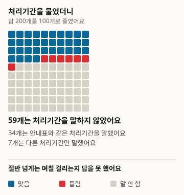
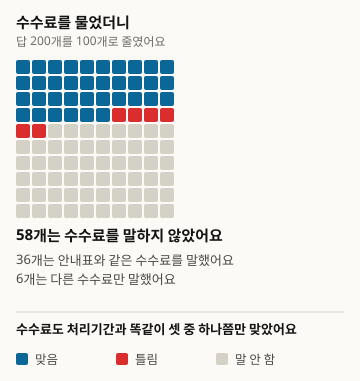
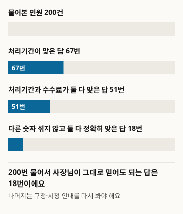
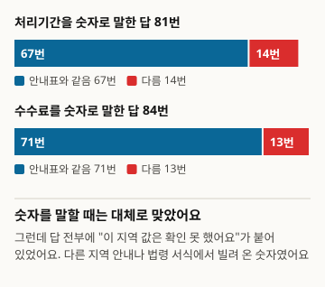

# 向AI询问营业申报的办理时限和手续费，它能答对吗

本文为译本。基准版为韩文原文,版本1: https://define404.com/report/006-business-permit-fees/

我们从6个市郡区的民愿办事指南表中抽取开业时要办的民愿200条，向具备网络搜索功能的AI助手询问办理时限和手续费，并与指南表中的数值逐一核对

- 作者：金夏原(Define404 Research)
- 日期：2026-11-10
- 类型：测量报告。新提问200条民愿，按规则判定。
- 预注册：研究仓库提交45ebc50(2026-11-10 01:38 ICT)。在采集前提交了包含假设、样本、判定规则和分析方法的prereg.md。
- DOI: https://doi.org/10.5281/zenodo.24091237
- 利益关系：作者所属的Define404正在筹备AI回答监测和按店铺的AI曝光诊断服务。本公司产品未纳入调查对象。

## 摘要

我们测量了店主向AI助手询问"到区厅办这个营业申报要几天，手续费多少？"时，能否得到正确答案。正确答案以公共数据门户公开的6个市郡区民愿事务指南为准。我们从营业申报、登记、许可民愿中办理时限和手续费各只有一个确定值的218条里随机抽取200条，并用韩语向具备网络搜索功能的Claude Sonnet 5.5逐条提问一次。200条回答全都表示无法确认该市郡区的数值。办理时限与指南表一致的回答为67条(33.5%)，手续费一致的回答为71条(35.5%)，不掺杂其他数字、两项都说得准确的回答为18条(9.0%)。只看给出数字的回答，办理时限82.7%、手续费84.5%与指南表相同。预注册假设H1(手续费比办理时限错得更多)和H2(办理时限短的民愿说对得更多)均未获支持。判定规则在采集后的核查中发现缺陷并作了修正，原规则的结果原样载于附录。

### 核心结果

- 200条回答全都含有"无法确认该市郡区的数值"这句话。给出数字时，借用的是其他地区的指南或法令表格作为参考。
- 办理时限说对的回答为200条中的67条，33.5%(95%置信区间27.3~40.3)，119条(59.5%)没有说办理时限。手续费说对的回答为71条，35.5%(29.2~42.3)，116条(58.0%)没有说。
- 不掺杂其他数字、办理时限和手续费两项都说得准确的回答为200条中的18条，9.0%(5.8~13.8)。
- 同一条民愿上，手续费正确率与办理时限正确率的差为+2.0个百分点(-3.9~7.9)，H1未获支持。短民愿与长民愿的办理时限正确率之差为-1.6个百分点(-14.8~11.5)，H2也未获支持。

<!-- src: 005-business-permits/analysis/out/results.json#preregistered.cells.all, H1, H2; exploratory.hedged, given_claim -->

## 1 引言

开店时，每个行业都要向区厅或市厅办理营业申报、登记、许可民愿。什么时候能开始营业取决于办理时限，手续费则因民愿不同，从免费到数万韩元不等。这些数值由市郡区以民愿事务指南的形式公开，但店主很少去找指南文件来打开。于是向AI助手询问"要几天？多少钱？"的情况越来越多。

测量AI对公共服务问题回答准确度的研究，如英国政府指南(Majithia 等 2026)或多国公共信息(Liu 等 2026)，针对的都是英语圈的制度(第2节)。像韩国市郡区民愿的办理时限、手续费这样，由公开指南表固定正确答案的数字，向具备网络搜索功能的通用AI助手提问并加以测量的报告，在我们确认的范围内没有找到。

本调查有三点贡献。以市郡区民愿事务指南为正确答案，随机抽取开业民愿200条，测量办理时限和手续费的正确率。把AI没有说数字的情况和说了其他数字的情况分开，看店主可以直接相信的回答有多少。抽样代码、判定规则、分析代码在采集前提交到仓库，采集后修正规则的过程和核查结果一并公开。

假设有两个。H1(第1项，配对比较)是：在同一条民愿上，说对手续费的比例低于说对办理时限的比例。H2(第2项)是：办理时限说对的比例，在办理时限短的民愿(即时~3日)中高于长的民愿(4日以上)。我们认为，凭猜测说常见数值时，短民愿会更常说对。

## 2 相关研究

测量语言模型对公共服务问题回答的研究近来增多。Majithia 等(2026)利用gov.uk公开信息合成了2万2千对英国市民问答，构建了CitizenQuery-UK基准。Liu 等(2026)用涵盖多国联邦、州、地方政府公共信息的CIVI基准评估了10个搜索智能体，报告称没有一个达到人类基线，且72.1%的失败出在搜索环节。Gosciak 等(2026)用美国SNAP咨询题目，实验了聊天机器人准确度对咨询员准确度的影响。在韩国法律方面，KBL(Kim 等 2024)与KoBLEX(Lee 等 2025)研究了法律知识和基于条文依据的推理。

这些研究针对的是英语圈制度，或者由专家判定、合成答案来确定正确答案，或者研究的是法律推理。本次调查只选了无需解释的两个数字(办理时限、手续费)，正确答案是市郡区公开的指南表数值。判定方式沿用FreshQA(Vu 等 2023)的宽松与严格两种分数，置信区间和配对差沿用Miller(2024)。样本不足40的单元格不作解释，这一标准取自PopQA(Mallen 等 2023)。以公开列表为正确答案、向AI助手提问的设计，与第5号扶持项目截止日期调查(Define404 Research 2026)一脉相承。

## 3 调查方法

图1. 调查是这样进行的

<!-- src: 005-business-permits/analysis/make_figures.py; analysis/out/results.json -->

### 3.1 总体与样本

正确答案来源是公共数据门户(data.go.kr)的市郡区民愿事务指南文件。2026-11-10用检索词민원편람、민원사무편람、민원사무현황下载了22个文件，其中办理时限和手续费两栏都有的6个被采用。文件无需登录或认证密钥即可下载。

表1. 正确答案来源(公共数据门户文件，2026-11-10接收)

| 市郡区 | 指南基准日 | 行 | 样本 |
|---|---|---|---|
| 首尔特别市 江西区 | 2025-09-16 | 773 | 55 |
| 庆尚北道 金泉市 | 2025-09-03 | 500 | 40 |
| 京畿道 始兴市 | 2026-09-11 | 498 | 34 |
| 江原特别自治道 江陵市 | 2025-11-21 | 444 | 31 |
| 大邱广域市 北区 | 2026-09-03 | 426 | 21 |
| 庆尚南道 昌宁郡 | 2025-11-25 | 373 | 19 |
| 合计 |  | 3,014 | 200 |

<!-- src: 005-business-permits/sampling/sample_log.txt; gate.md#1 -->

只保留开始新营业时要办的民愿。民愿名称中含有"业"字，且含有申报、登记、许可、指定之一的纳入；歇业、停业、变更、继承、补发、撤销等不属于开业的民愿排除(排除2,700行)。办理时限不是"即时"或"N日"单一值、或手续费不是"免费"或"N元"单一值的民愿也排除(94行)。电子与到访金额不同，或为"因类型而异"的民愿属于此类。民愿名称不足6个字的2行也排除。剩下的候选218条按文件编号和民愿名称排序，用种子20261110打乱后取前200条。

在200条样本中，办理时限短的民愿(即时~3日)为89条，长的民愿(4日以上)为111条。手续费免费80条，收费120条。1条民愿对应1条回答，所以民愿数200就是有效样本。H2的两个组接近在显著性水平5%、检验功效80%下检出20个百分点差异所需的每组98条。

### 3.2 提问

每条民愿生成一个韩语问题。问题模板为"{市郡区}에 '{민원사무명}' 민원을 내려고 해요. 처리기간은 며칠이고, 수수료는 얼마인가요?"。市郡区名称和民愿事务名称按指南表记载原样填入。问题分为20批、每批10题，批次文件中只有问题。

### 3.3 回答系统

回答系统只有一个条件：Claude Sonnet 5.5加网络搜索。选它是因为最接近人们实际使用的形态。一次调用负责一批(10题)，回答者不知道调查目的和正确答案。指示语要求每题都搜索，用提问的语言作答，收到搜索额度提示时停止，并只记录已搜索的题目。采集在2026-11-10进行。因搜索额度而缺失的3题重新获取，200条全部有效。197条搜索1次，3条搜索2次。

### 3.4 判定

判定由规则代码完成。把回答拆成句子，提取办理时限和手续费的主张值，与指南表数值比较。

- 办理时限：从含有处理、所需、花、期限等词的句子中提取"N日"和"即时"(包含当天、8小时以内)。日期写法和卫生教育、变更申报的期限不计。
- 手续费：从含有手续费、费用、缴纳等词的句子中提取金额和"免费"(无手续费、免除)。执照税、税额、债券、预存金等其他款项不计。
- 每个项目，没有主张值为未知，正确答案包含在主张值中为正确(宽松)，主张值只有正确答案一个为正确(严格)，没有正确答案则为错误。
- 两项都对是指办理时限和手续费都正确的情况。

没有使用LLM判定者和2名人工判定。无法用规则区分而由枢纽(hub)亲自判定的回答为0条。判定规则在采集后修改过一次(3.6节)。

### 3.5 分析

所有比例都附Wilson 95%置信区间。每条民愿只有一条回答，所以与按对象单位聚类的区间相同。H1是同一条民愿的手续费正确减去办理时限正确的配对差(Miller 2024)的95%置信区间和单侧z检验。H2是短民愿的办理时限正确比例减去长民愿比例的差。两个假设的p值做了Holm校正。按市郡区、免费与收费、给出数字的回答的正确率、错误回答的方向，是预注册中没有的探索性分析。样本不足40的单元格不作解释。

### 3.6 与预注册的差异

采集后，枢纽亲自阅读随机30条(核查用，种子20261110)的回答原文，并与规则提取的值对照。30条中有10条，注册规则(v1.0)提取错了值。把回答自己以"属于其他行业所以不适用"为由排除的金额也算了进去；同一句里有执照税时整句丢弃，漏掉了真正的手续费；还漏掉了"1周以内"或"需要10天"。

因此在解释分析结果之前，我们把规则改为v1.1。含有拒绝表述的句子的值不计，只删除执照税等词之后的一个金额，并把周单位和"N日要花"的句式算作办理时限。修正后的规则用与核查用不重叠的新随机30条(验证用，种子20261111)重新测量。30条中有8条仍有提取差异，判定60格(办理时限、手续费)中有7格与人工判读不同。人工判读是在不看正确答案、只读回答原文的情况下记录的。

按预注册第8节，v1.0的结果原样载于附录B。两个版本中H1、H2均未获支持，两个版本中两项都说得准确的回答都是18条。变化较大的是手续费错误(v1.0为25条，v1.1为13条)。

采集前我们看了试点2批(20条)，并在探索中增加了仅标记是否含有"无法确认"表述的一栏。该栏未用于判定。

## 4 结果

### 4.1 办理时限与手续费

表2. 说对办理时限和手续费的比例(判定规则v1.1，括号内为Wilson 95%置信区间)

| 项目 | 正确(宽松) | 正确(严格) | 错误 | 未说 |
|---|---|---|---|---|
| 办理时限 | 67 (33.5%; 27.3~40.3) | 44 (22.0%; 16.8~28.2) | 14 (7.0%; 4.2~11.4) | 119 (59.5%; 52.6~66.1) |
| 手续费 | 71 (35.5%; 29.2~42.3) | 48 (24.0%; 18.6~30.4) | 13 (6.5%; 3.8~10.8) | 116 (58.0%; 51.1~64.6) |
| 两项都 | 51 (25.5%; 20.0~32.0) | 18 (9.0%; 5.8~13.8) |  |  |

<!-- src: 005-business-permits/analysis/out/tables.md#표1~3; analysis/out/results.json#preregistered.cells.all -->

图2. 问AI 100次，说对办理时限的回答有多少(200条缩为100格并四舍五入)

<!-- src: 005-business-permits/analysis/make_figures.py; analysis/out/results.json#preregistered.cells.all -->

图3. 问AI 100次，说对手续费的回答有多少(200条缩为100格并四舍五入)

<!-- src: 005-business-permits/analysis/make_figures.py; analysis/out/results.json#preregistered.cells.all -->

办理时限和手续费都是大约三分之一说对，超过一半没有说数字。宽松分数与严格分数的配对差，办理时限为11.5个百分点(7.1~15.9)，手续费为11.5个百分点(7.1~15.9)。这意味着，大约每十条回答中就有一条，在正确的值旁边并排写了其他地区或其他流程的值。

图4. 办理时限和手续费两项都说得准确的回答，每十条只有一条

<!-- src: 005-business-permits/analysis/make_figures.py; analysis/out/results.json#preregistered.cells.all -->

### 4.2 预注册假设

表3. 预注册假设检验结果(差为个百分点，括号内为95%置信区间)

| 假设 | 差 | 单侧p | Holm p | 判定 |
|---|---|---|---|---|
| H1 | +2.0 (-3.9~7.9) | 0.747 | 1.000 | 未获支持 |
| H2 | -1.6 (-14.8~11.5) | 0.597 | 1.000 | 未获支持 |

<!-- src: 005-business-permits/analysis/out/tables.md#표4; analysis/out/results.json#preregistered.H1, H2, cells.short, cells.long -->

H1的方向就是反的。手续费正确率比办理时限高2.0个百分点，且置信区间包含0。两个项目的正确率在这份数据中无法区分。H2也是短民愿(n=89)32.6%(23.7~42.9)，长民愿(n=111)34.2%(26.1~43.5)，没有差异。AI凭猜测说常见值(3日)的假设，在这份数据中未获支持。

### 4.3 探索：给出数字的回答与"无法确认"

从这里起是预注册中没有的探索性分析。

200条回答全都含有"无法确认该市郡区的数值"这样的表述。给出数字的回答，是把其他市郡区的指南、法令表格的办理时限、施行规则的手续费表当作参考列出，并补充说"是否原样适用于本地区无法确认"。

只看给出数字的回答，说了办理时限的81条中有67条，82.7%(73.1~89.4)与指南表相同。说了手续费的84条中有71条，84.5%(75.3~90.7)相同。营业申报民愿的办理时限和手续费，多数由法令或全国统一标准规定，所以借用其他地区的值也经常说对。

图5. 给出数字时大体是对的，但全都附有"无法确认"

<!-- src: 005-business-permits/analysis/make_figures.py; analysis/out/results.json#exploratory.given_claim, hedged -->

错误的回答也有规律。办理时限错误的回答中，主张值只有一个的12条全都说得比指南表长(样本不足40，不作解释)。手续费错误的13条中，有8条对免费民愿说了金额，把收费民愿说成免费的回答为0条。

表4. 免费与收费民愿的正确率(探索，括号内为Wilson 95%置信区间)

| 类别 | n | 办理时限正确 | 手续费正确 | 两项都准确正确 |
|---|---|---|---|---|
| 免费民愿 | 80 | 17 (21.2%; 13.7~31.4) | 17 (21.2%; 13.7~31.4) | 5 (6.2%; 2.7~13.8) |
| 收费民愿 | 120 | 50 (41.7%; 33.2~50.6) | 54 (45.0%; 36.4~53.9) | 13 (10.8%; 6.4~17.7) |

<!-- src: 005-business-permits/analysis/out/results.json#preregistered.cells.free, paid -->

免费民愿的正确率较低。收费民愿有手续费表，容易被搜索到，免费民愿的依据资料似乎较少。按市郡区看，江西区(n=55)办理时限说对19条、手续费说对18条，金泉市(n=40)办理时限说对13条、手续费说对12条，其余四处样本不足40，不作解释。

<!-- src: 005-business-permits/analysis/out/results.json#exploratory.period_wrong_direction, fee_wrong_kind, by_city -->

## 5 讨论

在本次调查中，AI助手一次都没有说过自己确认了市郡区民愿的办理时限和手续费。市郡区民愿事务指南只以文件形式存在于公共数据门户，能直接搜索到的网页很少。AI转而找到其他地区的指南或法令表格，作为参考值给出，这些值在给出数字的回答中有80%以上与指南表相同。

从店主这边看，有两件事叠在一起。超过一半的回答根本拿不到数字。即使拿到数字，也与其他地区的值混在一起，或者附有"无法确认"的说明，难以直接相信。没有其他数字、两项都准确说对的回答，每十条只有一条。归根结底，十次中有九次还是要再看区厅、市厅的指南。

错误的方向也不是对店主不利的一边。办理时限说错的回答比指南表说得长，手续费说错的回答多是对免费民愿说了金额。错误地告知更快办完或不用花钱的情况很少。不过这一格样本很小，不能下定论。

判定规则在采集后修改这一点，需要谨慎看待。每条回答里"无法确认"和参考值混在一起，从句子里提取数字的规则很容易出错。修正后的规则在验证用30条中，判定60格里仍有7格与人工判读不同。正确率之类的比例可能在几个百分点以内波动。即便如此，200条全都回答了无法确认这一点，以及两项都准确说对的回答为18条这一点，在两个版本中是相同的。

### 店里马上能做的事

- 营业申报的办理时限和手续费，请不要依赖AI的回答，而是到区厅、市厅的民愿指南或政府24(정부24)确认。本次调查中，两项都准确说对的回答是200条中的18条。
- 如果AI说"无法确认，但其他区厅是3日"，那只是参考值，并不是该市郡区的值。
- 没有手续费的民愿，AI却说了金额，请再确认一次。手续费错误的13条中有8条属于这种情况。

## 6 局限

1. 回答系统只有Claude Sonnet 5.5网络搜索这一个条件，没有模型间比较。每题大多只搜索1次。如果是搜索更多的设置，结果可能不同。由一个智能体连续回答10题，前面的题目可能影响了后面的题目。
2. 判定规则在采集后修改过(3.6节)。修正后的规则在验证用30条中，判定60格里仍有7格与人工判读不同。原规则的结果在附录B。
3. 正确答案是市郡区指南。如果指南对法令修订的反映滞后，可能出现AI回答正确而指南错误的情况。指南基准日从2025-09到2026-09各不相同。
4. 6个市郡区是同时公开了办理时限、手续费两栏的地方，并不是随机选出的市郡区。只纳入办理时限、手续费为单一值的民愿，金额有多个的民愿被排除。
5. 机械地选取了民愿名称含"业"字的开业民愿，混入了几条难以视为开业的民愿，如开业申报(사업개시신고)或遗失申报。
6. 提问时原样放入民愿名称。这比店主实际含糊发问的情况条件更容易。
7. 采集只在2026-11-10一天进行。搜索结果每天都在变，同样的问题再问一次，数字可能不同。

## 7 伦理与利益关系

民愿名称、办理时限、手续费是市郡区公开的信息，所以原样载入公开资料。没有涉及可识别个人的信息。AI回答原文未放入公开资料。作者所属的Define404正在筹备AI回答监测和按店铺的AI曝光诊断服务。本公司产品未纳入调查对象。没有外部研究经费。

## 8 复现方法

- 公开仓库: https://github.com/johndefine404/define404-research-public (路径 005-business-permits)
- 正确答案来源: 公共数据门户 市郡区民愿事务指南6个(2026-11-10接收，文件编号见gate.md第1项) sampling/raw/minwon_<번호>.csv, 哈希 sampling/raw/SHA256SUMS, 下载 sampling/raw/download.sh
- 样本: sampling/draw_sample.py(种子20261110), 结果 sampling/sample.csv (SHA-256 f940f57621c88c8bd0fbcdcd84a984585ee51dfd58f540206570ed392fd11096, 两次运行一致)
- 提问: collect/question_templates.json v1.0, 批次 collect/batches/, 重试 collect/batches_retry/
- 判定: judge/auto_judge.py(v1.1, 结果 judge/judged.csv), judge/auto_judge_v10.py(注册规则 v1.0, 结果 judge/judged_v10.csv)。规则正文 judge/rules.md, 核查 judge/audit.py与audit_sample.json·audit_result.json
- 分析: analysis/run_analysis.py。结果 analysis/out/(v1.1), analysis/out_v10/(v1.0)的results.json, tables.md。正文中的数字只从这些文件摘录
- 图: analysis/make_figures.py从analysis/out/results.json读取数字并生成report/figures/*.svg
- 预注册: 研究仓库提交45ebc50 (2026-11-10 01:38 ICT)。在采集前提交了prereg.md
- 依赖: 只使用标准库
- 逐条民愿摘要数据(CSV): https://define404.com/report/data/006-business-permit-fees-summary.csv (民愿名称、正确答案、规则提取的值和判定v1.1·v1.0。没有AI回答原文)

## 参考文献

- Majithia, N. 等 (2026). The CitizenQuery Benchmark: A Novel Dataset and Evaluation Pipeline for Measuring LLM Performance in Citizen Query Tasks. arXiv:2602.04064. https://arxiv.org/abs/2602.04064
- Liu, D. 等 (2026). CIVI: A Framework for Diagnosing Search Agent Failures in Civic Information. arXiv:2609.08094. https://arxiv.org/abs/2609.08094
- Gosciak, J. 等 (2026). LLMs in social services: How does chatbot accuracy affect human accuracy? arXiv:2603.11213. https://arxiv.org/abs/2603.11213
- Kim, Y. 等 (2024). Developing a Pragmatic Benchmark for Assessing Korean Legal Language Understanding in Large Language Models. arXiv:2410.08731. https://arxiv.org/abs/2410.08731
- Lee, J. 等 (2025). KoBLEX: Open Legal Question Answering with Multi-hop Reasoning. arXiv:2509.01324. https://arxiv.org/abs/2509.01324
- Vu, T. 等 (2023). FreshLLMs: Refreshing Large Language Models with Search Engine Augmentation. arXiv:2310.03214. https://arxiv.org/abs/2310.03214
- Mallen, A. 等 (2023). When Not to Trust Language Models: Investigating Effectiveness of Parametric and Non-Parametric Memories. arXiv:2212.10511. https://arxiv.org/abs/2212.10511
- Miller, E. (2024). Adding Error Bars to Evals: A Statistical Approach to Language Model Evaluations. arXiv:2411.00640. https://arxiv.org/abs/2411.00640
- Define404 Research (2026). 向AI询问扶持项目公告，它能说对截止日期吗(韩文). https://define404.com/report/005-support-program-deadlines/

## 附录A 判定规则摘要(v1.1)

- 办理时限: 只看含有处理、所需、花、期限、时限、发放、完成之一的句子。含有拒绝表述(不适用、无法适用、其他行业、其他流程等)的句子跳过。即时、当天、立即处理、8小时以内为"即时"，N日、N个工作日、N个办公日为"N日"，N周为7N日，3~5日这样的范围两个端值都计。日期写法和卫生教育、开业期限不计。
- 手续费: 只看含有手续费、费用、缴纳、收费、印花、金额之一的句子，含有拒绝表述的句子跳过。执照税、税额、债券、预存金、评估、罚款等词之后25字以内的金额删除。免费、无手续费、免除、0元为"免费"，28,000元、2万8千元、2.8万元换算为以元为单位的整数。
- 分数: 没有主张值为未知，正确答案包含在主张值中为正确(宽松)，主张值只有正确答案一个为正确(严格)，其余为错误。
- 与注册规则v1.0的不同点: 跳过含拒绝表述的句子，只删除其后的一个金额而不是整个含排除词的句子，承认周单位和"N日要花"的句式。

## 附录B 注册规则v1.0的结果

按预注册第8节，载入原样套用注册判定规则(v1.0)的结果。

表5. 注册规则v1.0的正确率(括号内为Wilson 95%置信区间)

| 项目 | 正确(宽松) | 正确(严格) | 错误 | 未说 |
|---|---|---|---|---|
| 办理时限 | 71 (35.5%; 29.2~42.3) | 49 (24.5%; 19.1~30.9) | 16 (8.0%; 5.0~12.6) | 113 (56.5%; 49.6~63.2) |
| 手续费 | 71 (35.5%; 29.2~42.3) | 50 (25.0%; 19.5~31.4) | 25 (12.5%; 8.6~17.8) | 104 (52.0%; 45.1~58.8) |
| 两项都 | 46 (23.0%; 17.7~29.3) | 18 (9.0%; 5.8~13.8) |  |  |

<!-- src: 005-business-permits/analysis/out_v10/results.json#preregistered.cells.all -->

表6. 注册规则v1.0的假设检验(差为个百分点，括号内为95%置信区间)

| 假设 | 差 | 单侧p | Holm p | 判定 |
|---|---|---|---|---|
| H1 | +0.0 (-6.9~6.9) | 0.500 | 1.000 | 未获支持 |
| H2 | -1.2 (-14.5~12.1) | 0.570 | 1.000 | 未获支持 |

<!-- src: 005-business-permits/analysis/out_v10/results.json#preregistered.H1, H2 -->

v1.0中，给出数字的回答的正确率为：办理时限87条中的71条(81.6%)，手续费96条中的71条(74.0%)。手续费错误比v1.1多，是因为把回答自己排除的金额也算作了主张。

<!-- src: 005-business-permits/analysis/out_v10/results.json#exploratory.given_claim -->

## 附录C 相对于预注册的变更

| 项目 | 预注册 | 执行 |
|---|---|---|
| 判定规则 | v1.0(按句提取，含排除词的整句排除) | v1.1(跳过拒绝句，按金额单位排除，承认周单位)。v1.0结果见附录B |
| 规则核查 | 无 | 用核查用30条找出缺陷，用验证用30条测量v1.1(判定60格中7格有差异) |
| 探索栏 | 按市郡区、免费与收费、错误方向 | 看过试点20条后增加"无法确认"标记栏，采集后增加给出数字的回答的正确率 |
| 枢纽亲自判定 | 仅限规则无法区分的回答 | 0条 |
| 采集 | 2026-11-10，每次并行3个批次 | 2026-11-10，并行3~10个批次。因搜索额度缺失的3题通过重试补齐 |
