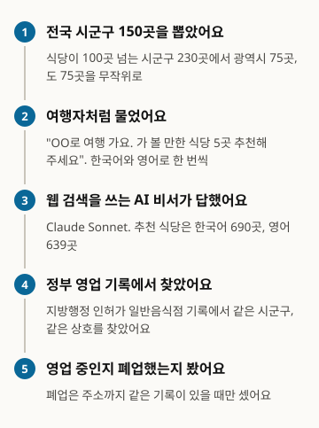
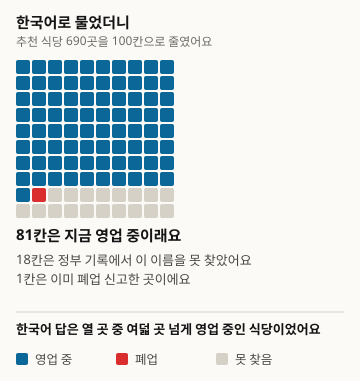
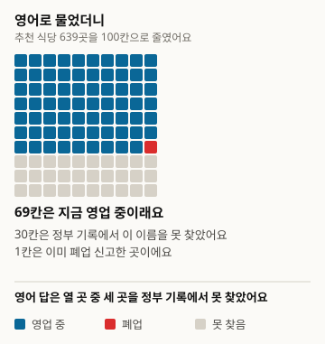
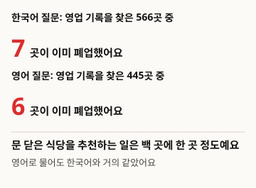
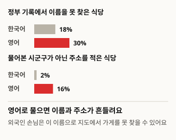

# Are the Restaurants AI Recommends to Travelers Really Open Right Now?

This is a translation. The reference version is the Korean original, version 1: https://define404.com/report/007-tourist-restaurant-picks/

We asked a web-search-enabled AI assistant, in Korean and in English, for restaurants worth visiting in 150 municipalities across Korea, and looked up the 1,329 recommended restaurants in government business records

- Author: Hawon Kim (Define404 Research)
- Date: 2026-11-16
- Type: Measurement report. 300 questions were newly asked and the recommended restaurants were judged by rule.
- Preregistration: research repository commit 6dc92ad (2026-11-14 02:13 ICT). The prereg.md file, containing the hypotheses, sample, judging rules, and analysis method, was committed before data collection.
- DOI: https://doi.org/10.5281/zenodo.24206700
- Conflicts of interest: the author's company, Define404, is preparing an AI answer monitoring service and a per-shop AI visibility check. Its own products were not included in the study.

## Summary

We measured whether a traveler who asks an AI assistant "I'm traveling to OO. Please recommend 5 restaurants worth visiting" is recommended restaurants that have already closed. From the 230 municipalities (si/gun/gu) with more than 100 general restaurants in business, we randomly drew 75 metropolitan and 75 provincial municipalities, and asked Claude Sonnet 5.5 with web search once in Korean and once in English. The 300 answers yielded 1,329 recommended restaurants, which we looked up in the local government licensing registry for general restaurants by the same municipality and the same business name. Of the 1,011 found in the registry, 13 (1.3%) had filed a closure, and there was no difference between Korean and English questions. Instead, the recommendations whose names could not be found in the registry were 30.4% for English questions and 18.0% for Korean questions, a difference of 14.3 percentage points when compared within the same municipality. Of the preregistered hypotheses, only H3 (English questions have a higher unverified share) was supported. A post-collection review found a defect in the closure judging rule and it was revised; the results under the original rule are reported unchanged in the appendix.

### Key results

- Of the 1,011 recommended restaurants found in government business records, 13 had filed a closure, 1.3% (95% confidence interval 0.6~2.0). The share was 1.2% (0.3~2.1) for Korean questions and 1.3% (0.3~2.4) for English questions.
- Within the same municipality, the difference in closure share between English and Korean questions was +0.2 percentage points (-1.1~1.5), so H1 was not supported. Provincial areas had 0.6% and metropolitan areas 2.1%, the opposite direction from H2.
- The share of recommended restaurants whose names could not be found in government records was 30.4% (26.2~34.5) for English questions and 18.0% (15.0~21.0) for Korean questions. The within-municipality difference was +14.3 percentage points (9.3~19.3), so H3 was supported.
- Exploratory: 16.0% of recommendations in English answers gave an address outside the municipality asked about, more than the 2.1% in Korean answers.

<!-- src: 007-tourist-closed-shops/analysis/out/results.json#loose.closed_all, closed_ko, closed_en, unverified_ko, unverified_en, H1, H2, H3; analysis/out/explore.json#addr_outside_area_ko, addr_outside_area_en -->

## 1 Introduction

More and more people ask AI assistants about restaurants at their travel destination. Foreign tourists often rely on AI answers written in English rather than on Korean map apps. Yet restaurants close often, and the reviews and listings left on the web are slow to change. If the AI passes on this old information as is, travelers end up standing in front of a closed shop, and the shop newly operating at that location misses customers.

There are many studies that use language models for travel planning, but most of them evaluated the quality of itineraries inside a prebuilt simulated environment or a given list of places (Section 2). Within the range we checked, we found no measurement of whether the restaurants an AI assistant actually recommended are still open according to government business records. We also found no measurement that compared answers to the same place asked in Korean and in English.

This study makes three contributions. With the local government licensing records as the ground truth source, we measured in 150 municipalities whether restaurants recommended by AI had already filed a closure. By asking about the same municipality in Korean and in English, we compared in pairs how much the question language changes closed recommendations and recommendations absent from the records. We committed the sample, judging rules, and analysis code to the repository before collection, and we publish the process of revising the rule after collection together with the results under the original rule.

There are three hypotheses. H1 (primary, paired comparison) is that, within the same municipality, the closure share of restaurants recommended for English questions is higher than for Korean questions. We expected English answers to rely on foreign-language travel reviews that are updated slowly. H2 (secondary) is that the closure share is higher in provincial municipalities than in metropolitan ones. H3 (secondary, paired comparison) is that the share of recommended restaurants not found in government records is higher for English questions.

## 2 Related Work

Several benchmarks evaluate travel planning with language models. TravelPlanner by Xie et al. (2024) evaluated 1,225 travel plans in a simulated environment holding about 4 million records, and reported that language agents of the time did not handle complex constraints well. TripTailor by Shen et al. (2025) evaluated personalized travel planning with more than 500,000 real places and about 4,000 itineraries. TravelEval by Chen et al. (2026) proposed a framework that evaluates travel plans along six dimensions: correctness, compliance, time, space, cost, and utility. On the fairness of recommendations, Ren et al. (2024) found ethnic and gender biases in travel recommendations and reported that hallucinations were more frequent in recommendations for minority groups. Venkateswaran et al. (2026) gave a list of Yelp restaurants and examined whether restaurant recommendations changed with the English dialect.

These studies evaluate inside a simulated environment or a list given by the researchers. This study compared the restaurants that a web-search AI assistant picked on its own against business records published by the government. The approach of asking about the same targets in several languages and comparing the answers continues from the cross-lingual consistency measurement of Qi et al. (2023). Judgments were made under two criteria, loose and strict, as in FreshQA (Vu et al. 2023), and the municipality-level confidence intervals and paired differences follow Miller (2024). The rule of not interpreting cells with fewer than 40 cases comes from PopQA (Mallen et al. 2023). The ground truth source is the same as in Report No. 2 (Define404 Research 2026), which used the same licensing records to ask an AI whether 800 closed shops were open.

## 3 Method

Figure 1. How we ran the study

<!-- src: 007-tourist-closed-shops/analysis/make_figures.py; analysis/out/results.json -->

### 3.1 Population and sample

The ground truth source is the local government licensing file for general restaurants (received 2026-10-21, 2,305,461 rows). It is the same file as in Report No. 2, and it was not changed during collection. The municipality was set from the first two tokens of the address (Sejong is a single province-level unit), and the general districts (gu) of administrative cities were merged into their city. Of all 247 municipalities, 230 have 100 or more general restaurants in business (77 metropolitan, 153 provincial). Metropolitan means the special and metropolitan cities, Sejong, and the 5 districts of the former Gwangju Metropolitan City.

From each stratum we drew 75 at random with seed 20261114, for 150 in total. Each municipality is a cluster, and the 150 municipalities are the effective sample. In the preregistration we calculated that, with a standard deviation of paired differences of 0.25, 150 municipalities detect a difference of about 5.7 percentage points at two-sided 5% with 80% power.

Table 1. Composition of the sampled municipalities

| Stratum | Eligible municipalities | Sample |
|---|---|---|
| Metropolitan | 77 | 75 |
| Provincial | 153 | 75 |
| Total | 230 | 150 |

<!-- src: 007-tourist-closed-shops/sampling/sample_log.json; prereg.md#3 -->

### 3.2 Questions

We asked once in Korean and once in English for each municipality. The Korean question was "{short province name} {municipality}로 여행 가요. 가 볼 만한 식당 5곳을 추천해 주세요. 가게마다 상호와 주소를 같이 적어 주세요." (I'm traveling to {short province name} {municipality}. Please recommend 5 restaurants worth visiting. Please give the business name and address for each.) The English question asked the same thing, giving the area name in both romanization and Hangul, and requested the Korean business name and address. This is because travelers who ask in English also need the Korean business name to show a taxi driver or a map. The 300 original questions are in the public repository.

### 3.3 Answering system

The answering system is a single one: Claude Sonnet 5.5 (claude-sonnet-5-5) with web search. Subagents received only the questions and answered after searching like an ordinary AI assistant; they did not know the research purpose, the sample, or the ground truth. Each agent handled only different municipalities in one language, and the Korean and English questions for the same municipality were answered by different agents. Along with the answer text, the respondent wrote the restaurants recommended in the answer as a list of names and addresses. Collection took place on a single day, 2026-11-14. All 300 answers searched at least once (336 searches in total), and there were no invalid answers with zero searches or a search-limit message.

### 3.4 Judging

For each recommended restaurant, we searched the licensing records within the municipality that was asked about. Business names were Unicode-normalized with spaces and symbols removed; equality counted as a strict match. After removing text in parentheses and a trailing "본점" (main branch), equality, or one name containing the other with the same road-name address, counted as a loose match. If any of the matched records was in business, the restaurant was open. The primary measure is the loose criterion, and the strict criterion is reported alongside as a sensitivity check. Names not in the answer text and recommendations from the 6th onward were excluded.

The rule revised after collection (v1.1) differs only when all matched records are closed. If the same municipality has a record in business whose business name is in a containment relation, it counts as open. Otherwise it counts as closed only when the road name + main building number or the lot number + main number of the answer's address matches the address of the closed record; if the address is missing or different, it is returned as unverified. The number of cells judged directly by the hub is 0.

### 3.5 Analysis

Every proportion has a delta-method 95% confidence interval from the municipality-cluster ratio estimator. H1 and H3 were tested one-sided as the mean difference in proportions over municipalities that have the relevant cell in both languages, and H2 as the difference between the proportions of the two strata. Holm correction was applied to the three hypotheses. Effect sizes and confidence intervals are given first and p-values after. Cells with fewer than 40 recommended restaurants were not interpreted. The analysis code uses only the standard library.

### 3.6 Changes from the preregistration

- The closure judging rule was revised from v1.0 to v1.1. Looking at the list of 47 closures produced by v1.0, well-known restaurants still in business had been matched to old closed records with the same name and counted as closed. The current shops were registered under a different name, with a menu item added after the business name. Under v1.1, 19 of the 47 became open, 15 became unverified (5 with no address, 10 with a different address), and 13 remained closed. The v1.0 results are reported unchanged in Appendix B.
- To speed up collection, each agent was given 2~3 batches in the same language (10~15 questions). The preregistration specified one batch (5 questions) at a time. The principle that the two languages for the same municipality are handled by different agents was kept.
- As exploratory cells, we looked at recommendations whose answer address was outside the municipality asked about, the districts of Incheon newly created in 2026, and source domains. All three are within the exploratory scope written in Section 9 of the preregistration.

## 4 Results

### 4.1 Business status of recommended restaurants

Table 2. Business status of recommended restaurants (judging rule v1.1, loose criterion, parentheses show municipality-cluster 95% confidence intervals)

| Question language | Recommended restaurants | Found in records | Closed share (of found) | Not-found share (of recommended) |
|---|---|---|---|---|
| Korean | 690 | 566 | 7 (1.2%; 0.3~2.1) | 124 (18.0%; 15.0~21.0) |
| English | 639 | 445 | 6 (1.3%; 0.3~2.4) | 194 (30.4%; 26.2~34.5) |
| Total | 1,329 | 1,011 | 13 (1.3%; 0.6~2.0) | 318 (23.9%; 21.2~26.7) |

<!-- src: 007-tourist-closed-shops/analysis/out/results.json#loose.closed_ko, closed_en, closed_all, unverified_ko, unverified_en, unverified_all -->

Figure 2. 100 restaurants the AI recommended when asked in Korean (690 restaurants reduced to 100 cells and rounded)

<!-- src: 007-tourist-closed-shops/analysis/make_figures.py; analysis/out/results.json#loose.closed_ko, unverified_ko -->

Figure 3. 100 restaurants the AI recommended when asked in English (639 restaurants reduced to 100 cells and rounded)

<!-- src: 007-tourist-closed-shops/analysis/make_figures.py; analysis/out/results.json#loose.closed_en, unverified_en -->

Of the recommended restaurants, 1,011 had names found in government records, and 13 of them had filed a closure. Under the strict criterion, it is 7 of 823 (0.9%; 0.2~1.5). The last closure dates of the 13 closed restaurants ranged from 0.1 to 11.0 years before the collection date, and 7 had closed within 3 years (exploratory).

Figure 4. About one in a hundred recommended restaurants had closed

<!-- src: 007-tourist-closed-shops/analysis/make_figures.py; analysis/out/results.json#loose.closed_ko, closed_en; analysis/out/explore.json#closed_years_since -->

### 4.2 Preregistered hypotheses

Table 3. Results of the preregistered hypothesis tests (judging rule v1.1, loose criterion, differences in percentage points, parentheses show 95% confidence intervals)

| Hypothesis | Difference | One-sided p | Holm p | Verdict |
|---|---|---|---|---|
| H1 | +0.2 (-1.1~1.5) | 0.372 | 0.745 | Not supported |
| H2 | -1.5 (-3.0~-0.0) | 0.978 | 0.978 | Not supported |
| H3 | +14.3 (9.3~19.3) | <0.001 | <0.001 | Supported |

<!-- src: 007-tourist-closed-shops/analysis/out/results.json#loose.H1, H2, H3, holm, closed_do, closed_metro -->

The paired comparison for H1 used the 138 municipalities that have recommendations found in the records in both languages. For H2, provincial areas had 3 of 527 (0.6%; 0.0~1.2) and metropolitan areas 10 of 484 (2.1%; 0.8~3.4), the opposite direction from the hypothesis. Since this direction was not preregistered, we only record it and do not interpret it. The paired comparison for H3 used the 149 municipalities that have recommendations in both languages. The English question for Seohae-gu, Incheon had 0 recommended restaurants and was dropped.

The conclusions are the same under the strict criterion. The closure share was 0.9% for Korean and 0.8% for English, and the H1 difference was +0.1 percentage points (-1.1~1.4). The unverified share was 33.6% for Korean and 42.9% for English, and the H3 difference was +10.9 percentage points (6.1~15.6).

<!-- src: 007-tourist-closed-shops/analysis/out/results.json#strict -->

### 4.3 Exploratory: names and addresses that waver in English answers

Answers to English questions had fewer recommendations to begin with. Answers that filled all 5 were 112 of 150 in Korean and 92 of 150 in English. On average, each answer recommended 4.6 restaurants in Korean and 4.26 in English. The respondents listed only places whose address they had confirmed, and stated in the answer why they could not fill the rest. Some English answers stated that the respondent had transcribed into Hangul a romanized name found in search.

Among recommendations that gave an address, addresses outside the municipality asked about were 85 of 530 (16.0%) in English and 14 of 656 (2.1%) in Korean. This cell checks only whether the municipality name appears in the answer address, so the districts of Incheon renamed in 2026 are counted more than they actually are.

<!-- src: 007-tourist-closed-shops/analysis/out/explore.json#recs_per_answer_ko, recs_per_answer_en, addr_outside_area_ko, addr_outside_area_en -->

Figure 5. Asked in English, names and addresses waver

<!-- src: 007-tourist-closed-shops/analysis/make_figures.py; analysis/out/results.json#loose.unverified_ko, unverified_en; analysis/out/explore.json#addr_outside_area_ko, addr_outside_area_en -->

In Seohae-gu, Incheon, newly created in 2026, the English respondent could not confirm the district name and made no recommendations, while the Korean respondent concluded that Seohae-gu did not exist and searched the former Seo-gu instead. All 4 restaurants in the English answer for Yeongjong-gu were not found in the records. The sample is small, so we do not interpret it.

The sources most cited in answers, in both languages, were the restaurant information sites siksinhot.com (124 Korean answers, 86 English answers) and polle.com (117 Korean, 62 English). In English answers, the foreign-language reservation site autoreserve.com (32) was the third most cited.

<!-- src: 007-tourist-closed-shops/analysis/out/explore.json#new_districts, top_domains_ko, top_domains_en -->

## 5 Discussion

Contrary to our initial concern, it was rare for a web-search AI assistant to recommend restaurants that had closed according to government records. It was about one in a hundred of the recommended restaurants found in the records, and it did not rise with the question language or the region. The fact that respondents recommended only places whose address they had confirmed in search results may have reduced closed recommendations. This follows the same pattern as Report No. 2, where the AI, given the names of closed shops, did not assert that they were open.

The problem came from somewhere else. Asked in English, three in ten recommended restaurants had no matching name in government records. That is 14.3 percentage points more than when asked in Korean, within the same municipality. English answers also had fewer recommendations and more recommendations giving an address outside the municipality asked about (exploratory). The cases include names in foreign-language reviews and reservation sites that differ from the business name registered with the government, and cases where the respondent guessed the Hangul for a romanized name. A restaurant not found in the records does not mean it has closed. Still, if a foreign traveler shows that name to a map or a taxi driver, they may not find the shop.

From the shop's point of view, the loss from a foreign-language name that does not match the actual business name looks larger than the loss from closure. This study cannot measure customer numbers, but the fact that 30% of recommendations for English questions do not connect to the records is something shops with many tourists should check first.

### What shops can do now

- Put both the English name and the Korean business name on map apps and reservation sites. In this study, when asked in English, 30.4% of restaurants recommended by AI could not be found in government business records.
- Make the business name on the sign, receipts, and maps the same as the registered business name. AI copies the name written in search results as is.
- If you moved or changed the business name, ask map apps and restaurant sites to correct the old information. 16.0% of English answers gave an address outside the municipality asked about.

## 6 Limitations

1. The answering system is a single condition, Claude Sonnet 5.5 with web search, so there is no comparison across models. Most questions involved one search. One agent answered 10~15 questions in a row, so earlier questions may have influenced later ones.
2. The closure judging rule was revised after collection (Section 3.6). v1.1 does not require address confirmation on the open side, so it leans toward counting fewer closures. The results under the original rule are in Appendix B, where the closure share is 4.6%.
3. The ground truth source is a file received on 2026-10-21. Shops that closed after that, or that did not file a closure, are counted as open. The closure share may have come out lower than the true value.
4. Only the licensing records for general restaurants were examined. Rest restaurants such as cafes and bakeries, shops that changed their business name, and shops registered under another name become unverified. Unverified does not mean closed; it means "not connected to the records."
5. We could not obtain a tourist-site-level source (the national standard data on tourist sites, 전국관광지정보표준데이터), so we used the municipality as the unit. Real travelers more often ask by neighborhood or tourist site name.
6. The English questions asked for the Korean business name. Without it, the answers could not be matched against the records, but this may be an easier condition than the questions real English speakers ask.
7. Collection was a single day, 2026-11-14. Search results change daily, so asking the same questions again may give different numbers.

## 7 Ethics and Conflicts of Interest

The business names and addresses in the licensing records are business information published by local governments. The public materials include only the business names and addresses the AI wrote in its answers and the judgment results; they do not include individual rows of the raw licensing data or the original AI answer texts. A closure judgment is the result of matching against the records and does not evaluate any particular shop. The author's company, Define404, is preparing an AI answer monitoring service and a per-shop AI visibility check. Its own products were not included in the study. There was no external funding.

## 8 Reproduction

- Public repository: https://github.com/johndefine404/define404-research-public (path 007-tourist-closed-shops)
- Ground truth source: local government licensing file for general restaurants (received 2026-10-21, SHA-256 2b548c6ecd66336e1b529d5213b6218d52d31d65a0284efa8e752020aeab24b4). Because of its size, only the hash is in the repository
- Sample: sampling/draw_sample.py (seed 20261114), result sampling/sample.csv (SHA-256 0dd3abcf902af48dbe6ad6100b07b9b6c9f3df6151bdb3ea3ae0baed0cbc4316, matched on two runs)
- Questions: collect/question_templates.json v1.0, original questions collect/items.csv, batches collect/batches/, instructions collect/PROTOCOL.md
- Judging: judge/auto_judge.py (v1.1, result judge/judged.csv), judge/auto_judge_v10.py (registered rule v1.0, result judge/judged_v10.csv). Rule text judge/rules.md
- Analysis: analysis/run_analysis.py, analysis/explore.py. Results in results.json under analysis/out/ (v1.1) and analysis/out_v10/ (v1.0). The numbers in the manuscript were copied only from these files
- Figures: analysis/make_figures.py reads the numbers from analysis/out/results.json and explore.json and creates report/figures/*.svg
- Preregistration: research repository commit 6dc92ad (2026-11-14 02:13 ICT). prereg.md was committed before collection
- Dependencies: standard library only
- Per-restaurant summary data (CSV): https://define404.com/report/data/007-tourist-restaurant-picks-summary.csv (municipality, question language, business name and address written by the AI, and judgments under v1.1 and v1.0; no raw AI answers)

## References

- Xie, J. 외 (2024). TravelPlanner: A Benchmark for Real-World Planning with Language Agents. arXiv:2402.01622. https://arxiv.org/abs/2402.01622
- Shen, Y. 외 (2025). TripTailor: A Real-World Benchmark for Personalized Travel Planning. arXiv:2508.01432. https://arxiv.org/abs/2508.01432
- Chen, W. 외 (2026). TravelEval: A Comprehensive Benchmarking Framework for Evaluating LLM-Powered Travel Planning Agents. arXiv:2606.01046. https://arxiv.org/abs/2606.01046
- Ren, R. 외 (2024). Whose Journey Matters? Investigating Identity Biases in Large Language Models (LLMs) for Travel Planning Assistance. arXiv:2410.17333. https://arxiv.org/abs/2410.17333
- Venkateswaran, N. 외 (2026). An Investigation of Linguistic Biases in LLM-Based Recommendations. arXiv:2604.25456. https://arxiv.org/abs/2604.25456
- Qi, J. 외 (2023). Cross-Lingual Consistency of Factual Knowledge in Multilingual Language Models. arXiv:2310.10378. https://arxiv.org/abs/2310.10378
- Vu, T. 외 (2023). FreshLLMs: Refreshing Large Language Models with Search Engine Augmentation. arXiv:2310.03214. https://arxiv.org/abs/2310.03214
- Mallen, A. 외 (2023). When Not to Trust Language Models: Investigating Effectiveness of Parametric and Non-Parametric Memories. arXiv:2212.10511. https://arxiv.org/abs/2212.10511
- Miller, E. (2024). Adding Error Bars to Evals: A Statistical Approach to Language Model Evaluations. arXiv:2411.00640. https://arxiv.org/abs/2411.00640
- Define404 Research (2026). Local404: AI는 폐업한 동네 가게를 아직 영업 중이라고 말하는가 [Local404: Does AI Say Closed Neighborhood Shops Are Still Open?]. https://define404.com/report/002-local404-closed-shops/

## Appendix A Summary of Judging Rules (v1.1)

- Lookup: search only within the municipality asked about. Strict is when the normalized business names are equal; loose is when they are equal after removing text in parentheses and a trailing "본점" (main branch), or when one name contains the other (the shorter one at least 3 characters) and the road name and main building number are the same.
- Business status: if any of the matched records is in business, the restaurant is open.
- Closed (v1.1): if all matched records are closed, first check whether the same municipality has a record in business whose business name is in a containment relation. If so, it is open. If not, it is closed only when the road name + main number or the lot number + main number of the answer's address matches the closed record; otherwise it is unverified.
- Difference from the registered rule v1.0: v1.0 counted a restaurant as closed whenever all matched records were closed, regardless of address.

## Appendix B Results under the Registered Rule v1.0

We report the results of applying the judging rule in Section 6 of the preregistration (v1.0) unchanged.

Table 4. Business status under the registered rule v1.0 (loose criterion, parentheses show municipality-cluster 95% confidence intervals)

| Question language | Found in records | Closed share (of found) | Not-found share (of recommended) |
|---|---|---|---|
| Korean | 572 | 23 (4.0%; 2.5~5.5) | 118 (17.1%; 14.2~20.0) |
| English | 454 | 24 (5.3%; 3.3~7.3) | 185 (29.0%; 24.8~33.1) |
| Total | 1,026 | 47 (4.6%; 3.3~5.9) | 303 (22.8%; 20.2~25.4) |

<!-- src: 007-tourist-closed-shops/analysis/out_v10/results.json#loose.closed_ko, closed_en, closed_all, unverified_ko, unverified_en, unverified_all -->

Table 5. Hypothesis tests under the registered rule v1.0 (loose criterion, differences in percentage points, parentheses show 95% confidence intervals)

| Hypothesis | Difference | One-sided p | Holm p | Verdict |
|---|---|---|---|---|
| H1 | +1.3 (-1.0~3.6) | 0.129 | 0.257 | Not supported |
| H2 | -2.1 (-4.7~0.5) | 0.942 | 0.942 | Not supported |
| H3 | +13.9 (8.8~19.0) | <0.001 | <0.001 | Supported |

<!-- src: 007-tourist-closed-shops/analysis/out_v10/results.json#loose.H1, H2, H3, holm -->

Under v1.0 the direction of the conclusions is also the same. The closure share is higher than under v1.1, but as the review in Section 3.6 showed, many of these are restaurants now in business under a different name.

## Appendix C Changes from the Preregistration

| Item | Preregistered | Executed |
|---|---|---|
| Closure judgment | v1.0 (closed if all matched records are closed) | v1.1 (check for in-business records under name variants, require address match). v1.0 results are in Appendix B |
| Collection grouping | One batch (5 questions) per agent | After 2 pilot batches, 2~3 batches in the same language (10~15 questions) per agent |
| Direct judging by the hub | Only cells the rules could not decide | 0 |
| Exploratory cells | Addresses outside the municipality, time since closure, source domains, strict versus loose difference | Same. Added the districts newly created in 2026 |
| Collection | 2026-11-14, 3 batches in parallel | 2026-11-14, 3 agents in parallel. 0 invalid answers |
