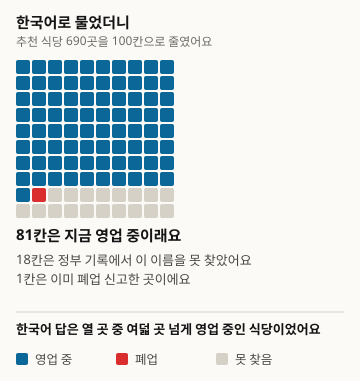
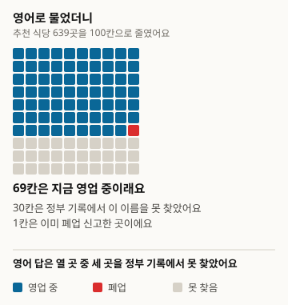
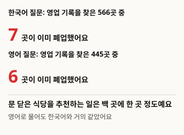
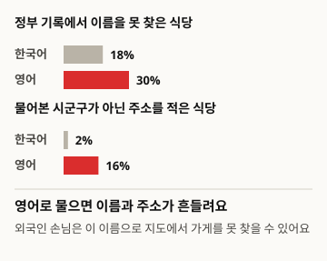

# AIが旅行者にすすめる飲食店は、本当にいまも営業しているのか

本稿は翻訳版です。基準版は韓国語、バージョン1です: https://define404.com/report/007-tourist-restaurant-picks/

全国の市郡区150か所について、行ってみる価値のある飲食店をウェブ検索を使うAIアシスタントに韓国語と英語で尋ね、すすめられた飲食店1,329か所を政府の営業記録で探しました

- 著者: 金夏原(キム・ハウォン、Define404 Research)
- 日付: 2026-11-16
- 種別: 測定報告。質問300件を新たに尋ね、すすめられた飲食店を規則で判定しました。
- 事前登録: 研究リポジトリのコミット6dc92ad(2026-11-14 02:13 ICT)。収集前に仮説・標本・判定規則・分析方法を記したprereg.mdをコミットしました。
- DOI: https://doi.org/10.5281/zenodo.24206700
- 利益相反: 著者が所属するDefine404は、AI回答モニタリングと店舗別AI露出診断のサービスを準備しています。自社製品は調査対象に含めていません。

## 要約

旅行者がAIアシスタントに「OOへ旅行に行きます。行ってみる価値のある飲食店を5か所すすめてください」と尋ねたとき、すでに閉店した飲食店をすすめられるかを測りました。営業中の一般飲食店が100か所を超える市郡区230か所から、広域75か所、道75か所を無作為に抽出し、ウェブ検索を使うClaude Sonnet 5.5に韓国語と英語で1回ずつ尋ねました。回答300件から、すすめられた飲食店1,329か所が得られ、これを地方行政許認可の一般飲食店記録で、同じ市郡区・同じ商号として探しました。記録で見つかった1,011か所のうち、廃業届が出ていた店は13か所(1.3%)で、韓国語と英語の質問の間に差はありませんでした。代わりに、記録で名前が見つからなかった推薦は英語の質問で30.4%、韓国語の質問で18.0%で、同じ市郡区どうしで比べた差は14.3ポイントでした。事前登録した仮説のうち、支持されたのはH3(英語の質問の方が未確認の割合が高い)だけでした。廃業の判定規則は収集後の点検で欠陥が見つかって修正し、元の規則による結果は付録にそのまま掲載しました。

### 主な結果

- 政府の営業記録で見つかった推薦飲食店1,011か所のうち、廃業届が出ていた店は13か所、1.3%(95%信頼区間0.6~2.0)でした。韓国語の質問は1.2%(0.3~2.1)、英語の質問は1.3%(0.3~2.4)です。
- 同じ市郡区での英語の質問と韓国語の質問の廃業割合の差は+0.2ポイント(-1.1~1.5)で、H1は支持されませんでした。道の地域は0.6%、広域は2.1%で、H2とは逆の方向でした。
- すすめられた飲食店のうち政府の記録で名前が見つからなかった割合は、英語の質問で30.4%(26.2~34.5)、韓国語の質問で18.0%(15.0~21.0)です。同じ市郡区どうしで比べた差は+14.3ポイント(9.3~19.3)で、H3は支持されました。
- 探索として見ると、英語の回答では尋ねた市郡区ではない場所の住所を書いた推薦が16.0%で、韓国語の回答の2.1%より多くありました。

<!-- src: 007-tourist-closed-shops/analysis/out/results.json#loose.closed_all, closed_ko, closed_en, unverified_ko, unverified_en, H1, H2, H3; analysis/out/explore.json#addr_outside_area_ko, addr_outside_area_en -->

## 1 はじめに

旅行先の飲食店をAIアシスタントに尋ねる人が増えています。外国人観光客は、韓国語の地図アプリよりも英語で書かれたAIの回答に頼ることが多いです。ところが飲食店はよく閉店し、ウェブに残る口コミや一覧はなかなか更新されません。AIがこうした古い情報をそのまま伝えると、旅行者は閉まった店の前に立つことになり、その場所で新たに営業している店はお客を逃します。

旅行計画に言語モデルを使う研究は多いものの、大半はあらかじめ作った模擬環境や、与えられた場所の一覧の中で日程の質を評価していました(2節)。AIアシスタントが実際にすすめた飲食店が、政府の営業記録上まだ営業中かを測った研究は、確認した範囲では見つかりませんでした。同じ場所を韓国語と英語で尋ねて比べた測定もありませんでした。

本調査の貢献は3つです。地方行政許認可記録を正解の出どころとし、AIがすすめた飲食店がすでに廃業届の出ている店かどうかを、市郡区150か所で測りました。同じ市郡区を韓国語と英語で尋ね、質問の言語によって廃業店の推薦と記録にない推薦がどれだけ変わるかを、対にして比べました。標本、判定規則、分析コードを収集前にリポジトリにコミットし、収集後に規則を直した経緯と元の規則による結果もあわせて公開しました。

仮説は3つです。H1(主仮説、対比較)は、同じ市郡区で英語の質問ですすめられた飲食店の廃業割合が、韓国語の質問より高いという仮説です。英語の回答は更新の遅い外国語の旅行口コミに頼るだろうと考えました。H2(副仮説)は、廃業割合が道の地域の市郡区で広域より高いという仮説です。H3(副仮説、対比較)は、すすめられた飲食店のうち政府の記録で見つからない割合が、英語の質問の方で高いという仮説です。

## 2 関連研究

旅行計画を言語モデルで評価するベンチマークがいくつも出ています。Xieら(2024)のTravelPlannerは、約400万件の記録を収めた模擬環境で旅行計画1,225件を評価し、当時の言語エージェントは複雑な制約をうまく守れないと報告しました。Shenら(2025)のTripTailorは、実在する場所50万か所余りと日程約4,000件で、個人に合わせた旅行計画を評価しました。Chenら(2026)のTravelEvalは、正確性・遵守・時間・空間・費用・効用の6つの次元で旅行計画を評価する枠組みを提案しました。推薦の公平性の面では、Renら(2024)が旅行推薦に民族・性別の偏りを見つけ、少数集団向けの推薦で幻覚がより多いと報告しました。Venkateswaranら(2026)は、Yelpの飲食店一覧を与えて、英語の方言によって飲食店の推薦が変わるかを調べました。

これらの研究は、模擬環境や研究者が与えた一覧の中で評価しています。本調査は、ウェブ検索を使うAIアシスタントが自ら選んだ飲食店を、政府が公開した営業記録と照合しました。同じ対象を複数の言語で尋ねて回答を比べる方法は、Qiら(2023)の言語間一貫性の測定につながります。判定はFreshQA(Vuら 2023)のように緩やかと厳格の2つの基準で出し、市郡区単位の信頼区間と対差はMiller(2024)に従いました。標本40未満の欄を解釈しない基準は、PopQA(Mallenら 2023)から取り入れました。同じ許認可記録を使って廃業店800か所の営業状況をAIに尋ねた2号(Define404 Research 2026)と、正解の出どころが同じです。

## 3 調査方法

図1. こうして調べました

<!-- src: 007-tourist-closed-shops/analysis/make_figures.py; analysis/out/results.json -->

### 3.1 母集団と標本

正解の出どころは、地方行政許認可の一般飲食店ファイルです(2026-10-21受信、2,305,461行)。2号と同じファイルで、収集中に差し替えていません。住所の最初の2トークンで市郡区を決め(世宗は市道1つ)、行政市の一般区は市にまとめました。営業中の一般飲食店が100か所以上ある市郡区は、全247か所のうち230か所(広域77、道153)です。広域は特別市・広域市と世宗、旧光州広域市の5つの区です。

層ごとに75か所をシード20261114で無作為に抽出し、150か所を決めました。市郡区1つが1つのクラスターで、市郡区150か所が実効標本です。事前登録では、対差の標準偏差を0.25とすると、150か所で両側5%、検出力80%のとき約5.7ポイントの差を検出できると計算しました。

表1. 標本市郡区の構成

| 層 | 対象市郡区 | 標本 |
|---|---|---|
| 広域 | 77 | 75 |
| 道 | 153 | 75 |
| 計 | 230 | 150 |

<!-- src: 007-tourist-closed-shops/sampling/sample_log.json; prereg.md#3 -->

### 3.2 質問

市郡区ごとに韓国語と英語で1回ずつ尋ねました。韓国語の質問は「{市道の略称} {市郡区}へ旅行に行きます。行ってみる価値のある飲食店を5か所すすめてください。店ごとに商号と住所も書いてください。」です。英語の質問は、ローマ字表記とハングルを併記した地域名で同じ内容を尋ね、ハングルの商号と住所を求めました。英語で尋ねる旅行者も、タクシーや地図で見せるハングルの商号が必要だからです。質問原文300件は公開リポジトリにあります。

### 3.3 回答システム

回答システムは、ウェブ検索を使うClaude Sonnet 5.5(claude-sonnet-5-5)1つです。サブエージェントが質問だけを受け取り、一般的なAIアシスタントのように検索してから答え、研究の目的・標本・正解は知りませんでした。1つのエージェントは1つの言語の互いに異なる市郡区だけを担当し、同じ市郡区の韓国語と英語は別のエージェントが答えました。回答者は回答本文とあわせて、回答ですすめた飲食店を名前・住所の一覧として書きました。収集は2026-11-14の1日で行いました。回答300件すべてが1回以上検索し(計336回)、検索0回や検索上限の文言がある無効回答はありませんでした。

### 3.4 判定

すすめられた飲食店ごとに、尋ねた市郡区の中で許認可記録を探しました。商号をUnicode正規化し、空白と記号を除いて同じなら厳格一致、括弧内の文字と末尾の「本店」を消して同じか、一方の名前が他方を含みつつ道路名住所が同じなら緩やか一致としました。見つかった記録のうち1つでも営業であれば営業です。主指標は緩やかな基準で、厳格な基準を感度分析としてあわせて出しました。回答本文にない名前と6番目以降の推薦は除きました。

収集後に改訂した規則(v1.1)は、見つかった記録がすべて廃業のときだけ異なります。同じ市郡区に、商号が包含関係にあって営業中の記録があれば営業とみなします。それ以外では、回答の住所の道路名+建物本番か地番+本番が廃業記録の住所と同じときだけ廃業と数え、住所がないか異なれば未確認に戻します。ハブが直接判定した欄は0件です。

### 3.5 分析

すべての割合に、市郡区クラスター比率推定量のデルタ法による95%信頼区間を付けました。H1とH3は両言語とも該当する欄がある市郡区の割合の差の平均で、H2は2つの層の割合の差で、片側検定を行いました。3つの仮説にHolm補正をかけました。効果の大きさと信頼区間を先に書き、p値は後に書きます。すすめられた飲食店が40か所未満の欄は解釈しませんでした。分析コードは標準ライブラリのみを使います。

### 3.6 事前登録からの変更点

- 廃業の判定規則をv1.0からv1.1に直しました。v1.0で出た廃業47件の一覧を見ると、いまも営業している有名な飲食店が同じ名前の古い廃業記録に当てはめられ、廃業として数えられていました。現在の店は、商号の後にメニュー名を付けた別の名前で届け出ていました。v1.1では47件のうち19件が営業、15件が未確認(住所なし5、住所違い10)になり、13件が廃業として残りました。v1.0の結果は付録Bにそのまま掲載しました。
- 収集を速めるため、1つのエージェントに同じ言語のバッチを2~3個(10~15問)任せました。事前登録ではバッチ1つ(5問)ずつでした。同じ市郡区の2つの言語を別のエージェントが担当する原則は守りました。
- 探索の欄として、回答の住所が尋ねた市郡区の外にある推薦、2026年に新設された仁川の区、出典ドメインを調べました。3つとも事前登録9節に記した探索範囲の中です。

## 4 結果

### 4.1 すすめられた飲食店の営業状態

表2. すすめられた飲食店の営業状態(判定規則v1.1、緩やかな基準、括弧内は市郡区クラスター95%信頼区間)

| 質問の言語 | 推薦飲食店 | 記録で発見 | 廃業の割合(発見分のうち) | 未発見の割合(推薦のうち) |
|---|---|---|---|---|
| 韓国語 | 690 | 566 | 7 (1.2%; 0.3~2.1) | 124 (18.0%; 15.0~21.0) |
| 英語 | 639 | 445 | 6 (1.3%; 0.3~2.4) | 194 (30.4%; 26.2~34.5) |
| 計 | 1,329 | 1,011 | 13 (1.3%; 0.6~2.0) | 318 (23.9%; 21.2~26.7) |

<!-- src: 007-tourist-closed-shops/analysis/out/results.json#loose.closed_ko, closed_en, closed_all, unverified_ko, unverified_en, unverified_all -->

図2. 韓国語で尋ねたときにAIがすすめた飲食店100か所(690か所を100マスに縮めて四捨五入しました)

<!-- src: 007-tourist-closed-shops/analysis/make_figures.py; analysis/out/results.json#loose.closed_ko, unverified_ko -->

図3. 英語で尋ねたときにAIがすすめた飲食店100か所(639か所を100マスに縮めて四捨五入しました)

<!-- src: 007-tourist-closed-shops/analysis/make_figures.py; analysis/out/results.json#loose.closed_en, unverified_en -->

すすめられた飲食店のうち、政府の記録で名前が見つかった店は1,011か所で、そのうち廃業届が出ていた店は13か所でした。厳格な基準で見ると、823か所のうち7か所(0.9%; 0.2~1.5)です。廃業13か所の最後の廃業日は、収集日を基準に0.1年前から11.0年前まで散らばっていて、7か所は3年以内に閉店した店です(探索)。

図4. 廃業した飲食店の推薦は、100か所に1か所ほどです

<!-- src: 007-tourist-closed-shops/analysis/make_figures.py; analysis/out/results.json#loose.closed_ko, closed_en; analysis/out/explore.json#closed_years_since -->

### 4.2 事前登録した仮説

表3. 事前登録した仮説の検定結果(判定規則v1.1、緩やかな基準、差はポイント、括弧内は95%信頼区間)

| 仮説 | 差 | 片側p | Holm p | 判定 |
|---|---|---|---|---|
| H1 | +0.2 (-1.1~1.5) | 0.372 | 0.745 | 支持されず |
| H2 | -1.5 (-3.0~-0.0) | 0.978 | 0.978 | 支持されず |
| H3 | +14.3 (9.3~19.3) | <0.001 | <0.001 | 支持 |

<!-- src: 007-tourist-closed-shops/analysis/out/results.json#loose.H1, H2, H3, holm, closed_do, closed_metro -->

H1の対比較は、両言語とも記録で見つかった推薦がある市郡区138か所で行いました。H2は、道の地域527か所のうち3か所(0.6%; 0.0~1.2)、広域484か所のうち10か所(2.1%; 0.8~3.4)で、仮説と逆の方向でした。この方向は事前登録していないため、解釈せずに記すだけにとどめます。H3の対比較は、両言語とも推薦がある市郡区149か所で行いました。仁川西海区の英語の質問は、すすめられた飲食店が0か所だったため除きました。

厳格な基準でも結論は同じです。廃業割合は韓国語0.9%、英語0.8%、H1の差は+0.1ポイント(-1.1~1.4)でした。未確認の割合は韓国語33.6%、英語42.9%、H3の差は+10.9ポイント(6.1~15.6)でした。

<!-- src: 007-tourist-closed-shops/analysis/out/results.json#strict -->

### 4.3 探索: 英語の回答で揺れる名前と住所

英語の質問への回答は、まず推薦の数が少なめでした。5か所をすべて埋めた回答は、韓国語150件のうち112件、英語150件のうち92件でした。回答1件あたり平均で、韓国語は4.6か所、英語は4.26か所をすすめました。回答者は住所を確認した店だけを書き、埋められなかった理由を回答に記しました。英語の回答の一部には、検索で出てきたローマ字の名前を回答者がハングルに書き換えたと記されていました。

住所を書いた推薦のうち、尋ねた市郡区ではない場所の住所は、英語530か所のうち85か所(16.0%)、韓国語656か所のうち14か所(2.1%)でした。この欄は回答の住所に市郡区の名前が入っているかだけを見ているため、2026年に名前が変わった仁川の区は実際より多く数えられます。

<!-- src: 007-tourist-closed-shops/analysis/out/explore.json#recs_per_answer_ko, recs_per_answer_en, addr_outside_area_ko, addr_outside_area_en -->

図5. 英語で尋ねると、名前と住所が揺れます

<!-- src: 007-tourist-closed-shops/analysis/make_figures.py; analysis/out/results.json#loose.unverified_ko, unverified_en; analysis/out/explore.json#addr_outside_area_ko, addr_outside_area_en -->

2026年に新設された仁川西海区では、英語の回答者が区の名前を確認できずに推薦をせず、韓国語の回答者は西海区は存在しないと判断して旧西区に置き換えて探しました。永宗区の英語の回答は、4か所すべてが記録で見つかりませんでした。標本が小さいため解釈しません。

回答が引用した出典は、両言語ともグルメ情報サイトのsiksinhot.com(韓国語124件、英語86件の回答)とpolle.com(韓国語117件、英語62件)が最も多くありました。英語の回答では、外国語の予約サイトautoreserve.com(32件)が3番目に多くありました。

<!-- src: 007-tourist-closed-shops/analysis/out/explore.json#new_districts, top_domains_ko, top_domains_en -->

## 5 考察

当初の懸念とは異なり、ウェブ検索を使うAIアシスタントが政府の記録上廃業した飲食店をすすめることはまれでした。記録で見つかった推薦飲食店100か所に1か所ほどで、質問の言語や地域によって増えることもありませんでした。回答者が検索結果で住所を確認した店だけをすすめたことが、廃業店の推薦を減らした可能性があります。2号で、AIが廃業店の名前を受け取っても営業中だと断定しなかったのと同じ流れです。

問題は別のところで出ました。英語で尋ねると、すすめられた飲食店10か所のうち3か所は、政府の記録で同じ名前を見つけられませんでした。韓国語で尋ねたときより、同じ市郡区を基準に14.3ポイント多くありました。英語の回答は推薦の数も少なく、尋ねた市郡区の外の住所を書いた推薦も多くありました(探索)。外国語の口コミや予約サイトに書かれた名前が政府に届け出た商号と異なる場合や、回答者がローマ字の名前をハングルに推測して書き換えた場合が混ざっています。記録で見つからなかった飲食店が閉店した店だという意味ではありません。ただ、外国人旅行者がその名前を地図やタクシーで見せても、店にたどり着けない可能性があります。

店の側から見ると、閉店によって生じる損失よりも、外国語で呼ばれる名前が実際の商号とずれることで生じる損失の方が大きく見えます。本調査で客数を測ることはできませんが、英語の質問による推薦の30%が記録とつながらないという点は、観光客の多い店がまず確認すべきことです。

### 店でいますぐできること

- 地図アプリと予約サイトに、英語の名前とハングルの商号を並べて載せておいてください。今回の調査では、英語で尋ねるとAIがすすめた飲食店の30.4%を政府の営業記録で見つけられませんでした。
- 看板、レシート、地図に書かれた商号を、営業届出の商号と同じにそろえてください。AIは検索結果に書かれた名前をそのまま書き写します。
- 移転したり商号を変えたりした場合は、地図アプリとグルメサイトの古い情報を直すよう依頼してください。英語の回答の16.0%は、尋ねた市郡区ではない住所を書いていました。

## 6 限界

1. 回答システムがClaude Sonnet 5.5のウェブ検索条件1つだけなので、モデル間の比較はありません。設問あたりの検索は大半が1回でした。1つのエージェントが10~15問を続けて答えたため、前の設問が後ろの設問に影響した可能性があります。
2. 廃業の判定規則を収集後に直しました(3.6節)。v1.1は営業の側には住所の確認をかけていないため、廃業を少なめに数える方向に傾いています。元の規則の結果は付録Bにあり、廃業割合は4.6%です。
3. 正解の出どころは2026-10-21に受け取ったファイルです。その後に廃業した店や、廃業届を出していない店は営業として数えられます。廃業割合は実際より低く出た可能性があります。
4. 許認可の一般飲食店記録だけを見ました。カフェ・パン屋のような休憩飲食店、商号を変えた店、別の名前で届け出た店は未確認になります。未確認は廃業ではなく「記録からつながらない」という意味です。
5. 観光地単位の出どころ(全国観光地情報標準データ)を入手できなかったため、市郡区を単位にしました。実際の旅行者は、町や観光地の名前で尋ねることの方が多いです。
6. 英語の質問でハングルの商号を求めました。ハングルの商号を尋ねないと記録と照合できないためですが、実際の英語利用者の質問より易しい条件かもしれません。
7. 収集は2026-11-14の1日だけです。検索結果は日々変わるため、同じ質問をもう一度すると数字が変わる可能性があります。

## 7 倫理と利益相反

許認可記録の商号と住所は、地方自治体が公開した営業情報です。公開資料には、AIが回答に書いた商号と住所、判定結果だけを載せ、許認可原データの個別の行やAIの回答原文は入れていません。廃業の判定は記録照合の結果であり、特定の店を評価するものではありません。著者が所属するDefine404は、AI回答モニタリングと店舗別AI露出診断のサービスを準備しています。自社製品は調査対象に含めていません。外部の研究費はありません。

## 8 再現方法

- 公開リポジトリ: https://github.com/johndefine404/define404-research-public (パス 007-tourist-closed-shops)
- 正解の出どころ: 地方行政許認可の一般飲食店ファイル(2026-10-21受信、SHA-256 2b548c6ecd66336e1b529d5213b6218d52d31d65a0284efa8e752020aeab24b4)。サイズが大きいため、リポジトリにはハッシュのみがあります
- 標本: sampling/draw_sample.py(シード20261114)、結果 sampling/sample.csv (SHA-256 0dd3abcf902af48dbe6ad6100b07b9b6c9f3df6151bdb3ea3ae0baed0cbc4316、2回実行で一致)
- 質問: collect/question_templates.json v1.0、質問原文 collect/items.csv、バッチ collect/batches/、指示文 collect/PROTOCOL.md
- 判定: judge/auto_judge.py(v1.1、結果 judge/judged.csv)、judge/auto_judge_v10.py(登録規則v1.0、結果 judge/judged_v10.csv)。規則本文 judge/rules.md
- 分析: analysis/run_analysis.py、analysis/explore.py。結果 analysis/out/(v1.1)、analysis/out_v10/(v1.0)のresults.json。原稿の数字は、このファイルからのみ転記しました
- 図: analysis/make_figures.pyがanalysis/out/results.jsonとexplore.jsonから数字を読み、report/figures/*.svgを作ります
- 事前登録: 研究リポジトリのコミット6dc92ad (2026-11-14 02:13 ICT)。収集前にprereg.mdをコミットしました
- 依存関係: 標準ライブラリのみ使います
- 推薦飲食店別の要約データ(CSV): https://define404.com/report/data/007-tourist-restaurant-picks-summary.csv (市郡区、質問の言語、AIが書いた商号・住所、判定v1.1・v1.0。AIの回答原文は含みません)

## 参考文献

- Xie, J. 외 (2024). TravelPlanner: A Benchmark for Real-World Planning with Language Agents. arXiv:2402.01622. https://arxiv.org/abs/2402.01622
- Shen, Y. 외 (2025). TripTailor: A Real-World Benchmark for Personalized Travel Planning. arXiv:2508.01432. https://arxiv.org/abs/2508.01432
- Chen, W. 외 (2026). TravelEval: A Comprehensive Benchmarking Framework for Evaluating LLM-Powered Travel Planning Agents. arXiv:2606.01046. https://arxiv.org/abs/2606.01046
- Ren, R. 외 (2024). Whose Journey Matters? Investigating Identity Biases in Large Language Models (LLMs) for Travel Planning Assistance. arXiv:2410.17333. https://arxiv.org/abs/2410.17333
- Venkateswaran, N. 외 (2026). An Investigation of Linguistic Biases in LLM-Based Recommendations. arXiv:2604.25456. https://arxiv.org/abs/2604.25456
- Qi, J. 외 (2023). Cross-Lingual Consistency of Factual Knowledge in Multilingual Language Models. arXiv:2310.10378. https://arxiv.org/abs/2310.10378
- Vu, T. 외 (2023). FreshLLMs: Refreshing Large Language Models with Search Engine Augmentation. arXiv:2310.03214. https://arxiv.org/abs/2310.03214
- Mallen, A. 외 (2023). When Not to Trust Language Models: Investigating Effectiveness of Parametric and Non-Parametric Memories. arXiv:2212.10511. https://arxiv.org/abs/2212.10511
- Miller, E. (2024). Adding Error Bars to Evals: A Statistical Approach to Language Model Evaluations. arXiv:2411.00640. https://arxiv.org/abs/2411.00640
- Define404 Research (2026). Local404: AI는 폐업한 동네 가게를 아직 영업 중이라고 말하는가. https://define404.com/report/002-local404-closed-shops/

## 付録A 判定規則の要約(v1.1)

- 探し方: 尋ねた市郡区の中だけで探します。厳格は正規化した商号が同じとき、緩やかは括弧内の文字と末尾の「本店」を消して同じとき、または一方の名前が他方を含み(短い方が3文字以上)道路名と建物本番が同じときです。
- 営業状態: 見つかった記録のうち1つでも営業であれば営業です。
- 廃業(v1.1): 見つかった記録がすべて廃業であれば、同じ市郡区に商号が包含関係にある営業記録があるかをまず見ます。あれば営業です。なければ、回答の住所の道路名+本番か地番+本番が廃業記録と同じときだけ廃業で、それ以外は未確認です。
- 登録規則v1.0との違い: v1.0は、見つかった記録がすべて廃業であれば、住所に関係なく廃業と数えていました。

## 付録B 登録規則v1.0の結果

事前登録6節の判定規則(v1.0)をそのまま適用した結果を掲載します。

表4. 登録規則v1.0の営業状態(緩やかな基準、括弧内は市郡区クラスター95%信頼区間)

| 質問の言語 | 記録で発見 | 廃業の割合(発見分のうち) | 未発見の割合(推薦のうち) |
|---|---|---|---|
| 韓国語 | 572 | 23 (4.0%; 2.5~5.5) | 118 (17.1%; 14.2~20.0) |
| 英語 | 454 | 24 (5.3%; 3.3~7.3) | 185 (29.0%; 24.8~33.1) |
| 計 | 1,026 | 47 (4.6%; 3.3~5.9) | 303 (22.8%; 20.2~25.4) |

<!-- src: 007-tourist-closed-shops/analysis/out_v10/results.json#loose.closed_ko, closed_en, closed_all, unverified_ko, unverified_en, unverified_all -->

表5. 登録規則v1.0の仮説検定(緩やかな基準、差はポイント、括弧内は95%信頼区間)

| 仮説 | 差 | 片側p | Holm p | 判定 |
|---|---|---|---|---|
| H1 | +1.3 (-1.0~3.6) | 0.129 | 0.257 | 支持されず |
| H2 | -2.1 (-4.7~0.5) | 0.942 | 0.942 | 支持されず |
| H3 | +13.9 (8.8~19.0) | <0.001 | <0.001 | 支持 |

<!-- src: 007-tourist-closed-shops/analysis/out_v10/results.json#loose.H1, H2, H3, holm -->

v1.0でも結論の方向は同じです。廃業割合はv1.1より高いものの、3.6節の点検のとおり、このうちかなりの数はいま別の名前で営業している飲食店です。

## 付録C 事前登録との相違

| 項目 | 事前登録 | 実施 |
|---|---|---|
| 廃業の判定 | v1.0(見つかった記録がすべて廃業なら廃業) | v1.1(名前の変形による営業記録を確認、住所の一致を要求)。v1.0の結果は付録B |
| 収集のまとまり | 1つのエージェントにバッチ1つ(5問) | 試行2バッチの後、1つのエージェントに同じ言語のバッチ2~3個(10~15問) |
| ハブによる直接判定 | 規則で分けられない欄のみ | 0件 |
| 探索の欄 | 市郡区外の住所、廃業からの経過、出典ドメイン、厳格・緩やかの差 | 同じ。2026年新設の区を追加 |
| 収集 | 2026-11-14、バッチ3つずつ並列 | 2026-11-14、エージェント3つずつ並列。無効回答0 |
