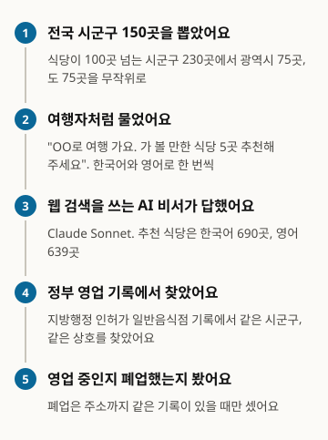
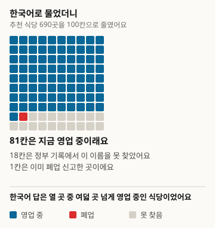
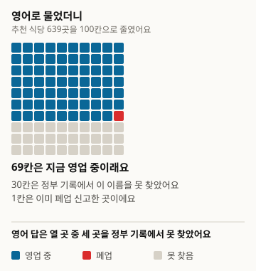
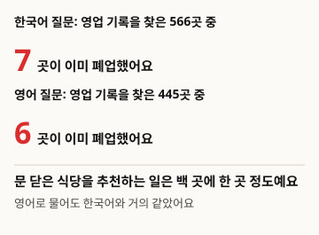
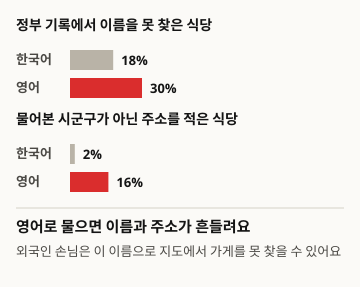

# AI가 여행자에게 추천하는 식당, 정말 지금 영업 중일까요

전국 시군구 150곳의 가 볼 만한 식당을 웹 검색 AI 비서에게 한국어와 영어로 묻고, 추천된 식당 1,329곳을 정부 영업 기록에서 찾아 봤어요

- 저자: 김하원 (Define404 Research)
- 날짜: 2026-11-16
- 유형: 측정 보고서. 질문 300개를 새로 묻고 추천 식당을 규칙으로 판정했어요.
- 사전 등록: 연구 저장소 커밋 6dc92ad(2026-11-14 02:13 ICT). 수집 전에 가설·표본·판정 규칙·분석 방법을 담은 prereg.md를 커밋했어요.
- DOI: https://doi.org/10.5281/zenodo.24206700
- 이해관계: 저자 소속 Define404는 AI 응답 모니터링과 가게별 AI 노출 진단 서비스를 준비하고 있어요. 자사 제품은 조사 대상에 넣지 않았어요.

## 요약

여행자가 AI 비서에게 "OO로 여행 가요, 가 볼 만한 식당 5곳 추천해 주세요"라고 물으면 이미 문 닫은 식당을 추천받는지 쟀어요. 영업 중인 일반음식점이 100곳 넘는 시군구 230곳에서 광역 75곳, 도 75곳을 무작위로 뽑고, 웹 검색을 쓰는 Claude Sonnet 5.5에게 한국어와 영어로 한 번씩 물었어요. 답 300개에서 추천 식당 1,329곳이 나왔고, 이를 지방행정 인허가 일반음식점 기록에서 같은 시군구, 같은 상호로 찾았어요. 기록에서 찾은 1,011곳 중 폐업 신고된 곳은 13곳(1.3%)이었고, 한국어와 영어 질문 사이 차이는 없었어요. 대신 기록에서 이름을 찾지 못한 추천은 영어 질문 30.4%, 한국어 질문 18.0%로, 같은 시군구끼리 비교한 차이가 14.3%p였어요. 사전 등록 가설 가운데 H3(영어 질문의 미확인 비율이 더 높음)만 지지됐어요. 폐업 판정 규칙은 수집 뒤 점검에서 결함을 찾아 고쳤고, 원래 규칙의 결과는 부록에 그대로 실었어요.

### 핵심 결과

- 정부 영업 기록에서 찾은 추천 식당 1,011곳 중 폐업 신고된 곳은 13곳, 1.3%(95% 신뢰구간 0.6~2.0)였어요. 한국어 질문 1.2%(0.3~2.1), 영어 질문 1.3%(0.3~2.4)예요.
- 같은 시군구에서 영어 질문과 한국어 질문의 폐업 비율 차이는 +0.2%p(-1.1~1.5)로 H1은 지지되지 않았어요. 도 지역은 0.6%, 광역은 2.1%로 H2와 반대 방향이었어요.
- 추천 식당 중 정부 기록에서 이름을 찾지 못한 비율은 영어 질문 30.4%(26.2~34.5), 한국어 질문 18.0%(15.0~21.0)예요. 같은 시군구끼리 비교한 차이는 +14.3%p(9.3~19.3)로 H3이 지지됐어요.
- 탐색으로 보면 영어 답은 물어본 시군구가 아닌 곳의 주소를 적은 추천이 16.0%로, 한국어 답 2.1%보다 많았어요.

<!-- src: 007-tourist-closed-shops/analysis/out/results.json#loose.closed_all, closed_ko, closed_en, unverified_ko, unverified_en, H1, H2, H3; analysis/out/explore.json#addr_outside_area_ko, addr_outside_area_en -->

## 1 서론

여행 갈 곳의 식당을 AI 비서에게 묻는 사람이 늘고 있어요. 외국인 관광객은 한국어 지도 앱보다 영어로 쓴 AI 답에 기대는 일이 많아요. 그런데 식당은 자주 문을 닫고, 웹에 남은 후기와 목록은 늦게 바뀌어요. AI가 이런 옛 정보를 그대로 옮기면 여행자는 문 닫은 가게 앞에 서게 되고, 그 자리에서 새로 영업하는 가게는 손님을 놓쳐요.

여행 계획에 언어 모델을 쓰는 연구는 많지만, 대부분 미리 만든 모의 환경이나 주어진 장소 목록 안에서 일정의 품질을 평가했어요(2절). AI 비서가 실제로 추천한 식당이 정부 영업 기록상 아직 영업 중인지 잰 측정은 확인한 범위에서 찾지 못했어요. 한국어와 영어로 같은 곳을 물어 비교한 측정도 없었어요.

이 조사의 기여는 세 가지예요. 지방행정 인허가 기록을 정답 원천으로 두고, AI가 추천한 식당이 이미 폐업 신고된 곳인지 시군구 150곳에서 쟀어요. 같은 시군구를 한국어와 영어로 물어, 질문 언어에 따라 폐업 추천과 기록에 없는 추천이 얼마나 달라지는지 짝으로 비교했어요. 표본, 판정 규칙, 분석 코드를 수집 전에 저장소에 커밋했고, 수집 뒤 규칙을 고친 과정과 원래 규칙의 결과를 함께 공개했어요.

가설은 세 개예요. H1(1차, 짝 비교)은 같은 시군구에서 영어 질문 추천 식당의 폐업 비율이 한국어 질문보다 높다는 가설이에요. 영어 답은 갱신이 느린 외국어 여행 후기에 기댈 거라고 봤어요. H2(2차)는 폐업 비율이 도 지역 시군구에서 광역보다 높다는 가설이에요. H3(2차, 짝 비교)은 추천 식당 중 정부 기록에서 찾지 못한 비율이 영어 질문에서 더 높다는 가설이에요.

## 2 관련 연구

여행 계획을 언어 모델로 평가하는 벤치마크가 여럿 나왔어요. Xie 외(2024)의 TravelPlanner는 약 400만 건의 기록을 담은 모의 환경에서 여행 계획 1,225건을 평가했고, 당시 언어 에이전트가 복잡한 제약을 잘 지키지 못한다고 보고했어요. Shen 외(2025)의 TripTailor는 실제 장소 50만여 곳과 일정 약 4,000건으로 개인 맞춤 여행 계획을 평가했어요. Chen 외(2026)의 TravelEval은 정확성·준수·시간·공간·비용·효용 여섯 차원으로 여행 계획을 평가하는 틀을 제안했어요. 추천의 공정성 쪽에서는 Ren 외(2024)가 여행 추천에서 민족·성별 편향을 찾았고, 소수 집단 추천에서 환각이 더 잦다고 보고했어요. Venkateswaran 외(2026)는 Yelp 식당 목록을 주고 영어 방언에 따라 식당 추천이 달라지는지 봤어요.

이 연구들은 모의 환경이나 연구자가 준 목록 안에서 평가해요. 이번 조사는 웹 검색을 쓰는 AI 비서가 스스로 고른 식당을, 정부가 공개한 영업 기록과 대조했어요. 같은 대상을 여러 언어로 물어 답을 비교하는 방식은 Qi 외(2023)의 언어 간 일관성 측정과 이어져요. 판정은 FreshQA(Vu 외 2023)처럼 느슨한·엄격한 두 기준으로 냈고, 시군구 단위 신뢰구간과 짝 차이는 Miller(2024)를 따랐어요. 표본 40 미만 칸을 해석하지 않는 기준은 PopQA(Mallen 외 2023)에서 가져왔어요. 같은 인허가 기록으로 폐업 가게 800곳의 영업 여부를 AI에게 물은 2호(Define404 Research 2026)와 정답 원천이 같아요.

## 3 조사 방법

그림 1. 이렇게 조사했어요

<!-- src: 007-tourist-closed-shops/analysis/make_figures.py; analysis/out/results.json -->

### 3.1 모집단과 표본

정답 원천은 지방행정 인허가 일반음식점 파일이에요(2026-10-21 수신, 2,305,461행). 2호와 같은 파일이고, 수집 중에 바꾸지 않았어요. 주소의 첫 두 토큰으로 시군구를 정했고(세종은 시도 하나), 행정시의 일반구는 시에 합쳤어요. 영업 중인 일반음식점이 100곳 이상인 시군구는 전체 247곳 중 230곳(광역 77, 도 153)이에요. 광역은 특별·광역시와 세종, 옛 광주광역시 5개 구예요.

층마다 75곳을 시드 20261114로 무작위로 뽑아 150곳을 정했어요. 시군구 하나가 군집이고, 시군구 150곳이 실효 표본이에요. 사전 등록에서 짝 차이 표준편차를 0.25로 두면 150곳으로 양측 5%, 검정력 80%에서 약 5.7%p 차이를 잡는다고 계산했어요.

표 1. 표본 시군구 구성

| 층 | 대상 시군구 | 표본 |
|---|---|---|
| 광역 | 77 | 75 |
| 도 | 153 | 75 |
| 합 | 230 | 150 |

<!-- src: 007-tourist-closed-shops/sampling/sample_log.json; prereg.md#3 -->

### 3.2 질문

시군구마다 한국어와 영어로 한 번씩 물었어요. 한국어 질문은 "{시도 약칭} {시군구}로 여행 가요. 가 볼 만한 식당 5곳을 추천해 주세요. 가게마다 상호와 주소를 같이 적어 주세요."예요. 영어 질문은 로마자 표기와 한글을 함께 적은 지역 이름으로 같은 내용을 묻고, 한글 상호와 주소를 달라고 했어요. 영어로 묻는 여행자도 택시나 지도에 보여 줄 한글 상호가 필요해서예요. 질문 원문 300개는 공개 저장소에 있어요.

### 3.3 응답 시스템

응답 시스템은 웹 검색을 쓰는 Claude Sonnet 5.5(claude-sonnet-5-5) 하나예요. 하위 에이전트가 질문만 받아 일반 AI 비서처럼 검색한 뒤 답했고, 연구 목적·표본·정답은 몰랐어요. 한 에이전트는 한 언어의 서로 다른 시군구만 맡았고, 같은 시군구의 한국어와 영어는 다른 에이전트가 답했어요. 응답자는 답 본문과 함께 답에서 추천한 식당을 이름·주소 목록으로 적었어요. 수집은 2026-11-14 하루에 했어요. 300개 답 모두 검색을 한 번 이상 했고(합 336회), 검색 0회나 검색 한도 문구가 있는 무효 답은 없었어요.

### 3.4 판정

추천 식당마다 질문한 시군구 안에서 인허가 기록을 찾았어요. 상호를 유니코드 정규화하고 공백과 기호를 뺀 뒤 같으면 엄격 일치, 괄호 안 글자와 끝의 "본점"을 지우고 같거나 한쪽 이름이 다른 쪽을 포함하면서 도로명 주소가 같으면 느슨 일치로 봤어요. 찾은 기록 중 하나라도 영업이면 영업이에요. 1차 지표는 느슨 기준이고, 엄격 기준을 민감도로 함께 냈어요. 답 본문에 없는 이름과 6번째 이후 추천은 뺐어요.

수집 뒤 개정한 규칙(v1.1)은 찾은 기록이 전부 폐업일 때만 달라요. 같은 시군구에 상호가 포함 관계이면서 영업 중인 기록이 있으면 영업으로 봐요. 그 밖에는 답 주소의 도로명+건물 본번이나 지번+본번이 폐업 기록의 주소와 같을 때만 폐업으로 세고, 주소가 없거나 다르면 미확인으로 돌려요. 허브가 직접 판정한 칸은 0건이에요.

### 3.5 분석

모든 비율에 시군구 군집 비율 추정량의 델타 방법 95% 신뢰구간을 붙였어요. H1과 H3은 두 언어 모두 해당 칸이 있는 시군구의 비율 차이 평균으로, H2는 두 층 비율의 차이로 단측 검정했어요. 세 가설에 Holm 보정을 했어요. 효과 크기와 신뢰구간을 먼저 쓰고 p값은 뒤에 써요. 추천 식당이 40곳 미만인 칸은 해석하지 않았어요. 분석 코드는 표준 라이브러리만 써요.

### 3.6 사전 등록과 달라진 점

- 폐업 판정 규칙을 v1.0에서 v1.1로 고쳤어요. v1.0으로 낸 폐업 47건의 목록을 보니, 지금도 영업하는 이름난 식당이 같은 이름의 옛 폐업 기록에 맞춰져 폐업으로 잡혀 있었어요. 지금 가게는 상호 뒤에 메뉴 이름을 붙인 다른 이름으로 신고돼 있었어요. v1.1에서 47건 중 19건은 영업, 15건은 미확인(주소 없음 5, 주소 다름 10)이 됐고 13건이 폐업으로 남았어요. v1.0 결과는 부록 B에 그대로 실었어요.
- 수집을 빠르게 하려고 에이전트 하나에 같은 언어 배치를 2~3개(10~15문항) 맡겼어요. 사전 등록은 배치 하나(5문항)씩이었어요. 같은 시군구의 두 언어를 다른 에이전트가 맡는 원칙은 지켰어요.
- 탐색 칸으로 답 주소가 질문한 시군구 밖인 추천, 2026년에 새로 생긴 인천의 구, 출처 도메인을 봤어요. 셋 다 사전 등록 9절에 적은 탐색 범위 안이에요.

## 4 결과

### 4.1 추천 식당의 영업 상태

표 2. 추천 식당의 영업 상태 (판정 규칙 v1.1, 느슨 기준, 괄호는 시군구 군집 95% 신뢰구간)

| 질문 언어 | 추천 식당 | 기록에서 찾음 | 폐업 비율(찾은 곳 중) | 못 찾은 비율(추천 중) |
|---|---|---|---|---|
| 한국어 | 690 | 566 | 7 (1.2%; 0.3~2.1) | 124 (18.0%; 15.0~21.0) |
| 영어 | 639 | 445 | 6 (1.3%; 0.3~2.4) | 194 (30.4%; 26.2~34.5) |
| 합 | 1,329 | 1,011 | 13 (1.3%; 0.6~2.0) | 318 (23.9%; 21.2~26.7) |

<!-- src: 007-tourist-closed-shops/analysis/out/results.json#loose.closed_ko, closed_en, closed_all, unverified_ko, unverified_en, unverified_all -->

그림 2. 한국어로 물었을 때 AI가 추천한 식당 100곳 (690곳을 100칸으로 줄여 반올림했어요)

<!-- src: 007-tourist-closed-shops/analysis/make_figures.py; analysis/out/results.json#loose.closed_ko, unverified_ko -->

그림 3. 영어로 물었을 때 AI가 추천한 식당 100곳 (639곳을 100칸으로 줄여 반올림했어요)

<!-- src: 007-tourist-closed-shops/analysis/make_figures.py; analysis/out/results.json#loose.closed_en, unverified_en -->

추천 식당 가운데 정부 기록에서 이름을 찾은 곳은 1,011곳이고, 그중 폐업 신고된 곳은 13곳이었어요. 엄격 기준으로 보면 823곳 중 7곳(0.9%; 0.2~1.5)이에요. 폐업 13곳의 마지막 폐업일은 수집일 기준 0.1년부터 11.0년 전까지 퍼져 있었고, 7곳은 3년 안에 문을 닫은 곳이에요(탐색).

그림 4. 폐업한 식당 추천은 백 곳에 한 곳 정도예요

<!-- src: 007-tourist-closed-shops/analysis/make_figures.py; analysis/out/results.json#loose.closed_ko, closed_en; analysis/out/explore.json#closed_years_since -->

### 4.2 사전 등록 가설

표 3. 사전 등록 가설 검정 결과 (판정 규칙 v1.1, 느슨 기준, 차이는 %p, 괄호는 95% 신뢰구간)

| 가설 | 차이 | 단측 p | Holm p | 판정 |
|---|---|---|---|---|
| H1 | +0.2 (-1.1~1.5) | 0.372 | 0.745 | 지지되지 않음 |
| H2 | -1.5 (-3.0~-0.0) | 0.978 | 0.978 | 지지되지 않음 |
| H3 | +14.3 (9.3~19.3) | <0.001 | <0.001 | 지지 |

<!-- src: 007-tourist-closed-shops/analysis/out/results.json#loose.H1, H2, H3, holm, closed_do, closed_metro -->

H1의 짝 비교는 두 언어 모두 기록에서 찾은 추천이 있는 시군구 138곳으로 했어요. H2는 도 지역 527곳 중 3곳(0.6%; 0.0~1.2), 광역 484곳 중 10곳(2.1%; 0.8~3.4)으로 가설과 반대 방향이었어요. 이 방향은 사전 등록하지 않았으니 해석하지 않고 적어만 둬요. H3의 짝 비교는 두 언어 모두 추천이 있는 시군구 149곳으로 했어요. 인천 서해구 영어 질문은 추천 식당이 0곳이라 빠졌어요.

엄격 기준으로도 결론은 같아요. 폐업 비율은 한국어 0.9%, 영어 0.8%, H1 차이는 +0.1%p(-1.1~1.4)였어요. 미확인 비율은 한국어 33.6%, 영어 42.9%, H3 차이는 +10.9%p(6.1~15.6)였어요.

<!-- src: 007-tourist-closed-shops/analysis/out/results.json#strict -->

### 4.3 탐색: 영어 답에서 흔들리는 이름과 주소

영어 질문의 답은 추천 수부터 적었어요. 5곳을 다 채운 답은 한국어 150개 중 112개, 영어 150개 중 92개였어요. 답 하나에 평균 한국어 4.6곳, 영어 4.26곳을 추천했어요. 응답자는 주소를 확인한 곳만 적고, 못 채운 이유를 답에 밝혔어요. 영어 답 일부는 검색에 나온 로마자 이름을 응답자가 한글로 옮겨 적었다고 답에 적었어요.

주소를 적은 추천 가운데 물어본 시군구가 아닌 곳의 주소는 영어 530곳 중 85곳(16.0%), 한국어 656곳 중 14곳(2.1%)이었어요. 이 칸은 답 주소에 시군구 이름이 들어 있는지만 봐서, 2026년에 이름이 바뀐 인천의 구는 실제보다 많이 잡혀요.

<!-- src: 007-tourist-closed-shops/analysis/out/explore.json#recs_per_answer_ko, recs_per_answer_en, addr_outside_area_ko, addr_outside_area_en -->

그림 5. 영어로 물으면 이름과 주소가 흔들려요

<!-- src: 007-tourist-closed-shops/analysis/make_figures.py; analysis/out/results.json#loose.unverified_ko, unverified_en; analysis/out/explore.json#addr_outside_area_ko, addr_outside_area_en -->

2026년에 새로 생긴 인천 서해구에서는 영어 응답자가 구 이름을 확인하지 못해 추천을 하지 않았고, 한국어 응답자는 서해구가 없다고 보고 옛 서구로 바꿔 찾았어요. 영종구 영어 답은 4곳 모두 기록에서 찾지 못했어요. 표본이 작아 해석하지 않아요.

답이 인용한 출처는 두 언어 모두 맛집 정보 사이트 siksinhot.com(한국어 124개 답, 영어 86개 답)과 polle.com(한국어 117개, 영어 62개)이 가장 많았어요. 영어 답에는 외국어 예약 사이트 autoreserve.com(32개)이 세 번째로 많았어요.

<!-- src: 007-tourist-closed-shops/analysis/out/explore.json#new_districts, top_domains_ko, top_domains_en -->

## 5 논의

처음 걱정과 달리, 웹 검색을 쓰는 AI 비서가 정부 기록상 폐업한 식당을 추천하는 일은 드물었어요. 기록에서 찾은 추천 식당 백 곳에 한 곳 정도였고, 질문 언어나 지역에 따라 늘지 않았어요. 응답자가 검색 결과에서 주소를 확인한 곳만 추천한 것이 폐업 추천을 줄였을 수 있어요. 2호에서 AI가 폐업 가게 이름을 받고도 영업 중이라고 단정하지 않던 것과 같은 흐름이에요.

문제는 다른 곳에서 나왔어요. 영어로 물으면 추천 식당 열 곳 중 세 곳은 정부 기록에서 같은 이름을 찾을 수 없었어요. 한국어로 물을 때보다 같은 시군구 기준 14.3%p 많았어요. 영어 답은 추천 수도 적었고, 물어본 시군구 밖 주소를 적은 추천도 많았어요(탐색). 외국어 후기와 예약 사이트에 적힌 이름이 정부에 신고된 상호와 다르거나, 응답자가 로마자 이름을 한글로 짐작해 옮긴 경우가 섞여 있어요. 기록에서 못 찾은 식당이 문을 닫은 곳이라는 뜻은 아니에요. 다만 외국인 여행자가 그 이름을 지도나 택시에 보여 주면 가게를 찾지 못할 수 있어요.

가게 입장에서 보면, 문을 닫아서 생기는 손해보다 외국어로 불리는 이름이 실제 상호와 어긋나서 생기는 손해가 더 커 보여요. 이 조사로 손님 수를 잴 수는 없지만, 영어 질문 추천의 30%가 기록과 이어지지 않는다는 점은 관광객이 많은 가게가 먼저 확인할 일이에요.

### 가게에서 바로 할 일

- 지도 앱과 예약 사이트에 영어 이름과 한글 상호를 함께 올려 두세요. 이번 조사에서 영어로 물으면 AI 추천 식당 30.4%를 정부 영업 기록에서 찾지 못했어요.
- 간판, 영수증, 지도에 적힌 상호를 영업 신고 상호와 같게 맞추세요. AI는 검색 결과에 적힌 이름을 그대로 옮겨요.
- 이전하거나 상호를 바꿨다면 지도 앱과 맛집 사이트의 옛 정보를 고쳐 달라고 요청하세요. 영어 답의 16.0%는 물어본 시군구가 아닌 주소를 적었어요.

## 6 한계

1. 응답 시스템이 Claude Sonnet 5.5 웹 검색 조건 하나라 모델 간 비교는 없어요. 문항당 검색이 대부분 1회였어요. 한 에이전트가 10~15문항을 이어서 답해 앞 문항이 뒤 문항에 영향을 줬을 수 있어요.
2. 폐업 판정 규칙을 수집 뒤에 고쳤어요(3.6절). v1.1은 영업 쪽에는 주소 확인을 걸지 않아, 폐업을 덜 세는 쪽으로 기울어 있어요. 원래 규칙의 결과는 부록 B에 있고, 폐업 비율은 4.6%예요.
3. 정답 원천은 2026-10-21에 받은 파일이에요. 그 뒤 폐업했거나 폐업 신고를 하지 않은 가게는 영업으로 잡혀요. 폐업 비율은 실제보다 낮게 나왔을 수 있어요.
4. 인허가 일반음식점 기록만 봤어요. 카페·빵집 같은 휴게음식점, 상호를 바꾼 가게, 다른 이름으로 신고한 가게는 미확인이 돼요. 미확인은 폐업이 아니라 "기록에서 이어지지 않음"이에요.
5. 관광지 단위 원천(전국관광지정보표준데이터)을 받지 못해 시군구를 단위로 썼어요. 실제 여행자는 동네나 관광지 이름으로 더 자주 물어요.
6. 영어 질문에 한글 상호를 달라고 했어요. 한글 상호를 묻지 않으면 기록과 대조할 수 없어서지만, 실제 영어 사용자의 질문보다 쉬운 조건일 수 있어요.
7. 수집은 2026-11-14 하루예요. 검색 결과는 날마다 바뀌므로 같은 질문을 다시 하면 숫자가 달라질 수 있어요.

## 7 윤리와 이해관계

인허가 기록의 상호와 주소는 지방자치단체가 공개한 영업 정보예요. 공개 자료에는 AI가 답에 적은 상호와 주소, 판정 결과만 싣고, 인허가 원자료의 개별 행이나 AI 답 원문은 넣지 않았어요. 폐업 판정은 기록 대조 결과이고 특정 가게를 평가하지 않아요. 저자 소속 Define404는 AI 응답 모니터링과 가게별 AI 노출 진단 서비스를 준비하고 있어요. 자사 제품은 조사 대상에 넣지 않았어요. 외부 연구비는 없어요.

## 8 재현 방법

- 공개 저장소: https://github.com/johndefine404/define404-research-public (경로 007-tourist-closed-shops)
- 정답 원천: 지방행정 인허가 일반음식점 파일(2026-10-21 수신, SHA-256 2b548c6ecd66336e1b529d5213b6218d52d31d65a0284efa8e752020aeab24b4). 크기 때문에 저장소에는 해시만 있어요
- 표본: sampling/draw_sample.py(시드 20261114), 결과 sampling/sample.csv (SHA-256 0dd3abcf902af48dbe6ad6100b07b9b6c9f3df6151bdb3ea3ae0baed0cbc4316, 두 번 실행 일치)
- 질문: collect/question_templates.json v1.0, 질문 원문 collect/items.csv, 배치 collect/batches/, 지시문 collect/PROTOCOL.md
- 판정: judge/auto_judge.py(v1.1, 결과 judge/judged.csv), judge/auto_judge_v10.py(등록 규칙 v1.0, 결과 judge/judged_v10.csv). 규칙 본문 judge/rules.md
- 분석: analysis/run_analysis.py, analysis/explore.py. 결과 analysis/out/(v1.1), analysis/out_v10/(v1.0)의 results.json. 원고의 숫자는 이 파일에서만 옮겼어요
- 그림: analysis/make_figures.py가 analysis/out/results.json과 explore.json에서 숫자를 읽어 report/figures/*.svg를 만들어요
- 사전 등록: 연구 저장소 커밋 6dc92ad (2026-11-14 02:13 ICT). 수집 전에 prereg.md를 커밋했어요
- 의존성: 표준 라이브러리만 써요
- 추천 식당별 요약 자료(CSV): https://define404.com/report/data/007-tourist-restaurant-picks-summary.csv (시군구, 질문 언어, AI가 적은 상호·주소, 판정 v1.1·v1.0. AI 답 원문은 없어요)

## 참고문헌

- Xie, J. 외 (2024). TravelPlanner: A Benchmark for Real-World Planning with Language Agents. arXiv:2402.01622. https://arxiv.org/abs/2402.01622
- Shen, Y. 외 (2025). TripTailor: A Real-World Benchmark for Personalized Travel Planning. arXiv:2508.01432. https://arxiv.org/abs/2508.01432
- Chen, W. 외 (2026). TravelEval: A Comprehensive Benchmarking Framework for Evaluating LLM-Powered Travel Planning Agents. arXiv:2606.01046. https://arxiv.org/abs/2606.01046
- Ren, R. 외 (2024). Whose Journey Matters? Investigating Identity Biases in Large Language Models (LLMs) for Travel Planning Assistance. arXiv:2410.17333. https://arxiv.org/abs/2410.17333
- Venkateswaran, N. 외 (2026). An Investigation of Linguistic Biases in LLM-Based Recommendations. arXiv:2604.25456. https://arxiv.org/abs/2604.25456
- Qi, J. 외 (2023). Cross-Lingual Consistency of Factual Knowledge in Multilingual Language Models. arXiv:2310.10378. https://arxiv.org/abs/2310.10378
- Vu, T. 외 (2023). FreshLLMs: Refreshing Large Language Models with Search Engine Augmentation. arXiv:2310.03214. https://arxiv.org/abs/2310.03214
- Mallen, A. 외 (2023). When Not to Trust Language Models: Investigating Effectiveness of Parametric and Non-Parametric Memories. arXiv:2212.10511. https://arxiv.org/abs/2212.10511
- Miller, E. (2024). Adding Error Bars to Evals: A Statistical Approach to Language Model Evaluations. arXiv:2411.00640. https://arxiv.org/abs/2411.00640
- Define404 Research (2026). Local404: AI는 폐업한 동네 가게를 아직 영업 중이라고 말하는가. https://define404.com/report/002-local404-closed-shops/

## 부록 A 판정 규칙 요약 (v1.1)

- 찾기: 질문한 시군구 안에서만 찾아요. 엄격은 정규화 상호가 같을 때, 느슨은 괄호 안 글자와 끝의 "본점"을 지우고 같을 때, 또는 한쪽 이름이 다른 쪽을 포함하고(짧은 쪽 3자 이상) 도로명과 건물 본번이 같을 때예요.
- 영업 상태: 찾은 기록 중 하나라도 영업이면 영업이에요.
- 폐업(v1.1): 찾은 기록이 전부 폐업이면, 같은 시군구에 상호가 포함 관계인 영업 기록이 있는지 먼저 봐요. 있으면 영업이에요. 없으면 답 주소의 도로명+본번이나 지번+본번이 폐업 기록과 같을 때만 폐업이고, 그 밖은 미확인이에요.
- 등록 규칙 v1.0과 다른 점: v1.0은 찾은 기록이 전부 폐업이면 주소와 상관없이 폐업으로 셌어요.

## 부록 B 등록 규칙 v1.0 결과

사전 등록 6절의 판정 규칙(v1.0)을 그대로 적용한 결과를 실어요.

표 4. 등록 규칙 v1.0의 영업 상태 (느슨 기준, 괄호는 시군구 군집 95% 신뢰구간)

| 질문 언어 | 기록에서 찾음 | 폐업 비율(찾은 곳 중) | 못 찾은 비율(추천 중) |
|---|---|---|---|
| 한국어 | 572 | 23 (4.0%; 2.5~5.5) | 118 (17.1%; 14.2~20.0) |
| 영어 | 454 | 24 (5.3%; 3.3~7.3) | 185 (29.0%; 24.8~33.1) |
| 합 | 1,026 | 47 (4.6%; 3.3~5.9) | 303 (22.8%; 20.2~25.4) |

<!-- src: 007-tourist-closed-shops/analysis/out_v10/results.json#loose.closed_ko, closed_en, closed_all, unverified_ko, unverified_en, unverified_all -->

표 5. 등록 규칙 v1.0의 가설 검정 (느슨 기준, 차이는 %p, 괄호는 95% 신뢰구간)

| 가설 | 차이 | 단측 p | Holm p | 판정 |
|---|---|---|---|---|
| H1 | +1.3 (-1.0~3.6) | 0.129 | 0.257 | 지지되지 않음 |
| H2 | -2.1 (-4.7~0.5) | 0.942 | 0.942 | 지지되지 않음 |
| H3 | +13.9 (8.8~19.0) | <0.001 | <0.001 | 지지 |

<!-- src: 007-tourist-closed-shops/analysis/out_v10/results.json#loose.H1, H2, H3, holm -->

v1.0에서도 결론의 방향은 같아요. 폐업 비율은 v1.1보다 높지만, 3.6절의 점검처럼 이 가운데 상당수는 지금 다른 이름으로 영업 중인 식당이에요.

## 부록 C 사전 등록 대비 변경

| 항목 | 사전 등록 | 실행 |
|---|---|---|
| 폐업 판정 | v1.0(찾은 기록이 전부 폐업이면 폐업) | v1.1(이름 변형 영업 기록 확인, 주소 일치 요구). v1.0 결과는 부록 B |
| 수집 묶음 | 에이전트 하나에 배치 하나(5문항) | 시범 2배치 뒤 에이전트 하나에 같은 언어 배치 2~3개(10~15문항) |
| 허브 직접 판정 | 규칙으로 못 가르는 칸만 | 0건 |
| 탐색 칸 | 시군구 밖 주소, 폐업 경과, 출처 도메인, 엄격·느슨 차이 | 같음. 2026 신설 구를 더함 |
| 수집 | 2026-11-14, 배치 3개씩 병렬 | 2026-11-14, 에이전트 3개씩 병렬. 무효 답 0 |
