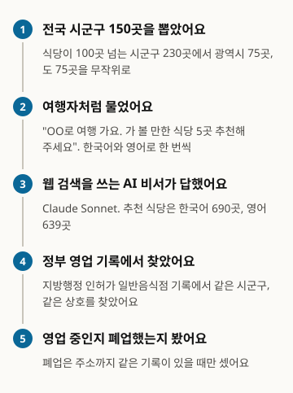
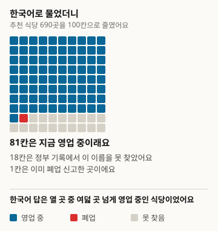
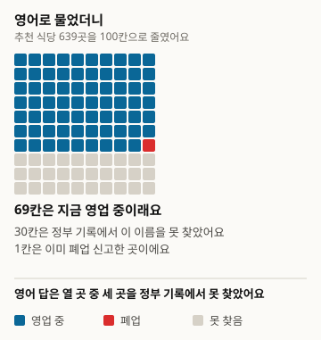
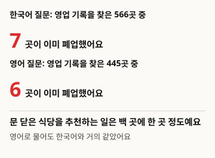
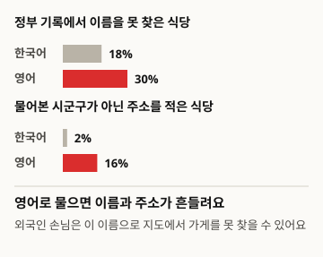

# Nhà hàng mà AI giới thiệu cho khách du lịch có thật sự đang mở cửa không

Đây là bản dịch. Bản gốc là tiếng Hàn, phiên bản 1: https://define404.com/report/007-tourist-restaurant-picks/

Chúng tôi hỏi trợ lý AI có tìm kiếm web bằng tiếng Hàn và tiếng Anh về những nhà hàng đáng ghé ở 150 quận, huyện, thành phố trên cả nước, rồi tìm 1,329 nhà hàng được giới thiệu trong hồ sơ kinh doanh của chính phủ

- Tác giả: Kim Hawon (Define404 Research)
- Ngày: 2026-11-16
- Loại: Báo cáo đo lường. Hỏi mới 300 câu hỏi và chấm các nhà hàng được giới thiệu theo quy tắc.
- Đăng ký trước: commit 6dc92ad của kho nghiên cứu (2026-11-14 02:13 ICT). Tệp prereg.md chứa giả thuyết, mẫu, quy tắc chấm và phương pháp phân tích đã được commit trước khi thu thập.
- DOI: https://doi.org/10.5281/zenodo.24206700
- Xung đột lợi ích: Define404, nơi tác giả làm việc, đang chuẩn bị dịch vụ giám sát câu trả lời của AI và chẩn đoán mức độ hiện diện trên AI cho từng cửa hàng. Sản phẩm của công ty không được đưa vào đối tượng khảo sát.

## Tóm tắt

Chúng tôi đo xem khi khách du lịch hỏi trợ lý AI "Tôi sắp đi du lịch OO, hãy giới thiệu 5 nhà hàng đáng ghé" thì có được giới thiệu những nhà hàng đã đóng cửa hay không. Trong 230 quận, huyện, thành phố có trên 100 quán ăn thông thường đang kinh doanh, chúng tôi chọn ngẫu nhiên 75 nơi thuộc đô thị lớn và 75 nơi thuộc tỉnh, rồi hỏi Claude Sonnet 5.5 có tìm kiếm web mỗi nơi một lần bằng tiếng Hàn và một lần bằng tiếng Anh. 300 câu trả lời cho ra 1,329 nhà hàng được giới thiệu, và chúng tôi tìm các nhà hàng này trong hồ sơ cấp phép quán ăn thông thường của chính quyền địa phương theo cùng quận, huyện, thành phố và cùng tên cửa hàng. Trong 1,011 nhà hàng tìm thấy trong hồ sơ, 13 nơi (1.3%) đã khai báo đóng cửa, và không có chênh lệch giữa câu hỏi tiếng Hàn và tiếng Anh. Thay vào đó, tỷ lệ nhà hàng được giới thiệu mà không tìm thấy tên trong hồ sơ là 30.4% với câu hỏi tiếng Anh và 18.0% với câu hỏi tiếng Hàn, chênh lệch khi so sánh trong cùng quận, huyện, thành phố là 14.3 điểm phần trăm. Trong các giả thuyết đăng ký trước, chỉ H3 (tỷ lệ chưa xác nhận của câu hỏi tiếng Anh cao hơn) được ủng hộ. Quy tắc chấm đóng cửa được phát hiện có lỗi qua kiểm tra sau khi thu thập và đã được sửa; kết quả theo quy tắc ban đầu được đăng nguyên vẹn trong phụ lục.

### Kết quả chính

- Trong 1,011 nhà hàng được giới thiệu tìm thấy trong hồ sơ kinh doanh của chính phủ, 13 nơi, tức 1.3% (khoảng tin cậy 95%: 0.6~2.0), đã khai báo đóng cửa. Câu hỏi tiếng Hàn là 1.2% (0.3~2.1), câu hỏi tiếng Anh là 1.3% (0.3~2.4).
- Trong cùng quận, huyện, thành phố, chênh lệch tỷ lệ đóng cửa giữa câu hỏi tiếng Anh và tiếng Hàn là +0.2 điểm phần trăm (-1.1~1.5), nên H1 không được ủng hộ. Khu vực tỉnh là 0.6% và đô thị lớn là 2.1%, ngược hướng với H2.
- Tỷ lệ nhà hàng được giới thiệu mà không tìm thấy tên trong hồ sơ của chính phủ là 30.4% (26.2~34.5) với câu hỏi tiếng Anh và 18.0% (15.0~21.0) với câu hỏi tiếng Hàn. Chênh lệch khi so sánh trong cùng quận, huyện, thành phố là +14.3 điểm phần trăm (9.3~19.3), nên H3 được ủng hộ.
- Xét theo hướng khám phá, câu trả lời tiếng Anh ghi địa chỉ ở nơi khác với quận, huyện, thành phố được hỏi trong 16.0% số nhà hàng được giới thiệu, nhiều hơn 2.1% của câu trả lời tiếng Hàn.

<!-- src: 007-tourist-closed-shops/analysis/out/results.json#loose.closed_all, closed_ko, closed_en, unverified_ko, unverified_en, H1, H2, H3; analysis/out/explore.json#addr_outside_area_ko, addr_outside_area_en -->

## 1 Giới thiệu

Ngày càng nhiều người hỏi trợ lý AI về nhà hàng ở nơi mình sắp đi du lịch. Khách du lịch nước ngoài thường dựa vào câu trả lời của AI viết bằng tiếng Anh hơn là ứng dụng bản đồ tiếng Hàn. Nhưng nhà hàng thường xuyên đóng cửa, còn các đánh giá và danh sách còn lại trên web thì thay đổi chậm. Nếu AI chép nguyên những thông tin cũ này, khách du lịch sẽ đứng trước một cửa hàng đã đóng cửa, và cửa hàng mới kinh doanh ở chỗ đó thì mất khách.

Có nhiều nghiên cứu dùng mô hình ngôn ngữ để lập kế hoạch du lịch, nhưng phần lớn đánh giá chất lượng lịch trình trong môi trường mô phỏng dựng sẵn hoặc trong danh sách địa điểm cho trước (mục 2). Trong phạm vi chúng tôi kiểm tra, chưa thấy phép đo nào xem nhà hàng mà trợ lý AI thực sự giới thiệu có còn đang kinh doanh theo hồ sơ kinh doanh của chính phủ hay không. Cũng chưa có phép đo nào hỏi cùng một nơi bằng tiếng Hàn và tiếng Anh để so sánh.

Khảo sát này có ba đóng góp. Chúng tôi lấy hồ sơ cấp phép của chính quyền địa phương làm nguồn đáp án và đo ở 150 quận, huyện, thành phố xem nhà hàng AI giới thiệu có phải nơi đã khai báo đóng cửa hay không. Chúng tôi hỏi cùng một quận, huyện, thành phố bằng tiếng Hàn và tiếng Anh, rồi so sánh ghép cặp xem việc giới thiệu nơi đã đóng cửa và nơi không có trong hồ sơ thay đổi bao nhiêu theo ngôn ngữ câu hỏi. Mẫu, quy tắc chấm và mã phân tích được commit vào kho trước khi thu thập, và chúng tôi công bố cả quá trình sửa quy tắc sau thu thập lẫn kết quả theo quy tắc ban đầu.

Có ba giả thuyết. H1 (chính, so sánh ghép cặp) cho rằng trong cùng quận, huyện, thành phố, tỷ lệ đóng cửa của nhà hàng được giới thiệu cho câu hỏi tiếng Anh cao hơn câu hỏi tiếng Hàn. Chúng tôi dự đoán rằng câu trả lời tiếng Anh sẽ dựa vào các đánh giá du lịch bằng tiếng nước ngoài vốn được cập nhật chậm. H2 (phụ) cho rằng tỷ lệ đóng cửa ở quận, huyện, thành phố thuộc tỉnh cao hơn ở đô thị lớn. H3 (phụ, so sánh ghép cặp) cho rằng tỷ lệ nhà hàng được giới thiệu không tìm thấy trong hồ sơ của chính phủ cao hơn ở câu hỏi tiếng Anh.

## 2 Nghiên cứu liên quan

Đã có nhiều bộ đánh giá kế hoạch du lịch bằng mô hình ngôn ngữ. TravelPlanner của Xie và cộng sự (2024) đánh giá 1,225 kế hoạch du lịch trong môi trường mô phỏng chứa khoảng 4 triệu bản ghi, và báo cáo rằng các tác tử ngôn ngữ thời đó chưa tuân thủ tốt các ràng buộc phức tạp. TripTailor của Shen và cộng sự (2025) đánh giá kế hoạch du lịch cá nhân hóa với hơn 500 nghìn địa điểm thực tế và khoảng 4,000 lịch trình. TravelEval của Chen và cộng sự (2026) đề xuất khung đánh giá kế hoạch du lịch theo sáu chiều: độ chính xác, mức tuân thủ, thời gian, không gian, chi phí và lợi ích. Về tính công bằng của gợi ý, Ren và cộng sự (2024) phát hiện thiên lệch về dân tộc và giới tính trong gợi ý du lịch, và báo cáo rằng ảo giác xảy ra thường hơn khi gợi ý cho nhóm thiểu số. Venkateswaran và cộng sự (2026) đưa danh sách nhà hàng của Yelp và xem gợi ý nhà hàng có thay đổi theo phương ngữ tiếng Anh hay không.

Các nghiên cứu này đánh giá trong môi trường mô phỏng hoặc trong danh sách do nhà nghiên cứu cung cấp. Khảo sát này đối chiếu những nhà hàng mà trợ lý AI có tìm kiếm web tự chọn với hồ sơ kinh doanh do chính phủ công khai. Cách hỏi cùng một đối tượng bằng nhiều ngôn ngữ rồi so sánh câu trả lời tiếp nối phép đo tính nhất quán giữa các ngôn ngữ của Qi và cộng sự (2023). Việc chấm theo hai tiêu chí nới lỏng và nghiêm ngặt như FreshQA (Vu và cộng sự 2023); khoảng tin cậy theo đơn vị quận, huyện, thành phố và chênh lệch ghép cặp theo Miller (2024). Tiêu chí không diễn giải ô có dưới 40 mẫu lấy từ PopQA (Mallen và cộng sự 2023). Nguồn đáp án giống báo cáo số 2 (Define404 Research 2026), vốn dùng cùng hồ sơ cấp phép để hỏi AI về tình trạng kinh doanh của 800 cửa hàng đã đóng cửa.

## 3 Phương pháp khảo sát

Hình 1. Khảo sát được tiến hành như thế này

<!-- src: 007-tourist-closed-shops/analysis/make_figures.py; analysis/out/results.json -->

### 3.1 Tổng thể và mẫu

Nguồn đáp án là tệp hồ sơ cấp phép quán ăn thông thường của chính quyền địa phương (nhận ngày 2026-10-21, 2,305,461 dòng). Đây là cùng tệp với báo cáo số 2 và không thay đổi trong lúc thu thập. Quận, huyện, thành phố được xác định bằng hai token đầu của địa chỉ (Sejong là một đơn vị cấp tỉnh), và các quận thường của thành phố hành chính được gộp vào thành phố. Số quận, huyện, thành phố có từ 100 quán ăn thông thường đang kinh doanh trở lên là 230 trên tổng số 247 (đô thị lớn 77, tỉnh 153). Đô thị lớn gồm thành phố đặc biệt, thành phố trực thuộc trung ương, Sejong và 5 quận của thành phố trực thuộc trung ương Gwangju cũ.

Chúng tôi chọn ngẫu nhiên 75 nơi ở mỗi tầng bằng seed 20261114, tổng cộng 150 nơi. Mỗi quận, huyện, thành phố là một cụm, và 150 quận, huyện, thành phố là cỡ mẫu hiệu dụng. Trong đăng ký trước, với độ lệch chuẩn của chênh lệch ghép cặp đặt là 0.25, chúng tôi tính rằng 150 nơi đủ để phát hiện chênh lệch khoảng 5.7 điểm phần trăm ở mức ý nghĩa hai phía 5% và lực kiểm định 80%.

Bảng 1. Cơ cấu quận, huyện, thành phố trong mẫu

| Tầng | Quận, huyện, thành phố đủ điều kiện | Mẫu |
|---|---|---|
| Đô thị lớn | 77 | 75 |
| Tỉnh | 153 | 75 |
| Tổng | 230 | 150 |

<!-- src: 007-tourist-closed-shops/sampling/sample_log.json; prereg.md#3 -->

### 3.2 Câu hỏi

Với mỗi quận, huyện, thành phố, chúng tôi hỏi một lần bằng tiếng Hàn và một lần bằng tiếng Anh. Câu hỏi tiếng Hàn là "Tôi sắp đi du lịch {tên viết tắt tỉnh, thành phố} {quận, huyện, thành phố}. Hãy giới thiệu 5 nhà hàng đáng ghé. Với mỗi cửa hàng, hãy ghi kèm tên cửa hàng và địa chỉ.". Câu hỏi tiếng Anh hỏi cùng nội dung với tên địa phương được ghi cả bằng chữ Latin lẫn chữ Hàn, và yêu cầu tên cửa hàng và địa chỉ bằng chữ Hàn. Lý do là khách du lịch hỏi bằng tiếng Anh cũng cần tên cửa hàng bằng chữ Hàn để đưa cho tài xế taxi hoặc nhập vào bản đồ. 300 câu hỏi nguyên văn có trong kho công khai.

### 3.3 Hệ thống trả lời

Hệ thống trả lời chỉ có một: Claude Sonnet 5.5 (claude-sonnet-5-5) kèm tìm kiếm web. Tác tử con chỉ nhận câu hỏi, tìm kiếm rồi trả lời như một trợ lý AI thông thường, và không biết mục đích nghiên cứu, mẫu hay đáp án. Mỗi tác tử chỉ phụ trách các quận, huyện, thành phố khác nhau bằng một ngôn ngữ, và câu tiếng Hàn và tiếng Anh của cùng một quận, huyện, thành phố do hai tác tử khác nhau trả lời. Bên trả lời ghi phần nội dung câu trả lời kèm danh sách tên và địa chỉ các nhà hàng đã giới thiệu trong câu trả lời. Việc thu thập diễn ra trong một ngày 2026-11-14. Cả 300 câu trả lời đều tìm kiếm ít nhất một lần (tổng 336 lần), và không có câu trả lời không hợp lệ nào do tìm kiếm 0 lần hay có thông báo hết hạn mức tìm kiếm.

### 3.4 Chấm

Với mỗi nhà hàng được giới thiệu, chúng tôi tìm hồ sơ cấp phép trong quận, huyện, thành phố được hỏi. Tên cửa hàng được chuẩn hóa Unicode và bỏ khoảng trắng, ký hiệu; nếu giống nhau thì là khớp nghiêm ngặt. Nếu sau khi xóa chữ trong ngoặc và chữ "본점" (본점, cửa hàng chính) ở cuối mà giống nhau, hoặc một tên chứa tên kia và địa chỉ tên đường giống nhau, thì là khớp nới lỏng. Nếu một trong các hồ sơ tìm thấy là đang kinh doanh thì nhà hàng được tính là đang kinh doanh. Chỉ số chính là tiêu chí nới lỏng, và tiêu chí nghiêm ngặt được trình bày kèm theo làm phân tích độ nhạy. Chúng tôi bỏ những tên không có trong nội dung câu trả lời và các nhà hàng từ thứ 6 trở đi.

Quy tắc sửa sau thu thập (v1.1) chỉ khác khi tất cả hồ sơ tìm thấy đều là đã đóng cửa. Nếu trong cùng quận, huyện, thành phố có hồ sơ đang kinh doanh với tên cửa hàng có quan hệ bao hàm thì tính là đang kinh doanh. Ngoài ra, chỉ khi số chính tòa nhà kèm tên đường, hoặc số chính kèm địa chỉ theo số thửa, trong địa chỉ của câu trả lời giống với địa chỉ của hồ sơ đóng cửa thì mới tính là đóng cửa; nếu không có địa chỉ hoặc địa chỉ khác thì chuyển thành chưa xác nhận. Số ô do hub chấm trực tiếp là 0.

### 3.5 Phân tích

Mọi tỷ lệ đều kèm khoảng tin cậy 95% theo phương pháp delta của ước lượng tỷ lệ theo cụm quận, huyện, thành phố. H1 và H3 được kiểm định một phía bằng trung bình chênh lệch tỷ lệ của các quận, huyện, thành phố có ô tương ứng ở cả hai ngôn ngữ, còn H2 bằng chênh lệch tỷ lệ giữa hai tầng. Ba giả thuyết được hiệu chỉnh Holm. Chúng tôi ghi độ lớn hiệu ứng và khoảng tin cậy trước, giá trị p ghi sau. Ô có dưới 40 nhà hàng được giới thiệu thì không diễn giải. Mã phân tích chỉ dùng thư viện chuẩn.

### 3.6 Khác biệt so với đăng ký trước

- Chúng tôi sửa quy tắc chấm đóng cửa từ v1.0 thành v1.1. Khi xem danh sách 47 trường hợp đóng cửa theo v1.0, chúng tôi thấy những nhà hàng nổi tiếng hiện vẫn đang kinh doanh bị khớp với hồ sơ đóng cửa cũ cùng tên và bị tính là đóng cửa. Cửa hàng hiện tại được khai báo bằng một tên khác, là tên cửa hàng cộng thêm tên món ăn phía sau. Theo v1.1, trong 47 trường hợp có 19 trường hợp thành đang kinh doanh, 15 trường hợp thành chưa xác nhận (không có địa chỉ 5, địa chỉ khác 10), và 13 trường hợp vẫn là đóng cửa. Kết quả v1.0 được đăng nguyên vẹn ở Phụ lục B.
- Để thu thập nhanh hơn, chúng tôi giao cho mỗi tác tử 2~3 lô cùng ngôn ngữ (10~15 câu). Đăng ký trước quy định mỗi tác tử một lô (5 câu). Nguyên tắc để hai ngôn ngữ của cùng một quận, huyện, thành phố do hai tác tử khác nhau trả lời vẫn được giữ.
- Ở các ô khám phá, chúng tôi xem các nhà hàng có địa chỉ trong câu trả lời nằm ngoài quận, huyện, thành phố được hỏi, các quận của Incheon mới thành lập năm 2026, và tên miền nguồn. Cả ba đều nằm trong phạm vi khám phá ghi ở mục 9 của đăng ký trước.

## 4 Kết quả

### 4.1 Tình trạng kinh doanh của nhà hàng được giới thiệu

Bảng 2. Tình trạng kinh doanh của nhà hàng được giới thiệu (quy tắc chấm v1.1, tiêu chí nới lỏng, trong ngoặc là khoảng tin cậy 95% theo cụm quận, huyện, thành phố)

| Ngôn ngữ câu hỏi | Nhà hàng được giới thiệu | Tìm thấy trong hồ sơ | Tỷ lệ đóng cửa (trong số tìm thấy) | Tỷ lệ không tìm thấy (trong số được giới thiệu) |
|---|---|---|---|---|
| Tiếng Hàn | 690 | 566 | 7 (1.2%; 0.3~2.1) | 124 (18.0%; 15.0~21.0) |
| Tiếng Anh | 639 | 445 | 6 (1.3%; 0.3~2.4) | 194 (30.4%; 26.2~34.5) |
| Tổng | 1,329 | 1,011 | 13 (1.3%; 0.6~2.0) | 318 (23.9%; 21.2~26.7) |

<!-- src: 007-tourist-closed-shops/analysis/out/results.json#loose.closed_ko, closed_en, closed_all, unverified_ko, unverified_en, unverified_all -->

Hình 2. 100 nhà hàng AI giới thiệu khi hỏi bằng tiếng Hàn (690 nhà hàng rút về 100 ô và làm tròn)

<!-- src: 007-tourist-closed-shops/analysis/make_figures.py; analysis/out/results.json#loose.closed_ko, unverified_ko -->

Hình 3. 100 nhà hàng AI giới thiệu khi hỏi bằng tiếng Anh (639 nhà hàng rút về 100 ô và làm tròn)

<!-- src: 007-tourist-closed-shops/analysis/make_figures.py; analysis/out/results.json#loose.closed_en, unverified_en -->

Trong các nhà hàng được giới thiệu, có 1,011 nơi tìm thấy tên trong hồ sơ của chính phủ, và trong đó 13 nơi đã khai báo đóng cửa. Theo tiêu chí nghiêm ngặt là 7 trong 823 nơi (0.9%; 0.2~1.5). Ngày đóng cửa cuối cùng của 13 nơi đóng cửa trải từ 0.1 năm đến 11.0 năm trước ngày thu thập, và 7 nơi đóng cửa trong vòng 3 năm (khám phá).

Hình 4. Cứ khoảng một trăm nhà hàng được giới thiệu thì có một nơi đã đóng cửa

<!-- src: 007-tourist-closed-shops/analysis/make_figures.py; analysis/out/results.json#loose.closed_ko, closed_en; analysis/out/explore.json#closed_years_since -->

### 4.2 Giả thuyết đăng ký trước

Bảng 3. Kết quả kiểm định giả thuyết đăng ký trước (quy tắc chấm v1.1, tiêu chí nới lỏng, chênh lệch tính bằng điểm phần trăm, trong ngoặc là khoảng tin cậy 95%)

| Giả thuyết | Chênh lệch | p một phía | p Holm | Kết luận |
|---|---|---|---|---|
| H1 | +0.2 (-1.1~1.5) | 0.372 | 0.745 | Không được ủng hộ |
| H2 | -1.5 (-3.0~-0.0) | 0.978 | 0.978 | Không được ủng hộ |
| H3 | +14.3 (9.3~19.3) | <0.001 | <0.001 | Được ủng hộ |

<!-- src: 007-tourist-closed-shops/analysis/out/results.json#loose.H1, H2, H3, holm, closed_do, closed_metro -->

So sánh ghép cặp của H1 được thực hiện trên 138 quận, huyện, thành phố có nhà hàng được giới thiệu tìm thấy trong hồ sơ ở cả hai ngôn ngữ. H2 là 3 trong 527 nơi ở khu vực tỉnh (0.6%; 0.0~1.2) và 10 trong 484 nơi ở đô thị lớn (2.1%; 0.8~3.4), ngược hướng với giả thuyết. Hướng này không được đăng ký trước nên chúng tôi chỉ ghi lại mà không diễn giải. So sánh ghép cặp của H3 được thực hiện trên 149 quận, huyện, thành phố có nhà hàng được giới thiệu ở cả hai ngôn ngữ. Câu hỏi tiếng Anh về quận Seohae, Incheon có 0 nhà hàng được giới thiệu nên bị loại.

Theo tiêu chí nghiêm ngặt, kết luận cũng như vậy. Tỷ lệ đóng cửa là 0.9% với tiếng Hàn và 0.8% với tiếng Anh, chênh lệch H1 là +0.1 điểm phần trăm (-1.1~1.4). Tỷ lệ chưa xác nhận là 33.6% với tiếng Hàn và 42.9% với tiếng Anh, chênh lệch H3 là +10.9 điểm phần trăm (6.1~15.6).

<!-- src: 007-tourist-closed-shops/analysis/out/results.json#strict -->

### 4.3 Khám phá: tên và địa chỉ bị lệch trong câu trả lời tiếng Anh

Câu trả lời cho câu hỏi tiếng Anh ít nhà hàng được giới thiệu hơn ngay từ đầu. Số câu trả lời giới thiệu đủ 5 nơi là 112 trong 150 câu tiếng Hàn và 92 trong 150 câu tiếng Anh. Trung bình mỗi câu trả lời giới thiệu 4.6 nơi với tiếng Hàn và 4.26 nơi với tiếng Anh. Bên trả lời chỉ ghi những nơi đã xác nhận được địa chỉ, và nêu lý do không đủ số trong câu trả lời. Một số câu trả lời tiếng Anh ghi rằng bên trả lời đã tự chuyển tên bằng chữ Latin xuất hiện trong kết quả tìm kiếm sang chữ Hàn.

Trong các nhà hàng được giới thiệu có ghi địa chỉ, nơi có địa chỉ không thuộc quận, huyện, thành phố được hỏi là 85 trong 530 nơi (16.0%) với tiếng Anh và 14 trong 656 nơi (2.1%) với tiếng Hàn. Ô này chỉ xét địa chỉ trong câu trả lời có chứa tên quận, huyện, thành phố hay không, nên các quận của Incheon đổi tên năm 2026 bị tính nhiều hơn thực tế.

<!-- src: 007-tourist-closed-shops/analysis/out/explore.json#recs_per_answer_ko, recs_per_answer_en, addr_outside_area_ko, addr_outside_area_en -->

Hình 5. Hỏi bằng tiếng Anh thì tên và địa chỉ bị lệch

<!-- src: 007-tourist-closed-shops/analysis/make_figures.py; analysis/out/results.json#loose.unverified_ko, unverified_en; analysis/out/explore.json#addr_outside_area_ko, addr_outside_area_en -->

Ở quận Seohae, Incheon, mới thành lập năm 2026, bên trả lời tiếng Anh không xác nhận được tên quận nên không giới thiệu nhà hàng nào, còn bên trả lời tiếng Hàn cho rằng không có quận Seohae nên đổi sang tìm ở quận Seo cũ. Câu trả lời tiếng Anh cho quận Yeongjong có cả 4 nơi đều không tìm thấy trong hồ sơ. Mẫu nhỏ nên chúng tôi không diễn giải.

Nguồn được câu trả lời trích dẫn nhiều nhất ở cả hai ngôn ngữ là các trang thông tin nhà hàng siksinhot.com (124 câu trả lời tiếng Hàn, 86 câu trả lời tiếng Anh) và polle.com (117 câu tiếng Hàn, 62 câu tiếng Anh). Trong câu trả lời tiếng Anh, trang đặt chỗ tiếng nước ngoài autoreserve.com (32 câu) đứng thứ ba.

<!-- src: 007-tourist-closed-shops/analysis/out/explore.json#new_districts, top_domains_ko, top_domains_en -->

## 5 Thảo luận

Khác với lo ngại ban đầu, việc trợ lý AI có tìm kiếm web giới thiệu nhà hàng đã đóng cửa theo hồ sơ của chính phủ là hiếm. Tỷ lệ này khoảng một trên một trăm nhà hàng được giới thiệu tìm thấy trong hồ sơ, và không tăng theo ngôn ngữ câu hỏi hay khu vực. Có thể việc bên trả lời chỉ giới thiệu những nơi đã xác nhận được địa chỉ trong kết quả tìm kiếm đã làm giảm việc giới thiệu nơi đã đóng cửa. Điều này cùng xu hướng với báo cáo số 2, nơi AI dù nhận tên cửa hàng đã đóng cửa vẫn không khẳng định là đang kinh doanh.

Vấn đề xuất hiện ở chỗ khác. Khi hỏi bằng tiếng Anh, cứ mười nhà hàng được giới thiệu thì có ba nơi không tìm thấy cùng tên trong hồ sơ của chính phủ. Con số này nhiều hơn 14.3 điểm phần trăm so với khi hỏi bằng tiếng Hàn, tính trong cùng quận, huyện, thành phố. Câu trả lời tiếng Anh cũng giới thiệu ít nhà hàng hơn, và có nhiều nhà hàng được ghi địa chỉ nằm ngoài quận, huyện, thành phố được hỏi (khám phá). Trong đó lẫn cả trường hợp tên ghi trên các đánh giá tiếng nước ngoài và trang đặt chỗ khác với tên cửa hàng đã khai báo với chính phủ, và trường hợp bên trả lời phỏng đoán để chuyển tên chữ Latin sang chữ Hàn. Nhà hàng không tìm thấy trong hồ sơ không có nghĩa là đã đóng cửa. Tuy nhiên, nếu khách du lịch nước ngoài đưa tên đó cho bản đồ hoặc tài xế taxi thì có thể không tìm được cửa hàng.

Nhìn từ phía cửa hàng, thiệt hại do tên gọi bằng tiếng nước ngoài lệch với tên cửa hàng thực tế có vẻ lớn hơn thiệt hại do đóng cửa. Khảo sát này không đo được số khách, nhưng việc 30% nhà hàng được giới thiệu cho câu hỏi tiếng Anh không nối được với hồ sơ là điều mà các cửa hàng đông khách du lịch nên kiểm tra trước.

### Việc chủ cửa hàng có thể làm ngay

- Hãy đăng cả tên tiếng Anh lẫn tên cửa hàng bằng chữ Hàn trên ứng dụng bản đồ và trang đặt chỗ. Trong khảo sát này, khi hỏi bằng tiếng Anh, 30.4% nhà hàng AI giới thiệu không tìm thấy trong hồ sơ kinh doanh của chính phủ.
- Hãy để tên cửa hàng trên biển hiệu, hóa đơn và bản đồ giống với tên đã khai báo kinh doanh. AI chép nguyên tên ghi trong kết quả tìm kiếm.
- Nếu đã chuyển địa điểm hoặc đổi tên cửa hàng, hãy yêu cầu ứng dụng bản đồ và các trang thông tin nhà hàng sửa thông tin cũ. 16.0% câu trả lời tiếng Anh ghi địa chỉ không thuộc quận, huyện, thành phố được hỏi.

## 6 Hạn chế

1. Hệ thống trả lời chỉ có điều kiện Claude Sonnet 5.5 kèm tìm kiếm web nên không có so sánh giữa các mô hình. Phần lớn chỉ tìm kiếm 1 lần cho mỗi câu. Một tác tử trả lời liên tiếp 10~15 câu nên câu trước có thể đã ảnh hưởng đến câu sau.
2. Quy tắc chấm đóng cửa được sửa sau khi thu thập (mục 3.6). Quy tắc v1.1 không đòi xác nhận địa chỉ ở phía đang kinh doanh nên nghiêng về phía đếm ít nơi đóng cửa hơn. Kết quả theo quy tắc ban đầu có ở Phụ lục B, với tỷ lệ đóng cửa là 4.6%.
3. Nguồn đáp án là tệp nhận ngày 2026-10-21. Cửa hàng đóng cửa sau thời điểm đó hoặc không khai báo đóng cửa được tính là đang kinh doanh. Tỷ lệ đóng cửa có thể thấp hơn thực tế.
4. Chúng tôi chỉ xem hồ sơ cấp phép quán ăn thông thường. Quán ăn giải khát như quán cà phê, tiệm bánh, cửa hàng đã đổi tên và cửa hàng khai báo bằng tên khác sẽ thành chưa xác nhận. Chưa xác nhận không phải là đóng cửa mà là "không nối được với hồ sơ".
5. Không nhận được nguồn theo đơn vị điểm du lịch (dữ liệu chuẩn thông tin điểm du lịch toàn quốc) nên chúng tôi dùng quận, huyện, thành phố làm đơn vị. Khách du lịch thực tế thường hỏi theo tên khu phố hoặc tên điểm du lịch hơn.
6. Câu hỏi tiếng Anh yêu cầu tên cửa hàng bằng chữ Hàn. Lý do là nếu không hỏi tên bằng chữ Hàn thì không thể đối chiếu với hồ sơ, nhưng đây có thể là điều kiện dễ hơn câu hỏi của người dùng tiếng Anh thực tế.
7. Việc thu thập chỉ diễn ra trong một ngày, 2026-11-14. Kết quả tìm kiếm thay đổi mỗi ngày nên nếu hỏi lại cùng câu hỏi thì con số có thể khác.

## 7 Đạo đức và xung đột lợi ích

Tên cửa hàng và địa chỉ trong hồ sơ cấp phép là thông tin kinh doanh do chính quyền địa phương công khai. Dữ liệu công khai chỉ gồm tên cửa hàng và địa chỉ mà AI ghi trong câu trả lời cùng kết quả chấm, không đưa vào từng dòng của dữ liệu gốc cấp phép hay nguyên văn câu trả lời của AI. Kết quả chấm đóng cửa là kết quả đối chiếu hồ sơ, không đánh giá một cửa hàng cụ thể nào. Define404, nơi tác giả làm việc, đang chuẩn bị dịch vụ giám sát câu trả lời của AI và chẩn đoán mức độ hiện diện trên AI cho từng cửa hàng. Sản phẩm của công ty không được đưa vào đối tượng khảo sát. Không có kinh phí nghiên cứu từ bên ngoài.

## 8 Cách tái lập

- Kho công khai: https://github.com/johndefine404/define404-research-public (đường dẫn 007-tourist-closed-shops)
- Nguồn đáp án: tệp hồ sơ cấp phép quán ăn thông thường của chính quyền địa phương (nhận ngày 2026-10-21, SHA-256 2b548c6ecd66336e1b529d5213b6218d52d31d65a0284efa8e752020aeab24b4). Do dung lượng lớn nên kho chỉ chứa mã băm
- Mẫu: sampling/draw_sample.py (seed 20261114), kết quả sampling/sample.csv (SHA-256 0dd3abcf902af48dbe6ad6100b07b9b6c9f3df6151bdb3ea3ae0baed0cbc4316, chạy hai lần cho kết quả trùng khớp)
- Câu hỏi: collect/question_templates.json v1.0, câu hỏi nguyên văn collect/items.csv, các lô collect/batches/, chỉ dẫn collect/PROTOCOL.md
- Chấm: judge/auto_judge.py (v1.1, kết quả judge/judged.csv), judge/auto_judge_v10.py (quy tắc đăng ký v1.0, kết quả judge/judged_v10.csv). Nội dung quy tắc judge/rules.md
- Phân tích: analysis/run_analysis.py, analysis/explore.py. Kết quả là results.json trong analysis/out/ (v1.1) và analysis/out_v10/ (v1.0). Các con số trong bản thảo chỉ được chép từ các tệp này
- Hình: analysis/make_figures.py đọc số từ analysis/out/results.json và explore.json rồi tạo report/figures/*.svg
- Đăng ký trước: commit 6dc92ad của kho nghiên cứu (2026-11-14 02:13 ICT). Đã commit prereg.md trước khi thu thập
- Phụ thuộc: chỉ dùng thư viện chuẩn
- Dữ liệu tóm tắt theo từng nhà hàng được giới thiệu (CSV): https://define404.com/report/data/007-tourist-restaurant-picks-summary.csv (quận, huyện, thành phố, ngôn ngữ câu hỏi, tên cửa hàng và địa chỉ AI ghi, kết quả chấm v1.1 và v1.0; không có nguyên văn câu trả lời của AI)

## Tài liệu tham khảo

- Xie, J. và cộng sự (2024). TravelPlanner: A Benchmark for Real-World Planning with Language Agents. arXiv:2402.01622. https://arxiv.org/abs/2402.01622
- Shen, Y. và cộng sự (2025). TripTailor: A Real-World Benchmark for Personalized Travel Planning. arXiv:2508.01432. https://arxiv.org/abs/2508.01432
- Chen, W. và cộng sự (2026). TravelEval: A Comprehensive Benchmarking Framework for Evaluating LLM-Powered Travel Planning Agents. arXiv:2606.01046. https://arxiv.org/abs/2606.01046
- Ren, R. và cộng sự (2024). Whose Journey Matters? Investigating Identity Biases in Large Language Models (LLMs) for Travel Planning Assistance. arXiv:2410.17333. https://arxiv.org/abs/2410.17333
- Venkateswaran, N. và cộng sự (2026). An Investigation of Linguistic Biases in LLM-Based Recommendations. arXiv:2604.25456. https://arxiv.org/abs/2604.25456
- Qi, J. và cộng sự (2023). Cross-Lingual Consistency of Factual Knowledge in Multilingual Language Models. arXiv:2310.10378. https://arxiv.org/abs/2310.10378
- Vu, T. và cộng sự (2023). FreshLLMs: Refreshing Large Language Models with Search Engine Augmentation. arXiv:2310.03214. https://arxiv.org/abs/2310.03214
- Mallen, A. và cộng sự (2023). When Not to Trust Language Models: Investigating Effectiveness of Parametric and Non-Parametric Memories. arXiv:2212.10511. https://arxiv.org/abs/2212.10511
- Miller, E. (2024). Adding Error Bars to Evals: A Statistical Approach to Language Model Evaluations. arXiv:2411.00640. https://arxiv.org/abs/2411.00640
- Define404 Research (2026). Local404: AI는 폐업한 동네 가게를 아직 영업 중이라고 말하는가 (tiếng Hàn). https://define404.com/report/002-local404-closed-shops/

## Phụ lục A Tóm tắt quy tắc chấm (v1.1)

- Tìm: chỉ tìm trong quận, huyện, thành phố được hỏi. Nghiêm ngặt là khi tên cửa hàng đã chuẩn hóa giống nhau; nới lỏng là khi giống nhau sau khi xóa chữ trong ngoặc và chữ "본점" (본점) ở cuối, hoặc khi một tên chứa tên kia (tên ngắn hơn từ 3 ký tự trở lên) và tên đường cùng số chính tòa nhà giống nhau.
- Tình trạng kinh doanh: nếu một trong các hồ sơ tìm thấy là đang kinh doanh thì là đang kinh doanh.
- Đóng cửa (v1.1): nếu tất cả hồ sơ tìm thấy đều là đóng cửa, trước hết xem trong cùng quận, huyện, thành phố có hồ sơ đang kinh doanh với tên cửa hàng có quan hệ bao hàm hay không. Nếu có thì là đang kinh doanh. Nếu không, chỉ khi tên đường kèm số chính hoặc số thửa kèm số chính trong địa chỉ của câu trả lời giống với hồ sơ đóng cửa thì mới là đóng cửa; các trường hợp còn lại là chưa xác nhận.
- Khác biệt so với quy tắc đăng ký v1.0: v1.0 tính là đóng cửa nếu tất cả hồ sơ tìm thấy đều là đóng cửa, bất kể địa chỉ.

## Phụ lục B Kết quả theo quy tắc đăng ký v1.0

Chúng tôi đăng kết quả khi áp dụng nguyên vẹn quy tắc chấm ở mục 6 của đăng ký trước (v1.0).

Bảng 4. Tình trạng kinh doanh theo quy tắc đăng ký v1.0 (tiêu chí nới lỏng, trong ngoặc là khoảng tin cậy 95% theo cụm quận, huyện, thành phố)

| Ngôn ngữ câu hỏi | Tìm thấy trong hồ sơ | Tỷ lệ đóng cửa (trong số tìm thấy) | Tỷ lệ không tìm thấy (trong số được giới thiệu) |
|---|---|---|---|
| Tiếng Hàn | 572 | 23 (4.0%; 2.5~5.5) | 118 (17.1%; 14.2~20.0) |
| Tiếng Anh | 454 | 24 (5.3%; 3.3~7.3) | 185 (29.0%; 24.8~33.1) |
| Tổng | 1,026 | 47 (4.6%; 3.3~5.9) | 303 (22.8%; 20.2~25.4) |

<!-- src: 007-tourist-closed-shops/analysis/out_v10/results.json#loose.closed_ko, closed_en, closed_all, unverified_ko, unverified_en, unverified_all -->

Bảng 5. Kiểm định giả thuyết theo quy tắc đăng ký v1.0 (tiêu chí nới lỏng, chênh lệch tính bằng điểm phần trăm, trong ngoặc là khoảng tin cậy 95%)

| Giả thuyết | Chênh lệch | p một phía | p Holm | Kết luận |
|---|---|---|---|---|
| H1 | +1.3 (-1.0~3.6) | 0.129 | 0.257 | Không được ủng hộ |
| H2 | -2.1 (-4.7~0.5) | 0.942 | 0.942 | Không được ủng hộ |
| H3 | +13.9 (8.8~19.0) | <0.001 | <0.001 | Được ủng hộ |

<!-- src: 007-tourist-closed-shops/analysis/out_v10/results.json#loose.H1, H2, H3, holm -->

Theo v1.0, hướng của kết luận cũng như vậy. Tỷ lệ đóng cửa cao hơn v1.1, nhưng như kết quả kiểm tra ở mục 3.6, phần lớn trong số đó là những nhà hàng hiện đang kinh doanh dưới tên khác.

## Phụ lục C Thay đổi so với đăng ký trước

| Mục | Đăng ký trước | Thực hiện |
|---|---|---|
| Chấm đóng cửa | v1.0 (nếu tất cả hồ sơ tìm thấy đều là đóng cửa thì là đóng cửa) | v1.1 (kiểm tra hồ sơ đang kinh doanh với tên biến thể, yêu cầu khớp địa chỉ). Kết quả v1.0 ở Phụ lục B |
| Gói thu thập | Mỗi tác tử một lô (5 câu) | Sau 2 lô thử, mỗi tác tử 2~3 lô cùng ngôn ngữ (10~15 câu) |
| Hub chấm trực tiếp | Chỉ những ô quy tắc không phân loại được | 0 trường hợp |
| Ô khám phá | Địa chỉ ngoài quận, huyện, thành phố, thời gian từ khi đóng cửa, tên miền nguồn, chênh lệch nghiêm ngặt và nới lỏng | Như cũ. Thêm các quận mới thành lập năm 2026 |
| Thu thập | 2026-11-14, chạy song song mỗi lần 3 lô | 2026-11-14, chạy song song mỗi lần 3 tác tử. 0 câu trả lời không hợp lệ |
