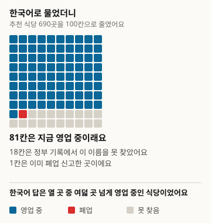
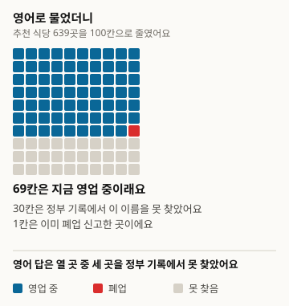
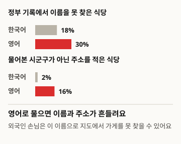

# AI向游客推荐的餐馆，现在真的还在营业吗

本文为译本。基准版为韩文原文,版本1: https://define404.com/report/007-tourist-restaurant-picks/

我们用韩语和英语向具备网络搜索功能的AI助手询问全国150个市郡区值得一去的餐馆，并在政府营业记录中查找了被推荐的1,329家餐馆

- 作者：金夏原(Define404 Research)
- 日期：2026-11-16
- 类型：测量报告。新提问300个问题，按规则判定被推荐的餐馆。
- 预注册：研究仓库提交6dc92ad(2026-11-14 02:13 ICT)。在采集前提交了包含假设、样本、判定规则和分析方法的prereg.md。
- DOI: https://doi.org/10.5281/zenodo.24206700
- 利益关系：作者所属的Define404正在筹备AI回答监测和按店铺的AI曝光诊断服务。本公司产品未纳入调查对象。

## 摘要

我们测量了游客向AI助手询问"我要去OO旅游，请推荐5家值得一去的餐馆"时，是否会被推荐已经关门的餐馆。从营业中的一般餐饮店超过100家的230个市郡区中，随机抽取广域75个、道75个，并用韩语和英语向使用网络搜索的Claude Sonnet 5.5各提问一次。300条回答共推荐了1,329家餐馆，我们在地方行政许可一般餐饮店记录中按同一市郡区、同一店名查找。在记录中找到的1,011家里，已申报停业的为13家(1.3%)，韩语提问与英语提问之间没有差异。相反，在记录中找不到名称的推荐，英语提问为30.4%，韩语提问为18.0%，同一市郡区之间比较的差为14.3个百分点。预注册假设中只有H3(英语提问的未确认比例更高)获得支持。停业判定规则在采集后的核查中发现缺陷并作了修正，原规则的结果原样载于附录。

### 核心结果

- 在政府营业记录中找到的1,011家推荐餐馆中，已申报停业的为13家，1.3%(95%置信区间0.6~2.0)。韩语提问1.2%(0.3~2.1)，英语提问1.3%(0.3~2.4)。
- 同一市郡区中英语提问与韩语提问的停业比例差为+0.2个百分点(-1.1~1.5)，H1未获支持。道地区为0.6%，广域为2.1%，与H2方向相反。
- 推荐餐馆中在政府记录里找不到名称的比例，英语提问为30.4%(26.2~34.5)，韩语提问为18.0%(15.0~21.0)。同一市郡区之间比较的差为+14.3个百分点(9.3~19.3)，H3获得支持。
- 从探索来看，英语回答中写了非所问市郡区地址的推荐占16.0%，多于韩语回答的2.1%。

<!-- src: 007-tourist-closed-shops/analysis/out/results.json#loose.closed_all, closed_ko, closed_en, unverified_ko, unverified_en, H1, H2, H3; analysis/out/explore.json#addr_outside_area_ko, addr_outside_area_en -->

## 1 引言

向AI助手询问旅游目的地餐馆的人越来越多。外国游客往往比起韩语地图应用，更依赖用英语写成的AI回答。但餐馆经常关门，网上留下的评价和名单更新得很慢。如果AI原样搬用这些旧信息，游客就会站在已经关门的店门前，而在原址新开业的店则会错过客人。

用语言模型做旅行规划的研究很多，但大多是在事先搭建的模拟环境或给定的地点名单中评估行程质量(第2节)。在我们确认的范围内，没有找到测量AI助手实际推荐的餐馆在政府营业记录上是否仍在营业的研究。用韩语和英语询问同一地点并加以比较的测量也没有。

本调查的贡献有三点。以地方行政许可记录为正确答案来源，在150个市郡区测量了AI推荐的餐馆是否为已申报停业的店。用韩语和英语询问同一市郡区，配对比较停业推荐和记录中没有的推荐随提问语言变化了多少。在采集前将样本、判定规则和分析代码提交到仓库，并一并公开了采集后修改规则的过程和原规则的结果。

假设有三个。H1(主要，配对比较)假设同一市郡区中英语提问推荐餐馆的停业比例高于韩语提问。我们认为英语回答会依赖更新较慢的外语旅游评价。H2(次要)假设停业比例在道地区市郡区高于广域。H3(次要，配对比较)假设推荐餐馆中在政府记录里找不到的比例在英语提问中更高。

## 2 相关研究

用语言模型评估旅行规划的基准已有多个。Xie等(2024)的TravelPlanner在收录约400万条记录的模拟环境中评估了1,225个旅行计划，报告称当时的语言智能体难以遵守复杂的约束。Shen等(2025)的TripTailor用50万余个真实地点和约4,000个行程评估了个性化旅行规划。Chen等(2026)的TravelEval提出了从准确性、遵守、时间、空间、费用、效用六个维度评估旅行计划的框架。在推荐的公平性方面，Ren等(2024)在旅行推荐中发现了民族和性别偏见，并报告少数群体推荐中幻觉更频繁。Venkateswaran等(2026)提供Yelp餐馆名单，考察了餐馆推荐是否随英语方言而变化。

这些研究都在模拟环境或研究者提供的名单内进行评估。本次调查将使用网络搜索的AI助手自行挑选的餐馆，与政府公开的营业记录相对照。用多种语言询问同一对象并比较回答的方式，与Qi等(2023)的跨语言一致性测量相衔接。判定像FreshQA(Vu等 2023)那样按宽松和严格两个标准给出，市郡区层面的置信区间和配对差遵循Miller(2024)。不解释样本不足40的格子这一标准取自PopQA(Mallen等 2023)。与用同一许可记录向AI询问800家停业店铺营业状况的第2号报告(Define404 Research 2026)使用相同的正确答案来源。

## 3 调查方法

图1. 调查是这样进行的

<!-- src: 007-tourist-closed-shops/analysis/make_figures.py; analysis/out/results.json -->

### 3.1 总体与样本

正确答案来源为地方行政许可一般餐饮店文件(2026-10-21接收，2,305,461行)。与第2号报告是同一文件，采集期间没有更换。以地址的前两个词元确定市郡区(世宗为单一市道)，行政市下的一般区并入市。营业中的一般餐饮店达100家以上的市郡区，在全部247个中有230个(广域77，道153)。广域是指特别市、广域市和世宗，以及原光州广域市的5个区。

每层以种子20261114随机抽取75个，共确定150个。一个市郡区为一个群组，150个市郡区为有效样本。预注册时计算得出，若配对差的标准差设为0.25，150个样本在双侧5%、检验力80%下可检出约5.7个百分点的差。

表1. 样本市郡区构成

| 层 | 对象市郡区 | 样本 |
|---|---|---|
| 广域 | 77 | 75 |
| 道 | 153 | 75 |
| 合计 | 230 | 150 |

<!-- src: 007-tourist-closed-shops/sampling/sample_log.json; prereg.md#3 -->

### 3.2 提问

每个市郡区用韩语和英语各问一次。韩语问题为"我要去{市道简称} {市郡区}旅游。请推荐5家值得一去的餐馆。每家店请一并写出店名和地址。"。英语问题用罗马字和韩文并记的地区名询问相同内容，并要求给出韩文店名和地址。这是因为用英语提问的游客也需要能给出租车司机或地图看的韩文店名。300个问题原文载于公开仓库。

### 3.3 回答系统

回答系统只有一个，即使用网络搜索的Claude Sonnet 5.5(claude-sonnet-5-5)。子智能体只接收问题，像普通AI助手一样搜索后作答，不知道研究目的、样本和正确答案。一个智能体只负责一种语言下的不同市郡区，同一市郡区的韩语和英语由不同的智能体回答。回答者在回答正文之外，还把回答中推荐的餐馆以名称和地址列表的形式写出。采集在2026-11-14一天内完成。300条回答全都进行了一次以上搜索(合计336次)，没有搜索0次或带有搜索限额字样的无效回答。

### 3.4 判定

对每家推荐餐馆，在所问的市郡区内查找许可记录。店名经Unicode规范化并去掉空格和符号后相同为严格一致；删去括号内文字和末尾的"总店"后相同，或一方名称包含另一方且道路名地址相同，为宽松一致。找到的记录中只要有一条为营业即为营业。主要指标为宽松标准，严格标准作为敏感性分析一并给出。回答正文中没有的名称和第6家以后的推荐不计。

采集后修订的规则(v1.1)只在找到的记录全部为停业时有所不同。同一市郡区中如有店名为包含关系且正在营业的记录，即视为营业。除此之外，只有当回答地址的道路名+建筑主号或地番+主号与停业记录的地址相同时才计为停业，没有地址或地址不同则归为未确认。由枢纽人工判定的格子为0件。

### 3.5 分析

所有比例都附上市郡区群组比例估计量的Delta法95%置信区间。H1和H3以两种语言都有相应格子的市郡区的比例差平均值，H2以两层比例之差，进行单侧检验。对三个假设做了Holm校正。先写效应量和置信区间，后写p值。推荐餐馆不足40家的格子不作解释。分析代码只使用标准库。

### 3.6 与预注册的差异

- 将停业判定规则从v1.0改为v1.1。查看v1.0给出的47件停业名单后发现，现在仍在营业的知名餐馆被匹配到同名的旧停业记录上，从而被判为停业。现在的店是以店名后加菜品名的另一个名称申报的。在v1.1中，47件里19件变为营业，15件变为未确认(无地址5，地址不同10)，13件仍为停业。v1.0的结果原样载于附录B。
- 为加快采集，一个智能体负责同一语言的2~3个批次(10~15题)。预注册时为每个智能体一个批次(5题)。同一市郡区的两种语言由不同智能体负责的原则得到遵守。
- 作为探索格子，考察了回答地址在所问市郡区以外的推荐、2026年新设立的仁川的区以及来源域名。三者都在预注册第9节所列的探索范围内。

## 4 结果

### 4.1 推荐餐馆的营业状态

表2. 推荐餐馆的营业状态(判定规则v1.1，宽松标准，括号内为市郡区群组95%置信区间)

| 提问语言 | 推荐餐馆 | 在记录中找到 | 停业比例(找到的店中) | 未找到比例(推荐中) |
|---|---|---|---|---|
| 韩语 | 690 | 566 | 7 (1.2%; 0.3~2.1) | 124 (18.0%; 15.0~21.0) |
| 英语 | 639 | 445 | 6 (1.3%; 0.3~2.4) | 194 (30.4%; 26.2~34.5) |
| 合计 | 1,329 | 1,011 | 13 (1.3%; 0.6~2.0) | 318 (23.9%; 21.2~26.7) |

<!-- src: 007-tourist-closed-shops/analysis/out/results.json#loose.closed_ko, closed_en, closed_all, unverified_ko, unverified_en, unverified_all -->

图2. 用韩语提问时AI推荐的100家餐馆(690家缩为100格并四舍五入)

<!-- src: 007-tourist-closed-shops/analysis/make_figures.py; analysis/out/results.json#loose.closed_ko, unverified_ko -->

图3. 用英语提问时AI推荐的100家餐馆(639家缩为100格并四舍五入)

<!-- src: 007-tourist-closed-shops/analysis/make_figures.py; analysis/out/results.json#loose.closed_en, unverified_en -->

推荐餐馆中在政府记录里找到名称的有1,011家，其中已申报停业的为13家。按严格标准为823家中的7家(0.9%; 0.2~1.5)。13家停业店最后的停业日期以采集日为准，分布在0.1年前到11.0年前之间，其中7家是在3年内关门的(探索)。

图4. 推荐停业餐馆的情况大约每一百家有一家

<!-- src: 007-tourist-closed-shops/analysis/make_figures.py; analysis/out/results.json#loose.closed_ko, closed_en; analysis/out/explore.json#closed_years_since -->

### 4.2 预注册假设

表3. 预注册假设检验结果(判定规则v1.1，宽松标准，差为个百分点，括号内为95%置信区间)

| 假设 | 差 | 单侧p | Holm p | 判定 |
|---|---|---|---|---|
| H1 | +0.2 (-1.1~1.5) | 0.372 | 0.745 | 未获支持 |
| H2 | -1.5 (-3.0~-0.0) | 0.978 | 0.978 | 未获支持 |
| H3 | +14.3 (9.3~19.3) | <0.001 | <0.001 | 获得支持 |

<!-- src: 007-tourist-closed-shops/analysis/out/results.json#loose.H1, H2, H3, holm, closed_do, closed_metro -->

H1的配对比较以两种语言都有在记录中找到的推荐的138个市郡区进行。H2为道地区527家中3家(0.6%; 0.0~1.2)，广域484家中10家(2.1%; 0.8~3.4)，与假设方向相反。这一方向未经预注册，因此不作解释，只作记录。H3的配对比较以两种语言都有推荐的149个市郡区进行。仁川西海区的英语提问推荐餐馆为0家，因此被排除。

按严格标准结论也相同。停业比例韩语0.9%，英语0.8%，H1的差为+0.1个百分点(-1.1~1.4)。未确认比例韩语33.6%，英语42.9%，H3的差为+10.9个百分点(6.1~15.6)。

<!-- src: 007-tourist-closed-shops/analysis/out/results.json#strict -->

### 4.3 探索：英语回答中摇摆的名称和地址

英语提问的回答从推荐数量上就少。推荐满5家的回答，韩语150条中有112条，英语150条中有92条。每条回答平均推荐韩语4.6家，英语4.26家。回答者只写出确认过地址的店，并在回答中说明了没能凑满的原因。部分英语回答写明，回答者是把搜索中出现的罗马字名称转写成韩文的。

在写了地址的推荐中，地址不在所问市郡区的，英语530家中有85家(16.0%)，韩语656家中有14家(2.1%)。这一格子只看回答地址中是否含有市郡区名称，因此2026年改名的仁川的区会被多计。

<!-- src: 007-tourist-closed-shops/analysis/out/explore.json#recs_per_answer_ko, recs_per_answer_en, addr_outside_area_ko, addr_outside_area_en -->

图5. 用英语提问，名称和地址就会摇摆

<!-- src: 007-tourist-closed-shops/analysis/make_figures.py; analysis/out/results.json#loose.unverified_ko, unverified_en; analysis/out/explore.json#addr_outside_area_ko, addr_outside_area_en -->

在2026年新设立的仁川西海区，英语回答者没能确认区名，因此没有给出推荐；韩语回答者认为西海区不存在，改为在原西区查找。永宗区的英语回答4家全都没能在记录中找到。样本较小，不作解释。

两种语言的回答所引用的来源，最多的都是美食信息网站siksinhot.com(韩语124条回答，英语86条回答)和polle.com(韩语117条，英语62条)。英语回答中外语预订网站autoreserve.com(32条)位居第三。

<!-- src: 007-tourist-closed-shops/analysis/out/explore.json#new_districts, top_domains_ko, top_domains_en -->

## 5 讨论

与最初的担心不同，使用网络搜索的AI助手推荐政府记录上已停业餐馆的情况很少见。在记录中找到的推荐餐馆中大约每一百家有一家，而且没有随提问语言或地区而增加。回答者只推荐在搜索结果中确认过地址的店，这可能减少了停业推荐。这与第2号报告中AI拿到停业店名也没有断定其仍在营业的情况是同一趋势。

问题出现在别处。用英语提问时，推荐餐馆每十家中有三家在政府记录中找不到同名记录。按同一市郡区计，比用韩语提问时多14.3个百分点。英语回答的推荐数量也较少，写了所问市郡区以外地址的推荐也较多(探索)。其中混杂着外语评价和预订网站上的名称与向政府申报的店名不同，或回答者凭猜测把罗马字名称转写成韩文的情况。在记录中找不到的餐馆并不意味着已经关门。只是外国游客把这个名称给地图或出租车司机看时，可能找不到这家店。

从店铺的角度看，因外语叫法与实际店名对不上而造成的损失，似乎比关门造成的损失更大。本调查无法测量客流量，但英语提问的推荐中有30%与记录对不上，这是游客多的店应当先确认的事。

### 店里马上能做的事

- 请在地图应用和预订网站上同时登记英文名称和韩文店名。本次调查中，用英语提问时，AI推荐的餐馆有30.4%在政府营业记录中找不到。
- 请让招牌、收据、地图上写的店名与营业申报的店名保持一致。AI会原样搬用搜索结果中写的名称。
- 如果搬迁或更改了店名，请要求地图应用和美食网站修正旧信息。英语回答中有16.0%写的不是所问市郡区的地址。

## 6 局限

1. 回答系统只有Claude Sonnet 5.5网络搜索这一个条件，没有模型之间的比较。每题的搜索大多为1次。一个智能体连续回答10~15题，前面的题可能影响了后面的题。
2. 停业判定规则是在采集后修改的(第3.6节)。v1.1在营业一侧没有加上地址确认，因此偏向于少计停业。原规则的结果载于附录B，停业比例为4.6%。
3. 正确答案来源是2026-10-21接收的文件。在那之后停业或没有申报停业的店会被计为营业。停业比例可能低于实际。
4. 只看了许可一般餐饮店记录。咖啡馆、面包店这类休息餐饮店，改了店名的店，以其他名称申报的店，都会成为未确认。未确认不是停业，而是"在记录中对不上"。
5. 没能获取景点层面的来源(全国旅游景点信息标准数据)，因此以市郡区为单位。实际游客更常用街区或景点名称提问。
6. 英语提问要求给出韩文店名。这是因为不问韩文店名就无法与记录对照，但这可能比实际英语使用者的提问条件更容易。
7. 采集只在2026-11-14一天。搜索结果每天都会变化，再问同样的问题数字可能会不同。

## 7 伦理与利益关系

许可记录中的店名和地址是地方自治团体公开的营业信息。公开资料只收录AI在回答中写出的店名和地址以及判定结果，没有收录许可原始数据的单独行或AI回答原文。停业判定是记录对照的结果，并不评价特定店铺。作者所属的Define404正在筹备AI回答监测和按店铺的AI曝光诊断服务。本公司产品未纳入调查对象。没有外部研究经费。

## 8 复现方法

- 公开仓库: https://github.com/johndefine404/define404-research-public (路径 007-tourist-closed-shops)
- 正确答案来源: 地方行政许可一般餐饮店文件(2026-10-21接收，SHA-256 2b548c6ecd66336e1b529d5213b6218d52d31d65a0284efa8e752020aeab24b4)。因文件较大，仓库中只有哈希
- 样本: sampling/draw_sample.py(种子20261114), 结果 sampling/sample.csv (SHA-256 0dd3abcf902af48dbe6ad6100b07b9b6c9f3df6151bdb3ea3ae0baed0cbc4316, 两次运行一致)
- 提问: collect/question_templates.json v1.0, 问题原文 collect/items.csv, 批次 collect/batches/, 指令 collect/PROTOCOL.md
- 判定: judge/auto_judge.py(v1.1, 结果 judge/judged.csv), judge/auto_judge_v10.py(注册规则 v1.0, 结果 judge/judged_v10.csv)。规则正文 judge/rules.md
- 分析: analysis/run_analysis.py, analysis/explore.py。结果 analysis/out/(v1.1), analysis/out_v10/(v1.0)的results.json。正文中的数字只从这些文件摘录
- 图: analysis/make_figures.py从analysis/out/results.json和explore.json读取数字并生成report/figures/*.svg
- 预注册: 研究仓库提交6dc92ad (2026-11-14 02:13 ICT)。在采集前提交了prereg.md
- 依赖: 只使用标准库
- 按推荐餐馆的摘要资料(CSV): https://define404.com/report/data/007-tourist-restaurant-picks-summary.csv (市郡区、提问语言、AI写出的店名和地址、判定v1.1和v1.0。不含AI回答原文)

## 参考文献

- Xie, J. 等 (2024). TravelPlanner: A Benchmark for Real-World Planning with Language Agents. arXiv:2402.01622. https://arxiv.org/abs/2402.01622
- Shen, Y. 等 (2025). TripTailor: A Real-World Benchmark for Personalized Travel Planning. arXiv:2508.01432. https://arxiv.org/abs/2508.01432
- Chen, W. 等 (2026). TravelEval: A Comprehensive Benchmarking Framework for Evaluating LLM-Powered Travel Planning Agents. arXiv:2606.01046. https://arxiv.org/abs/2606.01046
- Ren, R. 等 (2024). Whose Journey Matters? Investigating Identity Biases in Large Language Models (LLMs) for Travel Planning Assistance. arXiv:2410.17333. https://arxiv.org/abs/2410.17333
- Venkateswaran, N. 等 (2026). An Investigation of Linguistic Biases in LLM-Based Recommendations. arXiv:2604.25456. https://arxiv.org/abs/2604.25456
- Qi, J. 等 (2023). Cross-Lingual Consistency of Factual Knowledge in Multilingual Language Models. arXiv:2310.10378. https://arxiv.org/abs/2310.10378
- Vu, T. 等 (2023). FreshLLMs: Refreshing Large Language Models with Search Engine Augmentation. arXiv:2310.03214. https://arxiv.org/abs/2310.03214
- Mallen, A. 等 (2023). When Not to Trust Language Models: Investigating Effectiveness of Parametric and Non-Parametric Memories. arXiv:2212.10511. https://arxiv.org/abs/2212.10511
- Miller, E. (2024). Adding Error Bars to Evals: A Statistical Approach to Language Model Evaluations. arXiv:2411.00640. https://arxiv.org/abs/2411.00640
- Define404 Research (2026). Local404: AI는 폐업한 동네 가게를 아직 영업 중이라고 말하는가(韩文). https://define404.com/report/002-local404-closed-shops/

## 附录A 判定规则摘要(v1.1)

- 查找: 只在所问的市郡区内查找。严格为规范化店名相同时，宽松为删去括号内文字和末尾的"总店"后相同时，或一方名称包含另一方(较短一方3字以上)且道路名和建筑主号相同时。
- 营业状态: 找到的记录中只要有一条为营业即为营业。
- 停业(v1.1): 找到的记录全部为停业时，先查看同一市郡区中是否有店名为包含关系的营业记录。有则为营业。没有时，只有回答地址的道路名+主号或地番+主号与停业记录相同才为停业，其余为未确认。
- 与注册规则v1.0的不同点: v1.0在找到的记录全部为停业时，不论地址一律计为停业。

## 附录B 注册规则v1.0的结果

载入原样套用预注册第6节判定规则(v1.0)的结果。

表4. 注册规则v1.0的营业状态(宽松标准，括号内为市郡区群组95%置信区间)

| 提问语言 | 在记录中找到 | 停业比例(找到的店中) | 未找到比例(推荐中) |
|---|---|---|---|
| 韩语 | 572 | 23 (4.0%; 2.5~5.5) | 118 (17.1%; 14.2~20.0) |
| 英语 | 454 | 24 (5.3%; 3.3~7.3) | 185 (29.0%; 24.8~33.1) |
| 合计 | 1,026 | 47 (4.6%; 3.3~5.9) | 303 (22.8%; 20.2~25.4) |

<!-- src: 007-tourist-closed-shops/analysis/out_v10/results.json#loose.closed_ko, closed_en, closed_all, unverified_ko, unverified_en, unverified_all -->

表5. 注册规则v1.0的假设检验(宽松标准，差为个百分点，括号内为95%置信区间)

| 假设 | 差 | 单侧p | Holm p | 判定 |
|---|---|---|---|---|
| H1 | +1.3 (-1.0~3.6) | 0.129 | 0.257 | 未获支持 |
| H2 | -2.1 (-4.7~0.5) | 0.942 | 0.942 | 未获支持 |
| H3 | +13.9 (8.8~19.0) | <0.001 | <0.001 | 获得支持 |

<!-- src: 007-tourist-closed-shops/analysis/out_v10/results.json#loose.H1, H2, H3, holm -->

在v1.0下结论的方向也相同。停业比例高于v1.1，但正如第3.6节的核查所示，其中相当一部分是现在以其他名称营业的餐馆。

## 附录C 相对于预注册的变更

| 项目 | 预注册 | 实施 |
|---|---|---|
| 停业判定 | v1.0(找到的记录全部为停业则为停业) | v1.1(确认名称变体的营业记录，要求地址一致)。v1.0结果见附录B |
| 采集分组 | 每个智能体一个批次(5题) | 试行2个批次后，每个智能体负责同一语言的2~3个批次(10~15题) |
| 枢纽人工判定 | 只限规则无法区分的格子 | 0件 |
| 探索格子 | 市郡区以外的地址、停业经过时间、来源域名、严格与宽松的差异 | 相同。增加了2026年新设的区 |
| 采集 | 2026-11-14，每次3个批次并行 | 2026-11-14，每次3个智能体并行。无效回答0 |
